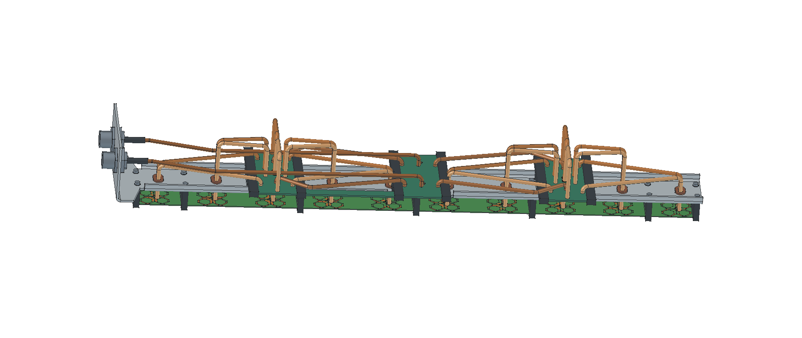

# R02 · distribuição por metade da coluna

Na montagem vertical, E01 é o elemento junto à base dos conectores N e E10 está no topo. A placa **inferior** distribui as duas polarizações a E01–E05 e a **superior** a E06–E10. Cada conector N alimenta sua própria árvore. A primeira divisão 1:2 de cada polarização fica na extensão da placa inferior, junto ao centro do painel. Quatro enlaces coaxiais ligam essas saídas às entradas dos divisores de cinco vias. A placa superior é independente. Na imagem do verso, a base dos conectores aparece à esquerda.

| Peça ou operação | Arquivo |
|---|---|
| Montagem completa com os 26 cabos nominais | [FreeCAD](P1H_R02_compacta.FCStd) |
| Refletor dobrado em alumínio de 2 mm | [FreeCAD](01_Refletor_dobrado.FCStd) · [STEP](01_Refletor_dobrado.step) |
| Desenvolvimento da chapa | [FreeCAD](02_Refletor_planificado.FCStd) · [DXF para corte 1:1](04_Refletor_CORTE_1a1.dxf) · [DXF com eixos de dobra](05_Refletor_marcacao_dobras.dxf) |
| Trilhos e berço com alívios | [STEPs de usinagem em coordenadas de montagem](componentes) |
| Identificação dos dois extremos de cada cabo | [Tabela do chicote](chicote_26_cabos.csv) |
| Gabarito 3D em mm, por reta e por arco | [20 ramais](caminhos.json) · [Quatro enlaces e duas entradas](enlaces.json) |
| Interfaces das placas | [KiCad inferior](../../kicad/R02_Inferior) · [KiCad superior](../../kicad/R02_Superior) |
| Conferência geométrica | [Chapa e DXF](verificacao.json) · [Comprimentos e interferências](verificacao_cad.json) |

## Chicote UT-141C de 50 Ω

| Função | Quantidade R02 | Eixo nominal R02 | Quantidade R01 | Eixo nominal R01 |
|---|---:|---:|---:|---:|
| Conector N até o primeiro divisor | 2 | 271,792 mm | 2 | 306,639 mm |
| Primeira divisão até o divisor de cada metade | 4 | 132,000 mm | — | — |
| Divisor de grupo até o radiador | 20 | 130,000 mm | 20 | 254,000 mm |
| Coaxial por caminho completo | | **533,792 mm** | | **560,639 mm** |
| Coaxial total dos chicotes | | **3,672 m** | | **5,693 m** |

Os 20 ramais terminais têm comprimento idêntico e todos os 20 caminhos N–antena somam o mesmo comprimento de coaxial. As duas entradas e os quatro enlaces são iguais dentro de suas respectivas funções. A linha de centro é a referência para formar o cabo. Na bancada, corrigir o corte bruto pela inserção real no conector, pela preparação das pontas e pelo plano de calibração. Parear o atraso elétrico após soldar. A 5,17 GHz, 0,10 mm de UT-141C corresponde a aproximadamente 0,89° de fase pela capacitância nominal de 95,2 pF/m.

A pesquisa manteve as cabeças divisoras de 39 × 78 mm centradas nos cinco radiadores, exigiu uma reta de solda mínima de 1,5 mm e curvas de raio ao eixo de 4,4 mm. Para a família de ramais com saída em −Z e chegada em +Z, o ramo de maior projeção impõe 129,395 mm. **130 mm foi o menor comprimento inteiro viável nesta geometria.** Os comprimentos da entrada e dos enlaces vieram da procura entre corredores de roteamento discretos. Uma PCB que estenda as próprias trilhas até cada radiador altera esse limite e a perda em microstrip.

No modelo nominal, a folga mínima entre capas é 0,646 mm, entre a entrada A e o enlace A inferior. Os cabos ocupam até 51 mm atrás da face Z = 0. Reservar espaço para ferramenta, soldagem e tolerâncias de formação. O suporte dos radiadores fecha a 16,61 mm da face do refletor. O raio interno de dobra dos coaxiais é 2,61 mm. [Ficha do UT-141C](https://www.micro-coax.com/wp-content/uploads/2024/12/micro-coax-ut-141c-datasheet.pdf)

## Alterações de fabricação

Usar a furação da R02. Aos 18 furos existentes de fixação, a variante acrescenta oito de Ø 2,8 mm, em X = −150,491, −107,491, 112,509 e 155,509 mm, combinados com Y = ±6,50 mm. Foram conferidos 39 contornos fechados no DXF de corte e o volume planificado contra o sólido dobrado. A base com os dois N fêmea, as juntas e os dez passa-cabos seguem as interfaces dimensionais da [R01](../mecanica_R01/README.md).

Usinar os dois alojamentos para cabeça/arruela de Ø 6,0 × 2,8 mm no berço 2 e os dois alívios complementares no trilho inferior direito conforme o STEP. Montar estes parafusos e o trilho antes de assentar o berço. Os trilhos do centro e da cabeça inferior têm rebaixo para a ponte de laminado. As duas janelas de cerca de 5,00 × 10,018 mm nas placas liberam a passagem dos cabos dos elementos centrais dos grupos.

As duas bobinas de fio esmaltado ligam a alma à blindagem na entrada de cada primeira divisão, em janela de 4 mm. O diâmetro médio é 1,80 mm, o fio tem 0,30 mm e são duas espiras de passo 0,73 mm. Remover o esmalte nas pontas. A análise do CAD EM verifica a continuidade geométrica do cobre da bobina, pino e blindagem em cada entrada. A conferência na montagem produzida exige medir a resistência entre o pino e a carcaça de cada N. [Cupom simulado com e sem bobina](../../resultados/r01/bobinas/README.md)
