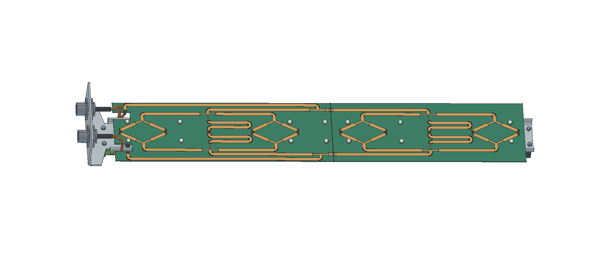

# R03 · duas distribuidoras alongadas

O verso da montagem mostra os conectores N na base, à esquerda. Cada conector alimenta uma polarização. Duas trilhas de acesso levam os sinais à primeira divisão 1:2 no centro da coluna. Cada metade recebe metade da potência de cada polarização em seu centro. Dentro de cada grupo, a divisão 2:1:2 e duas bifurcações 1:2 distribuem o sinal aos cinco radiadores. Um meandro compensa o comprimento elétrico do ramo central.

| Entrega | Arquivo |
|---|---|
| Montagem completa | [FreeCAD](P1H_R03_alongada.FCStd) |
| Refletor dobrado AL5052, 2 mm | [FreeCAD](01_Refletor_dobrado.FCStd) · [STEP](01_Refletor_dobrado.step) |
| Chapa planificada | [FreeCAD](02_Refletor_planificado.FCStd) · [DXF de corte 1:1, em mm](04_Refletor_CORTE_1a1.dxf) · [Marcação das dobras](05_Refletor_marcacao_dobras.dxf) |
| Fontes de fabricação elétrica | [KiCad inferior](../../kicad/R03_Inferior) · [KiCad superior](../../kicad/R03_Superior) |
| Percursos e conferências | [Retas e arcos nominais](caminhos.json) · [Chicote e folga](verificacao_chicote.json) · [Chapa e furação](verificacao.json) |

Os berços dianteiros de poliacetal de 5 mm mantêm a PCB radiadora a 16,61 mm da face de referência. Atrás do refletor, usar quatorze espaçadores de poliacetal de Ø 6 × 8 mm, oito na placa inferior e seis na superior, com fixadores M2,5. A face de massa das distribuidoras fica em Z = −10 mm e o sinal em Z = −11,52 mm. Há dez passagens de coaxial no refletor, duas entradas N na base dobrada com junta de vedação e 41 contornos fechados no DXF de corte. As dimensões dos conectores e das vedações estão no [desenho de referência da base](../mecanica_R01/README.md).

Cada uma das vinte pontas ao radiador usa um segmento reto de UT-141C de comprimento nominal de eixo 26,610 mm. As duas entradas N usam 71,108 mm cada, com curva ao eixo de 4,4 mm. Os recortes do divisor inferior liberam a passagem dessas entradas. Verificar a preparação das pontas e a inserção no conector antes do corte de série. A folga nominal mínima entre capas foi de 1,437 mm no CAD.

Alinhar as placas com folga de 0,50 mm na emenda. Usar duas fitas de cobre de sinal, com 6 mm de comprimento, 0,10 mm de espessura e largura igual à trilha de 50 Ω (3,866 mm no ZYF300CA-C). No verso correspondente, soldar duas fitas de massa de 6 × 14 × 0,10 mm. Montar os espaçadores e preparar o acesso às fitas de massa antes de apertar as PCBs. Posição e sobreposição estão modeladas na montagem.

As duas bobinas de curto em CC ligam pino à blindagem em janelas de 4 mm nas entradas. São duas espiras de fio esmaltado Ø 0,30 mm, diâmetro médio 1,80 mm e passo 0,73 mm. O modelo EM confirma a união elétrica do condutor de cada bobina entre alma e capa. Remover o esmalte nas pontas e conferir continuidade entre pino e carcaça nos dois conectores depois da soldagem.
