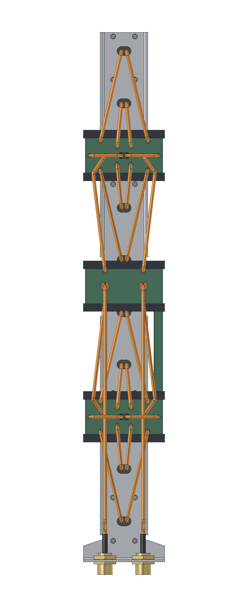

# R05 · correção da alimentação e do refletor

A revisão usa a placa contínua com dez radiadores, os dois divisores compactos da R02 e ambas as entradas N em fase. A face plana do refletor passou a **40 mm**. O chicote usa **duas entradas de 290 mm, quatro enlaces de 132 mm e vinte ramais de 135 mm**. A bobina de curto DC recebe uma abertura radial de Ø1 mm que preserva o restante da blindagem do coaxial.

**Estado:** geometria e interferências verificadas; o resultado de RF depende da simulação integral da R05. O desenho não constitui aprovação de desempenho nem qualificação da vedação.

| Entrega | Arquivo |
|---|---|
| Montagem completa, materiais e cabos | [FreeCAD](P1H_R05_compacta.FCStd) |
| Chapa dobrada de alumínio de 2 mm | [FreeCAD](01_Refletor_dobrado.FCStd) · [STEP](01_Refletor_dobrado.step) |
| Chapa planificada | [FreeCAD](02_Refletor_planificado.FCStd) · [Corte DXF 1:1](04_Refletor_CORTE_1a1.dxf) · [Eixos de dobra](05_Refletor_marcacao_dobras.dxf) |
| Desenho com cotas e montagem da bobina | [PDF A3, três pranchas](06_Desenho_de_fabricacao_R05.pdf) |
| Chicote entre interfaces | [Lista dos 26 cabos](chicote_26_cabos.csv) · [Ramais 3D](caminhos.json) · [Entradas e enlaces 3D](enlaces.json) |
| Conferência | [CAD](verificacao_cad.json) · [Chapa](verificacao_chapa.json) · [Gerbers e envelope](rastreabilidade.json) |

Os comprimentos são de linha de centro entre as interfaces do modelo, não comprimentos brutos de corte. Cada caminho N–radiador soma 557 mm de coaxial. O total do chicote é 3.808 mm. Formar curvas de raio 4,4 mm ao eixo e compensar inserção e decapagem conforme a junta real. O CAD tem folga mínima entre capas de **1,25953 mm** e nenhum cruzamento de sólidos; os cabos chegam a **Z = −52,66358 mm**.

A planificação usa raio interno de 2 mm e K = 0,4. Conferir esses valores com o processo de dobra antes de cortar o lote. O sólido paramétrico dobrado coincide com o refletor usado no RF, com diferença simétrica de volume nula. Os 39 contornos do DXF incluem o contorno externo, 26 furos de fixação, dez rasgos de passagem e dois recortes dos N.

Os berços de poliacetal, os trilhos, as juntas e as fixações preservam as interfaces e os alívios da [R02](../mecanica_R02/README.md). Os componentes usinados ficam nos [STEPs R02](../mecanica_R02/componentes). As duas bobinas usam fio de cobre Ø0,30 mm, duas espiras, raio médio 0,90 mm e passo 0,73 mm. A geometria do curto DC foi verificada por união do cobre; conferir resistência pino–carcaça em cada N após a montagem. O modelo eletromagnético atual não inclui a película de esmalte.

As três PCBs e seus Gerbers permanecem iguais à cotação de 6 de novembro: [coluna RO4350B 0,76 mm](../../kicad/P1H_Coluna_10), [divisor inferior](../../kicad/R02_Inferior) e [divisor superior](../../kicad/R02_Superior) em ZYF300CA-C 1,52 mm. Os SHA-256 foram conferidos em `rastreabilidade.json`. A [cotação histórica](../../resultados/r02/cotacao.md) não inclui a chapa, os coaxiais ou a montagem.

Fontes de reprodução: [automação R05](../../automacao/r05/README.md). Malhas, campos volumétricos e arquivos temporários permanecem fora do Git.
