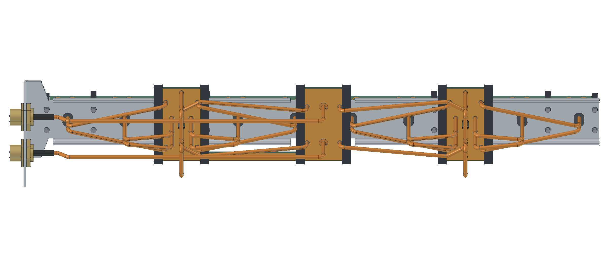

# R06 · montagem com ramais de 133 mm

**Geometria verificada; qualificação RF refinada pendente.** Esta revisão reduz os vinte ramais de 135 para 133 mm. As duas entradas de 290 mm e os quatro enlaces de 132 mm permanecem iguais. O circuito de parâmetros S usa somente a fase dos cabos, sem atenuação; eles permanecem no FreeCAD para fabricação.

A montagem tem dez radiadores na PCB contínua, dois divisores compactos, refletor de alumínio de 2 mm, apoios de poliacetal de 5 mm e duas bobinas de curto DC nas entradas. As geometrias da chapa, das PCBs e dos apoios são iguais às da R05: 275 objetos fora do chicote foram comparados por diferença simétrica de volume, inferior a 10⁻⁶ mm³. A visualização confere com o CAD fonte.

| Entrega | Arquivo |
|---|---|
| Montagem completa, materiais e cabos | [FreeCAD](P1H_R06_compacta.FCStd) |
| Chapa dobrada | [FreeCAD](01_Refletor_dobrado.FCStd) · [STEP](01_Refletor_dobrado.step) |
| Chapa planificada | [FreeCAD](02_Refletor_planificado.FCStd) · [Corte DXF 1:1](04_Refletor_CORTE_1a1.dxf) · [Dobras DXF](05_Refletor_marcacao_dobras.dxf) |
| Corte, montagem e bobina | [PDF A3, três pranchas](06_Desenho_de_fabricacao_R06.pdf) |
| Chicote | [Lista dos 26 cabos](chicote_26_cabos.csv) · [Ramais 3D](caminhos.json) · [Entradas e enlaces](enlaces.json) |
| Conferência | [Interferências](verificacao_cad.json) · [Comparação geométrica](comparacao_geometria.json) · [Chapa](verificacao_chapa.json) · [Rastreabilidade](rastreabilidade.json) |

Cada caminho N–radiador soma **555 mm** de coaxial; o total do chicote é **3.768 mm**. Os 26 caminhos têm curvas de raio de 4,4 mm ao eixo. A folga mínima entre capas é **0,761075 mm**, sem interferências volumétricas com os demais componentes. O envelope geométrico dos cabos chega a **Z = −51,663580 mm**, calculado por `optimalBoundingBox(False, False)`, sem depender da malha gráfica.

Os comprimentos são entre interfaces do CAD. Ajustar o corte bruto pelas inserções e decapagens da junta real; conferir igualdade dos atrasos após a solda. A folga indicada é nominal, sem simulação de tolerâncias de fabricação.

A planificação mantém raio interno de 2 mm e K = 0,4. Os 39 contornos DXF incluem o contorno externo, 26 fixações, dez rasgos e dois recortes dos N. Conferir raio e K com o ferramental da oficina. Os componentes usinados e apoios preservados estão nos [STEPs R02](../mecanica_R02/componentes).

Cada bobina tem duas espiras de fio Ø0,30 mm, raio médio 0,90 mm e passo 0,73 mm; a janela radial é Ø1 mm. Conferir continuidade pino–carcaça após a montagem. A referência N do Drive não tem internos separados e não substitui um modelo eletromagnético do conector; o circuito usa N ideal. A vedação desenhada requer ensaio físico.

Os Gerbers são os mesmos da [cotação de 7/11](../../resultados/r06/cotacao.md). A seleção preliminar de comprimento atende às metas no circuito com a primeira malha da PCB, mas o aceite aguarda o refinamento e a comparação numérica descritos na [qualificação R06](../../resultados/r06/README.md). O histórico [R05](../mecanica_R05/README.md) permanece preservado.
