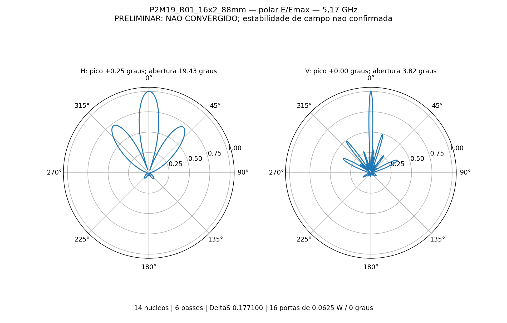
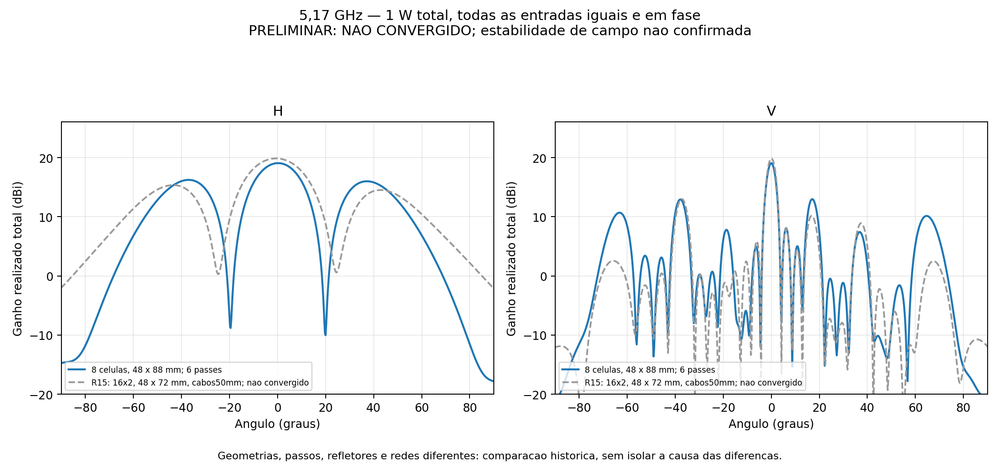
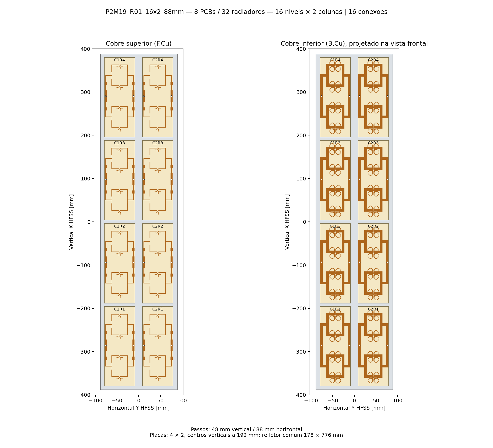

# P2M19 R01 — resultado em 5,17 GHz

**PRELIMINAR — não convergiu dentro do limite de seis passes.** Ganho frontal realizado total **19.0555 dBi**, abertura H **19.4280°**, abertura V **3.8200°**.

Execução de 13/11/2026, 6 passes de um máximo de seis, ΔS final **0.17710019**, 0 passes consecutivos convergidos. Alvo ΔS=0,05. Perfil conferido: 14 núcleos em todos os passes; solver direto, First Order, Classic com elementos curvilíneos. Sem sweep.

| Grandeza | Resultado | Comparação |
|---|---:|---|
| Ganho frontal total | 19.0555 dBi | Meta ≥19 dBi: atingida numericamente |
| Abertura H, −3 dB | 19.4280° | Desvio de 20°: -0.5720° (-2.86%) |
| Abertura V, −3 dB | 3.8200° | Informativo; não exigidos 20° nesta execução |
| Máximo H / V (interpolado) | +0.2521° / +0.0040° | Amostras centrais a cada 0,05° |
| VSWR ativo, mínimo / máximo | 1.3640 / 2.2951 | Dezesseis entradas simultâneas |
| VSWR com outras entradas casadas, máximo | 1.6469 | Referência 50 Ω |
| Maior lóbulo secundário H / V | -2.829 / -6.082 dB | Hemisfério frontal; relativo ao pico de cada corte |

O cumprimento numérico das metas não substitui convergência e consistência física. Não foi atribuída uma tolerância de aprovação à expressão “H próxima de 20°”; o desvio é reportado diretamente.

**Atenção ao diagrama horizontal:** a largura de 19.43° é a do lóbulo principal. Existe outro lóbulo frontal em −37° com nível de -2.83 dB relativo ao pico. Portanto o painel apresenta radiação lateral forte, apesar da largura central próxima de 20°. Todos esses valores permanecem preliminares.

## Excitação, geometria e perdas

Oito placas C12 de quatro elementos, quatro por coluna: 16 níveis × duas colunas, 32 radiadores. Dezesseis portas locais de 50 Ω, cada uma com 0,0625 W a 0°, total 1 W. Ganho total coerente; não caracteriza MIMO por entrada.

Passos: 48 mm entre radiadores verticais, 192 mm entre centros das placas e 88 mm entre colunas. PCBs 70 × 184 mm, folgas 8 mm na vertical / 18 mm na horizontal. Envelope das placas 158 × 760 mm. Refletor comum plano de alumínio 5052: 178 × 776 × 2 mm. Laminado a 14,949 mm da face superior do refletor.

Divisores impressos das placas preservados, com perdas de RO4350B (núcleo 0,76 mm, εr 3,66, tanδ 0,0037), cobre 35 µm e ENIG nominal Au 0,0254 µm / NiP 4,5 µm. Sem rede externa 1:8, cabos em 3D, conectores N, radome ou suportes plásticos. Terminais locais de 0,18 mm e soldas preservados. Os ganhos não incluem a futura distribuição externa.

A comparação R15 é histórica e preliminar: além do espaçamento horizontal, mudaram a largura do refletor e a remoção dos cabos de 50 mm. Portanto não isola o efeito do espaçamento.

## Auditoria

- Consistência física: **True**; balanço de potência: **True**.
- Reparos de malha: Major=0, Minor=0.
- Maior valor singular de S: 0.36235229; resíduo de reciprocidade: 9.992e-16.
- Erro relativo máximo da recomposição de campos: 1.736e-15.
- Estabilidade de nove campos nas duas últimas adaptações, limite informativo 0,1 dB: **False**. Essa monitoração não aumentou o número autorizado de passes.
- Avisos do solver matricial: 0.

A importação confere volume/envelope dos 329 sólidos; CAD sem interpenetrações em 552 pares examinados. Portas conferidas quanto a contatos e polaridade sinal→referência. Aberturas interpoladas entre amostras, sem alegar precisão física superior à malha.

## Arquivos

[Projeto HFSS](P2M19_16x2_88mm.aedt) · [CAD da geometria EM](P2M19_16x2_88mm.FCStd) · [Resultado completo](resultado.json) · [S16](centro.s16p) · [Configuração](configuracao.json).

Dados somente em 5,17 GHz; não qualificam a banda 5,09–5,25 GHz, tolerâncias de fabricação ou protótipo. Resultados volumétricos/malhas permanecem somente em `D:/dev/EMBRAER/P2M19/R01_16x2_88mm` e não são copiados ao repositório.

Potências (W): incidente_W=1.00000000, refletida_W=0.05070474, aceita_W=0.94929526, radiada_W=0.73041228, dissipada_W=0.21888299.

Os contextos de esfera HV e Centro_fino apresentam diferença frontal máxima de 0.00005615 dB. A verificação entre relatórios usa 0,001 dB; o limite inicial de 0,0000001 dB era mais estrito que a diferença numérica do próprio HFSS entre esses contextos. Não houve nova solução nem alteração de ΔS.

## Evolução da malha

| Passe | Tetraedros | ΔS | Ganho frontal monitorado (dBi) |
|---:|---:|---:|---:|
| 1 | 250196 | — | 7.010804 |
| 2 | 294284 | 0.70372940 | 12.885327 |
| 3 | 345789 | 0.39431915 | 16.214518 |
| 4 | 406462 | 0.20492071 | 17.753809 |
| 5 | 477576 | 0.11659943 | 18.235991 |
| 6 | 561541 | 0.17710019 | 19.055482 |

O diagnóstico da malha inicial registrou uma face curva rebaixada para representação linear (uma entre 1.216 faces curvas). A configuração curvilínea permaneceu ativa; o registro original está em [curvilinear_inicial.txt](evidencias/curvilinear_inicial.txt).
