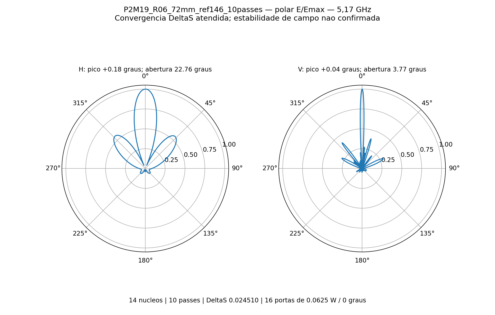
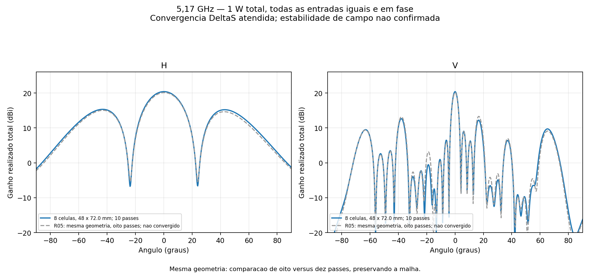
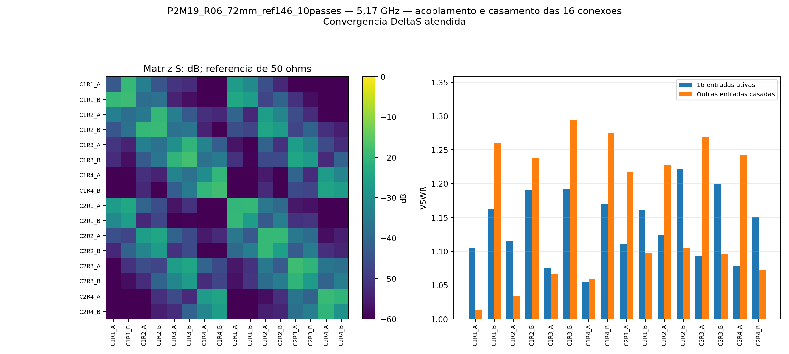
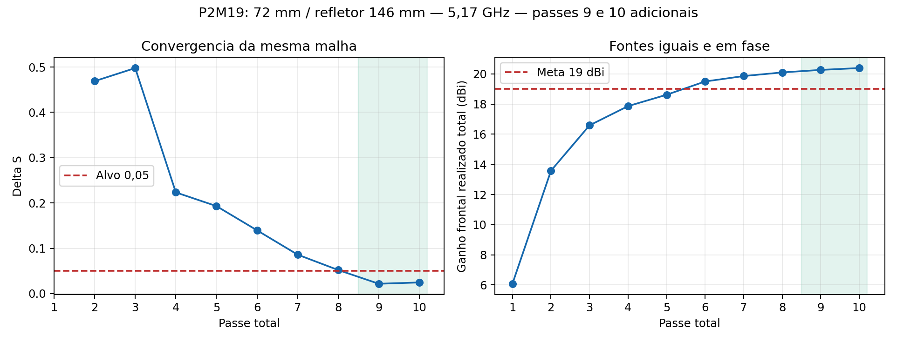

# P2M19 — continuação da malha: colunas 72 mm, refletor 146 mm

**Convergência S atendida — estabilidade dos campos ainda não confirmada.** Executados exatamente os passes **9 e 10**, preservando os oito anteriores. ΔS final **0.02450976**, alvo **0,05**; passes consecutivos atendidos: 2.

5,17 GHz, 14 núcleos, sem sweep. Oito placas C12, 16 níveis × duas colunas, 32 radiadores, 16 entradas iguais de 0,0625 W / 0°, total 1 W. Mesma geometria, materiais, fronteiras, portas, definições de malha e nove monitores de campo; alterados somente os limites mínimo/máximo para dez passes.

| Resultado | 8 passes | 10 passes |
|---|---:|---:|
| Ganho frontal realizado total (dBi) | 20.100983 | 20.390748 |
| Abertura horizontal (°) | 22.734187 | 22.760928 |
| Abertura vertical (°) | 3.753405 | 3.767930 |
| Máximo H (°) | 0.409364 | 0.178250 |
| Máximo V (°) | 0.042310 | 0.035152 |
| VSWR ativo mínimo | 1.143031 | 1.054039 |
| VSWR ativo máximo | 1.352969 | 1.220922 |
| VSWR máximo com demais entradas casadas | 1.323147 | 1.293547 |
| Maior lóbulo secundário H (dB) | -5.076796 | -5.073108 |
| Maior lóbulo secundário V (dB) | -6.804629 | -7.755500 |
| ΔS | 0.051965 | 0.024510 |

Potências: incidente 1.000000 W, refletida 0.004531 W, aceita 0.995469 W, radiada 0.797131 W e dissipada 0.198338 W. [VSWR individual das 16 entradas](vswr_por_porta.csv).

A variação de ganho entre oito e dez passes foi +0.289765 dB. A meta numérica de 19 dBi é atendida. Convergência S: sim; estabilidade das nove sondas (0,1 dB em dois passes): não; validação numérica conjunta: não. Convergência S e estabilidade do campo são verificações distintas. O monitoramento de campo não modifica a parada autorizada em dez passes.

As aberturas são de meia potência do lóbulo principal. Picos refinados em grade de 0,05° com interpolação parabólica local; lóbulos secundários avaliados no hemisfério frontal, em relação ao pico de cada corte. O zero corresponde à normal frontal do refletor.

Balanço de potência válido: sim; reparos Major/Minor: 0/0. Maior valor singular da matriz S: 0.25025531; erro de reciprocidade 1.695e-11; recomposição dos campos 4.774e-15.

Inclui acoplamento e perdas dos divisores impressos, RO4350B de núcleo 0,76 mm, cobre 35 µm e ENIG nominal. Refletor 146 × 776 × 2 mm, passo vertical 48 mm e altura de PCB 14,949 mm. Exclui rede externa de distribuição, cabos em 3D, conectores N, radome e apoios plásticos. É ganho total coerente, não qualificação por entrada MIMO. Nenhuma banda foi simulada nesta etapa.

## Histórico

| Passe | Tetraedros | ΔS | G frontal (dBi) |
|---:|---:|---:|---:|
| 1 | 268534 | — | 6.079411 |
| 2 | 315805 | 0.46880860 | 13.579744 |
| 3 | 371134 | 0.49768489 | 16.589591 |
| 4 | 435972 | 0.22326489 | 17.865506 |
| 5 | 512299 | 0.19307471 | 18.619939 |
| 6 | 602282 | 0.13960010 | 19.500282 |
| 7 | 708350 | 0.08591476 | 19.859973 |
| 8 | 834197 | 0.05196469 | 20.100983 |
| 9 | 983851 | 0.02161726 | 20.268544 |
| 10 | 1163077 | 0.02450976 | 20.390748 |

[HFSS](P2M19_R04_72mm_ref146.aedt) · [FreeCAD EM](P2M19_R04_72mm_ref146.FCStd) · [S16](centro.s16p) · [Resultados detalhados](resultado.json) · [Prova da continuidade](evidencias/continuidade_final.json).

O basename e o design HFSS conservam o nome R04 para reconhecer a malha copiada; a pasta e a configuração identificam a continuação R06. A referência de oito passes R05 permanece intacta. Malhas e campos nativos restauráveis ficam apenas na pasta local de trabalho; o Git contém nativo, campos distantes e evidências, sem `.aedtresults`, malhas, campos volumétricos ou locks.

Acompanhamento desta execução encerrado após os dez passes e a revisão. Não há novos passes, sweep, otimização geométrica ou agendamento recorrente ativos.
