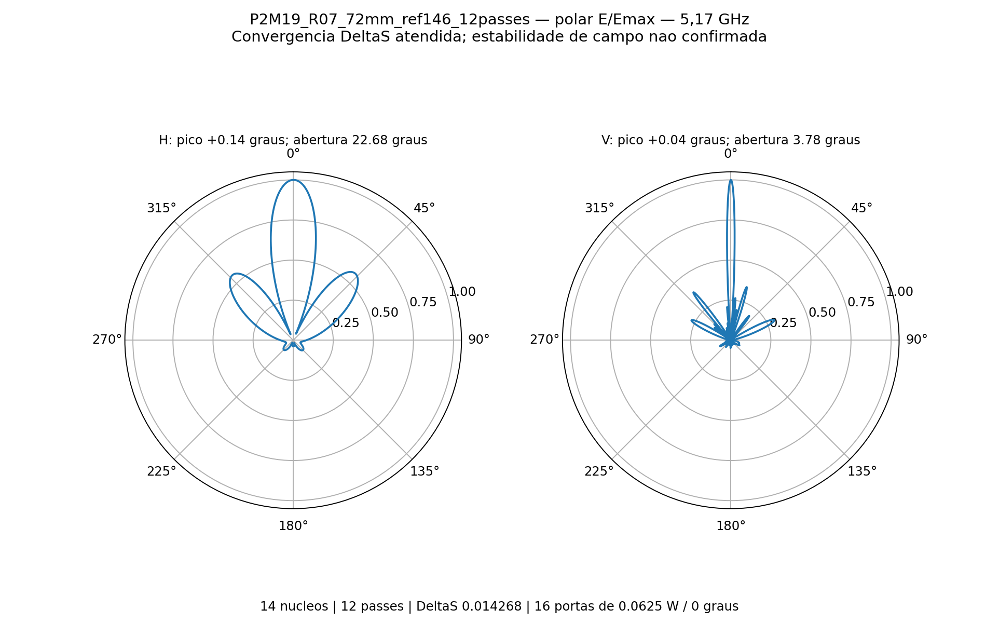
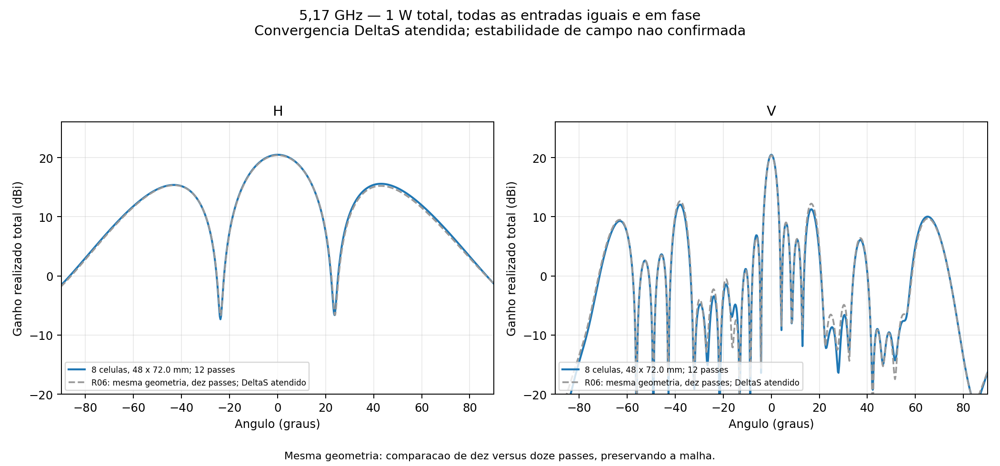
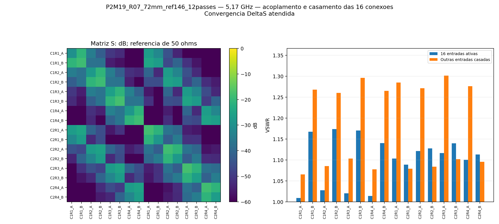
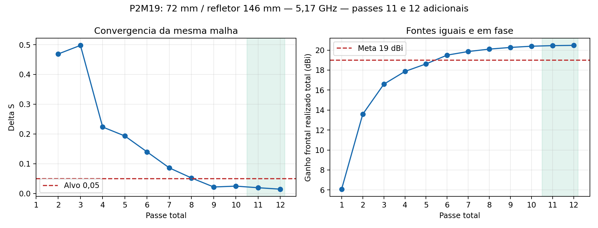
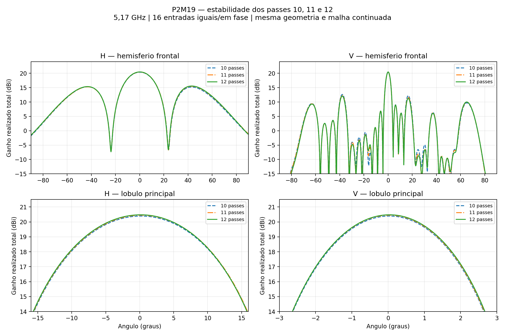

# P2M19 — continuação da malha: colunas 72 mm, refletor 146 mm

**Convergência S atendida — estabilidade dos campos ainda não confirmada.** Executados exatamente os passes **11 e 12**, preservando os dez anteriores. ΔS final **0.01426822**, alvo **0,05**; passes consecutivos atendidos: 3.

5,17 GHz, 14 núcleos, sem sweep. Oito placas C12, 16 níveis × duas colunas, 32 radiadores, 16 entradas iguais de 0,0625 W / 0°, total 1 W. Mesma geometria, materiais, fronteiras, portas, definições de malha e nove monitores de campo; alterados somente os limites mínimo/máximo para onze e depois doze passes, com exportação intermediária.

| Resultado | 10 passes | 12 passes |
|---|---:|---:|
| Ganho frontal realizado total (dBi) | 20.390748 | 20.474868 |
| Abertura horizontal (°) | 22.760928 | 22.682593 |
| Abertura vertical (°) | 3.767930 | 3.777939 |
| Máximo H (°) | 0.178250 | 0.144062 |
| Máximo V (°) | 0.035152 | 0.039020 |
| VSWR ativo mínimo | 1.054039 | 1.009214 |
| VSWR ativo máximo | 1.220922 | 1.173864 |
| VSWR máximo com demais entradas casadas | 1.293547 | 1.301226 |
| Maior lóbulo secundário H (dB) | -5.073108 | -4.906656 |
| Maior lóbulo secundário V (dB) | -7.755500 | -8.421950 |
| ΔS | 0.024510 | 0.014268 |

Potências: incidente 1.000000 W, refletida 0.002919 W, aceita 0.997081 W, radiada 0.800377 W e dissipada 0.196705 W. [VSWR individual das 16 entradas](vswr_por_porta.csv).

A variação de ganho entre dez e doze passes foi +0.084119 dB. A meta numérica de 19 dBi é atendida. Convergência S: sim; estabilidade das nove sondas (0,1 dB em dois passes): não; validação numérica conjunta: não. Convergência S e estabilidade do campo são verificações distintas. O monitoramento de campo não modifica a parada autorizada em doze passes.

As aberturas são de meia potência do lóbulo principal. Picos refinados em grade de 0,05° com interpolação parabólica local; lóbulos secundários avaliados no hemisfério frontal, em relação ao pico de cada corte. O zero corresponde à normal frontal do refletor.

Balanço de potência válido: sim; reparos Major/Minor: 0/0. Maior valor singular da matriz S: 0.24887248; erro de reciprocidade 2.415e-15; recomposição dos campos 3.954e-15.

Inclui acoplamento e perdas dos divisores impressos, RO4350B de núcleo 0,76 mm, cobre 35 µm e ENIG nominal. Refletor 146 × 776 × 2 mm, passo vertical 48 mm e altura de PCB 14,949 mm. Exclui rede externa de distribuição, cabos em 3D, conectores N, radome e apoios plásticos. É ganho total coerente, não qualificação por entrada MIMO. Nenhuma banda foi simulada nesta etapa.

## Histórico

| Passe | Tetraedros | ΔS | G frontal (dBi) |
|---:|---:|---:|---:|
| 1 | 268534 | — | 6.079411 |
| 2 | 315805 | 0.46880860 | 13.579744 |
| 3 | 371134 | 0.49768489 | 16.589591 |
| 4 | 435972 | 0.22326489 | 17.865506 |
| 5 | 512299 | 0.19307471 | 18.619939 |
| 6 | 602282 | 0.13960010 | 19.500282 |
| 7 | 708350 | 0.08591476 | 19.859973 |
| 8 | 834197 | 0.05196469 | 20.100983 |
| 9 | 983851 | 0.02161726 | 20.268544 |
| 10 | 1163077 | 0.02450976 | 20.390748 |
| 11 | 1377459 | 0.01913621 | 20.450054 |
| 12 | 1632517 | 0.01426822 | 20.474868 |

## Estabilidade entre passes consecutivos

O passe 11 teve seus campos completos exportados antes de continuar a mesma malha até o passe 12. Não houve interpolação entre passes.

| Passe | G frontal (dBi) | H (°) | V (°) | Pico H / V (°) | VSWR ativo máximo |
|---:|---:|---:|---:|---:|---:|
| 10 | 20.390748 | 22.760928 | 3.767930 | +0.17825 / +0.03515 | 1.220922 |
| 11 | 20.450054 | 22.745980 | 3.773572 | +0.20655 / +0.03210 | 1.173737 |
| 12 | 20.474868 | 22.682593 | 3.777939 | +0.14406 / +0.03902 | 1.173864 |

| Comparação | ΔG (dB) | ΔH (°) | ΔV (°) | Maior diferença H / V em E/Emax |
|---|---:|---:|---:|---:|
| 10 → 11 | +0.059306 | -0.014948 | +0.005642 | 0.013661 / 0.027748 |
| 11 → 12 | +0.024813 | -0.063387 | +0.004367 | 0.006338 / 0.016226 |
| 10 → 12 | +0.084119 | -0.078334 | +0.010009 | 0.018005 / 0.043974 |

Do passe 11 para o 12, a maior diferença absoluta de amplitude normalizada E/Emax foi 0.006338 em H e 0.016226 em V. O maior lóbulo secundário mudou +0.065983 dB em H e -0.286329 dB em V.

O ganho e as aberturas do lóbulo principal apresentaram pequenas mudanças quantificadas na tabela. A estabilidade completa de 0,1 dB nas nove sondas por dois passes não foi atendida. A maior variação no último passe foi 0.375207 dB em Theta=+45° / Phi=0°, direção -30.629 dB abaixo do ganho frontal. Não foram autorizados nem executados passes além de 12.

Diferencas completas dos diagramas sao diagnosticos, sem tolerancia adicional inventada. E/Emax normalizado por corte no hemisferio frontal; diferencas em dB excluem pontos abaixo de -20 dB em qualquer um dos diagramas para nao amplificar nulos.

[Dados completos de estabilidade](estabilidade_10_11_12.json) · [Tabela dos três passes](estabilidade_10_11_12.csv) · [Resultados intermediários do passe 11](passe11/resultado.json).

[HFSS](P2M19_R04_72mm_ref146.aedt) · [FreeCAD EM](P2M19_R04_72mm_ref146.FCStd) · [S16](centro.s16p) · [Resultados detalhados](resultado.json) · [Prova da continuidade](evidencias/continuidade_final.json).

O basename e o design HFSS conservam o nome R04 para reconhecer a malha copiada; a pasta e a configuração identificam a continuação R07. A referência de dez passes R06 permanece intacta. Malhas e campos nativos restauráveis ficam apenas na pasta local de trabalho; o Git contém nativo, campos distantes e evidências, sem `.aedtresults`, malhas, campos volumétricos ou locks.

Após exportar o passe 11, o controlador encontrou um erro de codificação ao gravar o JSON de configuração. O checkpoint RF ficou preservado; a recuperação gravou os metadados em Python 3 e conferiu o hash nativo usando bytes via .NET. O primeiro teste de recuperação parou nessa conferência, antes de qualquer cálculo. A retomada seguinte executou somente o passe 12. Nenhum passe RF foi repetido; a cadeia dos doze passes e seus tetraedros foi conferida. [Registro da recuperação](evidencias/recuperacao_codificacao.json).

Acompanhamento desta execução encerrado após os doze passes e a revisão. Não há novos passes, sweep, otimização geométrica ou agendamento recorrente ativos.
