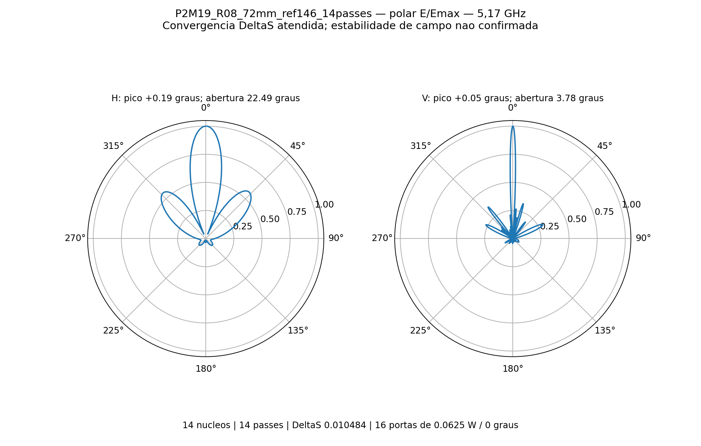
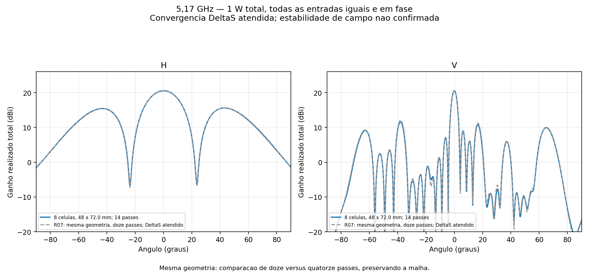
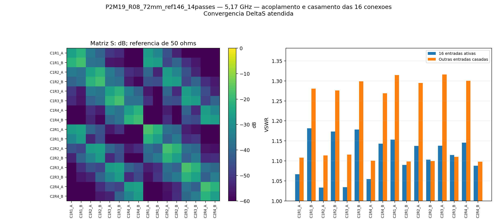
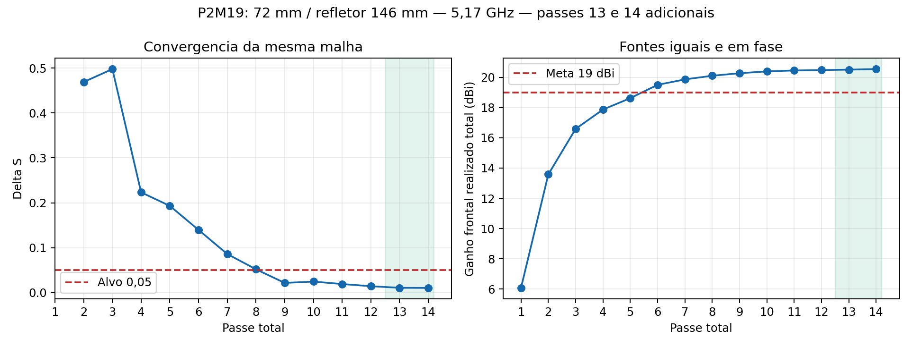
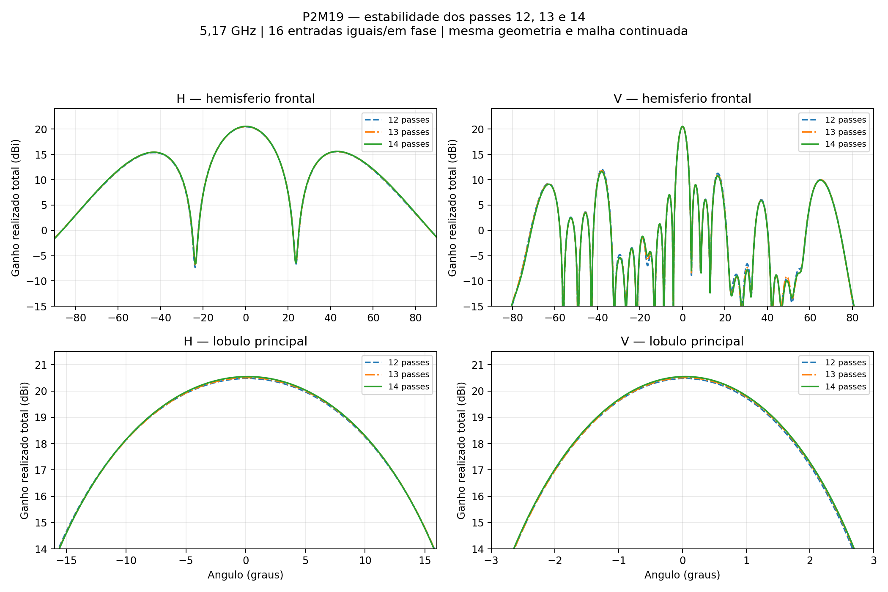

# P2M19 — continuação da malha: colunas 72 mm, refletor 146 mm

**Convergência S atendida — estabilidade dos campos ainda não confirmada.** Executados exatamente os passes **13 e 14**, preservando os doze anteriores. ΔS final **0.01048445**, alvo **0,05**; passes consecutivos atendidos: 3.

5,17 GHz, 14 núcleos, sem sweep. Oito placas C12, 16 níveis × duas colunas, 32 radiadores, 16 entradas iguais de 0,0625 W / 0°, total 1 W. Mesma geometria, materiais, fronteiras, portas, definições de malha e nove monitores de campo; alterados somente os limites mínimo/máximo para treze e depois quatorze passes, com exportação intermediária.

| Resultado | 12 passes | 14 passes |
|---|---:|---:|
| Ganho frontal realizado total (dBi) | 20.474868 | 20.544040 |
| Abertura horizontal (°) | 22.682593 | 22.491047 |
| Abertura vertical (°) | 3.777939 | 3.783221 |
| Máximo H (°) | 0.144062 | 0.187682 |
| Máximo V (°) | 0.039020 | 0.047561 |
| VSWR ativo mínimo | 1.009214 | 1.033047 |
| VSWR ativo máximo | 1.173864 | 1.181678 |
| VSWR máximo com demais entradas casadas | 1.301226 | 1.315984 |
| Maior lóbulo secundário H (dB) | -4.906656 | -4.951600 |
| Maior lóbulo secundário V (dB) | -8.421950 | -8.948741 |
| ΔS | 0.014268 | 0.010484 |

Potências: incidente 1.000000 W, refletida 0.003353 W, aceita 0.996647 W, radiada 0.796812 W e dissipada 0.199835 W. [VSWR individual das 16 entradas](vswr_por_porta.csv).

A variação de ganho entre doze e quatorze passes foi +0.069173 dB. A meta numérica de 19 dBi é atendida. Convergência S: sim; estabilidade das nove sondas (0,1 dB em dois passes): não; validação numérica conjunta: não. Convergência S e estabilidade do campo são verificações distintas. O monitoramento de campo não modifica a parada autorizada em quatorze passes.

As aberturas são de meia potência do lóbulo principal. Picos refinados em grade de 0,05° com interpolação parabólica local; lóbulos secundários avaliados no hemisfério frontal, em relação ao pico de cada corte. O zero corresponde à normal frontal do refletor.

Balanço de potência válido: sim; reparos Major/Minor: 0/0. Maior valor singular da matriz S: 0.24421644; erro de reciprocidade 1.414e-15; recomposição dos campos 4.120e-15.

Inclui acoplamento e perdas dos divisores impressos, RO4350B de núcleo 0,76 mm, cobre 35 µm e ENIG nominal. Refletor 146 × 776 × 2 mm, passo vertical 48 mm e altura de PCB 14,949 mm. Exclui rede externa de distribuição, cabos em 3D, conectores N, radome e apoios plásticos. É ganho total coerente, não qualificação por entrada MIMO. Nenhuma banda foi simulada nesta etapa.

## Histórico

| Passe | Tetraedros | ΔS | G frontal (dBi) |
|---:|---:|---:|---:|
| 1 | 268534 | — | 6.079411 |
| 2 | 315805 | 0.46880860 | 13.579744 |
| 3 | 371134 | 0.49768489 | 16.589591 |
| 4 | 435972 | 0.22326489 | 17.865506 |
| 5 | 512299 | 0.19307471 | 18.619939 |
| 6 | 602282 | 0.13960010 | 19.500282 |
| 7 | 708350 | 0.08591476 | 19.859973 |
| 8 | 834197 | 0.05196469 | 20.100983 |
| 9 | 983851 | 0.02161726 | 20.268544 |
| 10 | 1163077 | 0.02450976 | 20.390748 |
| 11 | 1377459 | 0.01913621 | 20.450054 |
| 12 | 1632517 | 0.01426822 | 20.474868 |
| 13 | 1935576 | 0.01074428 | 20.504076 |
| 14 | 2295298 | 0.01048445 | 20.544040 |

## Estabilidade entre passes consecutivos

O passe 13 teve seus campos completos exportados antes de continuar a mesma malha até o passe 14. Não houve interpolação entre passes.

| Passe | G frontal (dBi) | H (°) | V (°) | Pico H / V (°) | VSWR ativo máximo |
|---:|---:|---:|---:|---:|---:|
| 12 | 20.474868 | 22.682593 | 3.777939 | +0.14406 / +0.03902 | 1.173864 |
| 13 | 20.504076 | 22.589605 | 3.781699 | +0.19285 / +0.04936 | 1.173955 |
| 14 | 20.544040 | 22.491047 | 3.783221 | +0.18768 / +0.04756 | 1.181678 |

| Comparação | ΔG (dB) | ΔH (°) | ΔV (°) | Maior diferença H / V em E/Emax |
|---|---:|---:|---:|---:|
| 12 → 13 | +0.029208 | -0.092988 | +0.003760 | 0.004633 / 0.014357 |
| 13 → 14 | +0.039965 | -0.098558 | +0.001522 | 0.003532 / 0.010062 |
| 12 → 14 | +0.069173 | -0.191546 | +0.005282 | 0.007878 / 0.024416 |

Do passe 13 para o 14, a maior diferença absoluta de amplitude normalizada E/Emax foi 0.003532 em H e 0.010062 em V. O maior lóbulo secundário mudou -0.011513 dB em H e -0.226950 dB em V.

As mudanças de ganho e aberturas do lóbulo principal estão quantificadas na tabela. O critério completo de 0,1 dB nas nove sondas por dois passes não foi atendido. A maior variação no último passe foi 0.182068 dB em Theta=+45° / Phi=0°, direção -30.569 dB abaixo do ganho frontal. Não foram autorizados nem executados passes além de 14.

Diferencas completas dos diagramas sao diagnosticos, sem tolerancia adicional inventada. E/Emax normalizado por corte no hemisferio frontal; diferencas em dB excluem pontos abaixo de -20 dB em qualquer um dos diagramas para nao amplificar nulos.

[Dados completos de estabilidade](estabilidade_12_13_14.json) · [Tabela dos três passes](estabilidade_12_13_14.csv) · [Resultados intermediários do passe 13](passe13/resultado.json).

[HFSS](P2M19_R04_72mm_ref146.aedt) · [FreeCAD EM](P2M19_R04_72mm_ref146.FCStd) · [S16](centro.s16p) · [Resultados detalhados](resultado.json) · [Prova da continuidade](evidencias/continuidade_final.json).

O basename e o design HFSS conservam o nome R04 para reconhecer a malha copiada; a pasta e a configuração identificam a continuação R08. A referência de doze passes R07 permanece intacta. Malhas e campos nativos restauráveis ficam apenas na pasta local de trabalho; o Git contém nativo, campos distantes e evidências, sem `.aedtresults`, malhas, campos volumétricos ou locks.

Acompanhamento desta execução encerrado após os quatorze passes e a revisão. Não há novos passes, sweep, otimização geométrica ou agendamento recorrente ativos.
