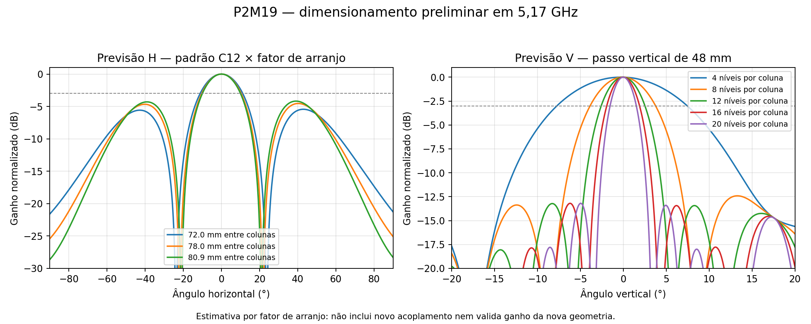

# P2M19 — dimensionamento inicial, 13/11/2026

**Candidato inicial: 16 níveis × duas colunas, 32 radiadores, oito placas C12 de quatro elementos (quatro por coluna).** O objetivo prioritário é ganho frontal realizado total de 19 dBi. Horizontal desejada: aproximadamente 20°. A vertical de 20° foi tratada como desejável, podendo mudar para preservar o ganho, conforme solicitado.

Esta pasta inicia um projeto separado. É um dimensionamento analítico a partir de resultados anteriores, não uma nova simulação HFSS nem um modelo CAD novo. Mantidos os projetos P2M21/P2S13.

## Premissas

- Centro em 5,17 GHz, mantendo como faixa de projeto 5,09–5,25 GHz. A estimativa só calcula o centro.
- Todas as entradas das células com igual potência incidente e fase 0°, 1 W total. Para oito placas são 16 entradas locais a 0,0625 W cada. Meta de ganho total; não implica 19 dBi por entrada MIMO.
- Placa C12: quatro radiadores, 70 × 184 mm, passo vertical 48 mm, distância da face inferior do laminado ao refletor 14,949 mm; RO4350B de 0,76 mm.
- Passo entre centros de placas empilhadas de 192 mm, deixando 8 mm entre bordas e mantendo 48 mm entre radiadores nas emendas.
- Planejamento inicial de distribuição: duas entradas externas, uma rede simétrica 1:8 por polarização. Cada rede pode ter uma raiz 1:2 central e dois 1:4, um por coluna. Dimensionamento de impedâncias, perdas, caminhos e casamento ainda pendente.

## Número de níveis

| Níveis por coluna | Radiadores totais | Placas de quatro | Ganho pela escala das referências | Vertical estimada | Altura do conjunto de PCBs |
|---:|---:|---:|---:|---:|---:|
| 8 | 16 | 4 | 16,47–16,84 dBi | 7,63° | 376 mm |
| 12 | 24 | 6 | 18,23–18,60 dBi | 5,09° | 568 mm |
| **16** | **32** | **8** | **19,48–19,85 dBi** | **3,82°** | **760 mm** |
| 20 | 40 | 10 | 20,45–20,82 dBi | 3,06° | 952 mm |

Ganho estimado por `G(N) = G(16) + 10 log10(N/16)`. Os extremos vêm das duas geometrias históricas, não constituem um intervalo de confiança nem um limite garantido. Esta escala pressupõe eficiência e acoplamento semelhantes; não estima a mudança de ganho causada pelo novo espaçamento horizontal/refletor. Perdas dos divisores locais e dos cabos de 50 mm presentes nas referências já estão incorporadas. A futura rede externa e qualquer radome não estão incluídos.

Referências: R15 de 72 mm, **19,84687 dBi / H 24,3513° / V 3,7484°**, oito passes, ΔS 0,05001533; R16 de 78 mm, **19,47983 dBi / H 22,9569° / V 3,7125°**, seis passes, ΔS 0,10314416. **Ambas não convergidas**; são evidências preliminares, não qualificação final. A célula C12 isolada convergiu em seis passes, ΔS 0,016719, com 12,4566 dBi / H 72,0547° / V 15,1827°.

Com uma reserva hipotética de 0,5 dB para a futura rede, o caso de 16 níveis ficaria em 18,98–19,35 dBi: margem curta, sem garantia. Se a meta exigir margem após distribuição e cobertura de banda, vinte níveis são a alternativa de reserva. A reserva de 0,5 dB não é perda simulada.

## Horizontal de 20°

A multiplicação do corte C12 por um fator de duas colunas prevê H de 22,33° a 72 mm, 20,71° a 78 mm e 20° a 80,91 mm. Entretanto, o painel HFSS preliminar foi cerca de 2° mais largo. A extrapolação local `d_novo ≈ d_atual × H_atual/20` aponta **87,7–89,5 mm**. Assim, **88 mm é somente o candidato inicial**, com 84/88/92 mm como pontos de comparação futuros. Para PCBs de 70 mm, 88 mm deixam 18 mm entre bordas e 158 mm de largura externa do conjunto. Refletor e abas ainda não dimensionados.

Não basta aumentar a distância: λ₀ = 57,99 mm, portanto essas separações excedem um comprimento de onda. O fator de arranjo apresenta réplicas laterais, moduladas pelo diagrama da célula; o painel de 78 mm já mostrou lóbulo horizontal aproximadamente 3,85 dB abaixo do principal. É necessário verificar refletor e lóbulos junto com a largura H, sem assumir que um feixe central mais estreito aumentará o ganho. [Analog Devices — fator de arranjo](https://www.analog.com/en/resources/analog-dialogue/articles/phased-array-antenna-patterns-part1.html), [lóbulos de grade](https://www.analog.com/en/resources/analog-dialogue/articles/phased-array-antenna-patterns-part2.html).

## Vertical e limite desta escolha

Com as placas atuais e iluminação uniforme, dezesseis níveis produzem vertical próxima de 4°, **não de 20°**. Diminuir o número de níveis alarga a vertical, mas reduz o ganho. A célula isolada de quatro já apresenta 15,18° na vertical; obter 20° com 19 dBi em duas colunas exigiria também reprojetar o elemento/refletor e a distribuição, e não apenas selecionar outra quantidade de placas. Isso não é uma impossibilidade física universal; é o limite da solução reaproveitada aqui.

## Rastreabilidade

[Cálculo reproduzível](estimar.py), [dados e hashes das referências](estimativa.json), [tabela CSV](comparacao_niveis.csv). Os cortes usam PCHIP sobre amostras HFSS de 0,25° e fator de arranjo normalizado em potência. A interpolação não aumenta a resolução física; não há novo acoplamento EM. A vertical replica células C12 a 192 mm, sem dividir padrões nos nulos. Os cortes analíticos são normalizados e não validam ganho absoluto.

Próxima etapa de projeto: preparar o conjunto 16×2 separado, em 5,17 GHz, verificar H/V e lóbulos e depois dimensionar a distribuição. Nenhum solve, sweep, alteração no FreeCAD aberto, fabricação ou email foi executado nesta estimativa.
