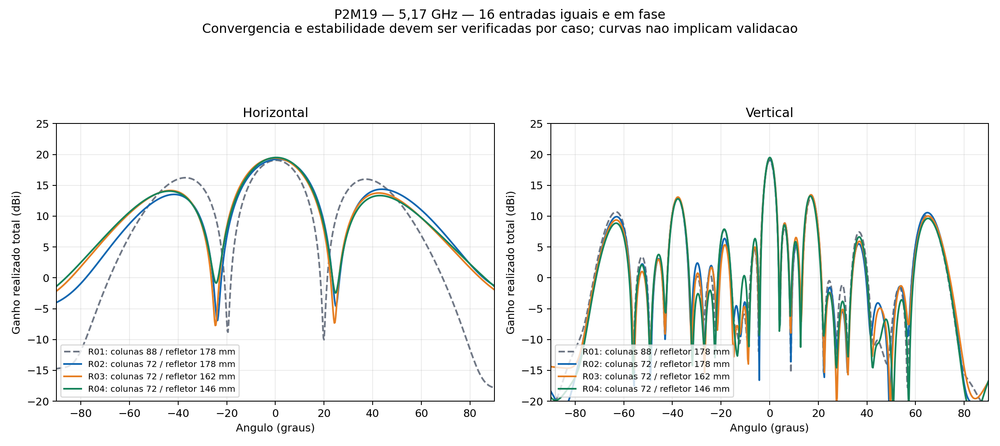
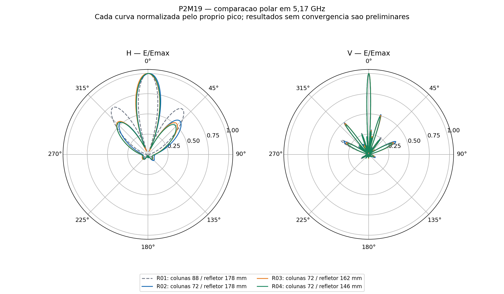

# P2M19 — 72 mm versus 88 mm e ajustes do refletor

**Lote concluido: tres geometrias novas, seis passes em cada uma. Nenhuma convergiu nem confirmou estabilidade completa dos campos.** A referencia de 88 mm tambem e preliminar.

Com 72 mm, os ganhos calculados ficaram entre 19.21 e 19.50 dBi, mas isso ainda nao valida a meta de 19 dBi. A abertura H ficou entre 23.55 e 24.24 graus; nenhum caso chegou a 30 graus.

Na comparacao direta com refletor de 178 mm, reduzir as colunas para 72 mm alargou numericamente o lobulo principal H e reduziu os lobulos horizontais. Reduzir depois o refletor para 162/146 mm trouxe pequenas diferencas adicionais e estreitou um pouco H. Nao se escolheu uma geometria como validada com base nessas diferencas.

Estudo em 5,17 GHz, 16 niveis × duas colunas, 32 radiadores e 16 portas de 0,0625 W / 0°. Cada caso usa 14 nucleos, no maximo seis passes, alvo ΔS 0,05 e nenhum sweep.

A R02 altera apenas o espacamento entre colunas de 88 para 72 mm e reposiciona os furos correspondentes. Mantem o refletor de 178 × 776 × 2 mm, PCBs C12, altura 14,949 mm, materiais, portas e setup. R03/R04 reduzem apenas a largura do refletor para 162/146 mm. As placas ficam com 2 mm entre bordas.

| Caso | Colunas / refletor (mm) | G frontal (dBi) | H / V (°) | SLL H / V (dB) | ΔS / passes | Convergiu? |
|---|---:|---:|---:|---:|---:|---|
| R01_16x2_88mm | 88 / 178 | 19.0555 | 19.428 / 3.820 | -2.829 / -6.082 | 0.177100 / 6 | **Nao** |
| R02_16x2_72mm | 72 / 178 | 19.2093 | 24.238 / 3.752 | -4.866 / -5.775 | 0.156138 / 6 | **Nao** |
| R03_72mm_ref162 | 72 / 162 | 19.4180 | 23.989 / 3.765 | -5.261 / -5.957 | 0.116891 / 6 | **Nao** |
| R04_72mm_ref146 | 72 / 146 | 19.5003 | 23.550 / 3.693 | -5.447 / -6.240 | 0.139600 / 6 | **Nao** |

H/V sao larguras de meia potencia do lobulo principal, nao cobertura angular total. SLL e o maior lobulo secundario do hemisferio frontal, relativo ao pico do proprio corte. Um lobulo secundario forte pode formar outra regiao acima de −3 dB.

**Nenhum resultado sem convergencia pode ser promovido a validado por apresentar ganho alto.** A referencia de 88 mm tambem nao convergiu. Diferencas pequenas podem conter erro numerico; a tabela nao prova uma melhoria fisica quando a malha ainda varia.

## Escopo e automacao

Fila local finita, sem agendamento recorrente do chat. Acompanha o processo existente, impede solves concorrentes e executa os dois ajustes geometricos preparados. Interrompe por erro do solver, reparo Major ou auditoria fisica invalida. Caso sem convergencia permanece exploratorio; nao recebe passes adicionais. O arquivo PARAR_APOS_CASO no diretorio da campanha impede o proximo inicio.

Inclui acoplamento e perdas dos divisores impressos, RO4350B, cobre e ENIG. Sem rede externa, cabos em 3D, conectores N, radome ou suportes plasticos. A abertura proxima de 30° e aceitavel conforme orientacao do usuario, sem tolerancia numerica de aprovacao inventada. A vertical e informativa.

## Diferencas frente a R01

| Caso | ΔG (dB) | ΔH (°) | ΔV (°) | ΔSLL H (dB) | ΔSLL V (dB) |
|---|---:|---:|---:|---:|---:|
| R02_16x2_72mm | +0.1538 | +4.8101 | -0.0679 | -2.0361 | +0.3071 |
| R03_72mm_ref162 | +0.3625 | +4.5607 | -0.0555 | -2.4316 | +0.1258 |
| R04_72mm_ref146 | +0.4448 | +4.1219 | -0.1267 | -2.6174 | -0.1576 |

Nos niveis de lobulos secundarios, ΔSLL negativo representa reducao relativa ao pico. A configuracao sera escolhida considerando tambem ganho, casamento e confiabilidade numerica, nao apenas a largura H.

## Apontamento, lobulos e casamento

| Caso | Maximo H / V (graus) | VSWR ativo maximo | Sondas de campo estaveis? | Validado numericamente? |
|---|---:|---:|---|---|
| R01_16x2_88mm | +0.252 / +0.004 | 2.2951 | Nao | **Nao** |
| R02_16x2_72mm | +0.992 / +0.083 | 1.7381 | Nao | **Nao** |
| R03_72mm_ref162 | -0.181 / +0.118 | 1.7623 | Nao | **Nao** |
| R04_72mm_ref146 | +0.374 / +0.078 | 1.6551 | Nao | **Nao** |

Maiores lobulos secundarios no hemisferio frontal, ordenados por nivel em cada corte. Angulos usam 0 graus na frente do refletor; H varia ao longo das colunas e V ao longo dos 16 niveis.

| Caso | Corte | Angulo (graus) | Nivel relativo (dB) |
|---|---|---:|---:|
| R01_16x2_88mm | H | -37.00 | -2.829 |
| R01_16x2_88mm | H | +37.25 | -3.066 |
| R01_16x2_88mm | V | +17.00 | -6.082 |
| R01_16x2_88mm | V | -37.75 | -6.148 |
| R01_16x2_88mm | V | -63.25 | -8.372 |
| R02_16x2_72mm | H | +43.75 | -4.866 |
| R02_16x2_72mm | H | -41.75 | -5.707 |
| R02_16x2_72mm | V | +17.00 | -5.775 |
| R02_16x2_72mm | V | -37.75 | -6.186 |
| R02_16x2_72mm | V | +65.00 | -8.645 |
| R03_72mm_ref162 | H | -43.25 | -5.261 |
| R03_72mm_ref162 | H | +42.50 | -5.671 |
| R03_72mm_ref162 | V | +17.00 | -5.957 |
| R03_72mm_ref162 | V | -37.75 | -6.327 |
| R03_72mm_ref162 | V | +65.25 | -9.397 |
| R04_72mm_ref146 | H | -43.50 | -5.447 |
| R04_72mm_ref146 | H | +43.00 | -6.170 |
| R04_72mm_ref146 | V | +16.75 | -6.240 |
| R04_72mm_ref146 | V | -37.75 | -6.684 |
| R04_72mm_ref146 | V | +65.25 | -9.874 |

## Potencia e rastreabilidade

| Caso | Incidente (W) | Aceita (W) | Radiada (W) | Balanco e passividade consistentes? |
|---|---:|---:|---:|---|
| R01_16x2_88mm | 1,000000 | 0.949295 | 0.730412 | Sim |
| R02_16x2_72mm | 1,000000 | 0.950436 | 0.730088 | Sim |
| R03_72mm_ref162 | 1,000000 | 0.957015 | 0.737911 | Sim |
| R04_72mm_ref146 | 1,000000 | 0.965346 | 0.746045 | Sim |

A consistencia fisica e necessaria, mas nao substitui a convergencia. Os nativos, S16, campos complexos por porta e auditorias de cada caso estao nas subpastas correspondentes. Os campos individuais recompostos devem reproduzir a excitacao simultanea.

| Caso | Variacao G frontal no ultimo passe (dB) | Maior variacao das nove sondas no ultimo passe (dB) |
|---|---:|---:|
| R01_16x2_88mm | +0.8195 | 5.0313 |
| R02_16x2_72mm | +0.8214 | 1.1647 |
| R03_72mm_ref162 | +0.7823 | 0.9257 |
| R04_72mm_ref146 | +0.8803 | 2.8162 |

Essas variacoes medem a evolucao numerica observada; nao sao intervalos estatisticos de incerteza. Diferencas de ganho entre geometrias menores que a variacao do ultimo passe exigem cautela especial.

- [R02_16x2_72mm](casos/R02_16x2_72mm/README.md)
- [R03_72mm_ref162](casos/R03_72mm_ref162/README.md)
- [R04_72mm_ref146](casos/R04_72mm_ref146/README.md)
- [Referencia R01 de 88 mm](../centro_16x2_88mm/README.md)

A fila local encerrou; nao ha nova geometria, passe adicional ou agendamento recorrente programado. O resultado e uma comparacao preliminar documentada, sem qualificacao de banda, rede externa ou ganho por entrada MIMO.
