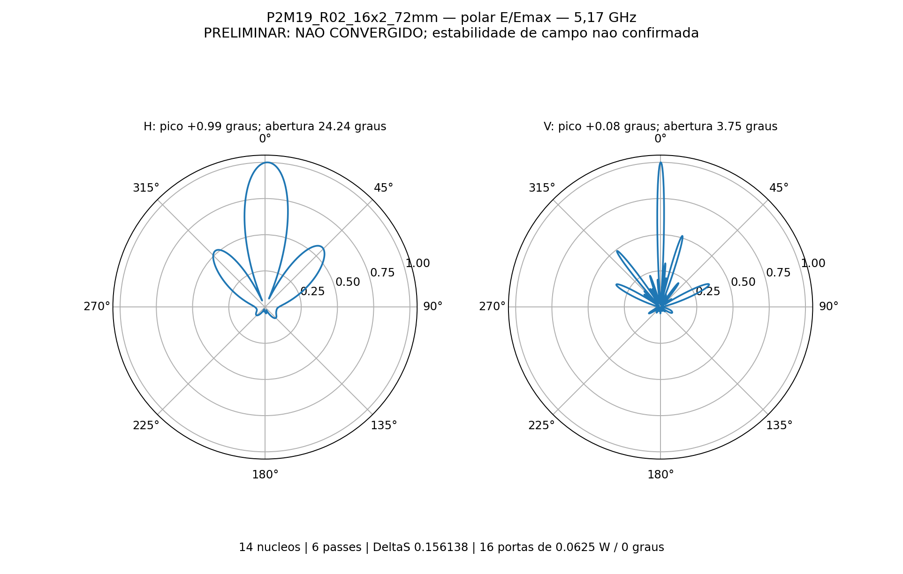
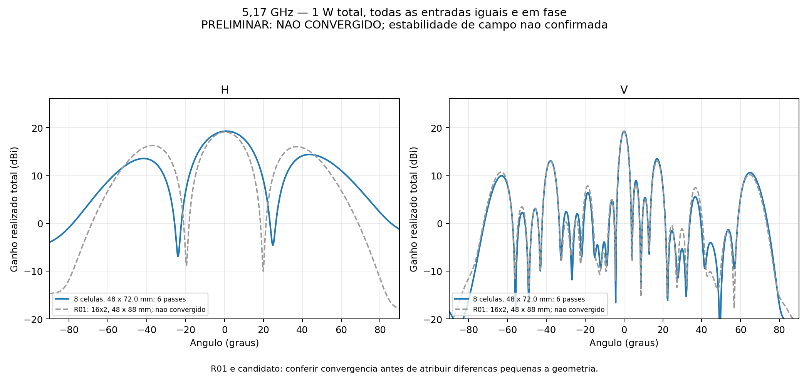
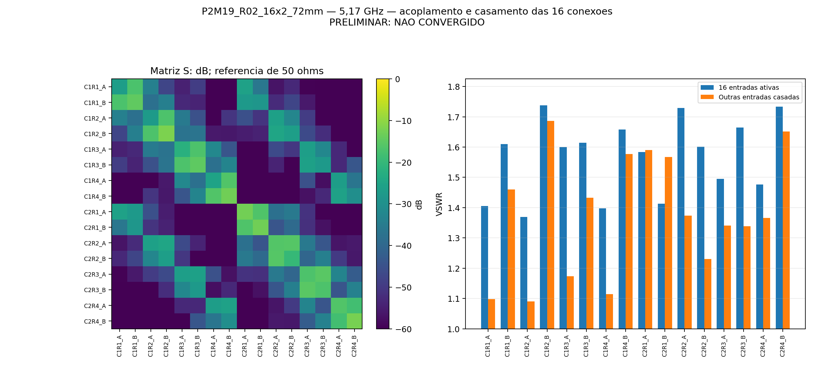

# R02_16x2_72mm

**PRELIMINAR — NÃO CONVERGIDO.** 5,17 GHz, 6 passes, ΔS 0.15613817; alvo 0,05. Perfil auditado: 14 núcleos, sem sweep.

Ganho frontal realizado total **19.2093 dBi**; aberturas do lóbulo principal H **24.2381°** e V **3.7520°**.

Máximos H/V: +0.9921° / +0.0826°. Maiores lóbulos secundários frontais H/V: -4.866 / -5.775 dB relativos ao pico de cada corte.

VSWR ativo nas 16 portas: 1.3695 a 1.7381. VSWR máximo com demais portas casadas: 1.6865.

16 níveis × duas colunas a 72 mm; oito placas C12 de quatro radiadores. Refletor 178 × 776 × 2 mm; altura da PCB 14,949 mm. Cada entrada recebe 0,0625 W a 0°, total 1 W.

Inclui acoplamento, divisores impressos e perdas de RO4350B, cobre e ENIG nominal. Sem rede externa, cabos em 3D, conectores N, radome ou suportes plásticos. O ganho é total coerente, não qualificação por entrada MIMO.

Balanço de potência consistente: True. Reparos Major/Minor: 0/0. Reciprocidade: 9.993e-16. Recomposição das fontes: erro relativo máximo 1.478e-15.

Estabilidade das nove sondas: False. Validação numérica completa: False. Atingir o limite de seis passes não representa convergência; resultados sem estabilidade permanecem preliminares.

[HFSS](P2M19_R02_16x2_72mm.aedt) · [CAD EM](P2M19_R02_16x2_72mm.FCStd) · [S16](centro.s16p) · [Resultado completo](resultado.json) · [Configuração](configuracao.json).

## Adaptação

| Passe | Tetraedros | ΔS | G frontal monitorado (dBi) |
|---:|---:|---:|---:|
| 1 | 236357 | — | 7.499718 |
| 2 | 277845 | 0.75863604 | 12.412199 |
| 3 | 326306 | 0.39284321 | 16.264406 |
| 4 | 383288 | 0.22397997 | 17.548147 |
| 5 | 450252 | 0.10247639 | 18.387935 |
| 6 | 529059 | 0.15613817 | 19.209303 |

Nativos e campos distantes estão preservados; malhas e campos volumétricos ficam somente na pasta local de trabalho. Materiais nominais e uma única frequência não qualificam fabricação ou banda completa.

O registro original da projeção curvilínea da malha inicial está em [curvilinear_inicial.txt](evidencias/curvilinear_inicial.txt). Eventuais faces rebaixadas para representação linear constam desse diagnóstico; isso é distinto da contagem de reparos Major/Minor.
