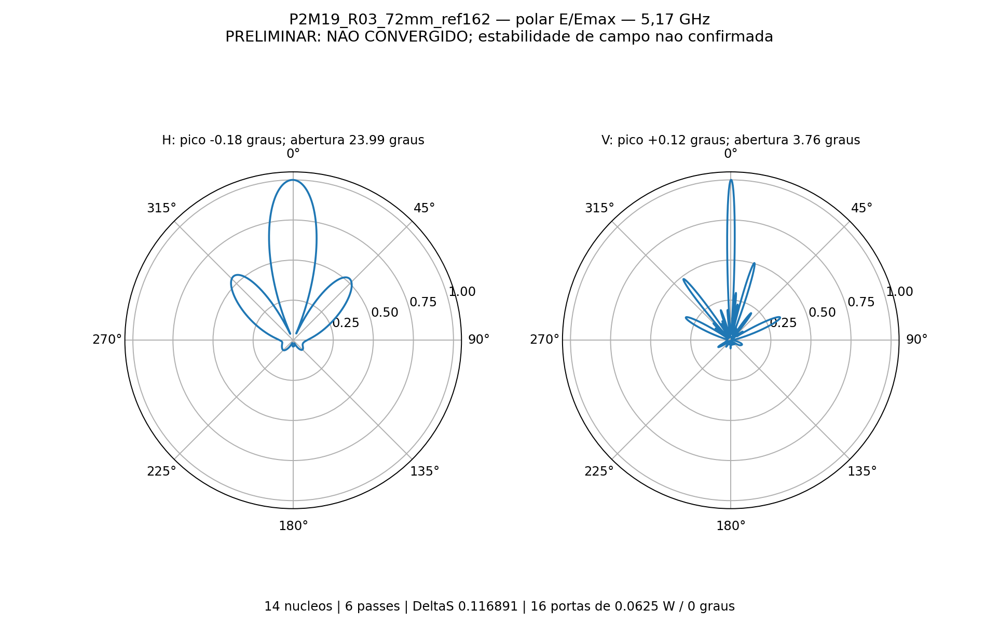
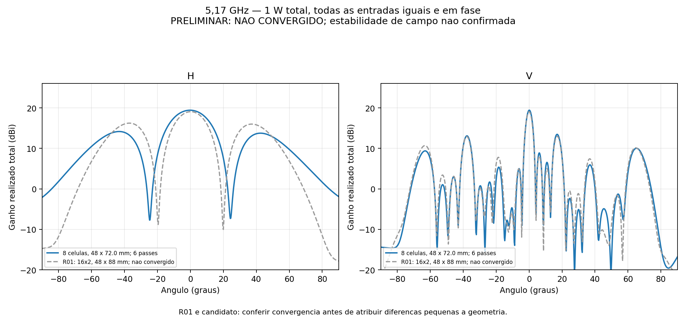
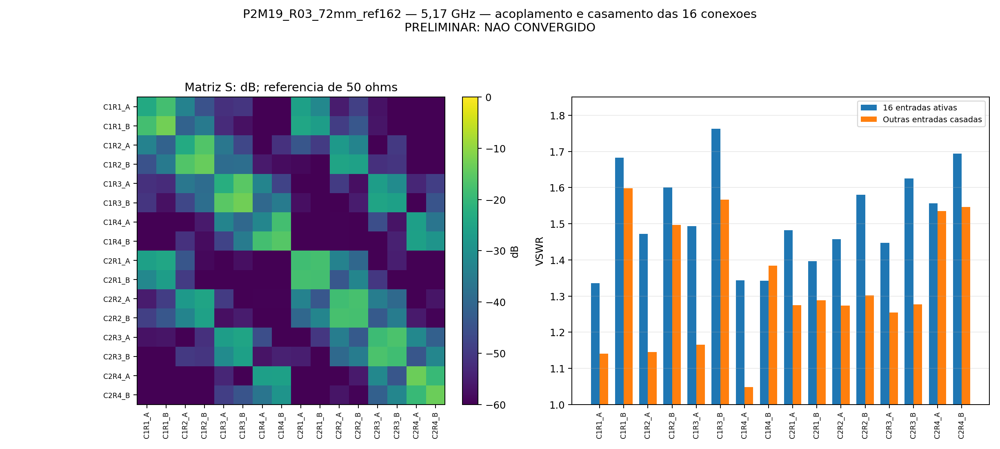

# R03_72mm_ref162

**PRELIMINAR — NÃO CONVERGIDO.** 5,17 GHz, 6 passes, ΔS 0.11689053; alvo 0,05. Perfil auditado: 14 núcleos, sem sweep.

Ganho frontal realizado total **19.4180 dBi**; aberturas do lóbulo principal H **23.9886°** e V **3.7645°**.

Máximos H/V: -0.1806° / +0.1182°. Maiores lóbulos secundários frontais H/V: -5.261 / -5.957 dB relativos ao pico de cada corte.

VSWR ativo nas 16 portas: 1.3355 a 1.7623. VSWR máximo com demais portas casadas: 1.5980.

16 níveis × duas colunas a 72 mm; oito placas C12 de quatro radiadores. Refletor 162 × 776 × 2 mm; altura da PCB 14,949 mm. Cada entrada recebe 0,0625 W a 0°, total 1 W.

Inclui acoplamento, divisores impressos e perdas de RO4350B, cobre e ENIG nominal. Sem rede externa, cabos em 3D, conectores N, radome ou suportes plásticos. O ganho é total coerente, não qualificação por entrada MIMO.

Balanço de potência consistente: True. Reparos Major/Minor: 0/0. Reciprocidade: 1.041e-16. Recomposição das fontes: erro relativo máximo 1.555e-15.

Estabilidade das nove sondas: False. Validação numérica completa: False. Atingir o limite de seis passes não representa convergência; resultados sem estabilidade permanecem preliminares.

[HFSS](P2M19_R03_72mm_ref162.aedt) · [CAD EM](P2M19_R03_72mm_ref162.FCStd) · [S16](centro.s16p) · [Resultado completo](resultado.json) · [Configuração](configuracao.json).

## Adaptação

| Passe | Tetraedros | ΔS | G frontal monitorado (dBi) |
|---:|---:|---:|---:|
| 1 | 257728 | — | 6.783968 |
| 2 | 302897 | 0.54368439 | 13.194412 |
| 3 | 355852 | 0.37064415 | 16.694021 |
| 4 | 418179 | 0.20038913 | 17.694246 |
| 5 | 491245 | 0.18041689 | 18.635680 |
| 6 | 577389 | 0.11689053 | 19.417975 |

Nativos e campos distantes estão preservados; malhas e campos volumétricos ficam somente na pasta local de trabalho. Materiais nominais e uma única frequência não qualificam fabricação ou banda completa.

O registro original da projeção curvilínea da malha inicial está em [curvilinear_inicial.txt](evidencias/curvilinear_inicial.txt). Eventuais faces rebaixadas para representação linear constam desse diagnóstico; isso é distinto da contagem de reparos Major/Minor.
