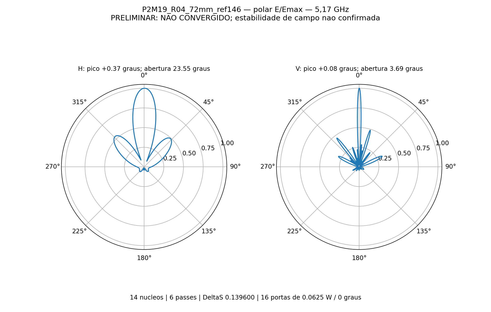
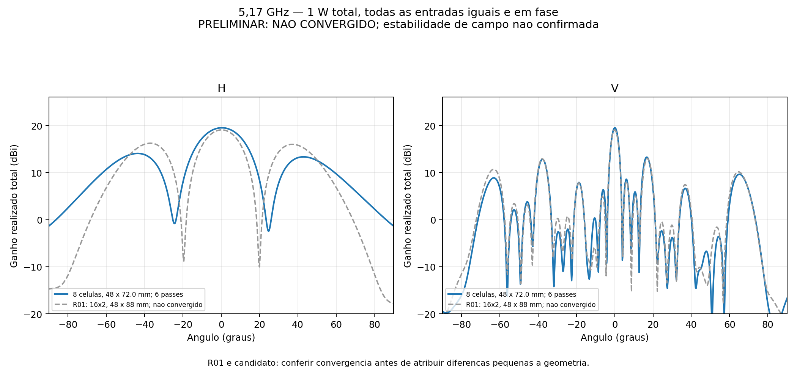
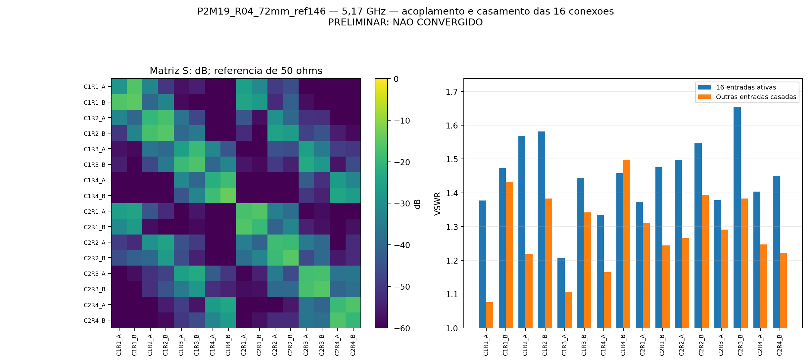

# R04_72mm_ref146

**PRELIMINAR — NÃO CONVERGIDO.** 5,17 GHz, 6 passes, ΔS 0.13960010; alvo 0,05. Perfil auditado: 14 núcleos, sem sweep.

Ganho frontal realizado total **19.5003 dBi**; aberturas do lóbulo principal H **23.5498°** e V **3.6932°**.

Máximos H/V: +0.3736° / +0.0776°. Maiores lóbulos secundários frontais H/V: -5.447 / -6.240 dB relativos ao pico de cada corte.

VSWR ativo nas 16 portas: 1.2076 a 1.6551. VSWR máximo com demais portas casadas: 1.4976.

16 níveis × duas colunas a 72 mm; oito placas C12 de quatro radiadores. Refletor 146 × 776 × 2 mm; altura da PCB 14,949 mm. Cada entrada recebe 0,0625 W a 0°, total 1 W.

Inclui acoplamento, divisores impressos e perdas de RO4350B, cobre e ENIG nominal. Sem rede externa, cabos em 3D, conectores N, radome ou suportes plásticos. O ganho é total coerente, não qualificação por entrada MIMO.

Balanço de potência consistente: True. Reparos Major/Minor: 0/0. Reciprocidade: 9.770e-17. Recomposição das fontes: erro relativo máximo 1.417e-15.

Estabilidade das nove sondas: False. Validação numérica completa: False. Atingir o limite de seis passes não representa convergência; resultados sem estabilidade permanecem preliminares.

[HFSS](P2M19_R04_72mm_ref146.aedt) · [CAD EM](P2M19_R04_72mm_ref146.FCStd) · [S16](centro.s16p) · [Resultado completo](resultado.json) · [Configuração](configuracao.json).

## Adaptação

| Passe | Tetraedros | ΔS | G frontal monitorado (dBi) |
|---:|---:|---:|---:|
| 1 | 268534 | — | 6.079411 |
| 2 | 315805 | 0.46880860 | 13.579744 |
| 3 | 371134 | 0.49768489 | 16.589591 |
| 4 | 435972 | 0.22326489 | 17.865506 |
| 5 | 512299 | 0.19307471 | 18.619939 |
| 6 | 602282 | 0.13960010 | 19.500282 |

Nativos e campos distantes estão preservados; malhas e campos volumétricos ficam somente na pasta local de trabalho. Materiais nominais e uma única frequência não qualificam fabricação ou banda completa.

O registro original da projeção curvilínea da malha inicial está em [curvilinear_inicial.txt](evidencias/curvilinear_inicial.txt). Eventuais faces rebaixadas para representação linear constam desse diagnóstico; isso é distinto da contagem de reparos Major/Minor.
