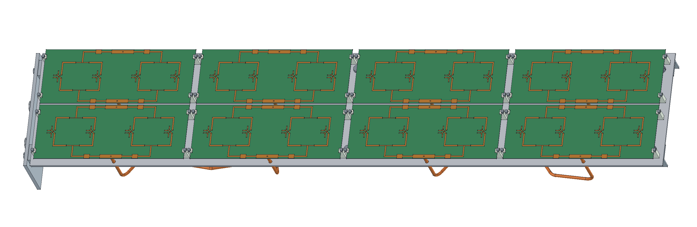
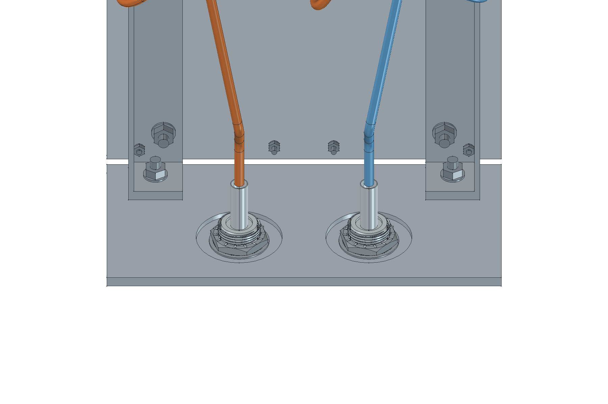
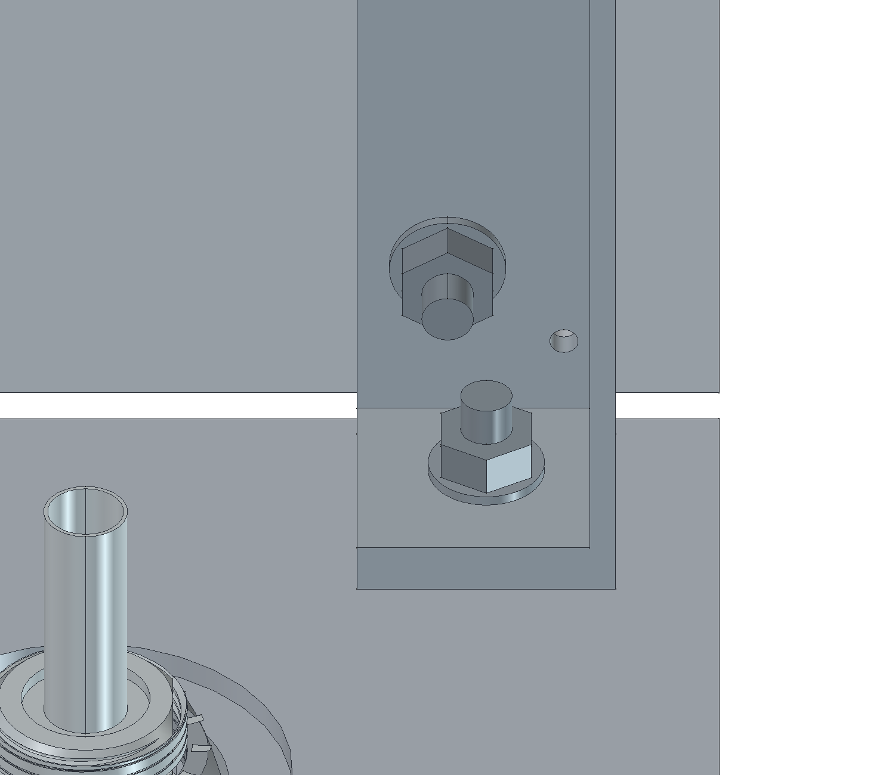
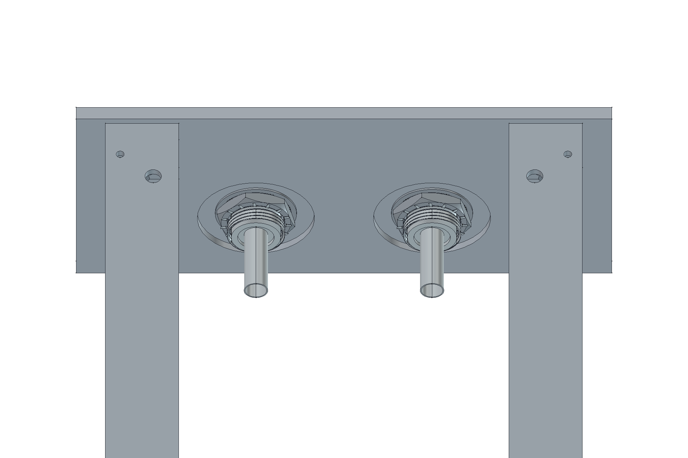
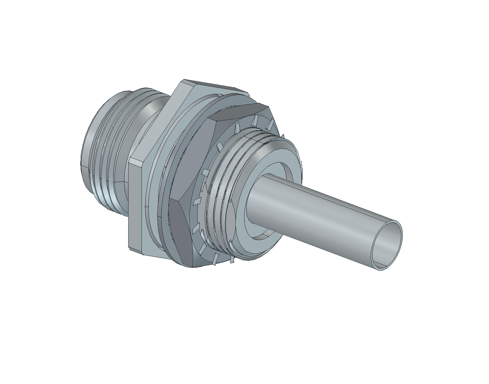
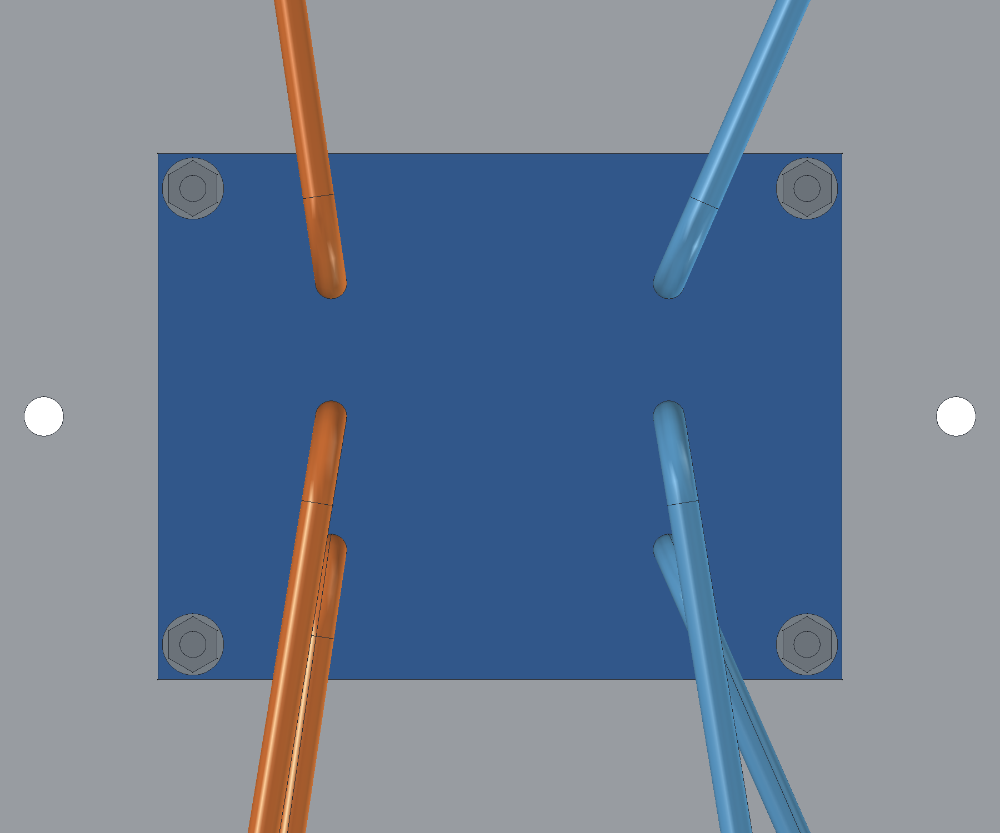
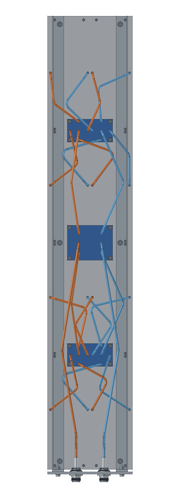
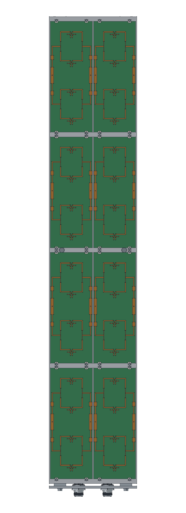
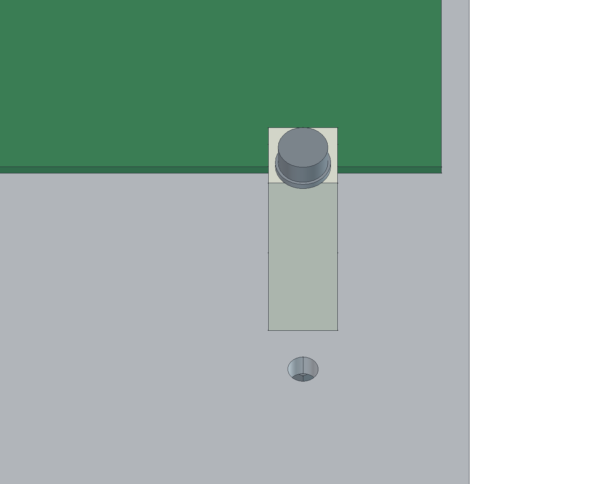

# P2M19 R09 — montagem mecânica PRELIMINAR

A montagem reúne as oito placas C12 de quatro elementos da R08, duas colunas a 72 mm, refletor de 146 × 776 × 2 mm, base inferior de alumínio, dois reforços traseiros, fixadores, duas entradas N e o espaço reservado para três PCBs de distribuição. O FreeCAD fica aberto com esta montagem.

**Nenhuma simulação foi executada nesta revisão.** As novas peças, furos e cabos não herdam a validação RF da R08. A rede externa está em planejamento, sem cobre fabricável nesta montagem. Não há radome, qualificação estrutural, classe IP ou liberação para fabricação.

- [Montagem FreeCAD editável](P2M19_R09_PRELIMINAR.FCStd) · [STEP completo](P2M19_R09_PRELIMINAR.step)
- [Base STEP](Base_aluminio_PRELIMINAR.step) · [Refletor furado STEP](Refletor_furado_PRELIMINAR.step)
- [Lista de materiais](lista_materiais_PRELIMINAR.csv) · [Furação em coordenadas](furacao_PRELIMINAR.csv) · [Dimensões](dimensoes.json)
- [Planejamento da rede divisora](../rede_R09_PLANEJAMENTO/README.md) · [Resultado RF de referência](../continuacao_72mm_ref146_14passes/README.md)

## Base e sustentação do refletor

O eixo **X é vertical**, positivo para cima; Y é horizontal; Z aponta para a frente da antena. O refletor ocupa X=−388 a +388 mm, Y=−73 a +73 mm e Z=−2 a 0 mm. A superfície inferior dos núcleos das PCBs permanece em Z=14,949 mm; o passo entre radiadores continua em 48 mm e entre placas em 192 mm.

A base separada mede **146 × 70 × 4 mm**, com alumínio 6061-T6 como proposta de material. Fica no plano inferior X=−396 a −392 mm, Y=±73 mm e Z=−70 a 0 mm. Dois perfis **L20 × 20 × 2 mm, comprimento 780 mm**, percorrem a traseira do refletor e distribuem os esforços; seus pés de **4 × 20 × 20 mm** são propostos soldados ao perfil. A solda, a têmpera após soldagem e as cargas de vento ainda precisam ser dimensionadas.

Cada perfil liga-se ao refletor por **três M4 × 12**, em X=−374, 0 e +374 mm, Y=−52 mm no lado esquerdo e +52 mm no direito, com furos Ø4,5 mm. Cada pé se prende à base por **um M4 × 16**, eixo X, centro Y=±55 mm e Z=−12 mm. Porcas e arruelas estão incluídas. A base não depende de uma única dobra na borda da chapa de 2 mm. Não foi definido suporte de mastro ou fixação ao edifício nesta revisão.

As oito PCBs usam **32 grampos de POM natural**, quatro por placa, com largura de 5 mm e apoio na altura de 14,949 mm. Não foram perfurados o laminado nem o cobre da C12. Há M2 × 25, porca e duas arruelas por grampo. As tolerâncias do laminado acabado e de retenção precisam de conferência no protótipo.

## Dois conectores N

Usado o **Amphenol 082-6784**, conforme [STEP fornecido](referencias/82-6784.stp) e referência mecânica anterior do projeto. São dois kits N fêmea, com eixos para baixo (−X), centros em Y=±24 mm e Z=−45 mm, distância entre centros de **48 mm**. O plano externo da base é X=−396 mm.

Cada recorte tem **Ø16,5 mm e 14 mm entre planos**. Na face interna há rebaixo **Ø32 × 2 mm**, deixando parede local de montagem de **2 mm**, compatível com a configuração de porca/arruela anteriormente documentada. A porca e a arruela foram separadas da pose do STEP e deslocadas axialmente 4,25 mm; o arquivo original fica preservado. A diferença de integração volumétrica da operação de separação foi 0,05355 mm³ (0,00116% do STEP), sem invalidar seus sólidos.

Foi verificado espaço geométrico para **envelope de soquete Ø30 mm**, com 1 mm de folga radial no rebaixo, sem choque contra base ou reforços. Isso não especifica um modelo de ferramenta. O kit inclui sua porca/arruela/junta; esses acessórios não devem ser comprados em duplicidade. A cauda do STEP termina em X=−367,25 mm e apresenta uma manga tubular **Ø6,5 externo / Ø5,9 interno**, maior que o UT-141C de Ø3,581 mm. Esse plano foi usado somente como início geométrico do percurso; não é uma interface de solda comprovada. O preparo e a profundidade real de inserção precisam do desenho de montagem do conector. Não foi inventado adaptador ou contato interno. O CAD do conector é referência mecânica e não comprova internos RF, torque de montagem ou vedação do produto.

## Rede traseira e cabos

A proposta usa uma **PCB duplo 1:2 central**, 60 × 78 mm, e duas **PCBs duplo 1:4**, 39 × 78 mm, centradas em X=−192 e +192 mm. Cada polarização tem sua entrada e distribuição 1:8; o conjunto chega às **16 conexões das oito C12**. As placas azuis são **envelopes sem traçado de cobre**, não arquivos de fabricação.

O núcleo proposto é ZYF300CA-C de 1,52 mm, ocupando Z=−12 a −10,48 mm. Há quatro furos Ø3,2 mm por placa, a 4 mm das bordas, e espaçadores POM Ø5/Ø3,2 × 8,48 mm. Os M3 × 16, porcas e arruelas estão representados. Os furos coincidem com o planejamento da rede e exigem áreas de exclusão de cobre no projeto posterior.

Os **22 cabos UT-141C** foram modelados como envelopes externos Ø3,581 mm, com arcos de raio de eixo **10 mm**: **2 × 425 mm** de entrada, **4 × 260 mm** de tronco e **16 × 205 mm** de saída. A soma é **5,170 m**; cada caminho N→PCB contém **890 mm** de eixo. Todos os cabos da mesma classe têm o mesmo comprimento geométrico. As cores distinguem A/B e não representam revestimentos diferentes.

Os eixos terminam na cauda N do STEP, no plano de cobre proposto dos divisores (Z=−12,035 mm) e no plano das portas diretas das C12 (Z=14,769 mm). **Os preparos, inserções, decapagens, internos coaxiais e filetes de solda não foram desenhados.** A coincidência de interfaces é um planejamento mecânico; não demonstra conexão metalúrgica, casamento, fase elétrica final ou perda RF. Os comprimentos não são uma lista de corte liberada.

Sequência proposta: instalar e apertar os dois N na base antes do chicote; prender os pés dos reforços à base; fixar refletor e grampos; instalar as PCBs radiantes e as reservas de distribuição; depois preparar o chicote conforme o desenho de terminação e verificar os comprimentos elétricos. A pressão dos grampos e os torques aguardam definição para o protótipo.

## Verificações e limites

- 561 objetos de forma finais e 643 sólidos; todos válidos. A montagem foi salva e reaberta.
- 744 pares com sobreposição de caixas foram examinados: **nenhuma interseção volumétrica** acima de 0,00001 mm³ nas interfaces acrescentadas.
- Os 328 corpos das PCBs C12 foram preservados. A serialização BREP de alguns corpos mudou ao salvar; diferenças geométricas simétricas, envelopes e centroides foram conferidos contra a origem e resultaram em zero. O refletor RF original permanece oculto como referência; a peça de fabricação acrescenta os furos mecânicos documentados.
- Distância exata entre eixos dos cabos conferida no OCCT: folga mínima entre superfícies **1,15683 mm**. Raios e comprimentos dos arcos concordam com o plano da rede em menos de 0,000001 mm. Não há contato entre os cabos e as demais peças.
- A base usa primitivas e cortes nativos, com teste de edição de altura 70→71→70 mm. As demais peças são BREP reconstruíveis pelos scripts. A montagem é posicionada, sem juntas cinemáticas.
- O STEP completo foi reimportado com **643 sólidos válidos, todos pareados, e envelope idêntico**. A integração global do compound mudou 5,1377 mm³ em 568580 mm³ (**0,000904%**). Ao integrar cada sólido separadamente, a diferença somada é somente **0,11961 mm³**; as maiores diferenças estão nos corpos N (0,04177 mm³ cada) e nas porcas/arruelas (0,01804 mm³ cada). Nos 328 corpos RF, a maior diferença individual é **0,00000005681 mm³**. O uso de `optimalBoundingBox` confirmou também os 22 cabos, evitando a caixa dependente dos pontos de controle das curvas. O nativo FCStd é a referência de geometria; este STEP serve à visualização/integração mecânica, **não à criação de um novo modelo RF**, e não preserva recursos paramétricos.
- Envelope total da montagem: **797,3 mm vertical × 146 mm horizontal × 90,059 mm de profundidade**.

[Auditoria CAD](verificacao_cad.json) · [Cabos e acesso da ferramenta](verificacao_cabos.json) · [Reimportação STEP](verificacao_STEP.json) · [Revisão visual](revisao_visual.json).

Para reconstruir: `mecanica_r09_criar.py`, `mecanica_r09_cabos.py`, `mecanica_r09_verificar.py` e `mecanica_r09_imagens.FCMacro` em `../automacao/`. O projeto RF R08 e seus resultados não foram alterados. A próxima etapa elétrica deve dimensionar o cobre das três distribuidoras e verificar o conjunto por parâmetros S; a presente entrega não inicia essa simulação.
