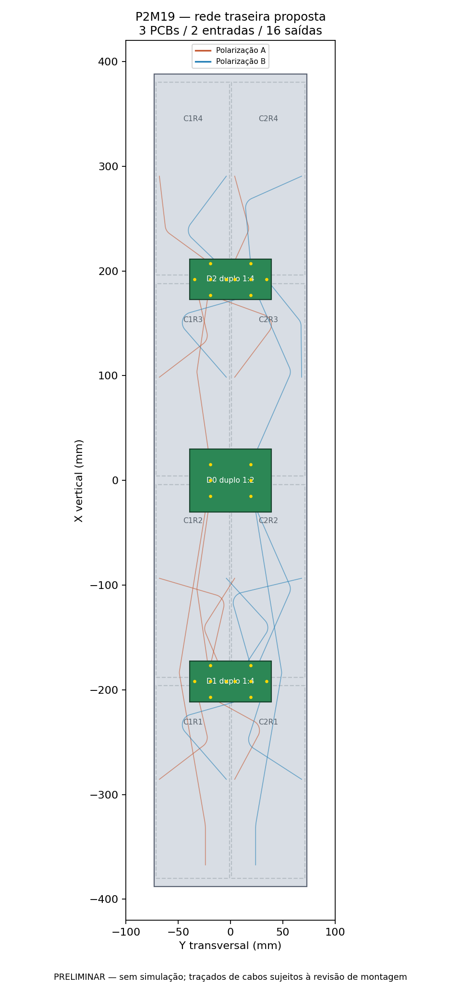
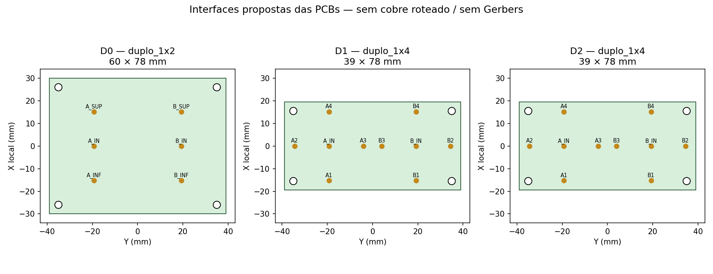

# P2M19 R09 — planejamento da rede externa

**Sem nova simulação. Preliminar, não liberado para fabricação.** A proposta mantém as oito placas C12, duas colunas a 72 mm e quatro níveis de placas. As dezesseis portas locais serão alimentadas por duas entradas independentes, A e B. A geometria RF da R08 permanece preservada.

## Topologia e posição

`N A/B → D0 (duplo 1:2) → D1/D2 (duplo 1:4 cada) → 16 entradas das oito C12`.

São **três PCBs, dois circuitos 1:2 e quatro circuitos 1:4**. Cada filial atende quatro placas, em duas posições verticais e duas colunas. Não há união entre A/B nem novas divisões nas placas radiantes.

| PCB | Centro X/Y (mm) | Envelope X×Y (mm) | Função |
|---|---:|---:|---|
| D0 | 0 / 0 | 60×78 | Duas entradas centrais e quatro troncos |
| D1 | −192 / 0 | 39×78 | Placas R1/R2; quatro saídas por polarização |
| D2 | +192 / 0 | 39×78 | Placas R3/R4; quatro saídas por polarização |

X é vertical, Y transversal e Z aponta para a frente. Laminados entre Z=−12 e −10,48 mm; sinal na face posterior Z=−12,035 mm. Furos propostos de Ø3,2 mm para M3: D0 em X local ±26/Y ±35; D1/D2 em X local ±15,5/Y ±35. Esses furos diferem da referência histórica e exigem reserva sem cobre no futuro layout.

## Chicote com caminhos iguais

| Classe | Quantidade | Comprimento de eixo por cabo |
|---|---:|---:|
| Entrada N → D0 | 2 | 425 mm |
| Tronco D0 → filial | 4 | 260 mm |
| Ramal filial → C12 | 16 | 205 mm |

São **22 cabos e 5,170 m de eixos**. Cada caminho N → C12 tem **890 mm de cabo**, além dos trajetos impressos idênticos por classe. Os comprimentos são analíticos, incluindo arcos com raio de eixo de 10 mm; não são comprimentos das linhas facetadas usadas para visualização. **Não é lista de corte**: faltam inserção, decapagem, terminação e ensaio do chicote soldado.

As rotas iniciais com cruzamentos foram corrigidas. A auditoria entre os 22 cabos encontrou distância mínima amostrada entre centros de **4.740336 mm** e folga superficial conservadora de **0.655336 mm**, descontando 0,504 mm para discretização. A verificação contra reforços, postes, base e placas pertence à montagem FreeCAD; este teste isolado não libera fabricação.

O cabo de referência é **Micro-Coax UT-141C**, 50 Ω, diâmetro externo 3,581 mm e condutor central de 0,9195 mm. O raio interno mínimo da ficha é 1,905 mm, equivalente a raio de eixo de 3,6955 mm; foram adotados 10 mm. Fonte primária consultada em 14/11/2026: [ficha UT-141C](https://www.micro-coax.com/wp-content/uploads/2024/12/micro-coax-ut-141c-datasheet.pdf).

Comprimento físico igual não garante fase igual após soldagem. De 95,2 pF/m e 50 Ω da ficha, deriva-se velocidade de 0.70076c e aproximadamente 8.859°/mm em 5,17 GHz. Uma diferença total de 3° equivale a 0.339 mm nesse modelo. As metas propostas são desequilíbrio total ≤3° e ≤0,15 dB; conferir eletricamente com VNA, usando cabo do mesmo lote e terminação reproduzível. Isso não constitui tolerância de corte aprovada.

## Dimensionamento das PCBs

A referência inicial é ZYF300CA-C, núcleo de 1,52 mm, Dk=2,94 e tanδ=0,0016 nominais, cobre de 35 µm e ENIG. A cotação JLC de 7/11 documenta o material historicamente; não houve nova consulta de estoque/preço. As radiantes permanecem RO4350B de 0,76 mm.

O 1:2 pode partir de dois transformadores de 70,7107 Ω/90°; o 1:4 de quatro transformadores de 100 Ω/90°. Síntese quasi-estática, ainda sem corrigir espessura de cobre:

| Impedância | Largura inicial (mm) | Quarto de onda (mm) |
|---|---:|---:|
| 50 Ω | 3,906 | 9,402 |
| 70,71 Ω | 2,172 | 9,587 |
| 100 Ω | 1,042 | 9,775 |

O 1:4 histórico usa W100=1,004 mm, L=9,769 mm e W50=3,872 mm. Essas dimensões são sementes para ajustar junções, pads de solda e retornos de terra com os efeitos do cobre/ENIG. Os ramais devem conservar comprimento físico e elétrico iguais, não apenas fase igual módulo 360°.

O 1:4 histórico tem VSWR **1,53665/1,53646** e perda excedente **0,33193/0,33038 dB**, com saídas de 50 Ω. **Não atende à meta futura de VSWR ≤1,25**; precisa de ajuste antes de fabricação. É uma rede T/radial sem resistores e sem isolamento entre saídas. A antena real deve ser carregada como matriz S16 acoplada.

## Comparação das alternativas

| Arquitetura | PCBs | Cabos | Eixos totais propostos | Cabo por caminho |
|---|---:|---:|---:|---:|
| Duplo 1:8 central | 1 | 18 | 7,090 m | 815 mm |
| Duplo 1:2 + dois duplos 1:4 | 3 | 22 | 5,170 m | 890 mm |

A distribuída reduz o cabo total em **27,08%** e encurta os ramais finais de 390 para 205 mm. Acrescenta duas PCBs e quatro interligações. A central pode ter menor perda por caminho, cerca de 0,069 dB menos cabo neste orçamento, e menos juntas; porém a referência radial 1:8 exige trilhas de 141,4 Ω e apresenta VSWR ≈1,697. A distribuída foi escolhida para organizar o painel e facilitar as interfaces, sem alegar que já minimiza a perda RF. Os 390 mm da alternativa são reserva comparativa não roteada; a proposta distribuída tem 22 curvas calculadas.

## Orçamento de perdas

A baseline de **20,544 dBi** inclui os divisores nas C12 e o acoplamento entre placas; **não inclui a nova rede externa**. A margem aritmética até 19 dBi é 1,544 dB. Interpolando os pontos de 5/10 GHz da ficha, o cabo tem cerca de 0.921 dB/m em 5,17 GHz, ou **0.820 dB** por caminho de 890 mm. Sobram aproximadamente **0.724 dB** para PCBs externas, conectores N, soldas, descasamento e desequilíbrio. É orçamento típico, sem garantia de ganho final.

Os históricos 1:2 R05 (0,222 dB) e 1:4 (0,332 dB) são geometrias distintas. Não podem ser somados e tratados como resultado desta rede, sobretudo com o 1:4 descasado. **Não foi calculado novo VSWR nas duas entradas N nem ganho com a rede R09.**

O orçamento para manter 19 dBi é apertado: se os novos estágios externos consumissem aproximadamente 0,55 dB, restariam cerca de 0,17 dB para conectores, soldas e outros efeitos. Isso serve para orientar o ajuste e a comparação com a alternativa central; não demonstra aprovação nem reprovação do produto completo.

## Sequência após autorização de retomada

1. Ajustar o duplo 1:2 e o duplo 1:4 separadamente em HFSS, com saídas de 50 Ω e terminais de solda reais. Preservar a simetria e não incluir cabos em 3D.
2. Combinar S6/S10 dos divisores e S16 da antena no Nexxim. A rede externa equivale a S18 antes de conectar a antena; após conectar as dezesseis cargas, restam as duas entradas N. Começar com cabos ideais de fase; tratar perdas reais em caso separado autorizado.
3. Verificar VSWR ativo com A/B iguais em fase e VSWR com a outra entrada casada, amplitude/fase nas C12 e recomposição dos campos complexos H/V. Metas propostas: VSWR ≤1,25 e ganho ≥19 dBi, ainda não demonstrados com a rede.
4. Congelar cobre e chicote, executar DRC e só então gerar Gerbers. Qualquer esgotamento de memória deverá ser registrado e interromper o solve, sem retomada automática.

[Interfaces e curvas](plano_rede.json) · [Conexões](conexoes.csv) · [Dimensionamento elétrico](dimensionamento_eletrico_preliminar.json) · [BOM](lista_materiais_rede_PRELIMINAR.csv) · [Comparação](comparacao_topologias.json) · [Auditoria dos cabos](auditoria_distancias_cabos.json).

Não foram criados cobre novo no KiCad ou Gerbers. Os desenhos são interfaces de planejamento. A [montagem FreeCAD R09](../mecanica_R09_PRELIMINAR/README.md) documenta os novos componentes mecânicos, sem validação RF/estrutural do conjunto.

A [auditoria CAD dos cabos](../mecanica_R09_PRELIMINAR/verificacao_cabos.json) verifica a mesma interface SHA-256 `5ee180f49d67fa1d26430e51acc6bf7ebc6eaff4132a446e3cf6267c73a32173`. Os 22 cabos foram reconstruídos com arcos OCCT, sem interferências entre si, folga exata mínima de 1,156834 mm e comprimentos coincidentes com os analíticos. Isso complementa a auditoria conservadora de amostras; a verificação completa das ferragens e demais peças permanece descrita nas evidências mecânicas.
