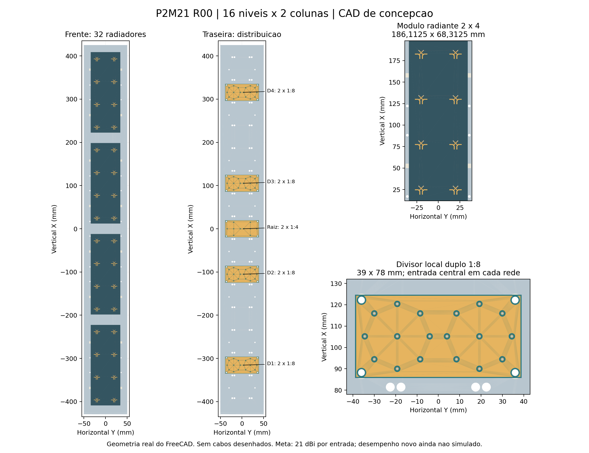
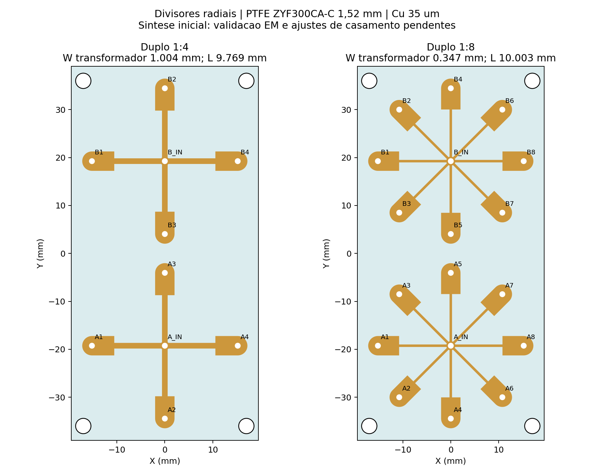

# P2M21 — duas colunas, MIMO 2×2, meta de 21 dBi por entrada

**R00: concepção criada, ainda sem qualificação eletromagnética do novo painel.** A P1H foi preservada como semipronta; seus resultados não aprovam esta nova geometria.

**Escopo atual — 9/11:** somente ganho total e diagramas H/V em **5,17 GHz**, com 16 níveis × 2 colunas e as 64 portas iguais/em fase. O pedido mais recente cancelou a varredura de 17 frequências e os refinamentos locais/iniciais impostos. A revisão R04 usa Classic com resolução global padrão, sem lambda refinement inicial, base mista, **14 núcleos e máximo quatro passes**, com ΔS final explícito mesmo sem convergência; a geometria está preservada. O cálculo central terminou às 04:29 com quatro passes: **23,06 dBi, H 32,72°, V 3,50° e ΔS 0,617681**. Os valores são **preliminares, não convergidos**; a auditoria também reprovou reciprocidade e eficiência. Nenhuma qualificação RF é declarada. [Setup, nativo e evidências](centro_sem_refinamento/README.md). O ensaio R02 e a tentativa TAU R03 foram interrompidos e permanecem históricos. A alimentação direta não inclui a rede externa nem comprova ganho MIMO por entrada.

**Estudo de 9/11, antes de corrigir a malha:** a pedido do usuário, foi comparada a alimentação de **todas as portas A/B simultaneamente, com amplitude igual e fase de 0°**, mantendo 1 W total. A estimativa com a referência P1H R06 favorece manter **16 níveis × 2 colunas**: ganho total frontal de aproximadamente **22,50 dBi**, H **39,1°** e V **3,49°** em 5,17 GHz, sem a nova rede. O caso 10×2 fica em 20,46 dBi. Foram documentadas 36 combinações de níveis, colunas e espaçamentos. Este estudo coerente não comprova o requisito MIMO por entrada nem a banda e não alterou a geometria ou iniciou novo ciclo HFSS. [Comparação, método e gráficos](estimativa_uniforme/README.md).

**Atualização de 8/11, após a execução R00:** a antena terminou às 16h43 sem convergir em seis passes: ΔS = 0,040859, contra o limite então adotado de 0,02. Foram identificados sete corpos com reparos Major. Aquela fila interrompeu antes da varredura do painel e do circuito; ganho e VSWR por entrada nos 17 pontos continuam sem confirmação. [Diagnóstico e evidências](diagnostico_20261108.md).

O requisito original do projeto, ainda não qualificado e fora desta etapa de centro, é ganho frontal realizado **≥21 dBi em cada entrada**, de **5,09 a 5,25 GHz**, nos 17 pontos separados por 10 MHz, com a outra entrada terminada em 50 Ω. Cada entrada alimenta uma polarização dos 32 radiadores, distribuídos nas duas colunas. Os dois canais permanecem independentes. Não se soma a potência dos canais para alegar 21 dBi por entrada.

## Arquitetura escolhida

| Item | R00 |
|---|---|
| Arranjo | 16 níveis × 2 colunas; 32 radiadores de duas polarizações |
| Passo vertical / horizontal | 52,6 / 40 mm |
| Placas radiantes | 4 módulos iguais de 2 colunas × 4 níveis |
| Dimensão de cada módulo | 186,1125 × 68,3125 mm |
| Radiadores | RO4350B, núcleo 0,76 mm; Dk de projeto 3,66; tanδ 0,0037 |
| Alimentação | Um divisor duplo 1:4 central e quatro divisores duplos 1:8 locais |
| Placa de cada divisor | 39 × 78 mm, PTFE ZYF300CA-C de 1,52 mm; Dk 2,94; tanδ 0,0016 |
| Metalização RF | Cu físico 35 µm; ENIG nominal Au 0,0254 µm / NiP 4,5 µm |
| Refletor | Face 850 × 100 mm; alumínio 2 mm; base dobrada a 90° |
| Apoios | Oito berços transversais em poliacetal, espessura 5 mm |
| Entradas mecânicas | Dois furos Ø16 mm na base, reservados aos conectores N |

RO4350B é laminado hidrocarboneto/cerâmico; o PTFE está nas distribuidoras. A disponibilidade dessas famílias e espessuras foi consultada no contexto P1H: [materiais JLCPCB](https://jlcpcb.com/news/rogers-ptfe-high-frequency-pcb-available). A cotação P1H não é uma cotação destas novas placas. Não houve compra.

[Detalhe do cobre nas duas faces da PCB](imagens/pcb_duas_faces.png)

## Por que 16 níveis e distribuição central

Foram comparados 10, 12, 14, 16, 18 e 20 níveis, com separações entre colunas de 32 a 48 mm. O pré-dimensionamento usa os campos complexos **por entrada individual** da R06 em 5,17 GHz, escala de número de radiadores e fator de arranjo horizontal. A seleção 16×2/40 mm dá uma estimativa de **22,42 dBi antes da reserva adicional**, ou **21,67 dBi com reserva de projeto assumida de 0,75 dB**, H aproximadamente **37,85°** e V aproximadamente **3,57°** no centro. A reserva não é perda simulada nem comprovação de banda. O novo acoplamento, as emendas das PCBs, o refletor e a rede podem alterar esses valores.

[Tabela de alternativas](planejamento/comparacao.csv) · [Gráfico](planejamento/predimensionamento.png) · [Premissas e referência](configuracao.json)

As distribuidoras locais ficam atrás dos centros dos quatro módulos, em X = −315,6, −105,2, +105,2 e +315,6 mm. A raiz fica em X = 0. Isso reduz a maior distância longitudinal entre centros, de 740,6 mm para uma raiz na base a 315,6 mm para a raiz central. Trata-se de comparação geométrica, antes dos arcos e conexões.

O histórico P1H mostrou perdas e desequilíbrios maiores nas versões alongadas inicialmente testadas. Por isso esta R00 parte de distribuidoras compactas locais. As redes são divisores radiais com transformadores de quarto de onda: **não são Wilkinson e não têm resistores de isolamento entre as saídas da mesma polarização**. O circuito completo deve considerar as reflexões e o acoplamento dos radiadores.

O [mapa de conexões](mapa_conexoes.csv) associa as 64 portas dos radiadores às saídas dos divisores. A atribuição minimiza a soma das distâncias ortogonais. Há reservas iniciais iguais de **165 mm nos ramais** e **365 mm nos troncos**, calculadas com margem para roteamento. **Não são comprimentos de corte liberados:** faltam as curvas físicas, folgas de montagem e o ajuste das fases usando as matrizes S reais. As entradas N na base exigem duas ligações adicionais até a raiz. A montagem CAD ainda não inclui o chicote e os conectores N detalhados.

## Arquivos criados

- [Módulo radiante KiCad](kicad/P2M21_Modulo_2x4/P2M21_Modulo_2x4.kicad_pcb), [divisor duplo 1:4](kicad/P2M21_Duplo_1x4/P2M21_Duplo_1x4.kicad_pcb) e [divisor duplo 1:8](kicad/P2M21_Duplo_1x8/P2M21_Duplo_1x8.kicad_pcb).
- [Montagem FreeCAD](freecad/P2M21_Montagem.FCStd), [chapa dobrada STEP](freecad/Refletor_dobrado.step), [planificação FreeCAD](freecad/Refletor_planificado.FCStd) e [DXF de corte/dobra](freecad/Refletor_corte_dobra_R00.dxf).
- HFSS separado: [antena de 64 portas](hfss/antena/P2M21_Antena.aedt), [divisor de 10 portas](hfss/divisor_1x4/P2M21_Duplo_1x4.aedt) e [divisor de 18 portas](hfss/divisor_1x8/P2M21_Duplo_1x8.aedt).

O cobre do radiador foi copiado do CAD R06, incluindo vias e soldas locais; os substratos, distribuição em duas colunas, reflector e apoios são novos. Os scripts em [automacao](automacao) reproduzem a construção. O CAD nativo mantém os corpos separados para edição e posicionamento; não recupera uma árvore de esboços do cobre importado. A montagem é por posicionamento, não uma montagem cinemática.

## Verificações e limites

O primeiro ensaio do divisor duplo 1:4 convergiu em seis passes, com ΔS final 0,01449 e dois passes consecutivos aprovados. Em 5,17 GHz, com todas as saídas casadas, VSWR A/B = 1,53665 / 1,53646; perda excedente = 0,33193 / 0,33038 dB. Isso ainda não aprova o casamento nem o ganho do painel carregado. A fila inicial resolve os divisores em separado e só então o centro da antena, sem aumentar o limite de seis passes. O estado de execução está em [qualificacao.json](qualificacao.json).

O divisor duplo 1:8 também convergiu em seis passes, com ΔS 0,018707 e dois consecutivos aprovados. No centro, VSWR A/B = 1,69614 / 1,69673 e perda excedente = 0,52494 / 0,52296 dB. As terminações casadas desse ensaio não reproduzem a impedância ativa da antena; o casamento final depende do circuito carregado. **Ambos completaram os 17 pontos**, com passividade/reciprocidade verificadas e zero reparos Major/Minor. A execução da antena de 64 portas ocorreu em 8/11 das 16:03 às 16:43 e terminou sem convergência; ainda não há ganho qualificado do painel.

Os modelos CAD foram reabertos e verificados: 653 objetos na antena, 44 no divisor 1:4 e 76 no 1:8, todos válidos, sem interseções volumétricas indevidas entre corpos. Contatos tangentes entre materiais são permitidos. O DRC das três placas tem **zero erros e zero itens desconectados**. Permanecem respectivamente 203, 20 e 36 avisos de máscara aberta/ponte de máscara nas áreas RF; os relatórios completos acompanham os nativos.

A chapa planificada mede 895,398 × 100 mm, com raio interno de 2 mm e fator K assumido de 0,4. Confirmar o raio, ferramental, ajuste dos conectores e vedação antes de fabricação. A planificação é preliminar, não uma liberação industrial.

No histórico R00 foram usados seis passes e ΔS ≤0,02. A revisão atual R04 segue 14 núcleos e máximo quatro passes no total, sem sweep, e apresenta o ΔS final mesmo se não convergir. O alvo de referência continua 0,04. Atingir o limite de passes não comprova convergência. Os nativos R00 preservam as antigas varreduras; sua existência não autoriza executá-las nesta etapa. Não se simulam cabos em 3D: a matriz S64 da antena e S10/S18 das distribuidoras serão conectadas por linhas ideais de fase, sem atenuação. A referência de ganho será a potência incidente em cada entrada MIMO individual.

Para a meta original MIMO, fora desta etapa central, ainda faltam a convergência EM, matrizes e campos nas 17 frequências, circuito carregado, VSWR por entrada, ganho e H/V por canal, isolamento/correlação MIMO e ajustes de casamento. O curto DC deverá incorporar as duas bobinas de entrada da referência P1H, com nova conferência da sua integração. Os avisos de máscara, terminais soldados, conectores e chicote precisam entrar na revisão de fabricação. **Nenhum resultado R00 demonstra ainda 21 dBi em toda a banda.**
