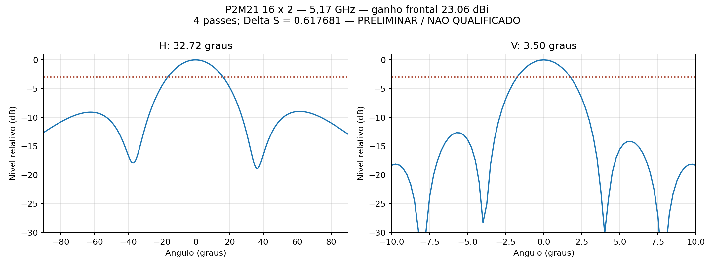

# P2M21 R04 — ganho e diagrama somente em 5,17 GHz

**Concluído em 9/11 às 04:29, no quarto passe. Resultado preliminar, sem convergência nem aprovação numérica.** A execução parou no limite solicitado; não houve sweep nem passes adicionais. Os passes 3 e 4 usaram 14 núcleos, confirmados no processo do solver; os dois iniciais usaram quatro núcleos e foram preservados.

## Resultado em 5,17 GHz

| Grandeza | Valor calculado | Interpretação |
|---|---:|---|
| Ganho frontal realizado total | 23,0631 dBi | 2,0631 dB acima de 21 dBi numericamente; **não validado** |
| Abertura horizontal a −3 dB | 32,7232° | Corte φ = 90° |
| Abertura vertical a −3 dB | 3,4961° | Corte φ = 0° |
| ΔS final | 0,617680996 | Acima da referência 0,04; **não convergiu** |
| Passes / teto | 4 / 4 | Limite respeitado |
| Tetraedros finais | 315.408 | Classic; zero reparos Major ou Minor |

As 64 portas receberam 0,015625 W a 0°, totalizando 1 W incidente. Não há divisor ou cabo nesta excitação direta. O número não é ganho MIMO por entrada e não demonstra comportamento em toda a banda. A grade angular é de 0,25° e os cruzamentos de −3 dB foram interpolados; o pico H ficou em −0,25° e o pico V em 0°.

| Passe | Tetraedros | ΔS | Ganho frontal (dBi) | Núcleos |
|---:|---:|---:|---:|---:|
| 1 | 188.299 | — | 17,0269 | 4 |
| 2 | 223.568 | 1,050241 | 20,4620 | 4 |
| 3 | 265.565 | 0,643468 | 21,9971 | 14 |
| 4 | 315.408 | 0,617681 | 23,0631 | 14 |

O ganho mudou **1,0661 dB** entre os dois últimos passes; a maior mudança nas nove direções monitoradas foi **1,3026 dB**. Portanto, o ganho ainda não estabilizou. ΔS é mudança da matriz S entre passes, não porcentagem de erro físico do ganho.

A auditoria preservou os limites e registrou duas falhas: erro máximo de reciprocidade `|Sij−Sji| = 1,11016×10⁻⁴`, acima do limite adotado de `10⁻⁶`; e eficiência de radiação calculada de **100,3485%**, não física. Esta corresponde a uma perda interna calculada de −3,089 mW; os dados não foram truncados para ocultar a inconsistência. A matriz passou no teste de passividade (maior valor singular 0,661124). A potência aceita foi 0,886321 W e a normalização entre ganho realizado e ganho concordou com S64 com erro de 3,77×10⁻¹⁵ W. Essas verificações parciais não anulam as reprovações nem a falta de convergência.

A primeira auditoria parou no limite de reciprocidade. O pós-processamento foi ajustado para registrar essa reprovação e a eficiência não física, mantendo `aprovado=false`, e disponibilizar os valores preliminares solicitados. **Nenhum novo solve foi realizado para esta entrega.**

[Dados completos em CSV](resultados_centro.csv) · [Auditoria](resultados/auditoria_centro.json) · [Convergência nativa](resultados/convergencia_centro.txt) · [S64](resultados/centro.s64p) · [Corte H](resultados/Uniforme_H.csv) · [Corte V](resultados/Uniforme_V.csv)

| Configuração verificada no arquivo nativo | Valor |
|---|---|
| Arranjo | 16 níveis × 2 colunas, 32 radiadores A/B |
| Excitação | 64 portas diretas, 0,015625 W / 0° cada; 1 W incidente total |
| Frequência | 5,17 GHz |
| Sweeps | Nenhum, removidos do setup |
| Operações locais de malha | Nenhuma: Length/TrueSurf e controle de vias removidos |
| Refinamento lambda inicial / malha importada | Desligado / nenhuma |
| Gerador inicial | Classic, resolução automática, slider global padrão 5, sem fallback TAU |
| Funções de base | Ordem mista (`BasisOrder=-1`) |
| Solver | Iterativo, residual 1e-5, 14 núcleos em uma tarefa, limite de RAM 90% |
| Adaptação durante o cálculo | Mínimo 2, máximo 4 passes no total; ΔS de referência 0,04, dois consecutivos para declarar convergência |
| Crescimento adaptativo configurado | 20%; não é refinamento imposto antes do solve |
| Campo salvo | Apenas campos radiados para ganho e cortes H/V |

A geração da malha inicial indispensável ao FEM permanece automática. Não há etapa separada de refinamento local ou por comprimento de onda antes da solução. Nove direções de ganho são registradas por passe somente para monitoramento, sem impor um critério adicional. O ΔS é a mudança da matriz entre passes, não uma garantia de erro de 4% no ganho. O limite mais recente é de quatro passes no total. Os valores serão apresentados mesmo sem atingir o ΔS de referência; o estado de convergência e o ΔS final serão explícitos. Não há autorização para ultrapassar quatro passes.

## Modelo preservado e tentativas anteriores

A auditoria confirmou igualdade dos **782 blocos de geometria** com a origem R02. Materiais, cobre, ENIG, portas, refletor e apoios não foram redesenhados. Divisores e cabos não estão no modelo radiante: esta etapa mede a alimentação direta coerente total, não o ganho por entrada MIMO da rede física.

O R02, com refinamentos locais, foi interrompido por nova instrução do usuário às 03:27. Havia quatro passes concluídos, ΔS 0,249792 e nenhum resultado aprovado de banda. A tentativa R03 retirou os controles locais e usou a seleção automática de mesher, que escolheu TAU. Às 03:38 foram relatados reparos Major, incluindo `E14_Ant01_Feed_A_Cu1`; a tentativa foi interrompida às 03:43, antes de concluir o primeiro passe. Esses logs permanecem como evidência, sem reutilizar a malha defeituosa.

A correção dirigida R04 seleciona Classic, mantendo a resolução global padrão e os controles locais desligados. O HFSS oferece Classic e TAU como geradores alternativos de malha inicial; a escolha pode alterar o consumo e a convergência conforme a geometria. [Documentação Ansys 2024 R2](https://ansyshelp.ansys.com/public/Views/Secured/Electronics/v242/en/Subsystems/HFSS/Content/HFSS/MeshingMethod.htm).

Desligar o refinamento lambda segue a instrução do usuário e exige cuidado ao interpretar uma convergência precoce. A documentação recomenda esse refinamento para ajudar a representar os campos em estruturas eletricamente grandes. A auditoria verificou reparos, potência e evolução dos campos; os resultados e as reprovações estão apresentados acima. [Refinamento lambda no HFSS](https://ansyshelp.ansys.com/public/Views/Secured/Electronics/v252/en/Subsystems/Circuit/Content/HFSS/SettingLambdaRefinement.htm).

## Execução e entrega

O [arquivo HFSS](hfss/P2M21_Ganho_Diagrama.aedt) foi atualizado para máximo quatro passes e conferido após a transição. Seus resultados e sua malha permanecem apenas no trabalho local R04; o nativo no Git sozinho não restaura a solução de campos. A revisão inicial de seis passes continua no histórico Git. [Configuração](configuracao.json), [auditoria do setup](evidencias/verificacao_preparacao.json) e [estado registrado](qualificacao.json) acompanham o nativo.

Trabalho local: `D:/dev/EMBRAER/P2M21/R04_Centro_Classic`. A [fila](../automacao/centro_automatico_pipeline.ps1) resolve exclusivamente o centro, exporta dois cortes complexos H/V e a S64 de um ponto, audita a convergência, reparos e normalização, e gera o gráfico. A S64 é usada para verificar potência e consistência; não há sweep de VSWR ou qualificação da faixa nesta etapa. Os scripts bloqueiam a execução de banda quando `apenas_centro=true`.

No pós-processamento foram apresentados ganho frontal realizado total, aberturas H/V a −3 dB, apontamento e evolução dos nove campos. Convergência exige os dois últimos passes realmente dentro de ΔS 0,04; a ausência de reparos Major é uma verificação separada da malha. Mesmo sem convergência, entregar o estudo como preliminar, com ganho, H/V e ΔS final, respeitando quatro passes. Falhas de malha/potência continuam sendo reportadas; não reiniciar ciclos automaticamente.

Chrome, JLCONE e utilitários de áudio/configuração foram encerrados. HWMonitor e Gerenciador de Tarefas recusaram encerramento por privilégio do Windows; não se elevou acesso para forçá-los. O terminal de outro trabalho, Codex, acesso remoto e serviços/drivers foram preservados. Nenhum documento de outro trabalho foi descartado.

Malhas, `.aedtresults`, `g3derr`, campos volumétricos e locks não são incluídos no Git. Nenhum email de checkpoint é enviado.

O [perfil HPC](HFSS_14nucleos.acf) usa 14 núcleos, uma tarefa e nenhuma GPU. O comando do solver no terceiro passe confirmou `-max_processors 14`. O licenciamento Auto foi preservado. A troca de recursos preservou os dois primeiros passes; o ajuste do teto preservou os três primeiros.
