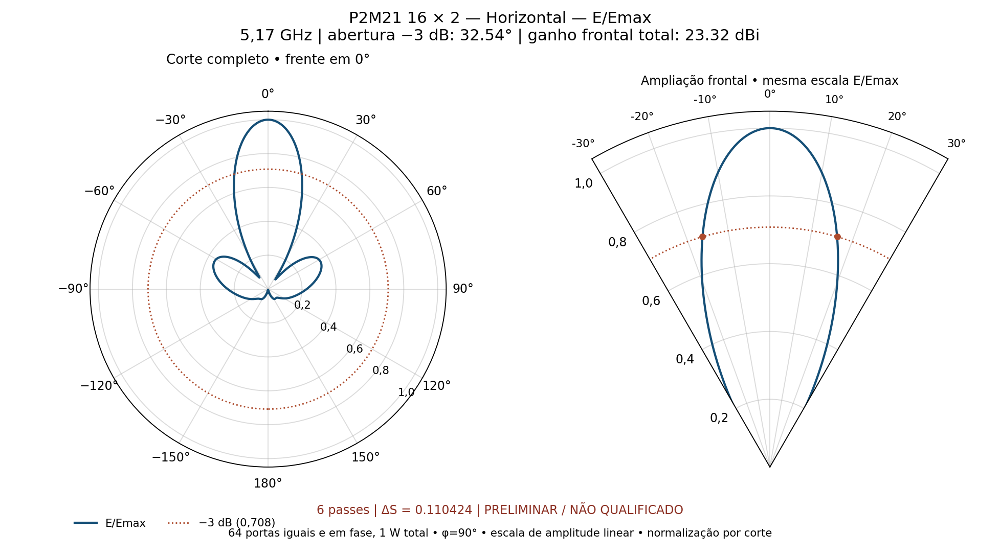
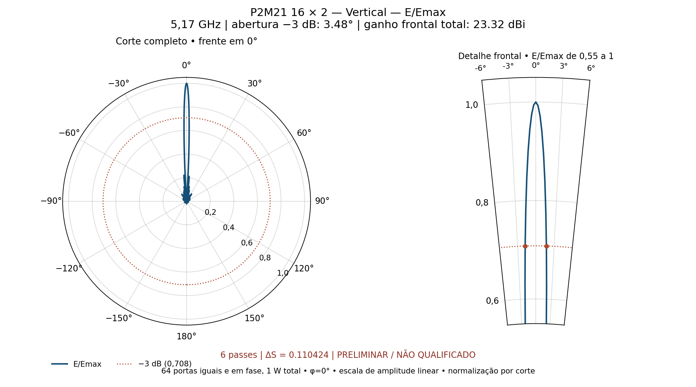

# P2M21 — continuação de quatro para seis passes

**PRELIMINAR / NÃO QUALIFICADO. NÃO CONVERGIU; ΔS final 0.110423576, referência 0,04.** Foram executados apenas os passes adicionais 5 e 6, preservando os quatro anteriores. 5,17 GHz, 14 núcleos nos passes 3–6, sem sweep. Nenhuma mudança de geometria, materiais, alimentação ou controles iniciais de malha; o setup mudou somente mínimo/máximo de passes para seis.

| Grandeza | Quatro passes | Seis passes |
|---|---:|---:|
| Ganho frontal realizado total (dBi) | 23.063119 | 23.322669 |
| Abertura horizontal −3 dB (°) | 32.723210 | 32.542922 |
| Abertura vertical −3 dB (°) | 3.496073 | 3.484268 |
| ΔS | 0.617680996 | 0.110423576 |

O ganho observado supera 21 dBi. O valor só constitui um resultado numericamente qualificado quando convergência e verificações forem aprovadas; a classificação acima é a deste cálculo. As 64 portas diretas recebem 0,015625 W/0°, total 1 W incidente. Não há rede externa no modelo; não se trata de ganho MIMO por entrada.

## Diagramas polares de amplitude

Normalização por corte completo: `E/Emax = sqrt(|Eθ|² + |Eφ|²) / máximo`. A escala é amplitude linear de 0 a 1. A curva foi conferida contra `10^((G−Gmax)/20)`. A referência de −3 dB corresponde a E/Emax = 0,707946. A frente está em 0°, a grade angular tem passo de 0,25° e o diagrama vertical inclui detalhe frontal radial de 0,55 a 1. Os dois arquivos PNG foram enviados por email após revisão visual e numérica.

## Auditoria

Malha: 0 reparos Major e 0 Minor. Eficiência calculada: 100.424953%. Maior valor singular S: 0.423930217. Erro máximo de reciprocidade: 8.8599489e-05. As inconsistências permanecem registradas; não foram simetrizadas as matrizes nem truncadas eficiências para aprovar o resultado.

- reciprocidade: `{"max_abs_Sij_menos_Sji": 8.859948900518336e-05, "limite": 1e-06}`.
- eficiencia_H: `{"eficiencia_radiacao": 1.0042495316952746, "limite": 1.0001}`.
- eficiencia_V: `{"eficiencia_radiacao": 1.0042495316952746, "limite": 1.0001}`.

[CSV dos resultados](resultados_centro.csv) · [Comparação com quatro passes](comparacao_4_6.json) · [Auditoria](resultados/auditoria_centro.json) · [Convergência nativa](resultados/convergencia_centro.txt) · [HFSS](hfss/P2M21_Ganho_Diagrama.aedt)

O nativo e os dados compactos são arquivados; a malha e os campos volumétricos permanecem locais, fora do Git. O `.aedt` sozinho não restaura a solução FEM. Email enviado para **gecesars@gmail.com** em 9/11/2026 às 06:01 (Brasília), com os dois PNGs finais. Destinatário, assunto e anexos foram confirmados pela leitura da mensagem enviada. [Comprovante](email_enviado.json).
