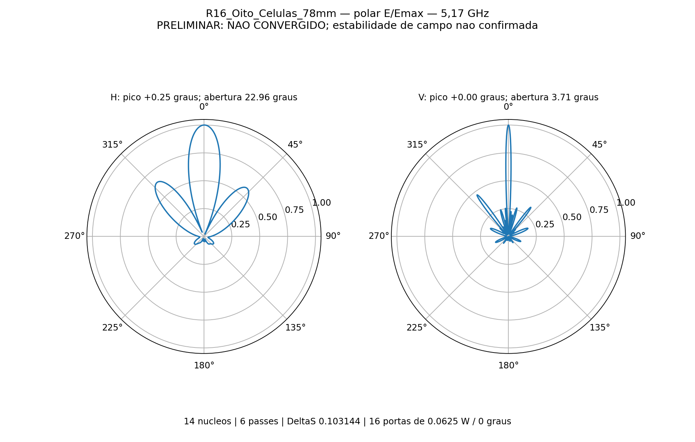

# R16_Oito_Celulas_78mm

Resultado em 5,17 GHz, 8 placas / 32 radiadores. 16 portas iguais em fase, 0.0625 W por porta, 1 W total. 14 nucleos, sem GUI, sem sweep. Cabos fisicos de 50 mm com perdas nominais; sem rede externa.

O ganho realizado inclui as perdas dieletricas do RO4350B (tan(delta) nominal 0,0037), inclusive nos dois divisores 1:4 impressos de cada PCB, as perdas dos condutores/cabos modelados e o descasamento. A futura distribuicao externa de duas entradas para as placas ainda nao faz parte deste modelo.

**Convergiu: False. Validado numericamente: False.** 6 passes; DeltaS 0.10314416; alvo 0,05; estabilidade das nove sondas: False. Ganho frontal total 19.47983 dBi.

| Corte | Abertura -3dB | Maximo | SLL frontal |
|---|---:|---:|---:|
| H | 22.9569 graus | +0.25 graus | -3.8525 dB |
| V | 3.7125 graus | +0.00 graus | -6.6156 dB |

VSWR ativo maximo 1.48352; com outras portas casadas 1.24403. Matriz passiva e reciproca, potencia e recomposicao de campos conferidas em resultado.json. O ganho se refere a todas as fontes coerentes, nao a uma entrada MIMO independente.

O nativo AEDT preserva a geometria e configuracao; as malhas/campos FEM restauraveis permanecem somente na pasta local de trabalho. Para usar outro caso de excitacao no HFSS, ajustar EditSources conforme oito_celulas_resolver.py. Os nomes dos relatorios nao fixam sozinhos as fontes; o arquivo foi salvo com todas ativas.
