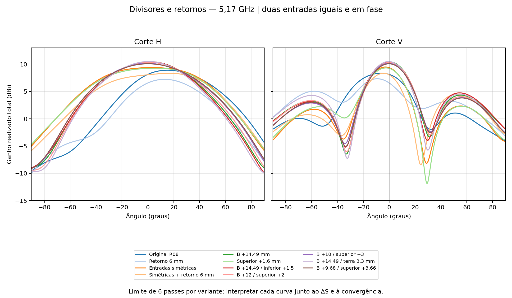
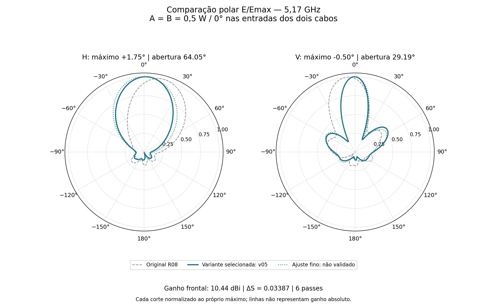
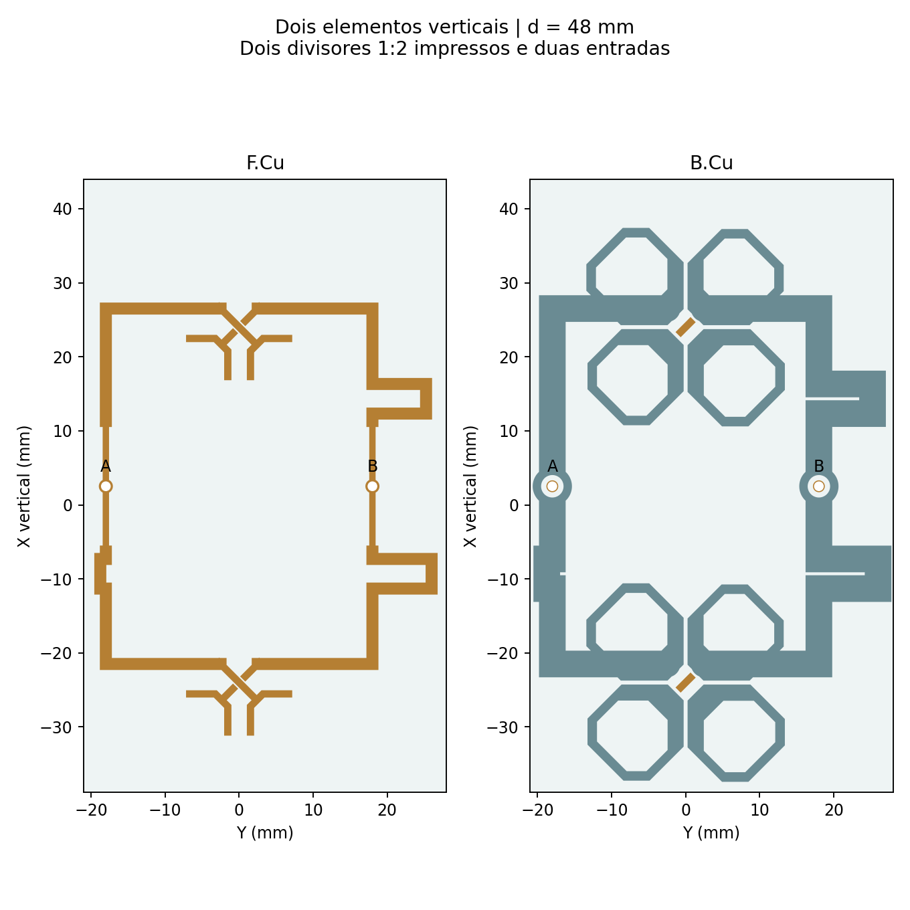

# Dois elementos: ensaios de divisores e retorno de terra

Estudo HFSS de 9/11/2026. Foram comparadas 10 alterações com a referência R08, usando a mesma instância GUI.
Dois elementos verticais separados por 48 mm, dois divisores impressos 1:2, dois cabos físicos de 50 mm, PCB RO4350B de 0,76 mm e refletor de alumínio de 2 mm. Sem apoios plásticos.
As duas entradas externas permaneceram em 0,5 W / 0°, total de 1 W. Frequência única de 5,17 GHz, sem sweep. Classic automático, sem operações locais de refinamento, máximo de 6 passes por geometria, alvo ΔS = 0,04 e dois passes consecutivos. 14 núcleos no perfil do solver.

Variante selecionada: **v05_B_longo_inferior_15**. Ganho frontal **10.442 dBi**; máximos H **+1.75°** e V **-0.50°**. Aberturas H **64.05°**, V **29.19°**. VSWR ativo A/B **1.218/1.274**. ΔS **0.033874**, 2 passes consecutivos aprovados.

Com a outra entrada casada, o VSWR da selecionada é A/B **1.119/1.520**; B ainda excede 1,5. O bom casamento ativo com ambas em fase não comprova o mesmo casamento em operação MIMO independente.

O ajuste de melhor apontamento foi **v09_B968_superior366**: H **+0.25°**, V **-0.25°**, ganho **10.075 dBi**, VSWR ativo **1.186/1.063**. ΔS final **0.022250**, mas somente **1 de 2 passes consecutivos**; fica preservado como candidato de ajuste, não como solução validada.

**A meta de máximo exatamente em 0° nos dois cortes ainda não foi atingida.** A variante escolhida é a melhor combinação testada de apontamento, convergência e casamento; não é uma declaração de otimização global.

| Variante | G frontal dBi | Pico H ° | Pico V ° | H ° | V ° | VSWR A/B ativo | ΔS | Convergência |
|---|---:|---:|---:|---:|---:|---|---:|---|
| R08_Dois_Verticais_Sem_Suportes | 8.128 | +15.25 | -6.25 | 64.41 | 43.74 | 1.071/2.510 | 0.089318 | Não |
| v00_terra6 | 6.561 | +13.00 | -9.25 | 57.78 | 37.89 | 1.932/1.414 | 0.077420 | Não |
| v01_central | 9.366 | +3.00 | -3.00 | 89.66 | 29.16 | 1.668/1.654 | 0.028829 | Não |
| v02_central_terra6 | 8.061 | +16.75 | -4.25 | 90.74 | 28.39 | 1.625/1.771 | 0.043763 | Não |
| v03_B_longo | 10.430 | +1.75 | +0.25 | 64.76 | 29.80 | 1.222/1.262 | 0.056490 | Não |
| v04_superior_16 | 9.235 | +5.75 | -2.50 | 88.17 | 29.72 | 1.373/1.428 | 0.020397 | Sim |
| v05_B_longo_inferior_15 | 10.442 | +1.75 | -0.50 | 64.05 | 29.19 | 1.218/1.274 | 0.033874 | Sim |
| v06_B12_superior2 | 10.330 | +1.00 | +0.25 | 66.89 | 29.97 | 1.145/1.168 | 0.035487 | Não |
| v07_B10_superior3 | 10.156 | -0.50 | -0.50 | 71.50 | 30.70 | 1.147/1.082 | 0.050980 | Não |
| v08_B145_inferior05_terra33 | 10.487 | +0.75 | -0.50 | 62.20 | 28.87 | 1.321/1.073 | 0.063629 | Não |
| v09_B968_superior366 | 10.075 | +0.25 | -0.25 | 73.15 | 30.53 | 1.186/1.063 | 0.022250 | Não |

As versões v01, v06 e v09 chegaram a ΔS < 0,04 no último passe, mas somente em um passe consecutivo. O indicador genérico do HFSS mostrou “Yes”; a auditoria mantém reprovação porque o setup exige dois consecutivos. Nenhuma execução excedeu seis passes.

As entradas originalmente estavam em X = 17 mm para A e X = 2,509 mm para B, com caminhos diferentes. Nos novos desenhos centrais, ambas ficam em X = 2,509 mm, Y = ±18 mm. O alargamento isolado do retorno nominal de 3,6 para 6 mm não melhorou os diagramas; reposicionar as conexões e equilibrar os caminhos trouxe a maior melhora inicial. Os ensaios de fase acrescentaram meandros nas trilhas mantendo as fases externas iguais.

Os resultados apoiam a hipótese de participação da alimentação/retorno na assimetria. Não provam que o terra é a causa única: mudar seu contorno também modifica impedância, acoplamento e fase elétrica, e algumas variantes não convergiram. Igual comprimento geométrico não garante igualdade elétrica.

Na selecionada, o ganho em 0° está 0.01033 dB abaixo do pico horizontal e 0.00346 dB abaixo do pico vertical. Esses déficits pequenos não autorizam arredondar os ângulos para zero.

Todos os CADs passaram nas verificações de sólidos/interseções e de curtos planares. A soma complexa dos campos individuais reproduziu o caso A+B; matrizes passivas e reparos de malha foram auditados. Os resultados são do módulo de dois elementos, não do painel 16×2 ou de ganho MIMO por entrada. Não houve nova cotação nem envio de email.

Os nativos HFSS, FreeCAD, geometria JSON, matrizes S e cortes exportados estão nas pastas de variantes. Foram excluídos resultados volumétricos, malhas, locks e temporários. O arquivo AEDT sem a pasta aedtresults preserva o modelo, mas não a solução FEM restaurável. O diretório local de trabalho mantém a solução completa.

Trabalho local: `D:/dev/EMBRAER/P2M21/R09_Divisor_Simetria`. Os scripts geradores e de análise estão em `../automacao/divisor_variantes_*.py`; os scripts de criação CAD/HFSS derivados estão em `reproducao/`. A geometria e os parâmetros em JSON registram cada ensaio.
