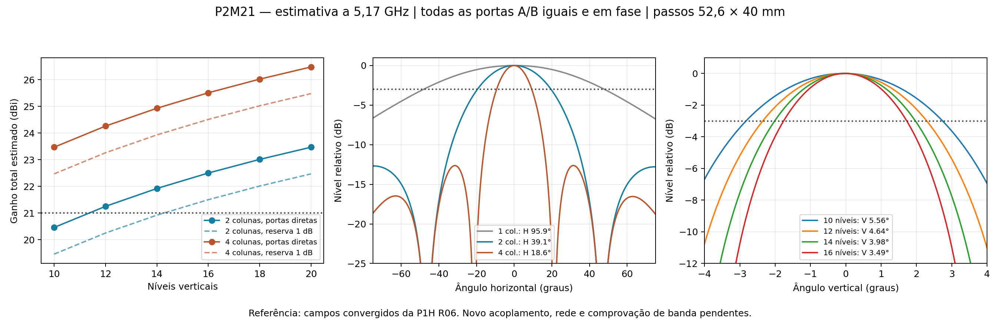
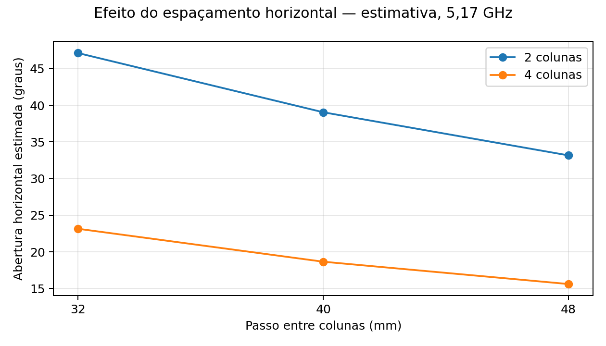

# Dimensionamento com todas as portas em fase — 9/11/2026

**Recomendação inicial: manter 16 níveis × 2 colunas** para a próxima correção de malha. A estimativa dá 22,50 dBi de ganho frontal total realizado, H de 39,1° e V de 3,49° em 5,17 GHz, antes da rede de alimentação. A alternativa 10×2 fica em aproximadamente 20,46 dBi; não oferece margem para a meta de 21 dBi.

## Excitação e referência

Todas as portas A e B de todos os radiadores têm **igual amplitude e fase de 0°**, com soma das potências incidentes normalizada em **1 W**. Para N níveis e M colunas há N×M radiadores e 2×N×M portas. Cada porta recebe 1/(2NM) W. Em 10×2 são 40 portas a 25 mW; em 16×2 são 64 portas a 15,625 mW. Não se adiciona um bônus de 3 dB simplesmente por ativar a segunda polarização: os campos são somados como números complexos e o ganho é dividido pela potência incidente total. A [documentação HFSS de potência incidente](https://ansyshelp.ansys.com/public/views/secured/electronics/v252/en/Subsystems/HFSS/Content/HFSS/IncidentPower.htm) descreve essa referência das excitações modais.

A referência é a **PCB P1H R06 convergida**, de dez radiadores em uma coluna, sem a rede externa: 20 portas diretas, 0,05 W a 0° em cada porta. Seus 40 cortes de campos complexos H/V foram recompostos com pesos 1/√20. A conferência contra os cortes nativos HFSS teve erro máximo menor que 7×10⁻¹³ dB. A referência resultou em **17,4483 dBi, H 95,9209° e V 5,5605°**. O resultado não vem da P2M21 R00, que não convergiu.

## Comparação em 5,17 GHz

Passos entre centros: **52,6 mm na vertical e 40 mm na horizontal**. H e V são larguras a −3 dB. O ganho inclui as perdas e o descasamento presentes na PCB de referência, mas exclui a nova rede e os cabos.

| Níveis × colunas | Radiadores / portas | Ganho total estimado | Horizontal | Vertical | Área ativa da PCB, altura × largura |
|---|---:|---:|---:|---:|---:|
| 10 × 2 | 20 / 40 | 20,46 dBi | 39,1° | 5,56° | 501,7 × 68,3 mm |
| 12 × 2 | 24 / 48 | 21,25 dBi | 39,1° | 4,64° | 606,9 × 68,3 mm |
| 14 × 2 | 28 / 56 | 21,92 dBi | 39,1° | 3,98° | 712,1 × 68,3 mm |
| **16 × 2** | **32 / 64** | **22,50 dBi** | **39,1°** | **3,49°** | **817,3 × 68,3 mm** |
| 18 × 2 | 36 / 72 | 23,01 dBi | 39,1° | 3,10° | 922,5 × 68,3 mm |
| 20 × 2 | 40 / 80 | 23,47 dBi | 39,1° | 2,79° | 1027,7 × 68,3 mm |
| 10 × 4 | 40 / 80 | 23,47 dBi | 18,6° | 5,56° | 501,7 × 148,3 mm |
| 12 × 4 | 48 / 96 | 24,26 dBi | 18,6° | 4,64° | 606,9 × 148,3 mm |

As dimensões ativas não incluem margens do refletor, abas, conectores ou radome. A geometria R00 de 16×2 já dispõe de face refletora de 850×100 mm.

## Escolha recomendada

**12×2 é o primeiro caso dessa sequência que supera 21 dBi na estimativa direta**, mas a margem de apenas 0,25 dB é pequena para a distribuição. O caso 14×2 tem 0,92 dB antes da rede. Com um cenário de reserva de 1 dB, esses dois casos ficariam em 20,25 e 20,92 dBi, respectivamente.

**16×2 oferece 1,50 dB de margem direta**, ou cerca de 21,50 dBi após uma reserva hipotética de 1 dB. Essa reserva é uma escolha de dimensionamento, não uma perda simulada. A configuração aproveita os quatro módulos radiantes 2×4 e as distribuidoras duplas 1:4/1:8 já desenhadas. Os divisores convergiram separadamente, mas o casamento e a perda da rede carregada pelas antenas continuam pendentes.

Se a prioridade for reduzir a altura, **10×4** é uma alternativa: aproximadamente 0,50 m de altura ativa, ganho estimado de 23,47 dBi e feixe horizontal de 18,6°. Usa mais radiadores, aumenta a largura e exige redimensionar a distribuição. O caso 20×2 tem o mesmo número de radiadores e a mesma escala de ganho, mas concentra o estreitamento na vertical.

O passo horizontal também muda a abertura. Foram comparados 32, 40 e 48 mm para duas e quatro colunas. O ganho de contagem foi mantido nessa varredura; não se calculou a mudança de eficiência por acoplamento. A [tabela completa](comparacao_completa.csv) registra 36 combinações.

## Método e limites

A escala frontal usada é **G(N,M) ≈ G(10,1) + 10 log₁₀(NM/10)**. Os cortes são multiplicados por fatores de arranjo normalizados para potência total constante. Na horizontal aplica-se o fator das M colunas; na vertical substitui-se o fator de dez níveis pelo de N níveis, preservando o padrão efetivo inferido da R06. A divisão pelo fator de dez níveis é restrita a ±4°, longe dos seus nulos, suficiente para o lóbulo principal dos casos N≥10. Não se usou essa extrapolação para prever lóbulos laterais verticais.

Os dados nativos têm passo angular de 0,25°. A interpolação PCHIP auxilia a localizar os cruzamentos de −3 dB; não aumenta a resolução física da simulação. Os números são apresentados como estimativas, não como tolerâncias de fabricação.

A aplicação do fator de arranjo pressupõe padrões de referência preservados. O novo acoplamento entre colunas, diferenças de posição, emendas, largura do substrato/refletor e o casamento podem alterar ganho e diagrama. A [Ansys documenta essas limitações do fator de arranjo e da normalização de ganho](https://ansyshelp.ansys.com/public/views/secured/electronics/v251/en/subsystems/hfss/Content/HFSS/ArrayFactorCalculation.htm).

**Esta estimativa é em 5,17 GHz, com todas as portas coerentes.** Não qualifica os 17 pontos de 5,09–5,25 GHz, o VSWR final nem o ganho MIMO por entrada com a outra casada. A comparação solicitada antecede a correção de malha; nesta etapa não se alterou o CAD, não se iniciou novo solve e não se mudou o limite de seis passes/ΔS de 2%.

[Dados, fórmulas e hashes dos campos usados](metodo_e_resultados.json) · [Script reproduzível](../automacao/estimar_uniforme.py) · [Tabela com passo horizontal de 40 mm](comparacao_40mm.csv)
