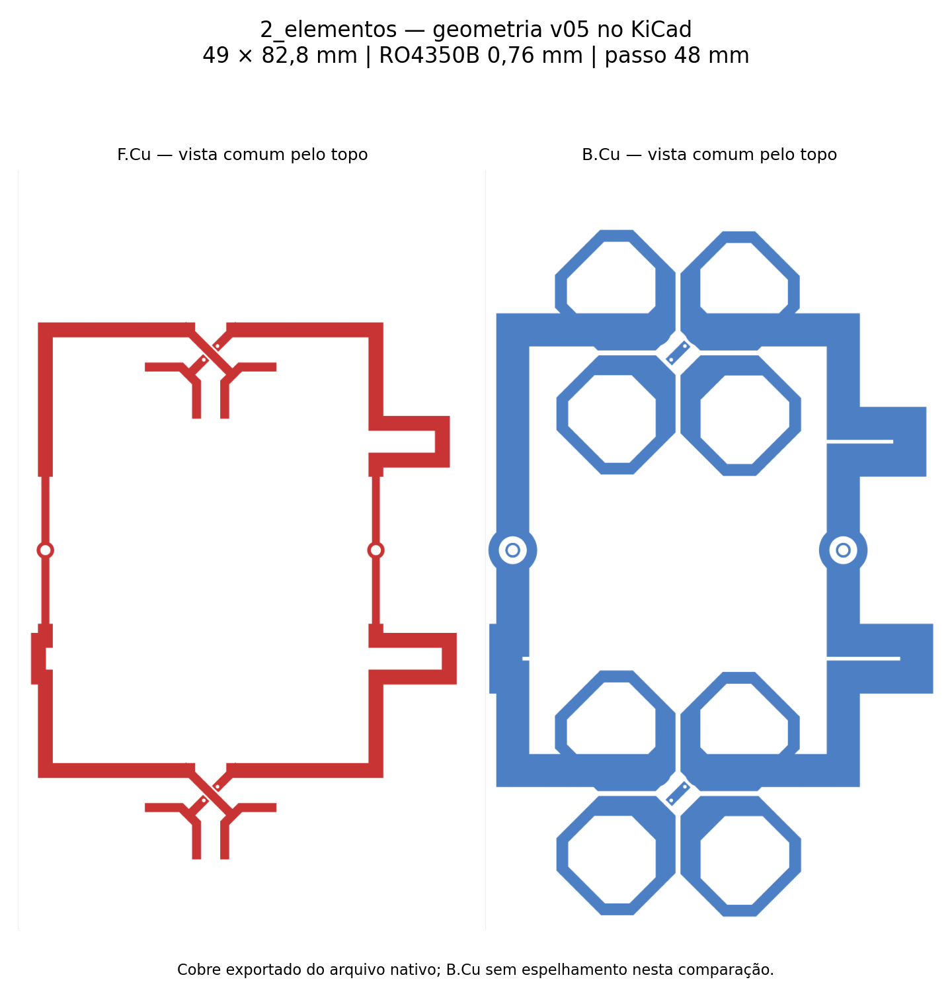

# 2_elementos — placa KiCad da variante v05

Placa editável criada em 9/11/2026 no KiCad 10.0.5, a partir da **v05_B_longo_inferior_15**, a melhor combinação convergida de apontamento e casamento ativo do estudo de dois elementos. O arquivo solicitado é [2_elementos.kicad_pcb](2_elementos.kicad_pcb); o projeto é [2_elementos.kicad_pro](2_elementos.kicad_pro).

## Geometria preservada

| Item | Valor |
|---|---|
| Placa | 49 mm de largura × 82,8 mm de altura |
| Radiadores | Dois, verticais, separados por 48 mm entre centros |
| Alimentação | Duas conexões coaxiais A/B; um divisor 1:2 impresso por polarização |
| Núcleo | RO4350B, 0,76 mm; εr de projeto 3,66; tanδ 0,0037 |
| Cobre | 35 µm em cada face; acabamento ENIG |
| Espessura nominal no KiCad | 0,83 mm = núcleo + duas folhas de cobre, sem incluir o acabamento |
| Máscara e legenda | Máscara aberta em ambas as faces; identificação somente em F.Fab |
| Conexões externas | J1 = A; J2 = B; pad 1 = vivo; pad 2 = referência de blindagem na área de retorno B.Cu |
| Furos metalizados | Dois de Ø1,10 mm nas entradas e quatro vias de Ø0,40 mm, com pad Ø0,726 mm |
| Folga mínima entre redes de cobre | 0,188750 mm |

Foram preservados o alinhamento dos pontos de conexão, os meandros de compensação, os retornos A/B e as ilhas radiantes da v05. Os retornos não foram transformados em um plano de terra comum. Os pads de identificação das blindagens estão inteiramente dentro do cobre que já existia no HFSS.

A transformação de coordenadas é uma rotação no plano: KiCad X = 80 + HFSS Y e KiCad Y = 110 − HFSS X, em milímetros. Os polígonos RF são desenhos de cobre editáveis com redes atribuídas; pads e vias são objetos elétricos nativos. Esta entrega é uma placa derivada de geometria EM, sem esquemático lógico associado.

## Conferências realizadas

- Reabertura do arquivo nativo no KiCad e leitura das coordenadas, pads e vias.
- Comparação do cobre por camada/rede com a geometria efetiva HFSS, incluindo anilhas e furos: distância máxima de Hausdorff **0,000001 mm** (1 nm), compatível com a resolução numérica da conversão; não é tolerância de fabricação.
- Diferença máxima de área por rede: **0,00001628 mm²**.
- Continuidade das redes SIG_A, SIG_B, RET_A e RET_B conferida por polígonos e vias; sem curtos entre redes diferentes e cobre dentro do contorno.
- **DRC: zero erros e zero itens desconectados.** Os **138 avisos** são exclusivamente `solder_mask_bridge`: a abertura total da máscara alcança redes diferentes, por intenção de reproduzir o modelo RF sem máscara. Isso não significa ponte de cobre.
- Imagens das faces exportadas diretamente do arquivo KiCad e revisadas. Gerber e Excellon exportados; mapa de furação com quatro vias e duas entradas, sem furos não metalizados.

Evidências: [verificacao.json](verificacao.json), [DRC completo](drc.json), [leitura do nativo](leitura_kicad.json) e [manifesto de arquivos](manifesto.json).

## Relação com os resultados RF

A referência v05 foi simulada com refletor de alumínio de 2 mm, face inferior do núcleo em Z = 16,61 mm, dois cabos físicos de 50 mm e sem apoios plásticos. Com A/B = 0,5 W / 0°, em 5,17 GHz, obteve ganho frontal total de **10,4416 dBi**, máximos H **+1,75°** e V **−0,50°**, aberturas **64,0467° × 29,1947°**, VSWR ativo **1,2182 / 1,2738** e ΔS final **0,033874**, após seis passes e dois consecutivos aprovados.

Esses valores pertencem à simulação de referência, não a uma nova simulação desta entrega KiCad. O máximo exatamente em zero grau não foi comprovado. Com a outra entrada casada, o VSWR da referência é **1,1193 / 1,5203**; portanto B ainda supera 1,5 nessa condição. A placa não comprova o desempenho do painel 16×2 nem a banda completa.

[Estudo HFSS e dez variantes](../../dois_verticais_divisor/README.md).

## Arquivos e reprodução

- [Projeto KiCad](2_elementos.kicad_pro) e [placa](2_elementos.kicad_pcb).
- [Pacote Gerber/Excellon](2_elementos_gerbers.zip) e arquivos individuais em `gerbers/`.
- [Gerador](../../automacao/dois_elementos_kicad.py), executado com o Python do KiCad.
- [Comparação geométrica](../../automacao/dois_elementos_conferir.py), executada com Python 3.12, Shapely, CairoSVG e Matplotlib.

Os Gerbers preservam a ausência de máscara e serigrafia do ensaio RF. A revisão de fabricação deve especificar **núcleo de 0,76 mm**, cobre e acabamento; a soma nominal de 0,83 mm não substitui a espessura acabada contratada com a fábrica. Não houve nova cotação ou compra nesta entrega.

Próxima configuração: [planejamento de quatro elementos verticais e dois divisores 1:4](../../planejamento/4_elementos/README.md).
