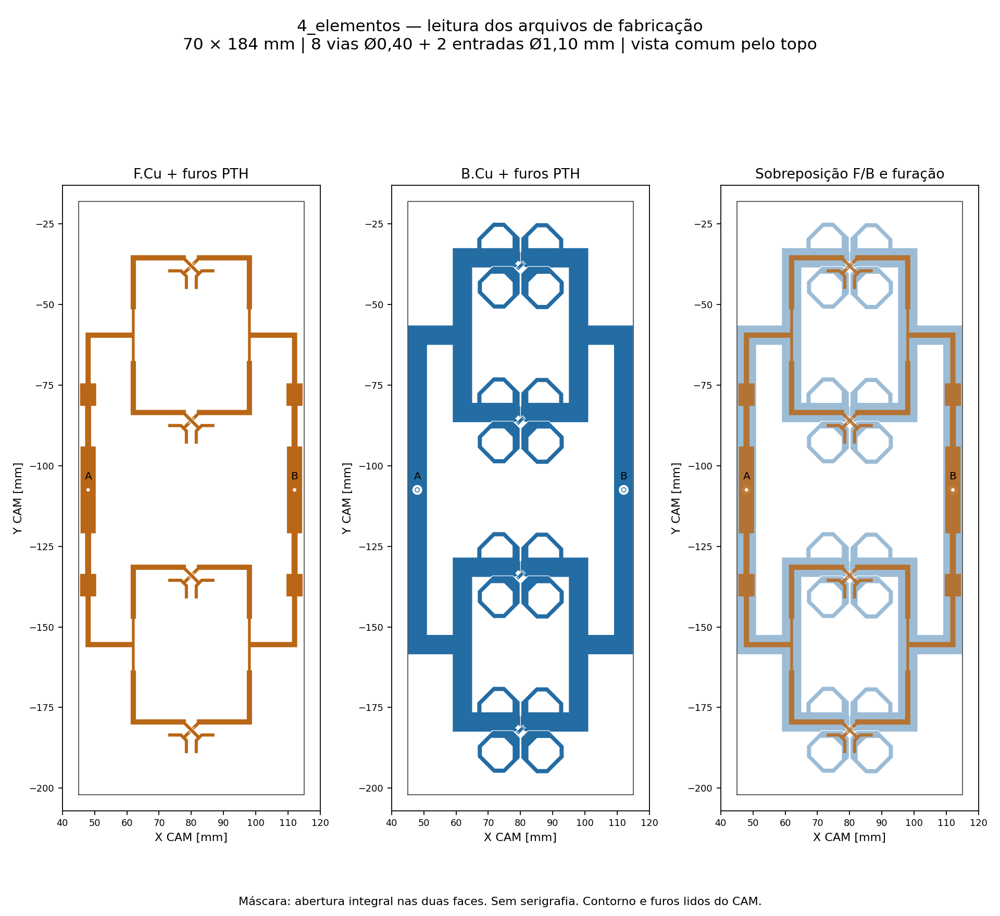

# 4_elementos — KiCad e Gerbers da geometria HFSS R13 C12

Criada em **10/11/2026**, no **KiCad 10.0.5**, como cópia da geometria efetiva da variante **c12_raiz_intermediaria**. A conversão preserva dipolos, transformadores, retornos, vias, entradas e contorno; não executa nova simulação nem altera o casamento ou o apontamento.

- [Abrir projeto KiCad](4_elementos.kicad_pro) · [Placa editável](4_elementos.kicad_pcb).
- **[ZIP Gerber/Excellon para JLCPCB](4_elementos_gerbers_JLCPCB.zip)** · [Especificação de fabricação](FABRICACAO_JLCPCB.txt).
- [Fonte HFSS/FreeCAD e resultados RF](../../quatro_elementos_casamento_banda/README.md).

## Placa e stackup

| Item | Valor preservado |
|---|---|
| Dimensões | **70 × 184 mm**, uma placa |
| Radiadores | Quatro, verticais, passo **48 mm** |
| Distribuição | Duas entradas A/B; um divisor 1:4 impresso por polarização |
| Laminado | **RO4350B, núcleo de 0,76 mm**; εr de projeto 3,66; tanδ 0,0037 |
| Cobre e acabamento | **35 µm por face**, ENIG; nominal HFSS NiP 4,5 µm / Au 0,0254 µm |
| Espessura nominal no KiCad | **0,83 mm** = núcleo + cobre, sem acabamento |
| Máscara/serigrafia | Máscara integralmente aberta nas duas faces; sem serigrafia de fabricação |
| Entradas | J1/A e J2/B, PTH **Ø1,10 mm**, pad **Ø1,60 mm** |
| Vias | Oito PTH **Ø0,40 mm**, pad **Ø0,726 mm**, sem preenchimento |
| Redes | SIG_A, SIG_B, RET_A, RET_B; retornos separados |
| Folga mínima entre redes | **0,188750 mm** |
| Folga cobre–borda | **0,200000 mm** |

Os transformadores de raiz mantêm três seções, iguais para A/B: **4,718844821 × 13,470226856 mm**, **1,863928087 × 12,592315588 mm** e **5,000000000 × 6,993442169 mm** (largura × comprimento). Os transformadores locais mantêm **0,860432596 × 8,816343958 mm**. Os polígonos completos têm prioridade sobre esses valores arredondados de leitura.

Os polígonos RF são desenhos de cobre editáveis com redes atribuídas; vias e pads são objetos elétricos nativos. Não há esquemático associado. Pad 1 é o vivo do coaxial; pad 2 apenas identifica a rede da blindagem dentro de cobre B.Cu já existente. Não foram acrescentados furos mecânicos, planos de massa, resistores, fiduciais ou texto no cobre.

Coordenadas: **KiCad X = 80 + HFSS Y; KiCad Y = 110 − HFSS X**, em mm. Nos Gerbers, o eixo Y aponta para cima: X = 80 + HFSS Y; Y = HFSS X − 110. Todos os arquivos CAM compartilham a origem, sem espelhamento adicional.

## Verificação da conversão

O arquivo `.kicad_pcb` foi salvo, reaberto e lido pelo KiCad. A auditoria independente compara cada camada/rede com `geometria.json`, incluindo as anilhas e os furos que `criar_cad.py` acrescenta ao modelo EM.

- **Cobre nativo:** erro máximo de Hausdorff **0,000001415 mm** (aproximadamente 1,4 nm); diferença máxima de área por rede **0,000056471 mm²**.
- **Gerbers reais:** erro máximo de Hausdorff **0,000001415 mm**; diferença máxima de área por face **0,000100766 mm²**. Foram lidos os comandos X2, não apenas examinados os nomes dos arquivos.
- **Furação Excellon:** oito vias e duas entradas, sem NPTH; erro máximo radial de arredondamento **0,000582469 mm**. O exportador decimal nativo do KiCad usa grade de 0,001 mm para furos; a geometria nativa e o cobre Gerber usam resolução de 0,000001 mm. Isso é precisão de arquivo, não tolerância de fabricação.
- Continuidade das quatro redes confirmada, sem curtos; cobre dentro do contorno fechado de 70 × 184 mm; aberturas de máscara cobrem exatamente a placa.
- **DRC: zero erros e zero itens desconectados.** Os **204 avisos** são exclusivamente `solder_mask_bridge`, esperados porque a máscara aberta abrange redes diferentes. Não são pontes de cobre.
- As duas faces e a sobreposição com contorno/furos foram renderizadas dos arquivos efetivamente exportados e revisadas visualmente.

Evidências: [leitura KiCad](leitura_kicad.json), [comparação por rede](verificacao.json), [DRC completo](drc.json), [auditoria Gerber/Excellon](verificacao_gerbers.json), [manifesto e hashes](manifesto.json).

## Condições para fabricar na JLCPCB

Usar o ZIP e as [notas de fabricação](FABRICACAO_JLCPCB.txt), com **RO4350B e núcleo de 0,76 mm**. A oferta pública de alta frequência da JLCPCB inclui duas camadas, cobre de 1 oz e ENIG; a espessura acabada de 0,9 mm deve ser distinguida da espessura do núcleo e dos 0,83 mm nominais no KiCad. A capacidade anunciada para RF indica furo mínimo de 0,2 mm e trilha/espaço de 0,10/0,10 mm. [JLCPCB — alta frequência](https://jlcpcb.com/pcb-fabrication/high-frequency-pcb).

O processo de metalização deve ser confirmado ao encomendar: o modelo usou parede de furo nominal de 35 µm, enquanto a tabela geral da JLCPCB publica média de 18 µm. ENIG, núcleo e espessuras reais também têm tolerâncias; os Gerbers não garantem esses parâmetros. Não substituir material ou redimensionar trilhas automaticamente. [JLCPCB — capacidades](https://jlcpcb.com/capabilities/pcb-capabilities). Fontes consultadas em 10/11/2026.

O ZIP contém cinco camadas Gerber, Excellon PTH e NPTH vazio, além das notas. O `.gbrjob` bruto permanece como evidência em `gerbers/`, fora do ZIP: a dimensão automática inclui o traço de contorno de 0,05 mm e a espessura é a soma nominal do CAD. O contorno de usinagem é a linha central de `Edge_Cuts`, com **70 × 184 mm**. Sem stencil, BOM/CPL ou montagem automática. Não foi feita nova cotação, upload ou compra.

## Estado RF da versão preservada

Na simulação C12, com as duas entradas **0,5 W / 0°**, em **5,17 GHz**:

| Grandeza | Resultado |
|---|---:|
| Ganho frontal realizado total | **12,4566 dBi** |
| Aberturas H / V | **72,0547° / 15,1827°** |
| Máximos H / V | **+0,75° / −0,25°** |
| VSWR ativo A / B no centro | **1,22733 / 1,23503** |
| Pior VSWR ativo confirmado na banda | **1,23548** |
| Pior VSWR com outra entrada casada, na banda | **1,23260** |

O VSWR ≤1,25 foi atendido numericamente entre 5,09 e 5,25 GHz, com Fast de 161 pontos de saída, conferência discreta em 5,09/5,17/5,25 GHz e em 5,173 GHz. **A tolerância atual de apontamento é ±0,5° nos dois cortes: H reprova e V atende.** Esta cópia preserva exatamente a versão solicitada e não representa uma correção desse desvio. [Registro da tolerância atual](aceite_atual.json).

Referência convergida em seis passes, ΔS final 0,016719, 14 núcleos. Ganho e diagramas só foram medidos em 5,17 GHz. O modelo inclui dois cabos físicos retos de 50 mm, soldas e refletor de alumínio **90 × 200 × 2 mm**, com face inferior do dielétrico **14,949 mm** acima do refletor (face inferior do cobre: **14,914 mm**). Esses itens são montagem externa e não entram nos Gerbers. [Montagem FreeCAD de referência](../../quatro_elementos_casamento_banda/c12_raiz_intermediaria/4_elementos.FCStd).

Não há ensaio de protótipo nem estudo de tolerâncias de fabricação. Os resultados pertencem ao módulo de quatro elementos e não qualificam o painel 16×2 ou o ganho MIMO por entrada.

## Reprodução

Executar [quatro_elementos_exportar.ps1](../../automacao/quatro_elementos_exportar.ps1). O fluxo usa o Python do KiCad para gerar/reabrir o nativo, `kicad-cli` para DRC/Gerber/Excellon/SVG e Python 3.12 com Shapely, CairoSVG e Matplotlib para as conferências. Fontes: [gerador](../../automacao/quatro_elementos_kicad.py), [auditoria geométrica](../../automacao/quatro_elementos_conferir.py), [auditoria CAM](../../automacao/quatro_elementos_gerbers.py), [empacotador](../../automacao/quatro_elementos_empacotar.py). A revisão visual das imagens deve ser repetida após qualquer regeneração.
