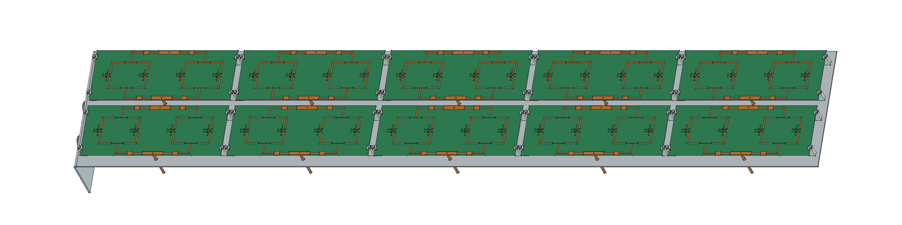

# P2M21 R18 — mecânica PRELIMINAR

Dez placas C12 de quatro elementos, cinco por coluna: 20 níveis × 2 colunas, passo vertical 48 mm e horizontal 78 mm. Face refletora 968 × 162 mm, alumínio 5052 de 2 mm, base dobrada e dois conectores N Amphenol 082-6784, a partir do STEP fornecido pelo usuário. Os 410 objetos das células foram preservados.

**Simulações interrompidas por solicitação do usuário. Nenhuma qualificação RF da R18.** O último cálculo completo de oito placas/72 mm entregou 19,8469 dBi com ΔS 0,050015, sem convergência. O caso de oito placas/78 mm deu 19,4798 dBi e ΔS 0,103144, também preliminar. O ensaio de dez placas foi interrompido durante o segundo passe, sem resultado final.

- [Documentação ilustrada](P2M21_R18_Documentacao_PRELIMINAR.pdf)
- [Três pranchas A3](P2M21_R18_Desenhos_PRELIMINARES_A3.pdf)
- [Montagem FreeCAD](P2M21_R18_PRELIMINAR.FCStd)
- [Refletor dobrado](Refletor_dobrado_PRELIMINAR.FCStd) · [STEP](Refletor_dobrado_PRELIMINAR.step)
- [Planificação](Refletor_planificado_PRELIMINAR.FCStd) · [Corte DXF 1:1](Refletor_CORTE_PRELIMINAR_1a1.dxf) · [Dobras DXF](Refletor_DOBRA_PRELIMINAR_1a1.dxf)
- [Grampo POM](Grampo_POM_PRELIMINAR.FCStd) · [BOM CSV](lista_materiais_PRELIMINAR.csv) · [Furação](furacao_refletor_PRELIMINAR.csv)
- [Dimensões](dimensoes.json) · [Verificação CAD](verificacao_cad.json)

Há quarenta grampos de POM de largura 5 mm, fixados com M2, sem perfurar as PCBs. O núcleo fica a 14,949 mm do refletor. A folga de retenção e as ferragens são propostas para protótipo, sem aprovação de resistência, vento ou tolerâncias. O desenvolvimento usa Ri=2 mm e K=0,4; confirmar na oficina antes de fabricar.

O cabo de referência é Micro-Coax UT-141C. Os vinte trechos de 50 mm são os do ensaio; as duas entradas retas de 459,25 mm são apenas propostas mecânicas. A soma de 1,9185 m não é a lista de corte ou compra final: faltam a distribuição externa, inserções e sobras. A região azul é **reserva de espaço**, sem placa ou rede RF fabricável. A topologia futura requer duas distribuições 1:10, vinte saídas no conjunto; a rede antiga de dez divisores 1:4 não foi reaproveitada como se atendesse esta configuração.

O Amphenol foi mantido por corresponder ao STEP disponível e à fixação documentada. Sua porca/arruela foi deslocada axialmente 4,25 mm da pose do STEP para a chapa de 2 mm. O original permanece em referencias. O CF-164 não é substituto direto: muda a fixação e exige conferir recorte e vedação. O IP67 de catálogo do N não qualifica o painel, cujo radome, tampa, suporte de mastro, bobinas de curto DC e chicote final ainda devem ser definidos.

O ganho realizado histórico inclui dielétrico das PCBs/divisores impressos, condutores, cabos físicos de 50 mm e descasamento; não inclui a futura rede externa. A R18 acrescenta dobra, suportes e conectores sem novo solve.

Esta montagem é BREP posicionado com scripts de reconstrução; não é um mecanismo com juntas cinemáticas. O Git contém nativos, documentação e evidências compactas, sem malhas ou campos volumétricos.

Fontes: [Amphenol 082-6784](https://www.amphenolrf.com/en-us/assets/file/4069129560/) e [UT-141C](https://www.micro-coax.com/wp-content/uploads/2024/12/micro-coax-ut-141c-datasheet.pdf), consultadas em 10/11/2026. Chat consultado: “Localizar conector N fêmea e cabo”.
