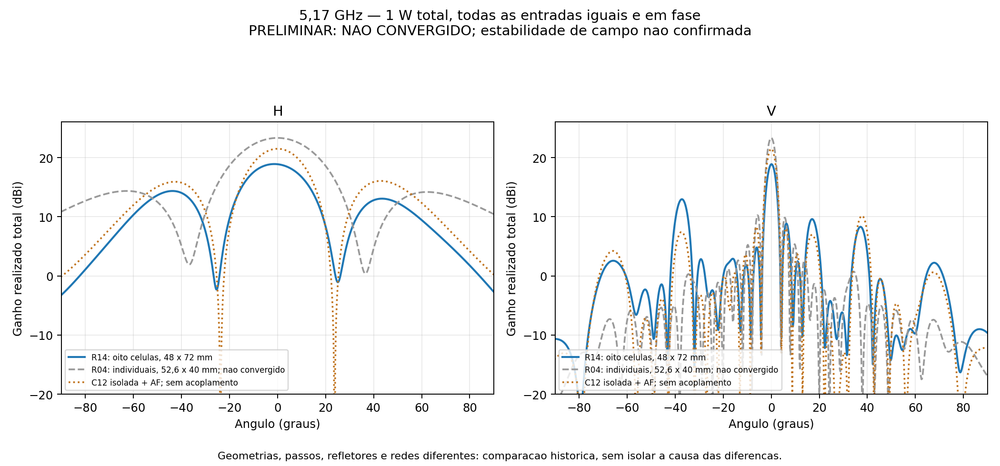
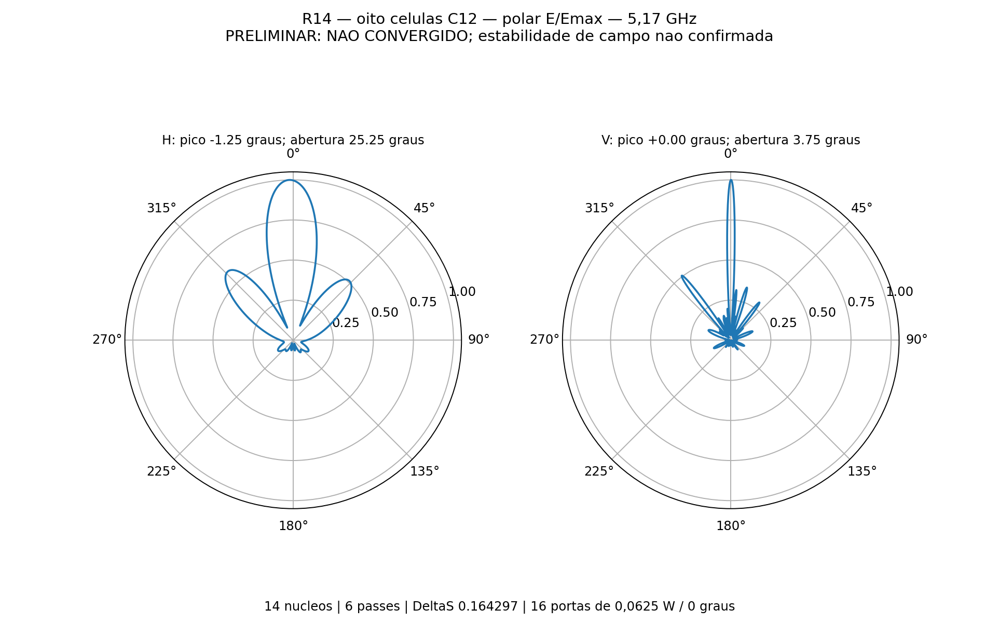
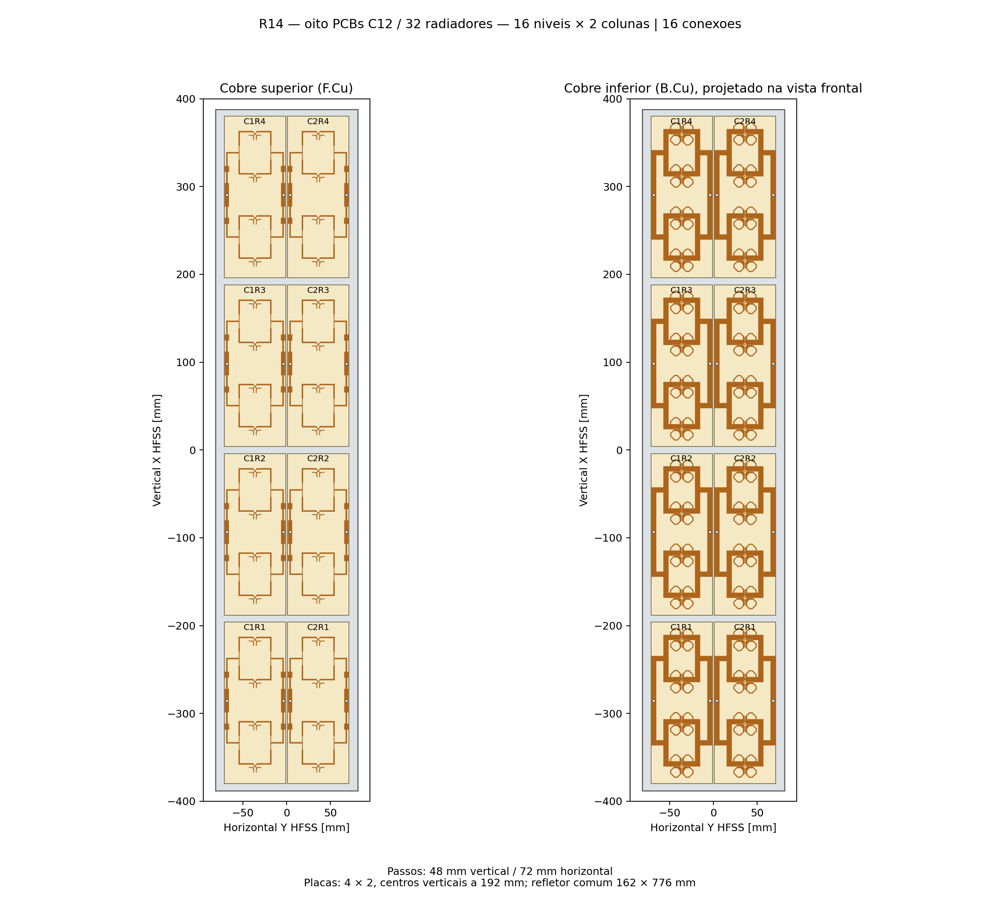
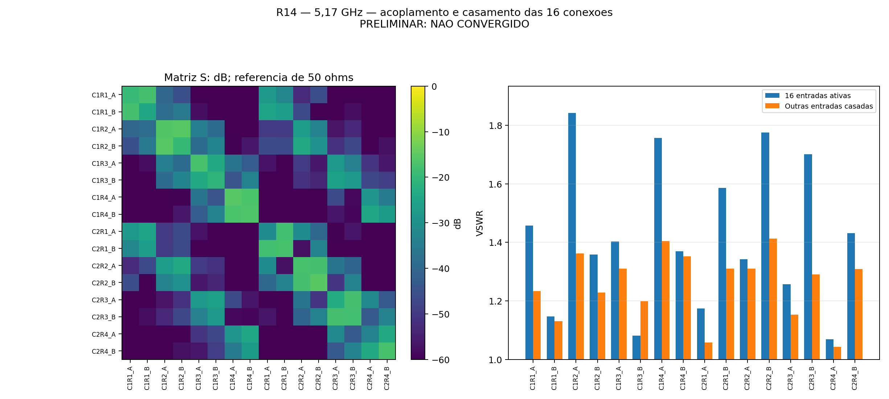

# R14 — oito placas 4_elementos como células do painel 16 × 2

Estudo de **10/11/2026**, **PRELIMINAR / NAO VALIDADO**. Resultado com todas as **16 portas a 0,0625 W / 0°**, total de **1 W incidente**, em **5,17 GHz**. **6 passes**, ΔS final **0.1642969**, alvo 0,05, limite seis, 0 passes consecutivos atendendo ao alvo. **14 núcleos**, sem GUI e sem sweep.

## Resultado e comparação solicitada

| Modelo | Ganho frontal total (dBi) | H −3 dB (°) | V −3 dB (°) | Pico H (°) | Pico V (°) |
|---|---:|---:|---:|---:|---:|
| R14_8celulas | 18.8776 | 25.2549 | 3.7541 | -1.25 | +0.00 |
| R04_individuais_nao_convergido | 23.3227 | 32.5429 | 3.4843 | +0.00 | +0.00 |

O ganho numérico total atinge 21 dBi: **nao**. Os dois máximos ficam dentro de ±0,5°: **nao**. SLL horizontal **-4.554 dB**; SLL vertical **-5.917 dB**, considerados os máximos locais no hemisfério frontal fora dos primeiros mínimos do lobo principal. Os picos são amostras da grade de 0,25°, não máximos 3D otimizados.

**A referência R04 com 64 portas individuais não convergiu**: ΔS 0,110424 e inconsistência de eficiência acima de 100%. Seus números são históricos, não uma referência validada. Além da modularização, mudaram passo vertical **52,6 → 48 mm**, horizontal **40 → 72 mm**, altura da PCB, refletor e presença dos divisores impressos/cabos. A comparação não atribui toda diferença à adoção das células.

A estimativa auxiliar usando o campo da C12 isolada e fator de arranjo previu **21,4875 dBi**, H **22,3252°**, V **3,8134°**. Ela não inclui acoplamento entre células nem o novo refletor. O resultado R14 acima provém do painel completo em FEM, não dessa estimativa.

## Modelo físico montado

Oito cópias da **C12 R13 / KiCad 4_elementos**, organizadas em **quatro níveis de placas × duas colunas**. Cada placa contém quatro radiadores e dois divisores 1:4 impressos, um por polarização. Resultam **16 níveis de radiadores × duas colunas = 32 radiadores**, com 16 conexões coaxiais.

| Parâmetro | Valor |
|---|---|
| Dimensões de cada PCB | 70 × 184 mm |
| Passo vertical dos radiadores | 48 mm, inclusive entre placas |
| Centros verticais das placas, X HFSS | −288, −96, +96, +288 mm |
| Centros horizontais, Y HFSS | −36, +36 mm; passo de 72 mm aprovado pelo usuário |
| Folgas entre placas | 8 mm vertical / 2 mm horizontal |
| Envolvente das oito PCBs | 142 × 760 mm |
| Refletor contínuo | Alumínio, 162 × 776 × 2 mm, 16 furos Ø4,2 mm para coaxiais |
| Face inferior do núcleo acima do refletor | 14,949 mm; cobre inferior em 14,914 mm |
| Cabos | 16 trechos retos de 50 mm, iguais aos da C12, com perdas físicas nominais |
| RO4350B | Núcleo 0,76 mm, εr 3,66 e tanδ 0,0037 |
| Metalização | Cu físico 35 µm; ENIG nominal Au 0,0254 µm / NiP 4,5 µm |
| Ausentes nesta etapa | Rede externa de distribuição, conectores N, apoios plásticos e radome |

As oito células mantêm a mesma orientação e a geometria dos sólidos C12; não foram espelhadas nem redesenhadas. Os oito refletores locais foram substituídos por uma chapa comum. O CAD tem **329 sólidos válidos**, **600 pares** de caixas sobrepostas examinados e **zero interseções indevidas**. O projeto foi reaberto para verificar persistência. A importação HFSS preservou nomes/quantidades por material e passou na validação nativa com 16 portas e sem erros de configuração.

## Alimentação, acoplamento e futura rede

Portas lumped em 50 Ω nas extremidades dos cabos, sem de-embedding, com sentido de integração idêntico ao da C12. Todas recebem igual onda incidente e fase zero. Há **oito conexões A e oito B**. O modelo resolve conjuntamente PCBs, redes impressas, cabos e refletor, incluindo o acoplamento entre as células. Não se trata de repetição periódica infinita.

Foram exportados **S16** e **32 cortes complexos embutidos**, H/V para cada porta a 1 W com as outras casadas, além dos casos com todas ativas e com cada grupo de polarização ativo. Estes dados preservam a interface para o próximo estudo de distribuição. Os grupos A/B usam oito fontes coerentes de 0,125 W, total de 1 W por ensaio, sem divisor externo real; não comprovam ganho MIMO por entrada do sistema acabado.

Os CSVs foram exportados após selecionar explicitamente as fontes de cada caso. O projeto nativo foi salvo com **todas as 16 fontes ativas**. No HFSS, os relatórios usam a excitação corrente: para reproduzir um CSV individual ou de um grupo, selecionar novamente esse caso com `EditSources`, conforme `oito_celulas_resolver.py`; o nome do relatório sozinho não fixa a alimentação.

**A rede de duas entradas independentes para 16 conexões não foi projetada nesta etapa**, conforme a sequência solicitada. A etapa seguinte deve partir do estado de convergência e dos diagramas desta entrega, sem declarar o painel aprovado apenas pelo ganho.

| Conexão | VSWR ativo com as 16 fontes | VSWR com demais portas casadas |
|---|---:|---:|
| C1R1_A | 1.4576 | 1.2330 |
| C1R1_B | 1.1466 | 1.1312 |
| C1R2_A | 1.8421 | 1.3619 |
| C1R2_B | 1.3581 | 1.2289 |
| C1R3_A | 1.4027 | 1.3108 |
| C1R3_B | 1.0812 | 1.1991 |
| C1R4_A | 1.7569 | 1.4045 |
| C1R4_B | 1.3697 | 1.3526 |
| C2R1_A | 1.1736 | 1.0572 |
| C2R1_B | 1.5863 | 1.3108 |
| C2R2_A | 1.3427 | 1.3106 |
| C2R2_B | 1.7759 | 1.4125 |
| C2R3_A | 1.2565 | 1.1531 |
| C2R3_B | 1.7017 | 1.2909 |
| C2R4_A | 1.0684 | 1.0426 |
| C2R4_B | 1.4320 | 1.3090 |

## Convergência e qualidade numérica

Classic automático, slider global 5, sem controles locais, sem MeshLink e sem LambdaRefine inicial. **BasisOrder=1 (First Order, primeira ordem)**, solver configurado como iterativo com residual 1e−5, adaptação de **20% durante o cálculo**, mínimo dois/máximo seis passes e dois passes consecutivos em ΔS ≤0,05. A célula isolada usa **BasisOrder=2 (Second Order, segunda ordem)**. A ordem menor foi escolhida para limitar o custo do painel; essa diferença numérica também impede atribuir a diferença de ganho somente à montagem. A geometria e os materiais das células foram preservados. Nenhum limite de passes foi ampliado nesta execução. A nomenclatura foi conferida no enum `BasisOrder` do PyAEDT instalado: Zero=0, Single=1, Double=2 e Mixed=−1.

O perfil nativo registrou **6 avisos de troca automática do solver iterativo para o direto** por convergência lenta. Os registros de Matrix Solve e os núcleos efetivamente empregados estão em [solver_efetivo.json](solver_efetivo.json); a execução não permaneceu exclusivamente iterativa.

| Passe | Tetraedros | Máximo ΔS | Ganho frontal monitorado (dBi) | Maior variação nas 9 direções monitoradas (dB) |
|---:|---:|---:|---:|---:|
| 1 | 284538 | — | -2.5966 | — |
| 2 | 331334 | 1.559313 | 10.1137 | 12.7103 |
| 3 | 387440 | 1.361500 | 15.6056 | 7.4561 |
| 4 | 454734 | 0.727068 | 17.1485 | 1.9042 |
| 5 | 533814 | 0.372422 | 17.9924 | 1.5789 |
| 6 | 626986 | 0.164297 | 18.8776 | 1.4358 |

As nove direções de campo são monitoramento, não um critério adicional de parada. O ganho frontal do último cache confere com a exportação explícita das 16 fontes: **True**. Para classificar a estabilidade observada, verificou-se variação ≤0,1 dB nas nove direções em ambas as últimas transições: **False**. A falta de estabilidade mantém o resultado preliminar e não aciona novos passes. ΔS compara soluções adaptativas e não é garantia de erro físico percentual. Não foi realizado estudo independente de refinamento adicional; não confundir convergência de S com validação experimental.

Malha: **0 Major / 0 Minor**. Maior valor singular de S: **0.35084272**; máximo |S−Sᵀ|: **1.04e-16**. Potência aceita: **0.9656356 W**. Eficiência de radiação: **76.8555%**; total: **74.2145%**. Erro máximo da recomposição dos 16 campos: **1.69e-15**. Erro de potência aceita entre S e razões de ganhos: **2.55e-15 W**.

Checagens físicas aprovadas: **True**. Limites: singular ≤1,0001, reciprocidade ≤1e−5, eficiência ≤1,0001, diferença de potência <1e−4 W e zero Major. Todas as métricas e ressalvas permanecem em [resultado.json](resultado.json), inclusive quando reprovadas.

## Arquivos e reprodução

- [Projeto HFSS](P2M21_8celulas.aedt) · [Montagem FreeCAD](P2M21_8celulas.FCStd).
- [S16 em 5,17 GHz](centro.s16p) · [Comparação CSV](comparacao.csv) · [Histórico adaptativo](historico_passes.json).
- [Configuração e posições](configuracao.json) · [Mapa das 16 portas](cad/portas.json) · [Manifesto](manifesto.json).
- [Célula e Gerbers preservados](../kicad/4_elementos/README.md) · [Referência individual R04](../centro_sem_refinamento/continuacao_6_passes/README.md).
- Scripts `oito_celulas_*.py` e [pipeline](../automacao/oito_celulas_pipeline.ps1) em `../automacao/`.

Os nativos e dados compactos são arquivados; `.aedtresults`, malhas, diagnósticos triangulados, locks e campos volumétricos permanecem fora do Git. A solução FEM restaurável permanece em **D:/dev/EMBRAER/P2M21/R14_Oito_Celulas**; o `.aedt` isolado exige novo solve para restaurar esses campos. Não houve sweep, nova fabricação, cotação ou envio de email nesta etapa.
