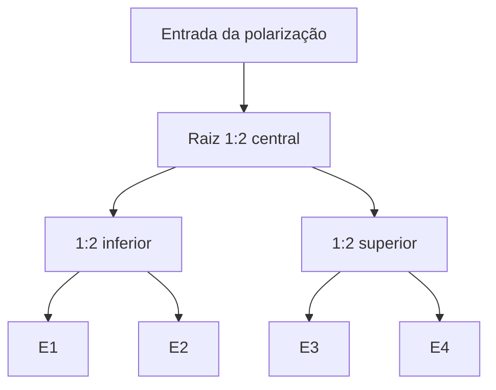
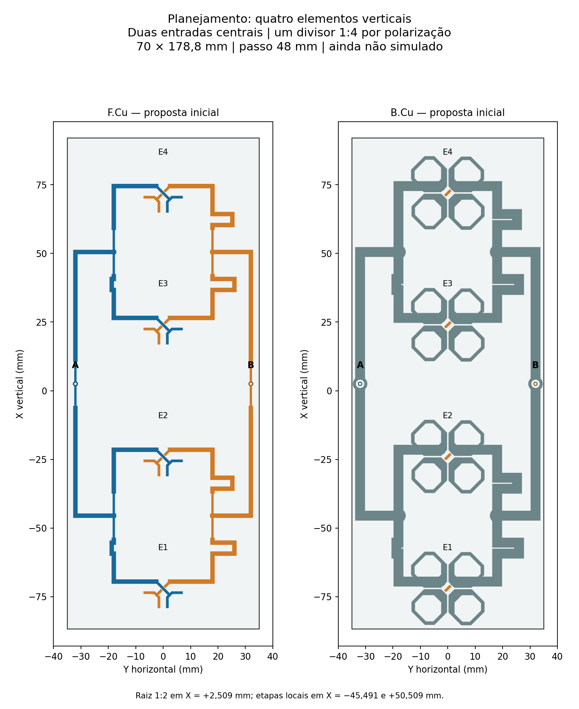

# Planejamento de quatro elementos em uma placa

Proposta de 9/11/2026, derivada da placa **2_elementos / v05**. Considera quatro radiadores **verticais, em uma coluna**, com duas polarizações. É um planejamento geométrico, ainda sem simulação do novo conjunto.

## Configuração inicial

| Item | Proposta |
|---|---|
| Radiadores | E1…E4 em X = −72, −24, +24 e +72 mm; Y = 0 |
| Passo vertical inicial | 48 mm, herdado do módulo de dois elementos |
| PCB contínua | 70 × 178,8 mm; RO4350B, núcleo 0,76 mm; Cu 35 µm e ENIG |
| Entradas | Duas: A em (X,Y) = (+2,509; −32) mm; B em (+2,509; +32) mm |
| Divisores | Um 1:4 por polarização, implementado por três junções 1:2 em dois estágios |
| Raiz | Um 1:2 junto a cada entrada central |
| Estágios locais | Dois 1:2 por polarização, próximos aos centros dos pares E1/E2 e E3/E4 |
| Cabos externos | Dois, com mesmo comprimento; referência inicial de ensaio: 50 mm, como no módulo |
| Refletor inicial | 90 × 194,8 × 2 mm; alumínio; face inferior do núcleo a Z = 16,61 mm |

Os troncos impressos seguem duas faixas externas, em Y = ±32 mm, chegando aos divisores locais em Y = ±18 mm. Isso permite evitar cruzamentos com os ramos dos radiadores. A largura passa de 49 para 70 mm para acomodar essas duas faixas e seus retornos; o comprimento cresce de 82,8 para 178,8 mm. Essas dimensões são a primeira proposta, não um mínimo otimizado.

Cada polarização usa a árvore abaixo. As duas árvores têm entradas e redes separadas.

Os quatro pontos que seriam entradas coaxiais dos dois módulos v05 passam a ser junções impressas. Seus pads de sinal na face inferior, furos PTH e aberturas de retorno para o coaxial foram removidos no planejamento. O retorno fica contínuo nesses nós. Permanecem somente as duas conexões externas A/B e as oito vias dos radiadores.

## Comprimentos iniciais

Cada tronco novo mede 62 mm de linha central: 48 mm longitudinais e 14 mm transversais. Os dois troncos de uma polarização têm o mesmo comprimento geométrico. Nas quatro saídas, os ajustes locais da v05 foram preservados como ponto de partida:

| Polarização | Saída | Tronco novo mm | Ramo local mm | Total nominal mm |
|---|---|---:|---:|---:|
| A | E1 | 62.000 | 40.991 | 102.991 |
| A | E2 | 62.000 | 39.491 | 101.491 |
| B | E1 | 62.000 | 55.482 | 117.482 |
| B | E2 | 62.000 | 53.982 | 115.982 |
| A | E3 | 62.000 | 40.991 | 102.991 |
| A | E4 | 62.000 | 39.491 | 101.491 |
| B | E3 | 62.000 | 55.482 | 117.482 |
| B | E4 | 62.000 | 53.982 | 115.982 |

A seção inicial de cada divisão usa 70,71 Ω, largura inicial de 0,8604 mm e comprimento de quarto de onda de 8,8163 mm; as ligações restantes usam 50 Ω, largura de 1,6234 mm. São dimensões de partida do mesmo stackup, sujeitas ao ajuste eletromagnético das junções e das cargas.

Os ramos locais têm comprimentos diferentes por causa da compensação encontrada na v05. **Não há comprovação de amplitude ou fase uniforme nos quatro radiadores.** Igualar os dois troncos por grupo não elimina o efeito das impedâncias ativas, dos retornos ou do acoplamento. A divisão nominal 1:4 corresponde a −6,02 dB por saída antes das perdas e dos descasamentos, sob cargas e divisão ideais; não é uma perda medida deste conjunto. Esta árvore não é Wilkinson e não inclui resistores de isolamento.

## Próxima etapa de engenharia

1. Rever as transições entre a raiz e os dois estágios locais, incluindo o retorno contínuo nos antigos pontos de coaxial.
2. Criar o HFSS do módulo completo de quatro elementos com o novo refletor e as duas entradas; manter o ensaio inicial em 5,17 GHz, 14 núcleos e até seis passes.
3. Alimentar A e B com 0,5 W / 0° e conferir ganho frontal, máximos H/V, aberturas, VSWR ativo e VSWR individual com a outra entrada casada. Registrar o ΔS atingido e os passes consecutivos.
4. Ajustar comprimentos e junções usando as fases elétricas efetivas. Confirmar que a melhora de apontamento não piorou o casamento ou o ganho.
5. Após essa comparação, criar a revisão KiCad de quatro elementos e seu pacote de fabricação.

O planejamento foi verificado em 2D: sem sobreposição entre redes diferentes, cobre dentro do contorno e folga mínima de 0.188750 mm. Isso não substitui a verificação de continuidade por vias, o DRC do futuro KiCad ou a simulação EM. Não houve novo solve nesta etapa, nem qualificação de banda ou do painel 16×2.

Geometria e premissas em [planejamento.json](planejamento.json). Script reproduzível: [quatro_elementos_planejar.py](../../automacao/quatro_elementos_planejar.py).
