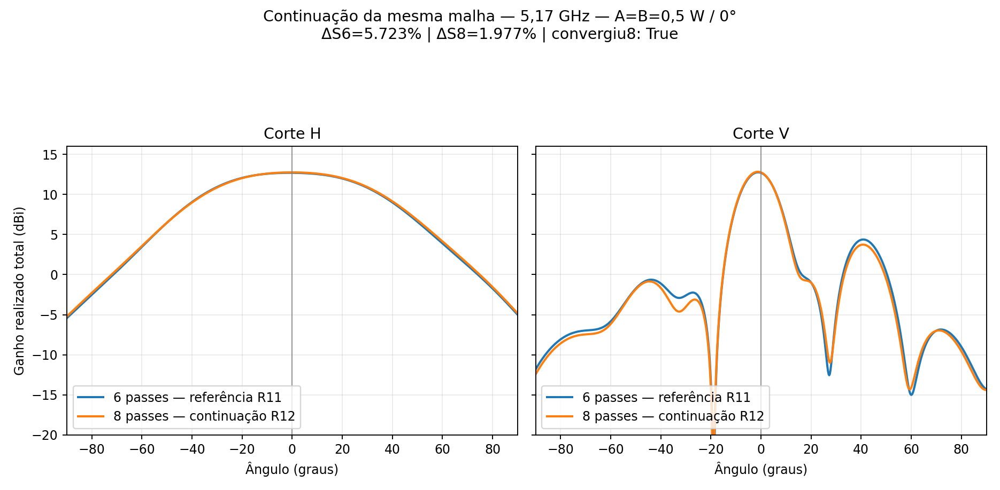
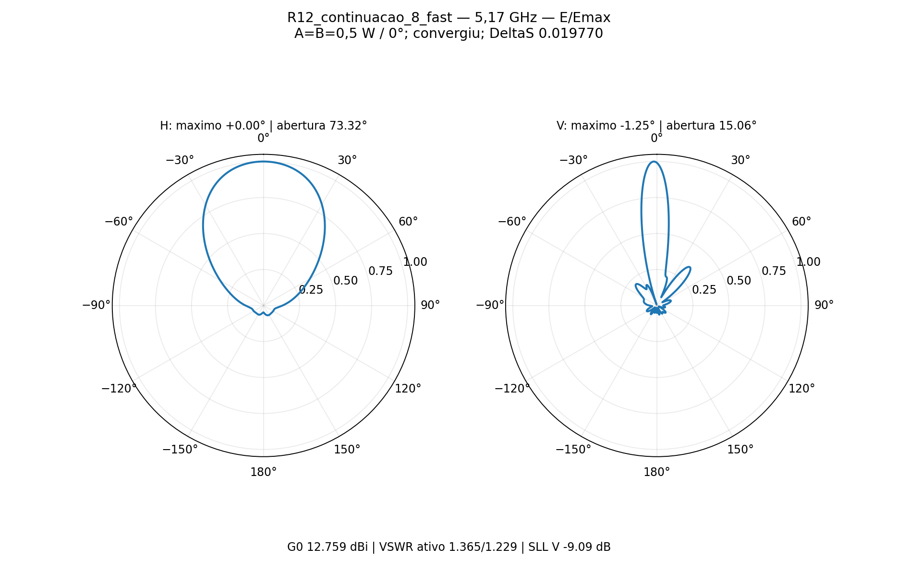
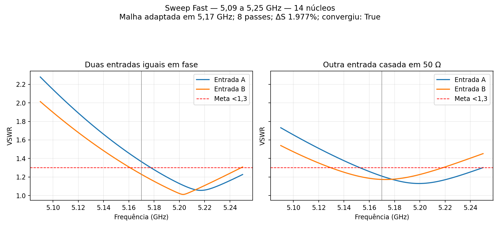

# P2M21 — continuação de oito passes e sweep Fast R12

**Convergência central: SIM.** Foram executados somente os passes adicionais **7 e 8**, preservando os seis anteriores e a malha da variante R11 `v21_altura_menos10_casada`. Resultado central: **12.75860 dBi**, VSWR ativo **1.36482/1.22851**, ΔS final **1.9770%**, 2/2 passes consecutivos abaixo de 5%. A conclusão do sweep Fast não significa qualificação do ganho em toda a banda.

## Configuração preservada

Quatro radiadores, passo **48 mm**, distância entre face inferior do laminado e topo do refletor **14,949 mm**; RO4350B 0,76 mm, cobre de 35 µm e ENIG nominal. Dois divisores 1:4 impressos espelhados, transformadores de raiz com **0,656371 mm de largura × 9,000142 mm de comprimento**. Dois cabos físicos de 50 mm, com as perdas nominais do modelo; sem suportes plásticos. Fontes **A=B=0,5 W/0°**, 1 W incidente total. Sem GUI, **14 núcleos**, Classic/base mista, adaptação de 50%, residual iterativo de 1e−5, sem refinamentos locais ou LambdaRefine iniciais.

O limite foi alterado de 6 para 8 e o mínimo para 8 para executar exatamente dois passes adicionais. Geometria, materiais, fronteiras e operações de malha permaneceram iguais. Ao editar, o AEDT normalizou o default inativo `Target` de 0,3333 para 0,6667; `DoLambdaRefine=false` e `SetLambdaTarget=false` permaneceram. A auditoria interrompeu antes de qualquer solve para investigar: os cinco arquivos críticos de malha/campos estavam idênticos byte a byte, e a execução posterior confirmou início no passe 7 e histórico 1–6 idêntico. Não houve reinício do zero ou alteração do alvo ΔS.

## Ganho e diagramas somente em 5,17 GHz

| Caso | G0 dBi | VSWR ativo A/B | VSWR casado A/B | Máximos H/V ° | Aberturas H/V ° | SLL vertical dB | ΔS | Consecutivos |
|---|---:|---:|---:|---:|---:|---:|---:|---:|
| Seis passes (R11) | 12.70176 | 1.23272 / 1.09401 | 1.10406 / 1.18079 | -1.00 / -1.25 | 73.630 / 15.180 | -8.385 | 5.7225% | 0/2 |
| Oito passes (R12) | 12.75860 | 1.36482 / 1.22851 | 1.20907 / 1.17334 | +0.00 / -1.25 | 73.322 / 15.058 | -9.095 | 1.9770% | 2/2 |

Frente=+Z, H=φ90° (YZ), V=φ0° (XZ), grade angular de 0,25°. SLL é o maior máximo local no hemisfério frontal fora dos primeiros mínimos do lóbulo principal. Entre 6 e 8 passes: ΔG0 **+0.05685 dB**, ΔaberturaH **-0.308°**, ΔaberturaV **-0.122°**. Essas diferenças descrevem a estabilidade observada; não são uma estimativa rigorosa de erro físico.

Metas centrais: ganho≥12 dBi **True**; VSWR ativo<1,3 **False**; VSWR casado<1,3 **True**; máximos H/V exatamente0° na grade **False**. Convergência de S não garante por si só estabilidade de todos os detalhes do diagrama.

## Sweep Fast: 5,09 a 5,25 GHz

**161 pontos de saída, espaçados de 1 MHz**, portas referidas a 50 Ω, sem geração de diagramas fora do centro. O Fast usa a malha adaptada e o método ALPS; seus pontos não são 161 adaptações independentes. [Documentação do Fast no AEDT2024R2](https://ansyshelp.ansys.com/public/Views/Secured/Electronics/v242/en/Subsystems/HFSS/Content/HFSS/FastFrequencySweeps.htm). Os diagramas acima vêm de `Centro : LastAdaptive`, em 5,17 GHz. A matriz do Fast no centro difere da adaptativa por no máximo **3.49e-05** em valor absoluto complexo.

| Condição/entrada | VSWR mínimo | VSWR máximo | Frequência do máximo GHz | Pontos com VSWR≥1,3 |
|---|---:|---:|---:|---:|
| ativo A | 1.05538 | 2.27960 | 5.090 | 88 |
| ativo B | 1.01153 | 2.01420 | 5.090 | 74 |
| casado A | 1.12964 | 1.73178 | 5.090 | 64 |
| casado B | 1.17283 | 1.53940 | 5.090 | 72 |

Todos os VSWR ativos e casados abaixo de 1,3 nos 161 pontos: **False**. O sweep foi concluído sem novos passes adaptativos; o histórico antes/depois é idêntico. Ganho e aberturas fora de 5,17 GHz **não foram avaliados**, conforme solicitado.

## Auditorias e arquivos

Malha central: **0 Major/0 Minor**. Matriz central passiva/recíproca, resíduo de reciprocidade **2.05e-05**; erro da recomposição complexa de A+B **5.29e-15**. Potência aceita **0.982843 W**, eficiência de radiação **80.607%**. No Fast, maior valor singular **0.3665532**, maior resíduo de reciprocidade **1.12e-15**. O alvo ΔS foi conferido no setup e na exportação; os 14 núcleos foram conferidos nos passes.

[HFSS com setup e Fast](centro/P2M21_4_elementos.aedt) · [CAD](centro/4_elementos.FCStd) · [Polar PDF](centro/polar_HV.pdf) · [S2P Fast](centro/banda_fast.s2p) · [VSWR CSV](vswr_banda_fast.csv) · [Resultado central](centro/resultado.json) · [Auditoria da continuidade](continuidade_auditada.json).

Os nativos, Touchstones, cortes distantes e evidências compactas acompanham o relatório. Malhas, `.aedtresults`, campos volumétricos e locks permanecem somente no estudo local `D:/dev/EMBRAER/P2M21/R12_Quatro_8Passes_Fast/antena`. O nativo sem resultados permite editar o modelo; recuperar campos FEM em outra máquina exige novo solve. A referência R11 foi preservada. Esta etapa não qualifica o painel 16×2, desempenho MIMO por entrada, fabricação ou banda de ganho.
