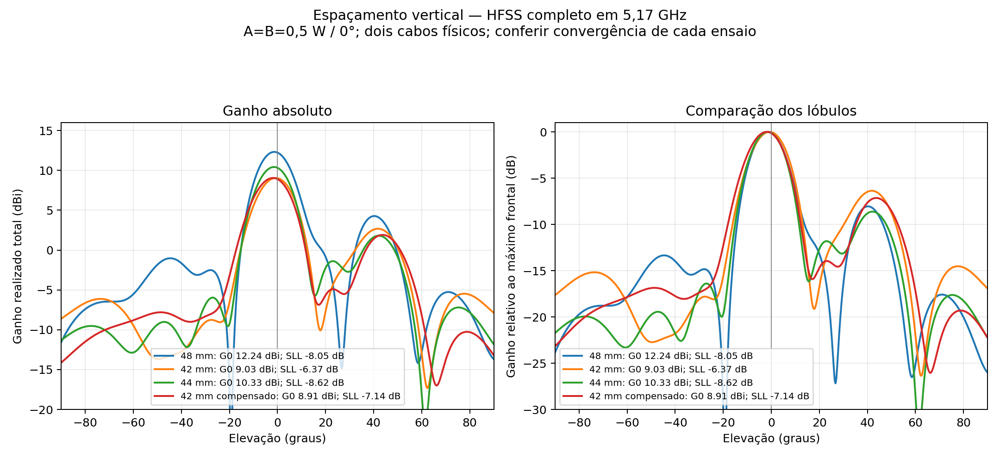
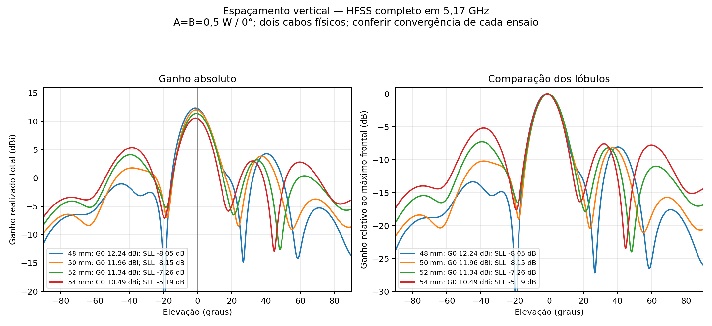
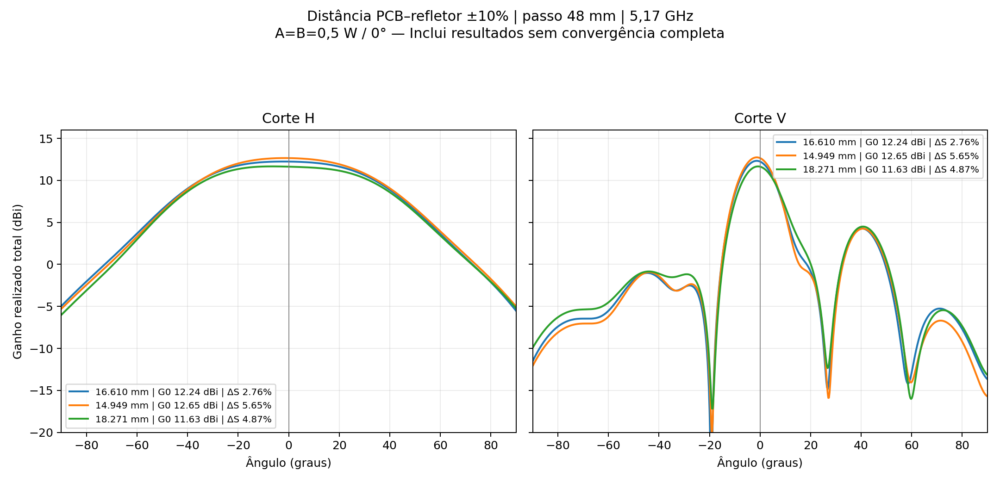
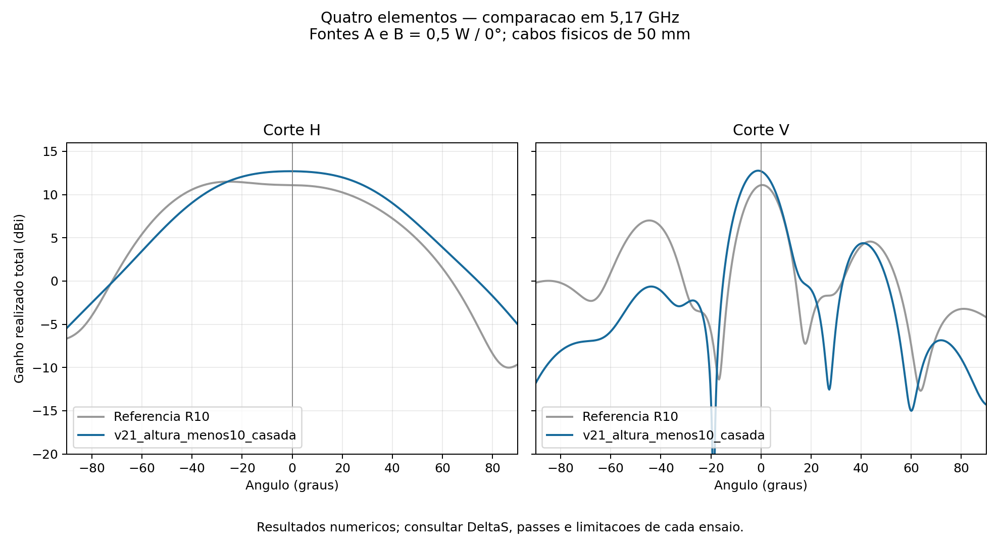
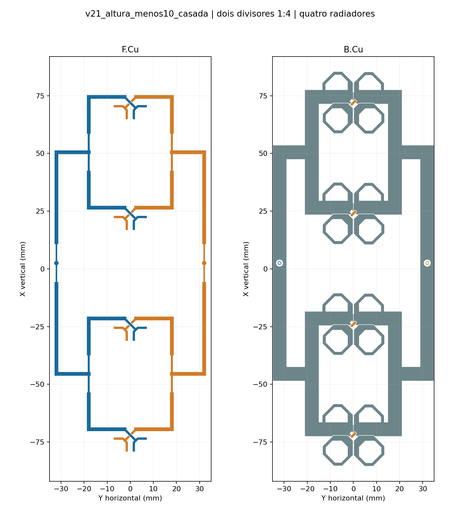
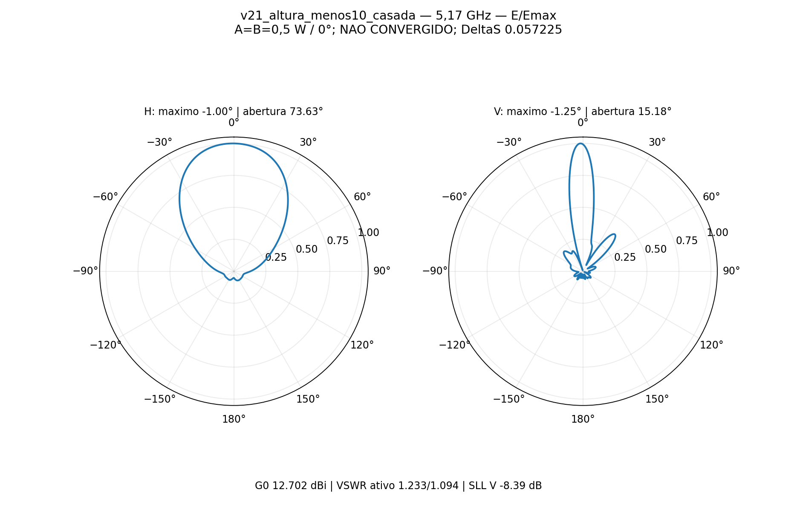

# Quatro elementos — divisores, espaçamento e refletor R11

**EM AJUSTE — NÃO LIBERADA.** Variante apresentada: **v21_altura_menos10_casada**. 6 passes em 5,17 GHz, ΔS final **0.057225** (5.7225%). HFSS indicou convergência: False; passes consecutivos abaixo do alvo: **0 de 2**. Convergência completa conforme o setup: **False**. Atingir o limite de seis passes ou somente o último ΔS não substitui os dois passes configurados.

## Escolha entre os casos testados

Os valores obtidos favorecem passo de 48 mm e distancia de 14,949 mm entre laminado e refletor, com reajuste igual dos transformadores de raiz em A/B: ganho frontal de 12,7018 dBi, VSWR ativo 1,2327/1,0940 e casado 1,1041/1,1808. Frente a referencia de 48 mm e 16,610 mm, o ganho aumenta 0,4663 dB, o maior lobulo secundario vertical cai de -8,049 para -8,385 dB e o maximo H se aproxima de zero (-2,25 para -1,00 graus). Os casos de 50/52/54 mm reajustados atendem VSWR, mas ficam abaixo de 12 dBi frontais.

Escolha preliminar entre modulos efetivamente testados, sem prova de otimo global. O candidato terminou em seis passes com DeltaS 0,057225 (5,7225%), acima do alvo de 5%, e zero dos dois passes consecutivos exigidos. Os maximos H/V ainda estao em -1,00/-1,25 graus; portanto, nao ha liberacao de RF ou fabricacao. A referencia de altura nominal tambem nao completou a convergencia (DeltaS 2,7638%, apenas um de dois consecutivos). Diferencas de ganho/diagrama nao tem limite de incerteza validado por estudo independente de malha.

## Pedido vigente

Quatro radiadores verticais, passo de 48 mm na variante apresentada; dois divisores 1:4 impressos; dois cabos físicos iguais de 50 mm. Fontes **A = B = 0,5 W / 0°**, 1 W total. Divisores e retornos acrescentados espelhados, sem compensações distintas entre polarizações. Meta de ganho frontal realizado total ≥12 dBi, VSWR **<1,3** nas duas entradas, máximos H/V em 0° e minimização dos lóbulos secundários verticais. Somente 5,17 GHz, sem GUI, 14 núcleos e no máximo seis passes, alvo ΔS = 0,05. Não houve varredura de frequência.

## Resultado

| Grandeza | Resultado |
|---|---:|
| Ganho realizado total frontal | 12.70176 dBi |
| Máximo H / V | -1.00° / -1.25° |
| Abertura H / V a −3 dB | 73.630° / 15.180° |
| VSWR ativo A / B, ambas ligadas | 1.23272 / 1.09401 |
| VSWR A / B, outra entrada casada em 50 Ω | 1.10406 / 1.18079 |
| Maior lóbulo secundário vertical frontal | -8.385 dB, em +40.75° |
| Potência aceita, incidente total de 1 W | 0.993560 W |
| Eficiência de radiação / total | 80.922% / 80.400% |

Frente = +Z; H é φ = 90° (YZ), V é φ = 0° (XZ). Grade angular de 0,25°. Os máximos são os pontos de maior ganho nos cortes frontais, sem girar o sistema de coordenadas. O lóbulo principal vertical é delimitado pelos primeiros mínimos; o SLL é o maior máximo local no hemisfério frontal fora desse intervalo. A referência R10 tinha SLL vertical de −4,101 dB.

## Geometria e transformadores

PCB 70.0 × 184.0 mm, núcleo RO4350B 0,76 mm (εr 3,66; tanδ 0,0037), cobre físico 35 µm, ENIG nominal Au 0,0254 µm / NiP 4,5 µm a 1,5 MS/m. Refletor de alumínio 90.0 × 200.0 × 2 mm; face inferior do núcleo a Z = 14.949 mm em relação ao topo do refletor. Radiadores e vias originais preservados. Sem suportes plásticos ou conectores N. Os cabos incluem cobre e PTFE com perdas nominais, conforme a referência R10.

Nas trilhas planas, a dimensão transversal é a largura. Dimensões iguais nas duas polarizações:

| Polarização | Largura raiz mm | Comprimento raiz mm | Largura local mm | Comprimento local mm |
|---|---:|---:|---:|---:|
| A | 0.656371 | 9.000142 | 0.860433 | 8.816344 |
| B | 0.656371 | 9.000142 | 0.860433 | 8.816344 |

As duas árvores usam uma divisão 1:2 na raiz e duas divisões 1:2 locais. Não são Wilkinson e não há resistores de isolamento. Os parâmetros completos dos planos de massa e das linhas estão em `selecionada/configuracao.json`; a geometria 2D e a auditoria de simetria estão em `selecionada/geometria.json`. A igualdade conferida se refere aos novos divisores e faixas de retorno; o cobre e as transições por vias dos radiadores originais não foram substituídos.

## Ensaios preservados

As variantes anteriores à instrução de manter os divisores espelhados ficaram apenas como histórico. O limite de VSWR foi posteriormente reduzido de 1,5 para 1,3. Os valores abaixo permitem aplicar o requisito atual sem reinterpretar aprovação antiga.

| Variante | Passo mm | Altura mm | Divisores espelhados | G0 dBi | Máximos H/V ° | VSWR ativo A/B | VSWR casado A/B | SLL V dB | ΔS | Consecutivos |
|---|---:|---:|---|---:|---:|---:|---:|---:|---:|---:|
| v00a_retorno6 | 48 | 16.610 | histórico descartado | 11.359 | +5.00 / +0.75 | 1.450 / 2.369 | 1.588 / 1.988 | -8.96 | 0.127210 | 0/2 |
| v01_faseB | 48 | 16.610 | histórico descartado | 11.715 | -0.50 / -0.50 | 1.737 / 1.690 | 1.363 / 1.305 | -7.68 | 0.061926 | 0/2 |
| v03_simetrica | 48 | 16.610 | sim | 12.080 | +3.25 / -1.00 | 1.530 / 1.358 | 1.214 / 1.146 | -8.18 | 0.044089 | 1/2 |
| v04b_massa_centrada | 48 | 16.610 | sim | 10.756 | +6.00 / -0.25 | 1.467 / 1.365 | 1.317 / 1.224 | -3.65 | 0.046984 | 1/2 |
| v05_casamento_comum | 48 | 16.610 | sim | 12.058 | +0.00 / -0.75 | 1.350 / 1.307 | 1.159 / 1.302 | -7.40 | 0.046553 | 1/2 |
| v06_massa_continua | 48 | 16.610 | sim | 10.594 | -12.25 / +2.75 | 2.761 / 2.524 | 1.955 / 1.762 | -10.05 | 0.081728 | 0/2 |
| v09_transformadores | 48 | 16.610 | sim | 12.235 | -2.25 / -1.25 | 1.289 / 1.134 | 1.210 / 1.197 | -8.05 | 0.027638 | 1/2 |
| v10_passo42 | 42 | 16.610 | sim | 9.030 | +3.75 / -0.75 | 4.008 / 3.592 | 2.271 / 2.120 | -6.37 | 0.094131 | 0/2 |
| v11_passo44 | 44 | 16.610 | sim | 10.327 | +2.00 / -1.50 | 3.620 / 3.230 | 2.199 / 2.017 | -8.62 | 0.059151 | 0/2 |
| v12_passo42_compensado | 42 | 16.610 | sim | 8.909 | +6.25 / -2.00 | 4.614 / 3.806 | 2.623 / 2.283 | -7.14 | 0.065216 | 0/2 |
| v13_passo50_ajustado | 50 | 16.610 | sim | 11.907 | -10.75 / -0.75 | 1.297 / 1.397 | 1.296 / 1.440 | -7.84 | 0.031472 | 1/2 |
| v14_passo52_ajustado | 52 | 16.610 | sim | 11.058 | -17.75 / -0.75 | 1.516 / 1.680 | 1.431 / 1.610 | -7.82 | 0.104300 | 0/2 |
| v15_passo54_ajustado | 54 | 16.610 | sim | 10.333 | -21.50 / -1.00 | 1.765 / 1.869 | 1.673 / 1.766 | -5.40 | 0.056053 | 0/2 |
| v16_passo50_reajustado | 50 | 16.610 | sim | 11.959 | -13.00 / -0.75 | 1.206 / 1.075 | 1.103 / 1.064 | -8.15 | 0.066533 | 0/2 |
| v17_passo52_reajustado | 52 | 16.610 | sim | 11.341 | -18.00 / -0.75 | 1.100 / 1.230 | 1.147 / 1.239 | -7.26 | 0.026868 | 1/2 |
| v18_passo54_reajustado | 54 | 16.610 | sim | 10.488 | -22.00 / -1.25 | 1.149 / 1.161 | 1.125 / 1.114 | -5.19 | 0.048446 | 1/2 |
| v19_altura_menos10 | 48 | 14.949 | sim | 12.649 | -1.50 / -1.25 | 1.387 / 1.172 | 1.235 / 1.238 | -8.48 | 0.056483 | 0/2 |
| v20_altura_mais10 | 48 | 18.271 | sim | 11.629 | -6.50 / -0.75 | 1.221 / 1.126 | 1.060 / 1.243 | -7.16 | 0.048662 | 1/2 |
| v21_altura_menos10_casada | 48 | 14.949 | sim | 12.702 | -1.00 / -1.25 | 1.233 / 1.094 | 1.104 / 1.181 | -8.39 | 0.057225 | 0/2 |

## Comparação de espaçamentos

O estudo comparou o módulo completo, incluindo acoplamento, divisores impressos e dois cabos físicos. A PCB e o refletor mantiveram as dimensões externas. Os caminhos dos quatro radiadores continuam iguais entre si em cada variante, com A/B espelhados. Ao reduzir o passo de 48 para 42 mm, o caminho impresso direto cai de 101,491 para 92,491 mm. A variante compensada repõe 9 mm com meandros iguais: 6 mm na raiz e 3 mm em cada ramo local. Isso preserva o comprimento geométrico, sem demonstrar igualdade de fase real nas descontinuidades.

| Passo mm | Caminho | G0 dBi | VSWR ativo A/B | SLL V dB | ΔS | Consecutivos |
|---:|---|---:|---:|---:|---:|---:|
| 48 | trajeto direto | 12.235 | 1.289 / 1.134 | -8.049 | 2.764% | 1/2 |
| 42 | trajeto direto | 9.030 | 4.008 / 3.592 | -6.368 | 9.413% | 0/2 |
| 44 | trajeto direto | 10.327 | 3.620 / 3.230 | -8.619 | 5.915% | 0/2 |
| 42 | reposto por meandros | 8.909 | 4.614 / 3.806 | -7.143 | 6.522% | 0/2 |

Esses ensaios não demonstram um espaçamento ótimo global nem isolam apenas o fator de arranjo: o deslocamento dos elementos altera o acoplamento e exige reposicionar as trilhas e retornos. A comparação ideal complementar usa quatro fontes pontuais iguais; não fornece ganho ou VSWR do módulo real. Os casos sem convergência completa permanecem preliminares.

## Pedido adicional: 50, 52 e 54 mm

As três versões usam PCB comum de **70 × 202 mm** e refletor de **90 × 218 × 2 mm**, para comportar o maior espaçamento. As trilhas foram reposicionadas mantendo os quatro caminhos geometricamente iguais e a simetria A/B. Os transformadores de entrada foram pré-dimensionados individualmente por um modelo nominal de duas etapas de linha, calibrado na matriz S da referência de 48 mm. Esse modelo mantém cargas equivalentes congeladas e não prevê o novo acoplamento, as curvas ou as bordas. A tabela abaixo usa somente os resultados reais do HFSS completo.

| Passo mm | G0 dBi | Máximos H/V ° | VSWR ativo A/B | VSWR casado A/B | SLL V dB | ΔS | Consecutivos |
|---:|---:|---:|---:|---:|---:|---:|---:|
| 48 | 12.235 | -2.25 / -1.25 | 1.289 / 1.134 | 1.210 / 1.197 | -8.049 | 2.764% | 1/2 |
| 50 | 11.959 | -13.00 / -0.75 | 1.206 / 1.075 | 1.103 / 1.064 | -8.150 | 6.653% | 0/2 |
| 52 | 11.341 | -18.00 / -0.75 | 1.100 / 1.230 | 1.147 / 1.239 | -7.258 | 2.687% | 1/2 |
| 54 | 10.488 | -22.00 / -1.25 | 1.149 / 1.161 | 1.125 / 1.114 | -5.186 | 4.845% | 1/2 |

A referência de 48 mm tem PCB/refletor menores (70 × 184 / 90 × 200 mm); sua comparação com as novas versões não isola apenas o passo. Adaptação interna nas três novas versões: 75%, sem refinamento inicial imposto; continuam limitadas a seis passes, ΔS alvo de 5% e 14 núcleos. Os primeiros casos usam base mista; os reajustes posteriores testam base de primeira ordem, registrada em cada configuração e resultado. A fase aplicada às duas entradas é sempre 0°. Igualdade geométrica dos caminhos não substitui a verificação da distribuição efetiva de corrente, campo e potência.

## Distância da PCB ao refletor: −10%, nominal e +10%

O espaçamento de **48 mm** foi selecionado como melhor base numérica entre os módulos testados: a referência de 16,610 mm atingiu simultaneamente ganho frontal ≥12 dBi e todos os VSWR <1,3. Isso não comprova um ótimo global nem elimina a incerteza dos resultados sem convergência completa. Os testes seguintes mantiveram o passo, o desenho das duas faces, as vias, os transformadores, os contornos, os materiais e o setup da referência de 48 mm. A condição nominal foi reutilizada, sem outra simulação.

A distância é medida **da face superior do refletor à face inferior do laminado**. O cobre inferior fica 0,035 mm mais perto. Os dois cabos mantêm 50 mm de comprimento e foram transladados em Z junto com a PCB; o refletor permanece fixo. A auditoria CAD confirmou 42 sólidos por variante, mesmos volumes e envelopes iguais após compensar a translação, sem interseções indevidas. A auditoria planar confirmou diferença nula no cobre, mesmas vias e oito caminhos geométricos de 101,491 mm. Isso preserva a excitação aplicada e a geometria das linhas, mas não impõe uma distribuição ideal de potência aos radiadores.

| Altura mm | G0 dBi | Máximos H/V ° | Aberturas H/V ° | VSWR ativo A/B | VSWR casado A/B | SLL V dB | ΔS | Consecutivos |
|---:|---:|---:|---:|---:|---:|---:|---:|---:|
| 16.610 | 12.235 | -2.25 / -1.25 | 77.15 / 15.44 | 1.289 / 1.134 | 1.210 / 1.197 | -8.049 | 2.764% | 1/2 |
| 14.949 | 12.649 | -1.50 / -1.25 | 73.69 / 15.12 | 1.387 / 1.172 | 1.235 / 1.238 | -8.485 | 5.648% | 0/2 |
| 18.271 | 11.629 | -6.50 / -0.75 | 79.73 / 16.19 | 1.221 / 1.126 | 1.060 / 1.243 | -7.161 | 4.866% | 1/2 |

Todos os casos de altura usam base mista, adaptação interna de 50%, malha inicial automática, 14 núcleos, máximo de seis passes e ΔS alvo de 5%. Os valores acima são do HFSS completo em 5,17 GHz. Os planos e a rastreabilidade estão em `plano_alturas.json` e `auditoria_cad_alturas.json`.

### Ajuste posterior do transformador na altura de 14,949 mm

Ensaio separado da comparação controlada acima: `v21_altura_menos10_casada`. Mantidos passo de 48 mm, altura de 14,949 mm, planos de retorno, radiadores, cabos, contornos e setup. Alteradas igualmente em A/B somente as seções transformadoras da raiz: largura **0.656371 mm** e comprimento **9.000142 mm**. O pré-dimensionamento usou a matriz S real da altura menor em um modelo nominal de linha com cargas congeladas; a previsão não foi usada como resultado final. A comparação do cobre confirmou alterações apenas nos sinais F.Cu A/B próximos à raiz, sem mudar retornos ou vias.

O HFSS completo desse ajuste resultou em **G0 12.70176 dBi**, VSWR ativo **1.23272 / 1.09401**, VSWR casado **1.10406 / 1.18079**, SLL vertical **-8.385 dB**. Máximos H/V **-1.00° / -1.25°**. Terminou em 6 passes, ΔS **5.7225%**, 0/2 consecutivos; convergência completa: **False**. Esse caso não deve ser confundido com a variante de altura sem reajuste.

## Verificação e limites

CAD e contatos conferidos antes do solve. Malha da variante apresentada: **0 Major e 0 Minor**. Matriz passiva: True; maior valor singular 0.1749639; resíduo de reciprocidade 2.891e-06. A recomposição complexa dos campos individuais reproduz A+B com erro relativo máximo 3.62e-15. O balanço da potência aceita entre a matriz S e as grandezas de ganho difere em 3.22e-15 W. Os 14 núcleos foram confirmados nos registros de solução de matriz de todos os passes.

O solver usa Classic, base mista, residual iterativo 1e−5, malha inicial automática sem MeshLink, operações locais ou LambdaRefine. Adaptação interna da variante: 50% por passe. Essa adaptação não aumenta o limite de seis passes. ΔS não é um limite rigoroso do erro físico do ganho ou do apontamento; não houve ensaio independente de estabilidade de malha. Não se qualifica a banda completa, o painel 16×2 ou o ganho MIMO por entrada. Sondas locais de Ez, quando disponíveis, são integrais aproximadas para diagnóstico relativo e não potência por radiador.

[Projeto HFSS](selecionada/P2M21_4_elementos.aedt) · [CAD](selecionada/4_elementos.FCStd) · [Dados completos](selecionada/resultado.json) · [Touchstone](selecionada/centro.s2p)

O pacote contém nativo e dados compactos; exclui `.aedtresults`, malhas, g3derr, campos volumétricos e locks. Os campos FEM restauráveis permanecem no estudo local em `D:/dev/EMBRAER/P2M21/R11_Divisor_Ajustes/v21_altura_menos10_casada`. Sem os resultados locais, o nativo conserva o modelo e exige novo solve para recuperar os campos no AEDT. Não houve compra, nova cotação, email ou liberação de fabricação nesta etapa.
