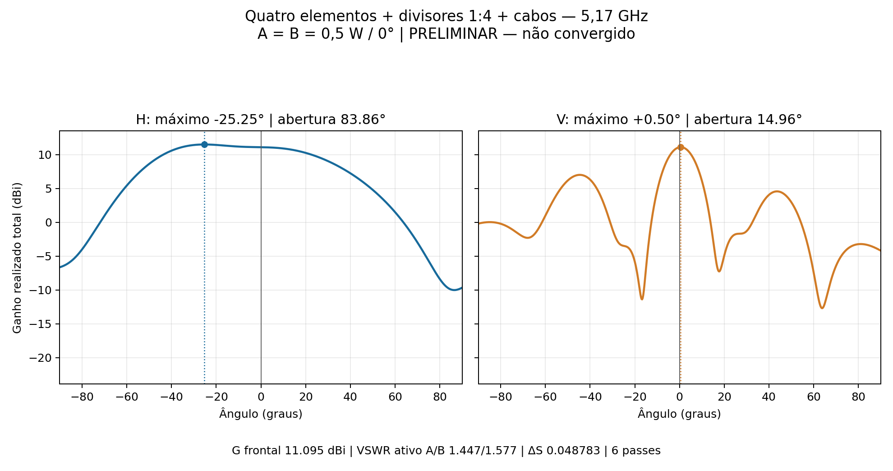
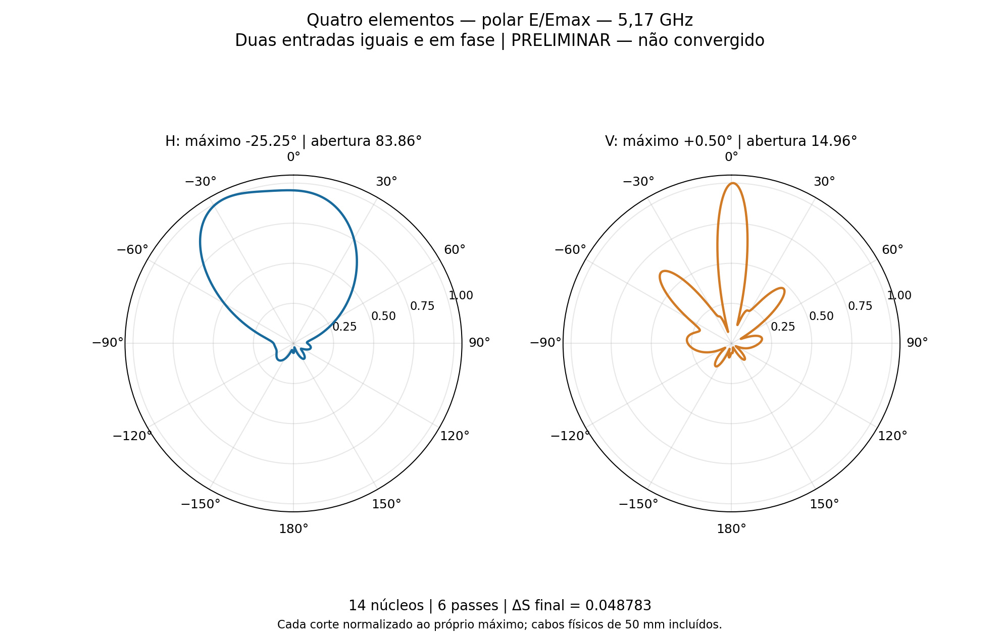
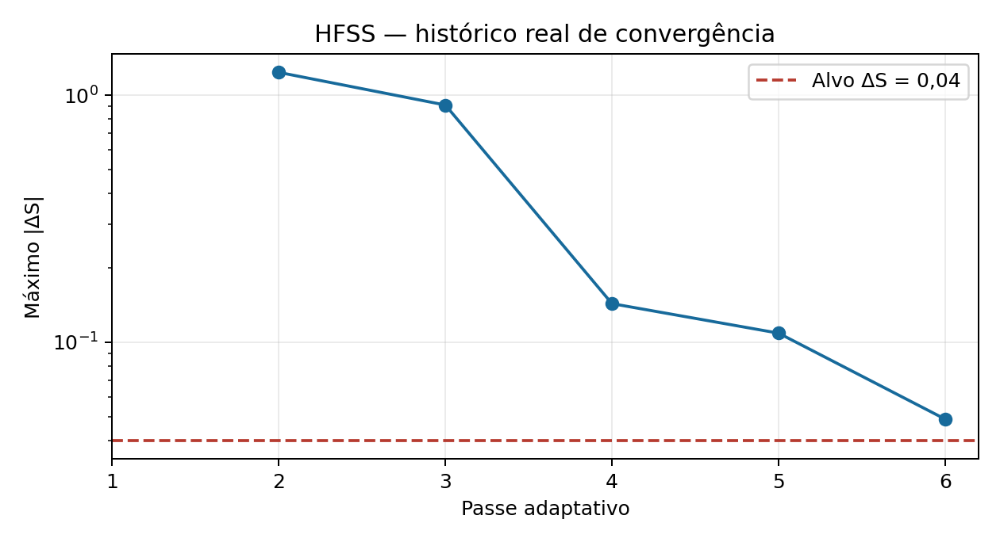

# Quatro elementos — ensaio HFSS em 5,17 GHz

Ensaio de 9/11/2026: **PRELIMINAR — não convergido**. 6 passes, ΔS final **0.048783** para alvo 0,04; 0 de 2 passes consecutivos exigidos. O limite de seis passes foi respeitado. Nenhum sweep foi executado.

| Resultado | A+B, entradas iguais e em fase |
|---|---:|
| Ganho realizado total frontal, θ = 0° | **11.0946 dBi** |
| Máximo do corte horizontal | **-25.25°**, 11.4984 dBi |
| Máximo do corte vertical | **+0.50°**, 11.1083 dBi |
| Abertura horizontal a −3 dB | 83.858° |
| Abertura vertical a −3 dB | 14.961° |
| VSWR ativo A / B | **1.4470 / 1.5774** |
| VSWR A / B com a outra entrada casada em 50 Ω | 1.5320 / 1.9457 |

## Modelo e execução

Quatro radiadores verticais em X = −72, −24, +24 e +72 mm; passo 48 mm, PCB contínua 70 × 178,8 mm. Duas árvores impressas 1:4, uma por polarização, cada uma composta por uma raiz 1:2 e dois estágios locais 1:2. Os ajustes locais da v05 foram preservados. As quatro interfaces coaxiais intermediárias foram substituídas por junções impressas com retorno contínuo.

Dois cabos físicos de 50 mm, retos e perpendiculares à placa, conectados em X = +2,509 mm, Y = ±32 mm. Incluídos pinos, blindagens, PTFE e soldas; as portas ficam nas extremidades dos cabos, Z = −33,39 mm. Refletor de alumínio de 2 mm, face 194,8 × 90 mm. Face inferior do núcleo em Z = 16,61 mm. Sem apoios plásticos ou conectores N.

RO4350B de 0,76 mm, εr = 3,66 e tanδ = 0,0037; cobre físico de 35 µm e ENIG nominal da v05. Os cabos incluem as perdas nominais do condutor e do PTFE (εr = 2,03636, tanδ = 0,00027683). NiP de 4,5 µm com condutividade nominal de 1,5 MS/m e ouro de 0,0254 µm, aplicados às faces expostas por impedância em camadas, sem shell elements. Esses parâmetros são hipóteses do modelo.

AEDT 2024 R2 executado com `-ng`, sem GUI. **14 núcleos** confirmados nos 6 registros de solução de matriz. Classic com resolução automática 5, sem refinamentos locais, sem MeshLink e sem LambdaRefine inicial; adaptação de 20% durante o solve, base mista e solver iterativo com residual 1e−5. Somente o setup Centro em 5,17 GHz. A região aberta foi dimensionada com a referência conservadora de 5,09 GHz, o que não constitui solução nessa frequência.

Ambas as portas foram alimentadas com **0,5 W / 0°**, total de 1 W. Frente = +Z, θ = 0°. H: φ = 90°, plano YZ; V: φ = 0°, plano XZ. Grade angular de 0,25°. Os máximos reportados são amostras dos cortes no hemisfério frontal, não um máximo 3D otimizado.

## Auditorias

CAD: 42 sólidos válidos, 73 pares com sobreposição de caixas examinados, sem interseções volumétricas indevidas. Malha: 0 corpos com reparo Major e 0 com Minor. Matriz S em 50 Ω: maior valor singular 0.37090875; resíduo de reciprocidade |S−Sᵀ| máximo 1.1381508e-05. A recomposição complexa dos campos A/B reproduziu o caso conjunto com erro relativo máximo 4.22e-15.

Potência aceita com ambas as entradas ativas: 0.958220 W. Eficiência de radiação derivada das grandezas HFSS: 83.775%; eficiência total: 80.275%. Diferença máxima entre potência aceita por S e pela razão ganho realizado/ganho: 7.22e-15 W.

Ressalvas físicas: nenhuma falha identificada nos critérios numéricos acima.

| Passe | Tetraedros | Máximo ΔS |
|---:|---:|---:|
| 1 | 53955 | — |
| 2 | 63119 | 1.236 |
| 3 | 74111 | 0.91167 |
| 4 | 87292 | 0.14319 |
| 5 | 102628 | 0.10874 |
| 6 | 120557 | 0.048783 |

O critério ΔS compara soluções adaptativas; não é um limite rigoroso do erro físico do ganho ou do diagrama. Não foi executado um estudo independente de estabilidade de malha. Estes resultados não qualificam a banda completa nem o painel 16×2; o ganho é total com as duas entradas coerentes, não ganho MIMO por entrada.

## Arquivos

[Projeto HFSS](P2M21_4_elementos.aedt), [CAD FreeCAD](4_elementos.FCStd), [Touchstone](centro.s2p), [resumo CSV](resumo.csv), [auditoria completa](resultado.json) e [convergência HFSS](convergencia.txt). O nativo salvo mantém ambas as fontes em 0,5 W / 0°. As soluções FEM completas permanecem em `D:/dev/EMBRAER/P2M21/R10_Quatro_Verticais`; o repositório exclui malhas, resultados volumétricos, locks e temporários. Sem a pasta de resultados, o AEDT preserva o modelo, mas exige novo solve para restaurar os campos nativos.

Geometria de origem: [planejamento dos quatro elementos](../planejamento/4_elementos/README.md). Scripts em `../automacao/quatro_elementos_*.py`; os geradores específicos CAD/HFSS estão nesta pasta. Não houve novo ensaio de otimização, nova cotação ou envio de email.
