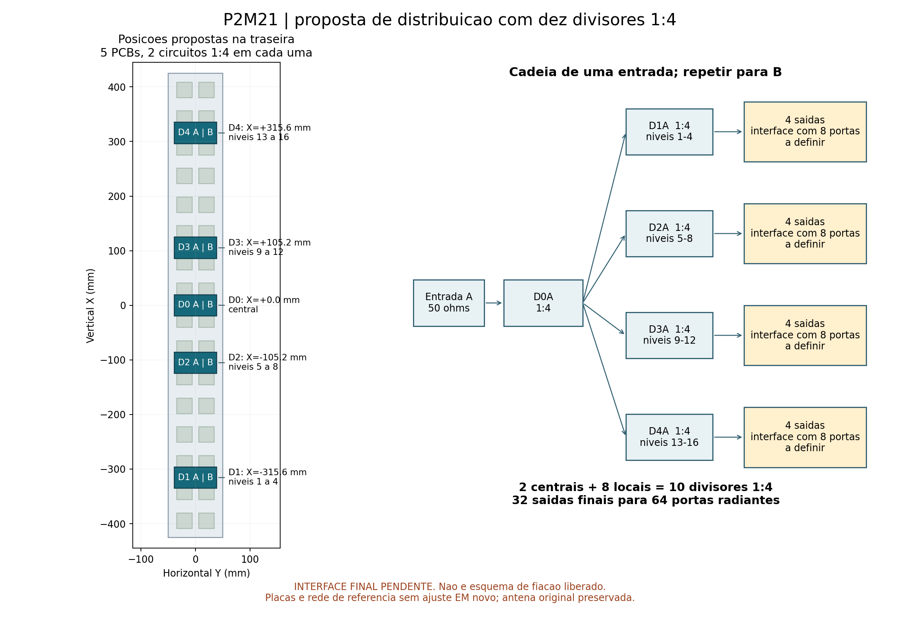
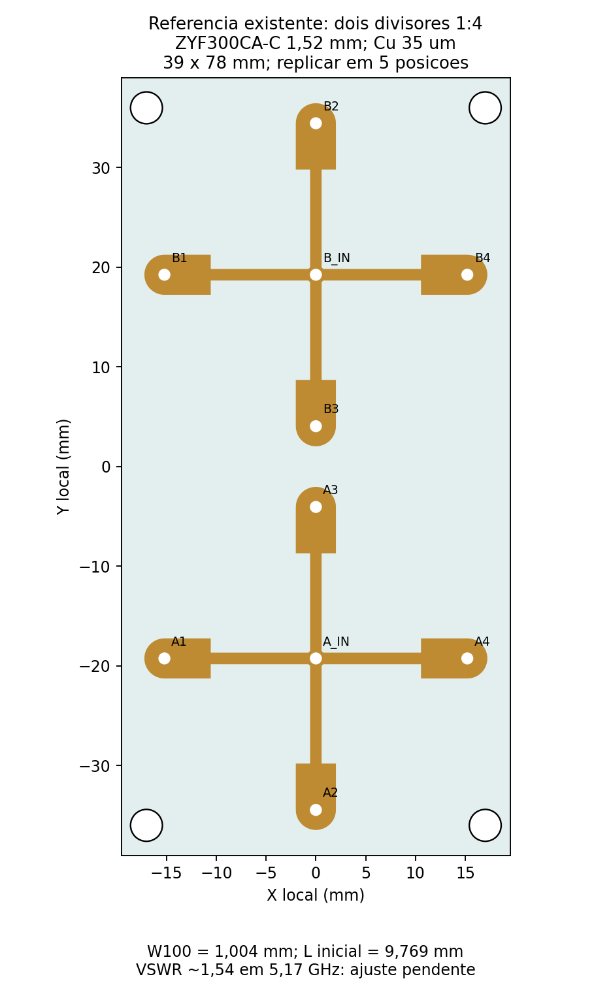

# P2M21 — distribuição com dez divisores 1:4

Pedido de 9/11/2026: dois divisores centrais 1:4, um por entrada, e quatro divisores locais 1:4 por entrada, distribuídos ao longo do painel. **A disposição mecânica está preparada; a ligação final às portas radiantes aguarda definição do usuário.** Nenhum novo solve foi executado nesta revisão.

| PCB proposta | Centro vertical X (mm) | Circuitos | Grupo de níveis |
|---|---:|---|---|
| D0 | 0 | D0A e D0B, ambos 1:4 | Raiz das duas entradas |
| D1 | −315,6 | D1A e D1B, ambos 1:4 | 1–4 |
| D2 | −105,2 | D2A e D2B, ambos 1:4 | 5–8 |
| D3 | +105,2 | D3A e D3B, ambos 1:4 | 9–12 |
| D4 | +315,6 | D4A e D4B, ambos 1:4 | 13–16 |

São **dez circuitos RF em cinco PCBs duplas**, não dez PCBs. Cada placa proposta conserva duas redes independentes, com entradas centrais A/B e quatro saídas por rede. A posição transversal é Y=0; a base dos substratos fica em Z=−11,52 mm, atrás do refletor. As placas de referência medem 39 × 78 mm, mantendo os furos e os espaçadores da montagem anterior. Os níveis são numerados da parte inferior para a superior, com passo vertical de 52,6 mm.

## Definição elétrica pendente

Cada entrada terá `1:4 → quatro 1:4`, portanto **16 saídas finais por entrada, 32 no conjunto**. O painel atual tem **32 radiadores de duas portas A/B, totalizando 64 portas**. A nova rede, isoladamente, fornece metade das conexões necessárias para manter a condição atual de excitação.

A proposta enviada ao usuário mantém uma entrada por polarização e associa cada saída local ao par de colunas do mesmo nível. Isso exige **32 divisões adicionais 1:2**, uma por nível e polarização. Foi sugerida sua integração em trilhas das placas radiantes para reduzir cabos. Essas divisões **ainda não foram desenhadas nem aprovadas**; exigem dimensionamento de impedância, fase, retornos de corrente e nova avaliação eletromagnética das placas modificadas. Os caminhos devem ser eletricamente iguais; não basta unir dois terminais de 50 Ω em paralelo.

O [mapa lógico](mapa_logico.csv) termina explicitamente nas interfaces pendentes. Os números OUT1–4 representam ramos lógicos e ainda não são uma lista de soldagem nos terminais físicos. Nenhuma porta A/B foi omitida, curto-circuitada ou ligada em paralelo nesta revisão. A geometria dos radiadores e os resultados de seis passes permanecem preservados.

## Divisor de referência e ajuste necessário

Foi reaproveitado, sem mudança de cobre, o divisor duplo 1:4 R00. Isso permite preparar a posição física e os arquivos editáveis enquanto se define a interface. Não é um novo divisor casado ou uma rede completa qualificada.

- Laminado nominal ZYF300CA-C de 1,52 mm, Dk 2,94, tanδ 0,0016; cobre físico de 35 µm e ENIG nominal.
- Rede radial sem resistores de isolamento entre saídas. Transformadores de referência de 100 Ω: largura 1,004 mm e comprimento sintetizado de 9,769 mm; acesso de 50 Ω com largura 3,872 mm. Valores da geometria existente, sem novo ajuste.
- HFSS histórico em 5,17 GHz, demais portas casadas em 50 Ω: VSWR A/B **1,53665 / 1,53646**, perda excedente **0,33193 / 0,33038 dB**, desequilíbrio de amplitude **0,0595 / 0,0685 dB** e de fase **0,6851 / 0,7089°**.
- O casamento histórico não atende a VSWR <1,5. O ajuste desse divisor e a ligação às cargas reais continuam pendentes. Os dados históricos de 17 frequências são referência; não houve novo sweep.

## Arquivos e conferências

- [Montagem FreeCAD com cinco PCBs duplas](freecad/P2M21_Dez_1x4_Posicionamento.FCStd): cada placa está em um `App::Part` com posição editável. É montagem por posicionamento, sem chicote novo ou restrições cinemáticas.
- [Verificação CAD](freecad/verificacao.json): 673 formas preexistentes preservadas por volume, 220 formas das cinco distribuidoras, sólidos válidos, zero interseções volumétricas nas 740 comparações necessárias envolvendo as novas distribuidoras. Arquivo salvo e reaberto. A leitura da origem emitiu avisos de nomes do mapa de elementos; as formas e a persistência passaram nas verificações.
- [PCB KiCad de referência](referencia_1x4/P2M21_Duplo_1x4.kicad_pcb) e [projeto](referencia_1x4/P2M21_Duplo_1x4.kicad_pro), copiados byte a byte. [DRC histórico de 8/11](referencia_1x4/drc.json): zero erros e zero itens desconectados, 20 avisos; não é uma nova execução de DRC.
- [HFSS histórico](referencia_1x4/P2M21_Duplo_1x4.aedt), [S10](referencia_1x4/divisor.s10p), [análise](referencia_1x4/analise.json), [geometria](referencia_1x4/geometria.json) e [rastreabilidade](origem_referencias.json). O projeto histórico mantém sua configuração antiga e não deve ser resolvido automaticamente nesta etapa.
- [Configuração da revisão](configuracao.json): posição, contagem e interface pendente explícitas.

Depois da definição das ligações: ajustar o 1:4 com saídas casadas, verificar as divisões finais e combinar as matrizes separadas em circuito com cabos ideais apenas de fase. Qualquer novo ciclo seguirá 14 núcleos, máximo quatro passes, referência ΔS=0,04, somente 5,17 GHz e sem sweep; o pedido de mais dois passes anterior foi uma continuação específica já encerrada. Comprimentos físicos e lista de corte dependem do roteamento e do equilíbrio de fase, e não estão liberados.

Não houve nova cotação, liberação de fabricação, envio de email ou alteração da antena já simulada.
