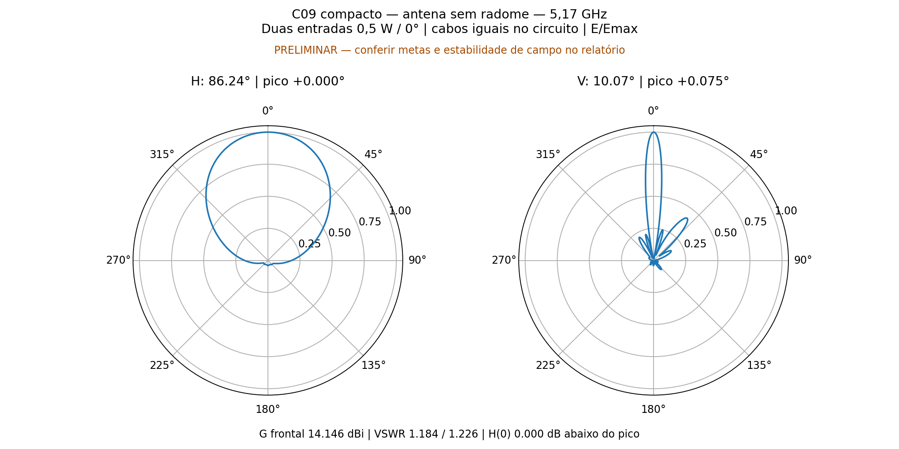
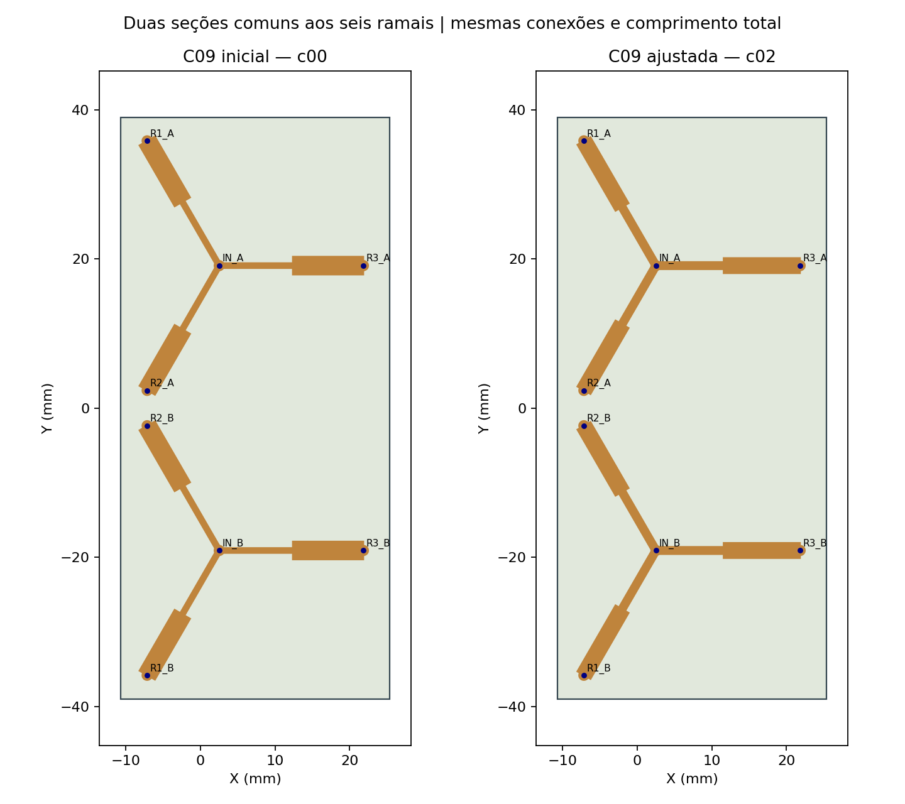
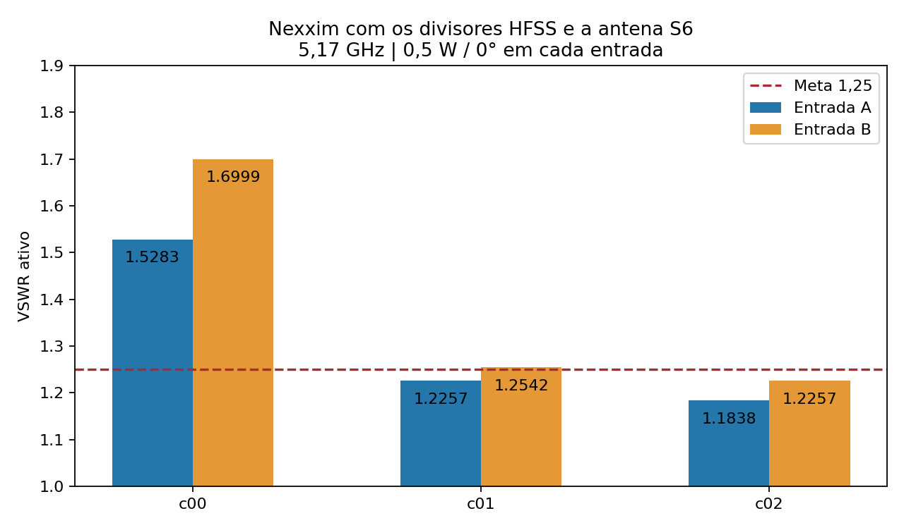
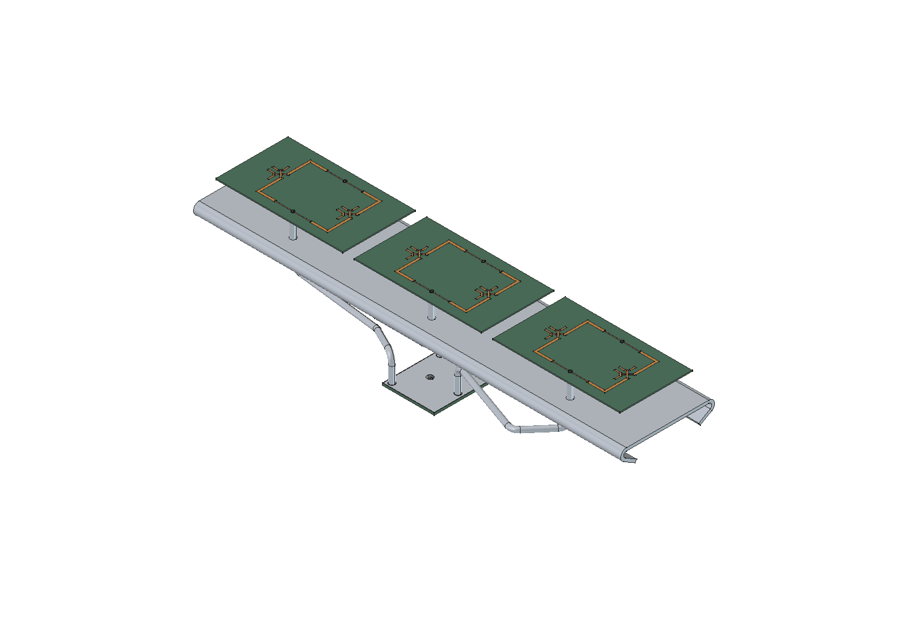
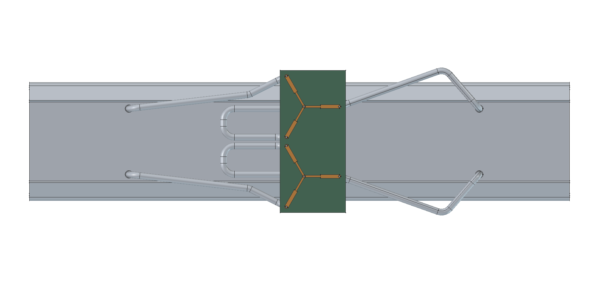

# C09 — ajuste dos transformadores e confirmação HFSS/Nexxim

**Casamento do conjunto confirmado em 5,17 GHz.** Versão selecionada: c02.

O divisor foi recalculado no HFSS e seu S8 conectado no Nexxim ao S6 da antena formada por três placas de dois elementos. Mantidos dois sinais de 0,5 W / 0°, seis ramais iguais, cabos iguais de 134 mm somente no circuito, ausência de radome e nenhum sweep.

| Resultado com a antena conectada | Valor | Critério |
|---|---:|---:|
| VSWR ativo A / B | 1.18382 / 1.22572 | ≤1,25 |
| VSWR com outra entrada em 50 Ω | 1.14234 / 1.20721 | Informativo |
| Ganho frontal realizado total | 14.1456 dBi | ≥12 dBi |
| Abertura H / V | 86.241° / 10.068° | Abertura H≈100° ainda pendente |
| Máximo H / V | +0.000° / +0.0752° | V: 0° ±0,5° |
| H(0°) abaixo do máximo | 0.0000000 dB | ≤0,5 dB |
| Assimetria principal V | 0.1114 dB | Referência 0,2 dB |

## Dimensões e simetria

| Dimensão comum aos seis ramais | c00 | c02 |
|---|---:|---:|
| W1_mm | 0.703341 | 1.003349 |
| W2_mm | 2.433234 | 2.070673 |
| L1_mm | 9.850324 | 9.055480 |
| L2_mm | 9.473582 | 10.268427 |
| comprimento_por_ramal_mm | 19.323907 | 19.323907 |

PCB preservada em 36 × 78 mm, ZYF300CA-C de 1,52 mm (εr=2,94, tanδ=0,0016), cobre 35 µm e ENIG nominal. Somente Sinal_A e Sinal_B mudaram: as 50 outras peças do divisor, os oito terminais, as posições de solda e os cabos foram preservados. A divisão entre as duas seções mudou igualmente nos seis caminhos. Igualdade elétrica nominal significa mesmos materiais, larguras e comprimentos; as fases reais são verificadas no S8.

## Confirmação de circuito e convergência

| Variante HFSS ligada no Nexxim | VSWR A | VSWR B | Passes do divisor | ΔS |
|---|---:|---:|---:|---:|
| c00 | 1.52829 | 1.69994 | 5 | 0.0195629 |
| c01 | 1.22567 | 1.25418 | 6 | 0.0162264 |
| c02 | 1.18382 | 1.22572 | 5 | 0.0203663 |

O divisor selecionado convergiu em 5 passes, ΔS 0.0203663, com dois passes consecutivos abaixo de 0,05. Todos os passes usaram 14 núcleos, solver direto e Classic com elementos curvilíneos. A auditoria verificou importação CAD, passividade, reciprocidade e ausência de reparos Major. Não houve passes além de seis em nenhum candidato.

O Nexxim foi realmente executado, com duas fontes de igual potência/fase, oito blocos Touchstone e seis interligações iguais. A matriz S2 exportada confere com a conexão independente por ondas complexas: erro máximo 6.15e-16. As matrizes usadas aqui são do novo HFSS; os modelos de linhas calibrados ficam separados como guias, sem valor de confirmação EM.

**Condição da antena reutilizada:** geometria, S6 e campos da R14 foram preservados por SHA-256. A antena já tinha seis passes e ΔS 0,0243789; não foi recalculada nesta sintonia do divisor. Seus campos ainda variaram 0,309 dB no último passe. Portanto o casamento do circuito pode ser confirmado, mas ganho e diagramas permanecem preliminares e a aprovação RF completa da antena não está sendo declarada. A abertura H continua inferior aos aproximadamente 100° desejados.

## Divisor isolado e conjunto carregado

O ajuste foi feito para a carga real da antena através dos cabos. Ele não transforma este divisor em um componente genericamente casado a 50 Ω em todas as portas. A trifurcação não tem resistores de isolação.

| Saídas terminadas em 50 Ω | VSWR de entrada | Dispersão de amplitude | Dispersão de fase |
|---|---:|---:|---:|
| A | 1.7158 | 0.0878 dB | 0.8351° |
| B | 1.7058 | 0.1362 dB | 0.7985° |

Balanço para 1 W incidente: refletido 0.008685 W, perda no divisor 0.021336 W, perda nos cabos 0.034229 W, aceito na antena 0.935749 W. O último termo inclui dissipação e radiação da antena.

Cabos: 134 mm físicos, 133,82 mm entre planos EM; os 0,18 mm finais de terminal estão no S6. A linha RLGC usa cobre/PTFE nominal e perde 0.1231 dB por caminho. Não inclui radiação dos cabos, acoplamento espacial divisor–antena, conectores N ou tolerâncias de fabricação. Não houve simulação de banda.

## Montagem atualizada

Somente as duas trilhas do divisor foram alteradas no conjunto de 122 sólidos. A montagem mecânica continua preliminar; os cabos aparecem no CAD, mas não no modelo HFSS.

## Arquivos

[HFSS divisor](c02/divisor/Divisor_Duplo3.aedt) · [Nexxim com arquivos externos](c02/circuito/C09_Ajuste_Nexxim_sem_malhas.aedtz) · [Resultados](c02/circuito/resultado.json) · [Auditoria](c02/divisor/auditoria_em.json)

[Antena HFSS preservada](../compacto_c09/c00/antena/PCB_SemCabos.aedt) · [Montagem FreeCAD](c02/visual/Antena_C09_Ajustada_PRELIMINAR.FCStd)

Os nativos e exportações compactas estão no pacote, sem malhas ou campos volumétricos. Os arquivos do estudo inicial foram preservados. Ainda não foram gerados novos Gerbers desta sintonia.
