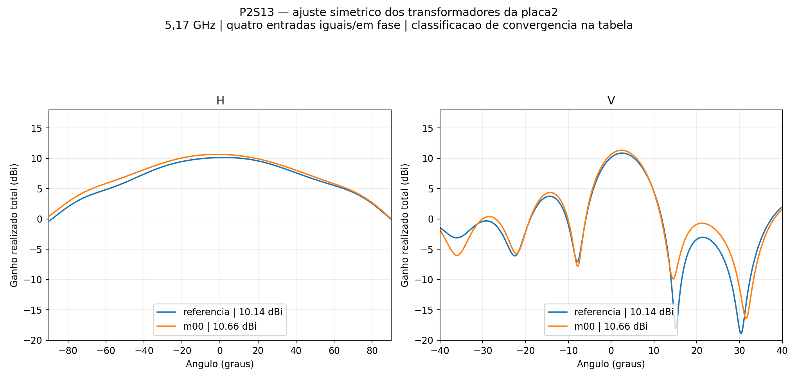
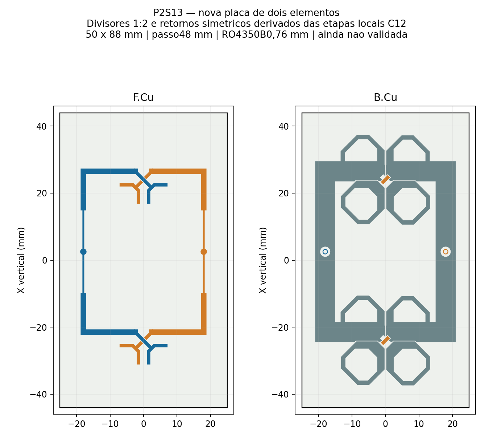

# P2S13 — casamento da placa de dois elementos

O usuário pediu VSWR ≤1,25 em 5,17 GHz, alimentação simétrica/em fase, 14 núcleos, até seis passes e ΔS≤0,05. O ajuste é aplicado **somente aos transformadores da placa de dois elementos** no painel de seis níveis (C12 de quatro + nova placa de dois). A referência é o refletor b=10 mm/90°, que apresentou a maior abertura horizontal na etapa anterior. Não houve mudança de refletor, radiadores, retornos, espaçamento, altura ou cabos nesta comparação.

O candidato **m00** atinge numericamente o VSWR, mas permanece preliminar. Transformadores iguais nas duas polarizações: **0.546717 mm de largura e 13.151813 mm de comprimento**. As duas bifurcações continuam simétricas, com quatro caminhos geométricos de 39,490832 mm. O restante de cada caminho é a linha de 1,623415 mm. Alterar a partição de larguras conserva o caminho geométrico, mas altera seu comprimento elétrico.

## Condições e objetivo

- Quatro entradas externas de 0,25 W a 0°, total de 1 W; nenhuma fase ajustada externamente.
- Cabos coaxiais físicos de 50 mm, substratos e metalizações com perdas, como na referência. Não inclui conectores N ou rede externa.
- Passo vertical 48 mm, seis níveis; PCB2 de 50 × 88 mm; RO4350B com núcleo de 0,76 mm e face inferior a 14,949 mm do refletor.
- Classic automático, 14 núcleos, frequência única de 5,17 GHz, sem sweep, máximo de seis passes, ΔS-alvo de 0,05 e dois passes consecutivos. Concluir no limite não significa convergir.
- Objetivo de casamento: VSWR nas entradas A/B da **PCB2**, tanto com todas as entradas iguais/em fase quanto com as demais terminadas em 50 Ω. O maior VSWR ativo de todas as quatro entradas também é registrado no JSON.

A triagem inicial usou MLine e a matriz Z4 efetiva congelada extraída do S4 anterior. Ela remove e repõe uma rede equivalente dos transformadores para selecionar dimensões; não prediz a alteração do campo nem do acoplamento geométrico. A recomposição exata da matriz original é apenas um teste da álgebra. O coaxial foi ideal de fase somente nessa triagem; as soluções HFSS abaixo incluem os cabos físicos com perdas.

## Resultados HFSS

| Caso | Largura / comprimento mm | VSWR2 ativo A/B | VSWR2 demais casadas A/B | G frontal dBi | H / V graus | Passes / ΔS |
|---|---:|---:|---:|---:|---:|---:|
| referencia | 0.860433 / 8.816344 | 1.9434 / 1.8126 | 1.6185 / 1.5346 | 10.145 | 85.91 / 10.26 | 6 / 0.049882 |
| m00 | 0.546717 / 13.151813 | 1.1956 / 1.1685 | 1.1501 / 1.2107 | 10.657 | 87.30 / 10.07 | 6 / 0.042633 |

Máximos dos cortes do candidato selecionado: **H -1.75° / V +2.50°**. Lóbulo secundário vertical mais alto: **-6.96 dB** relativo ao pico do corte. Ganho é frontal realizado total com as quatro entradas simultâneas; não representa ganho MIMO por entrada isolada.

Convergência S: **False**; estabilidade das nove sondas de campo: **False**; auditoria de passividade, reciprocidade, potência e malha: **True**. A meta de casamento não substitui essas verificações. As metas anteriores de ganho 13 dBi/H99–121°/V16,2–19,8° são relatadas nos resultados do painel e não foram relaxadas para classificar o casamento.

O último ΔS ficou abaixo de 0,05, mas foram registrados **1 de dois passes consecutivos necessários**. O rótulo `Converged` exportado pelo HFSS é `True`; a auditoria não o aceita isoladamente quando o próprio contador consecutivo é insuficiente. Entre os dois últimos passes, o ganho frontal mudou **+0.225 dB**, e a maior mudança entre as nove sondas foi **0.503 dB**. Não foram executados passes adicionais ou reiniciado o mesmo caso.

O maior VSWR ativo considerando **as quatro entradas do painel** é **1.2595**. O atendimento numérico ao limite 1,25 nesta etapa se refere às duas entradas da PCB2; não deve ser estendido às entradas da PCB4 nem à banda completa.

[Placa FreeCAD](m00/placa2/2_elementos_simetrica.FCStd) · [Conjunto FreeCAD](m00/P2S13_Casamento2.FCStd) · [Projeto HFSS](m00/P2S13_Casamento2.aedt) · [Diagramas polares](m00/polar_HV.png) · [Tabela CSV](comparacao.csv) · [Dados e classificação](comparacao.json) · [Manifesto SHA-256](manifesto.json).

O CAD foi verificado quanto a simetria, continuidade, isolamento e interferências. O nativo AEDT contém o modelo; a malha e os campos volumétricos ficam somente na pasta de trabalho e não são restaurados pela cópia do Git. S4, campos distantes, cortes e evidências compactas são preservados. Esta etapa não libera fabricação nem comprova desempenho em toda a banda.

Pasta de trabalho: `D:/dev/EMBRAER/P2S13/R02_Casamento_Placa2`. Scripts: `../automacao/casar2_*.py` e `casar2_pipeline.ps1`. Ensaios anteriores preservados em [seis_elementos](../seis_elementos/README.md).
