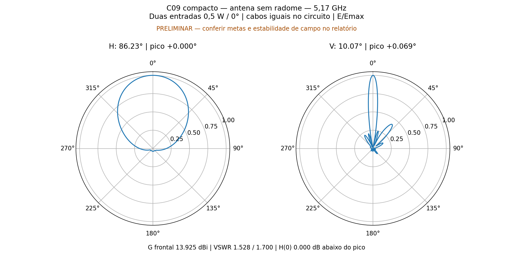
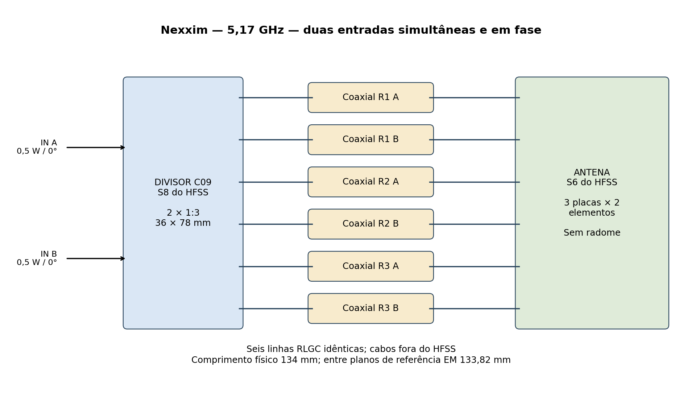
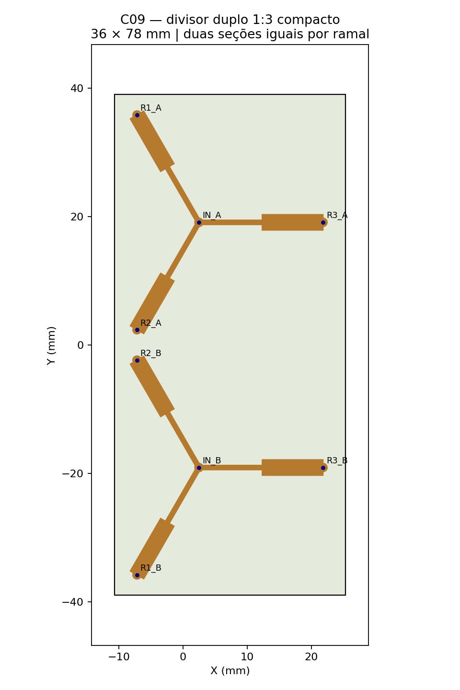
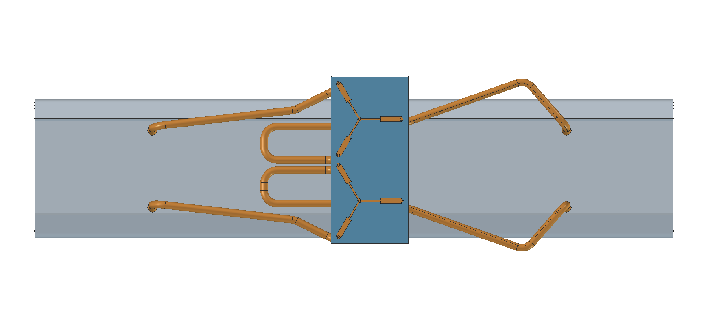
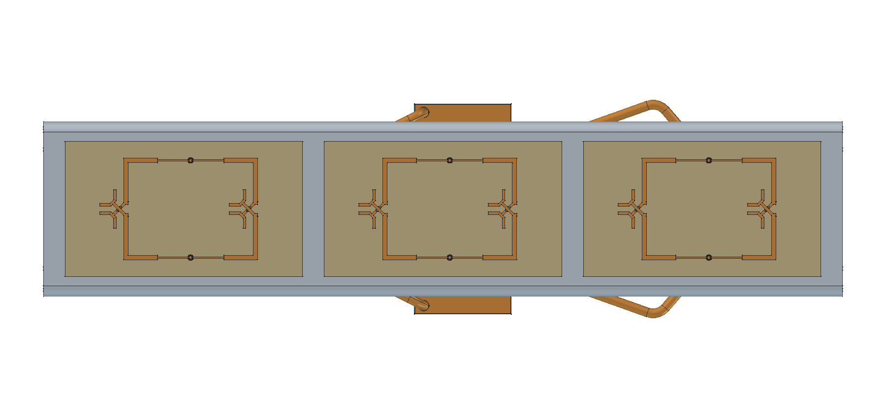

# C09 compacto — HFSS separado e Nexxim

**Resultado em 5,17 GHz: estudo ainda não qualificado; ver reprovações abaixo.**

Duas entradas de 0,5 W / 0°, seis radiadores em três PCBs de dois elementos. O radome foi retirado. Cada polarização usa um divisor 1:3 de duas seções, com os três ramais fisicamente iguais.

| Grandeza | Resultado | Meta |
|---|---:|---:|
| Ganho frontal realizado total | 13.9252 dBi | ≥12 dBi |
| VSWR ativo A / B | 1.5283 / 1.6999 | ≤1,25 |
| VSWR com outra entrada casada A / B | 1.5546 / 1.7326 | Informativo |
| Abertura H / V a −3 dB | 86.228° / 10.073° | Informativo |
| H(0°) abaixo do máximo global | 0.0000 dB | ≤0,5 dB |
| Direção do máximo V | +0.0691° | 0° ±0,5° |
| Assimetria do lóbulo principal V | 0.0967 dB | ≤0,2 dB (diagnóstico) |

Metas individuais: VSWR_ativo=**não atende**, ganho_frontal=atende, H_frontal_ate_05dB=atende, maximo_vertical=atende, simetria_vertical=atende. A abertura horizontal também ficou abaixo dos aproximadamente 100° buscados no projeto; essa redução não deve ser confundida com melhoria de ganho sem contrapartida.

## Circuito efetivamente calculado

O Nexxim LNA calculou os oito blocos Touchstone: S8 do divisor, seis S2 de coaxial e S6 da antena. A matriz S2 exportada pelo Nexxim confere com a conexão independente por ondas de potência; erro absoluto máximo 4.61e-16. Não se substituiu a simulação Nexxim por uma simples soma de perdas.

Os diagramas são recompostos dos campos complexos embutidos das seis portas da antena, usando as ondas incidentes obtidas no circuito carregado. A recomposição da excitação uniforme foi confrontada com o HFSS. Ganho total refere-se às duas entradas coerentes, 1 W incidente total; não é ganho MIMO por entrada.

Os cabos são seis linhas RLGC iguais, com comprimento físico de 134 mm. O trecho entre planos de referência EM é 133.82 mm: os últimos 0,18 mm do acesso estão no modelo da antena. A perda nominal calculada de cada linha é 0.1231 dB. Inclui cobre e PTFE nominal (εr=2.036363534, tanδ=0.000276831); não é um ensaio de cabo comercial. Não há cabos longos em 3D no HFSS.

## Divisor e geometria

PCB ZYF300CA-C de 1,52 mm, 36 × 78 mm, cobre de 35 µm. Todos os seis ramais possuem duas seções com comprimentos 9.850324 e 9.473582 mm, larguras 0.703341 e 2.433234 mm. Comprimento total por ramal 19.323907 mm. A mesma sequência de materiais e dimensões define a igualdade elétrica nominal; as fases reais estão medidas abaixo.

| Saídas em 50 Ω | VSWR de entrada | Perda excedente | Dispersão de amplitude | Dispersão de fase |
|---|---:|---:|---:|---:|
| A | 1.4073 | 0.2409 dB | 0.0732 dB | 1.1420° |
| B | 1.4079 | 0.2402 dB | 0.1350 dB | 0.9905° |

As trifurcações não possuem resistores de isolação. O maior acoplamento entre saídas da mesma polarização, com outras portas casadas, é -9.95 dB (A) e -9.93 dB (B). Por isso o casamento e o equilíbrio carregados são calculados com a matriz S6 completa da antena, incluindo reflexões entre blocos.

## Convergência e potência

| Bloco HFSS | Passes | ΔS atingido | Convergência |
|---|---:|---:|---|
| antena | 6 | 0.0243789 | Sim |
| divisor | 5 | 0.0195629 | Sim |

Limite de seis passes por bloco, ΔS alvo 0,05 e dois passes consecutivos; 14 núcleos confirmados no perfil. Classic com elementos curvilíneos e solver direto, sem sweep e sem operações locais de refinamento. Encerrar no limite não equivale a convergir.

As nove direções de campo são apenas monitoradas. Os dois últimos máximos de variação são 0.9500 / 0.3090 dB; referência de estabilidade 0,1 dB. Este monitor não autoriza passes adicionais nem modifica o critério ΔS pedido.

Balanço para 1 W incidente: refletido 0.055434 W, perda no divisor 0.022619 W, perda nos cabos 0.032526 W e potência aceita pela antena 0.889422 W. Esta última ainda inclui perdas/radiação da própria antena; não é toda potência radiada.

Matrizes passivas/recíprocas, ausência de reparos Major e potência uniforme HFSS verificadas nas auditorias EM. A ausência de reparos não significa ausência de todos os avisos locais do mesher; eles foram conservados nas auditorias.

## Limites e arquivos

HFSS separado: acoplamento entre radiadores incluido no S6; nao inclui acoplamento espacial antena-divisor, radiacao dos cabos nem contribuicao direta do campo do divisor. Cabos somente RLGC no circuito; sem radome e sem conectores N. Apenas o ponto central foi calculado. Não há comprovação da banda de 5,09–5,25 GHz nem validação experimental.

[Nexxim nativo](circuito/C09_Antena_Nexxim.aedt) · [Arquivo Nexxim com Touchstones](circuito/C09_Antena_Nexxim_sem_malhas.aedtz) · [Resultados](circuito/resultado.json) · [Verificação Nexxim](circuito/verificacao_nexxim.json)

[HFSS divisor](divisor/Divisor_Duplo3.aedt) · [HFSS antena](antena/PCB_SemCabos.aedt) · [FreeCAD montagem preliminar](visual/Antena_C09_SemRadome_PRELIMINAR.FCStd)

A montagem FreeCAD continua aberta. KiCad/Gerbers C08 anteriores permanecem históricos; ainda não há Gerbers C09 liberados. Cabos aparecem somente no CAD mecânico e no circuito. O pacote Git contém nativos e exportações compactas, sem malhas ou campos volumétricos; abrir o HFSS do Git não restaura uma solução volumétrica salva.
