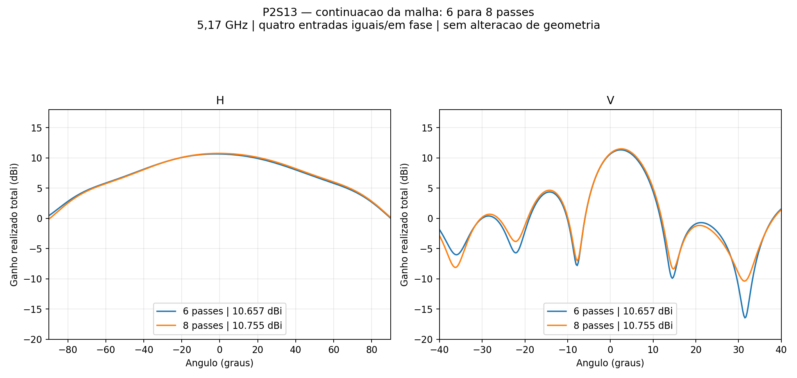
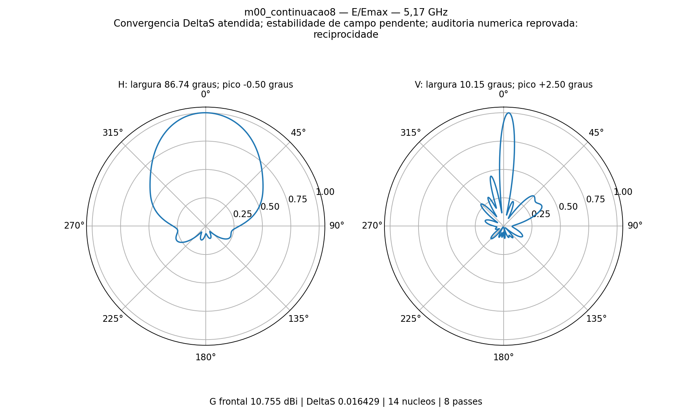

# P2S13 — dois passes adicionais na versão ajustada

Continuação solicitada em 11/11/2026: **somente os passes 7 e 8**, preservando os seis anteriores. **Resultado requer as ressalvas de convergência/estabilidade descritas abaixo.**

- **ΔS≤0,05 com dois passes consecutivos: sim.** Último ΔS=0.01642882; contador consecutivo=3.
- **VSWR≤1,25 nas duas entradas da PCB2: sim**, tanto ativo com quatro entradas iguais/em fase quanto com as demais terminadas em 50 Ω.
- **Estabilidade das nove sondas de campo: não**, usando o limite já existente de 0,1 dB em dois passos consecutivos. Não confundir convergência de S com estabilidade de todos os campos.
- **Auditoria numérica conjunta: não.** A reciprocidade excedeu o limite; passividade, balanço de potência, recomposição dos campos e malha passaram nas verificações.

## Continuidade conferida

A solução foi copiada para uma pasta própria, incluindo os 66 arquivos de resultados locais. Os hashes do adaptativo, da malha e dos campos salvos foram conferidos antes da retomada. O HFSS reconheceu os seis passes existentes e o worker retomou com `-solve_adapt 7 -max_processors 14`. Nenhum novo ciclo inicial de malha foi executado.

O setup mudou somente de máximo 6/mínimo 2 para **máximo 8/mínimo 8**, para executar exatamente os dois passos solicitados. ΔS=0,05, dois passes consecutivos, geometria, materiais, fronteiras, parâmetros de malha e os nove identificadores de cache foram mantidos. Ao final, os históricos completos dos seis primeiros passes permaneceram idênticos; o projeto original e seus resultados também foram conferidos sem alteração. [Auditoria antes do solve](preparacao_auditada.json) · [Auditoria final](continuidade_auditada.json) · [Origem e hashes](origem.json).

## Condições físicas

Painel de seis níveis: C12 de quatro elementos + PCB simétrica de dois, refletor b=10 mm/90°, passo 48 mm. Transformadores PCB2 de **0,546717 mm × 13,151813 mm**, caminhos geométricos iguais de 39,490832 mm. Quatro cabos coaxiais físicos de 50 mm, perdas dos condutores e dielétricos incluídas. Quatro entradas **0,25 W / 0°**, total de 1 W. Potência por radiador não é uniforme entre as placas de quatro e dois elementos.

**5,17 GHz somente, sem sweep, 14 núcleos nos dois passos adicionais.** A análise não representa ganho MIMO por entrada isolada nem qualifica a banda. PCB, cabos, rede impressa e refletor são os mesmos do [ensaio de seis passes](../casamento_placa2/README.md).

## Comparação

| Grandeza | 6 passes | 8 passes |
|---|---:|---:|
| ΔS | 0.042633 | 0.016429 |
| Passes consecutivos | 1 | 3 |
| VSWR ativo PCB2 A | 1.19565 | 1.22085 |
| VSWR ativo PCB2 B | 1.16847 | 1.14980 |
| VSWR PCB2 A, demais casadas | 1.15011 | 1.10125 |
| VSWR PCB2 B, demais casadas | 1.21075 | 1.14708 |
| Ganho frontal realizado total (dBi) | 10.6567 | 10.7554 |
| Abertura H (°) | 87.297 | 86.738 |
| Abertura V (°) | 10.073 | 10.148 |
| Máximo H (°) | -1.75 | -0.50 |
| Máximo V (°) | +2.50 | +2.50 |
| Lóbulo secundário V (dB) | -6.963 | -6.848 |

Do passe 6 ao 8: ganho frontal **+0.0987 dB**, largura H **-0.558°** e V **+0.075°**. No último passo, o ganho frontal mudou **+0.0374 dB** e a maior mudança das nove sondas foi **0.7446 dB**.

A maior mudança de campo ocorreu em **θ=-8° / φ=0°**, perto do primeiro mínimo do corte vertical. O erro máximo de reciprocidade foi **3.8429329e-05**, entre R1_A e R2_B, acima do limite mantido em **1×10⁻⁵**. A matriz é passiva e o balanço de potência confere, mas essa auditoria foi reprovada. Simetrizar a matriz apenas como diagnóstico mudaria o VSWR ativo em no máximo 2.8244246e-05; isso não estima o erro completo de malha, não corrige a solução e não foi aplicado aos dados entregues. [Diagnóstico numérico](diagnostico_numerico.json).

O maior VSWR ativo das quatro entradas do painel foi **1.22085**. A meta de casamento desta etapa é das duas entradas da PCB2. As metas anteriores de ganho 13 dBi, H99–121° e V16,2–19,8° continuam apresentadas no JSON do conjunto, sem aprovação implícita pelo casamento.

[HFSS atualizado](P2S13_Casamento2.aedt) · [Montagem FreeCAD](P2S13_Casamento2.FCStd) · [PCB2 preservada](../casamento_placa2/m00/placa2/2_elementos_simetrica.FCStd) · [Tabela CSV](comparacao.csv) · [Dados e verificações](resultado.json) · [Histórico adaptativo](historico_passes.json) · [Manifesto SHA-256](manifesto.json).

O nativo contém o modelo e os relatórios, porém a solução FEM completa exige as malhas/campos locais. O Git guarda o nativo, S4, campos distantes, diagramas e evidências compactas, sem `.aedtresults`, malhas, locks ou campos volumétricos. Trabalho local: `D:/dev/EMBRAER/P2S13/R03_Continuacao_M00`. Nenhum passo adicional além de oito foi programado.
