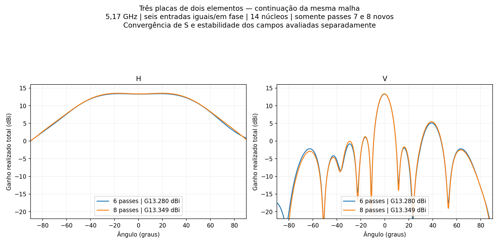
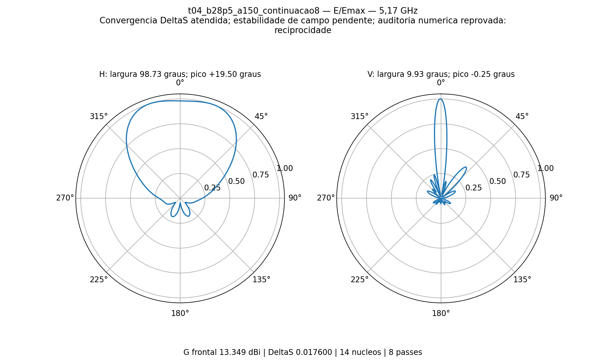

# P2S13 — continuação das três placas de dois elementos

Executados **somente os passes 7 e 8**, preservando a malha e os seis anteriores da versão b=28,5 mm / 150°. **Convergência ΔS≤0,05 por dois passes consecutivos: sim**. Último ΔS **0.01759952**, contador consecutivo **3**. Estabilidade das nove sondas de campo: **não**. Auditoria numérica completa: **não**.

## Condições e continuidade

Três PCBs idênticas de dois elementos, seis níveis a 48 mm, placas a 96 mm e vão de 8 mm. Refletor Al 2 mm, comprimento 296 mm, largura desenvolvida 90 mm, início das dobras 28,5 mm e ângulo 150° para trás. Altura da PCB 14,949 mm. Seis cabos físicos de 50 mm e redes 1:2 impressas com perdas, sem divisores externos ou N. **Seis entradas de 1/6 W a 0°, total 1 W, 5,17 GHz, 14 núcleos, sem sweep.** Ganho realizado total, não ganho MIMO por entrada isolada.

A cópia preservou os 76 arquivos de resultados por SHA-256. O HFSS reconheceu os seis passes; a retomada iniciou no passe 7. O setup mudou somente máximo 6→8 e mínimo 2→8. Geometria, materiais, fronteiras, malha, nove caches e fontes foram mantidos. Os seis registros completos iniciais permaneceram idênticos; a fonte R05 e seus resultados não foram alterados. [Auditoria antes da retomada](preparacao_auditada.json) · [Auditoria final](continuidade_auditada.json) · [Origem e hashes](origem.json).

## Resultados

| Grandeza | 6 passes | 8 passes |
|---|---:|---:|
| ΔS | 0.041546 | 0.017600 |
| Passes consecutivos | 1 | 3 |
| Ganho frontal realizado (dBi) | 13.2799 | 13.3493 |
| Abertura H (°) | 99.318 | 98.727 |
| Abertura V (°) | 9.911 | 9.931 |
| Máximo H (°) | -15.75 | +19.50 |
| Máximo V (°) | -0.25 | -0.25 |
| SLL vertical (dB) | -8.190 | -7.913 |
| VSWR ativo máximo | 1.47830 | 1.32203 |
| VSWR demais portas casadas, máximo | 1.44235 | 1.31290 |

Variações 6→8: ganho **+0.0694dB**, H **-0.591°**, V **+0.020°**. A última malha tem **771442 tetraedros**. Maior variação de campo no último passe **0.111963dB** (monitor 0,1 dB por dois passes). Reciprocidade máxima |S−Sᵀ| **9.2388682e-05**, limite 1×10⁻⁵. Passividade: **sim**; balanço de potência: **sim**; reparos Major/Minor: **0/0**. Não confundir convergência de S com aprovação de todos os campos ou medição experimental.

| Entrada | VSWR ativo | VSWR demais casadas |
|---|---:|---:|
| R1_A | 1.16285 | 1.21313 |
| R1_B | 1.15104 | 1.30659 |
| R2_A | 1.32203 | 1.18623 |
| R2_B | 1.30705 | 1.29365 |
| R3_A | 1.22343 | 1.20616 |
| R3_B | 1.22725 | 1.31290 |

As metas anteriores de H próximo de 100°, ganho≥13dBi e VSWR≤1,25 são verificadas separadamente no [resultado](resultado.json). Não há qualificação de banda. O próximo estudo solicitado é o divisor duplo 1:3 carregado pela matriz S6, com casamento visto nas duas entradas externas; os resultados desta página ainda são das seis entradas diretas.

[HFSS atualizado](P2S13_TresPCB2.aedt) · [Montagem FreeCAD](P2S13_TresPCB2.FCStd) · [Tabela CSV](comparacao.csv) · [S6](centro.s6p) · [Histórico de seis passes](../tres_placas2/README.md) · [Manifesto](manifesto.json).

Trabalho local: `D:/dev/EMBRAER/P2S13/R06_Continuacao_Tres2`. Nativos, Touchstone, campos distantes e evidências compactas arquivados; sem `.aedtresults`, malhas, locks ou campos volumétricos. A solução FEM completa permanece local. Nenhum passe além do 8 foi programado.
