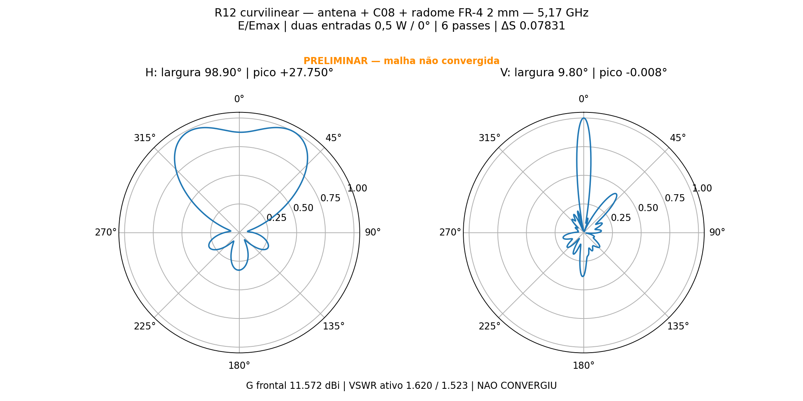
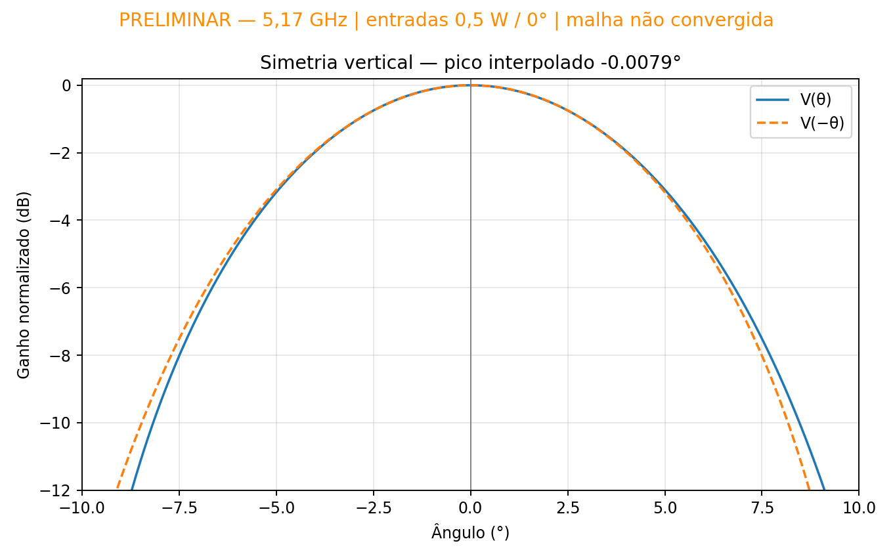

# R12 — simplificacao e elementos curvilineos

Pedido de 12/11/2026: melhorar a simulacao R11, simplificar o modelo e habilitar curvilinear elements. A R11 permanece arquivada e reprovada: no sexto passe o sistema linear iterativo atingiu 600 iteracoes, residual maximo 0,04803, e o balanco de potencia foi nao fisico.

## Mudancas desta revisao

- Uniao de 18 pares de corpos contiguos do mesmo material nos seis cabos: vivo com prolongamento, blindagem com prolongamento e PTFE com prolongamento. Total de corpos fisicos 141 para 123; faces 5634 para 5580. Nenhuma homogeneizacao de materiais distintos. Nao foram removidas perdas, soldas, metalizacao PTH, ENIG, dielétricos ou radome.
- Diferencas booleanas verificadas antes/depois das unioes, objetos nao envolvidos preservados, corpos validos, zero intersecoes volumetricas. Ver `cad/simplificacao.json` e `cad/intersecoes.json`. Placas e Gerbers C08 permanecem geometricamente inalterados; a simplificacao pertence ao modelo de simulacao.
- `GlobalCurvilinear.Apply=true` (antes false). Curvas de cabos, furos e refletor passam a usar a opcao global de elementos curvilineos. Esta opcao pode aumentar o custo por elemento; nao se presume ganho de desempenho apenas por habilita-la.
- `BasisOrder=1` (antes2), solver **Direct Solver** (antes Iterative Solver), crescimento adaptativo configurado30% (antes50%). O solver direto evita a mesma limitacao de600iteracoes do iterativo. A execucao desta R12 completou os seis passes em cerca de10min41s, sem avisos do solver matricial; a memoria registrada no ultimo Matrix Solve foi de aproximadamente18,4GiB. O percentual configurado nao e garantia do crescimento efetivo dos tetraedros.
- Classic automatico, slider5, sem fallback, sem TAU, sem MeshLink, sem operacoes locais de pre-refinamento e sem refinamento lambda inicial.

## Condicoes preservadas

5,17GHz somente, sem sweep, 14nucleos, no maximo6passes, DeltaS<=0,05 por2passes consecutivos. Fontes externas IN_A/IN_B de0,5W/0graus. Mesma geometria externa, tres placas de dois elementos, C08, seis cabos50mm e radome FR4 Isola370HR de2mm, nominal epsilon3,92/tand0,025. Refletor28,5mm/150graus. Conectores externos e vedacao nao caracterizados.

Metas: ganho frontal realizado>=12dBi, VSWRativo<=1,25, lobo principal vertical centrado (tolerancia angular anterior+/-0,5grau) e simetria registrada (auditoria0,2dB). VSWR com a outra entrada casada tambem e reportado. Convergencia S nao basta: conferir solver matricial, reciprocity, potencia, recomposicao dos campos e estabilidade. Nenhum resultado RF novo foi aprovado na preparacao.

`r12_pipeline.ps1` cria e fecha o nativo, verifica os parametros salvos em `setup_confirmado.json`, reabre para resolver e exportar, fecha, audita e plota. Qualquer falha para a fila; ela nao cria um novo ciclo nem ultrapassa6passes. Nao executar novamente enquanto houver uma fila ativa.

Referencia da opcao: https://ansyshelp.ansys.com/public/Views/Secured/Electronics/v242/en/Subsystems/HFSS/Content/Mesh/SpecifyingInitialMeshSettings.htm. API local PyAEDT `Mesh.assign_initial_mesh_from_slider(curvilinear=True)` mapeia para `InitialMeshSettings / GlobalCurvilinear / Apply`. A configuracao efetiva deve ser confirmada no arquivo nativo, nao apenas no script.

## Resultado encerrado em 12/11/2026

O HFSS encerrou às 01:50:52 e concluiu a exportação às 01:51:04, horário local. A auditoria automática parou ao procurar `IterativeResidual`, parâmetro ausente no solver direto. A leitura foi corrigida e a auditoria refeita **sem novo solve**, sobre os mesmos arquivos; ver `recuperacao_auditoria.json`. O limite de seis passes foi respeitado.

**PRELIMINAR: não convergiu e não atende ao ganho frontal ou VSWR solicitados.** Os testes de passividade, reciprocidade e potência estão consistentes; isso não substitui a convergência da malha.

| Verificação em 5,17 GHz | Resultado | Situação |
| --- | --- | --- |
| Passes / núcleos | 6 / 14 em cada passe | Limites respeitados |
| ΔS final / meta | 0,078306812 / ≤0,05 | Não atende; zero passes consecutivos no alvo |
| Ganho frontal realizado total | 11,571884 dBi | Não atende ≥12 dBi |
| VSWR ativo A / B | 1,619914 / 1,522820 | Não atende ≤1,25 |
| VSWR com outra entrada casada A / B | 1,612828 / 1,568656 | Não atende ≤1,25 |
| Abertura H / V a −3 dB | 98,902309° / 9,795850° | Valores preliminares |
| Máximo H | +27,75°; 12,724019 dBi | Pico fora do eixo; há outro máximo em −25,75°, 0,113 dB abaixo |
| Máximo V | −0,01° na grade; −0,007875° interpolado | Próximo de 0°; dentro de ±0,5° |
| Assimetria do lóbulo principal V | 0,067624 dB em ±4,871° | Dentro da auditoria de 0,2 dB |
| Tetraedros no passe 6 | 409.007 | Zero reparos Major e Minor |
| Variação máxima das nove amostras de campo, passe 6 | 0,689115 dB | Ainda acima do monitoramento de 0,1 dB |

O centro do corte horizontal fica 1,152 dB abaixo do máximo. A largura horizontal indicada corresponde aos cruzamentos externos de −3 dB (−48,276° a +50,626°) da região frontal com dois máximos. O lóbulo principal vertical é quase simétrico, mas o diagrama completo não é: há um lóbulo em +40° a −7,119 dB relativo ao pico V. A centragem nominal do principal não aprova todo o diagrama nem resolve as demais metas.

### Balanço de potência

Duas entradas de 0,5 W a 0°, total de 1 W, com cabos físicos e perdas de materiais incluídos:

- Refletida: 0,049467044 W.
- Aceita: 0,950532956 W, conferida pelos parâmetros S.
- Radiada: 0,783956729 W.
- Dissipada inferida pela diferença aceita−radiada: 0,166576228 W.
- Eficiência de radiação: 82,4755%; eficiência total: 78,3957%.

Assim, 1 W = 0,049467044 + 0,783956729 + 0,166576228 W. A dissipação é inferida por diferença, sem decomposição independente por material. Matriz S passiva (maior valor singular 0,249404), erro de reciprocidade zero na precisão exportada; recomposição coerente de campos individuais confere em menos de1,4e−14. Não houve o balanço não físico nem o aviso de falha iterativa da R11. **O balanço consistente não autoriza chamar a R12 de convergida.**

### Diagramas e reprodução

`resultado.json` e `potencia_conferida.json` contêm a auditoria numérica; `historico_passes.json` conserva todos os passes. `ALL_*.csv`, `IN_*.csv` e `centro.s2p` conservam as exportações do HFSS; `diagrama_H.csv` e `diagrama_V.csv` dão ganho realizado e E/Emax. As curvas de cada corte são normalizadas ao próprio máximo. Fontes e arquivos de configuração têm SHA256 rastreado.

O `.aedt` fechado reproduz a geometria e o setup; a malha e os campos volumétricos ficam apenas na pasta local de trabalho, fora do Git. O projeto nativo isolado exige novo solve para restaurar campos no HFSS. As PCBs e Gerbers C08 não foram alterados nesta auditoria. Sem sweep, sem passes adicionais e sem liberação RF para fabricação.

## Estado do pacote

Calculo encerrado. Validacao RF pendente/reprovada; consultar resultado.json.
