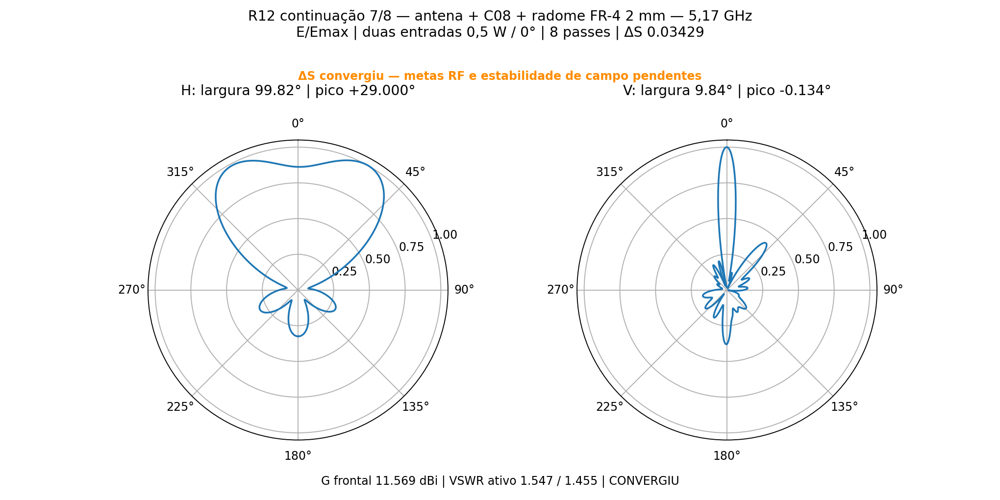
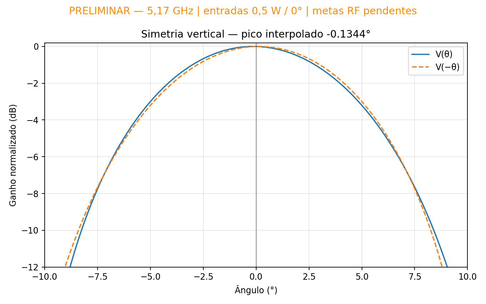
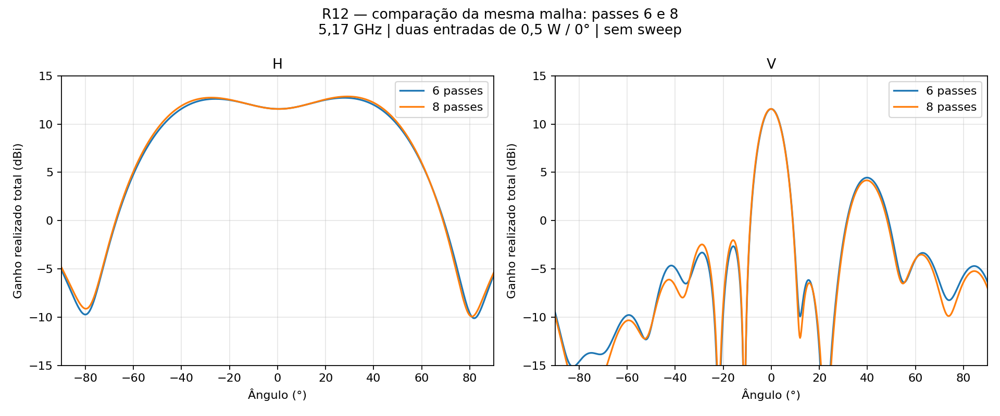

# R12 — dois passes adicionais, oito no total

Solicitação de 12/11/2026. Executados somente os passes 7 e 8, a 5,17 GHz, sem sweep e com 14 núcleos em cada solução matricial. Duas entradas externas de 0,5 W a 0°, total 1 W. Mesmos três módulos radiantes M00, divisor duplo C08, seis cabos físicos com perdas, refletor e radome FR-4 de 2 mm.

## Resultado

| Grandeza | Seis passes | Oito passes |
| --- | ---: | ---: |
| ΔS | 0.078307 | 0.034291 |
| G frontal (dBi) | 11.571884 | 11.569272 |
| VSWR ativo A | 1.619914 | 1.547453 |
| VSWR ativo B | 1.522820 | 1.455024 |
| H (graus) | 98.902309 | 99.818418 |
| V (graus) | 9.795850 | 9.843454 |
| Máximo V (graus) | -0.007875 | -0.134412 |
| Assimetria principal V (dB) | 0.067624 | 0.207787 |

Convergência HFSS: **sim**, 2 passes consecutivos no alvo ΔS≤0,05; são exigidos dois. Balanço de potência consistente: **True**. Validação nominal completa: **False**. As comparações numéricas não qualificam resultados sem convergência ou com falha física. Estabilidade de nove amostras de campo nos dois últimos passes: [0.6533604976275607, 0.28222257655207006] dB (monitoramento de 0,1 dB).

VSWR com a outra entrada casada: 1.546515 / 1.524701. Máximo horizontal em +29.00°, com 12.860271 dBi; distinguir esse pico do ganho frontal. A assimetria V se refere apenas ao lóbulo principal no intervalo [-4.841511979675504, 4.841511979675504], com critério de 0,2 dB; tolerância angular anterior de ±0,5°. Lóbulos secundários estão registrados em `resultado.json`.

## Potência e integridade

Potência incidente 1 W; refletida 0.040267693 W; aceita 0.959732307 W; radiada 0.794377111 W. Dissipação inferida por diferença aceita−radiada: 0.165355196 W, sem decomposição por material. Conferir `potencia_conferida.json` e o perfil matricial em `auditoria_solver_matricial.json`.

A cópia de 65 arquivos de resultados preservou a malha nativa, os campos e o cache por SHA256. Antes de resolver, a auditoria confirmou que somente MaximumPasses 6→8 e MinimumPasses 2→8 mudaram; geometria, materiais, fronteiras e malha foram preservados. A auditoria final confirmou os mesmos seis passes iniciais, inclusive tetraedros, ΔS e nove campos, e verificou que a origem não foi alterada. Não houve reinício da adaptação. Os oito passes são o total histórico, não oito novos.

## Arquivos

`P2S13_Curvilinear.aedt`: projeto fechado, com a geometria e o setup atualizados. `centro.s2p`, cortes complexos e diagramas CSV são exportações do campo distante. `resultado.json`, histórico e auditorias rastreiam o resultado. Malhas, resultados volumétricos, locks e temporários ficam somente na pasta de trabalho local, fora do Git; o nativo isolado exige novo solve para restaurar os campos no HFSS. A referência de seis passes está preservada no diretório superior e na pasta local `referencia6`.

As geometrias KiCad e FreeCAD desta entrega são idênticas às PCBs simuladas; sua organização não implica aprovação RF. FR-4 nominal Isola370HR εr3,92/tanδ0,025, sem caracterização do lote, adesivos ou conectores externos. Simulação de frequência única.
