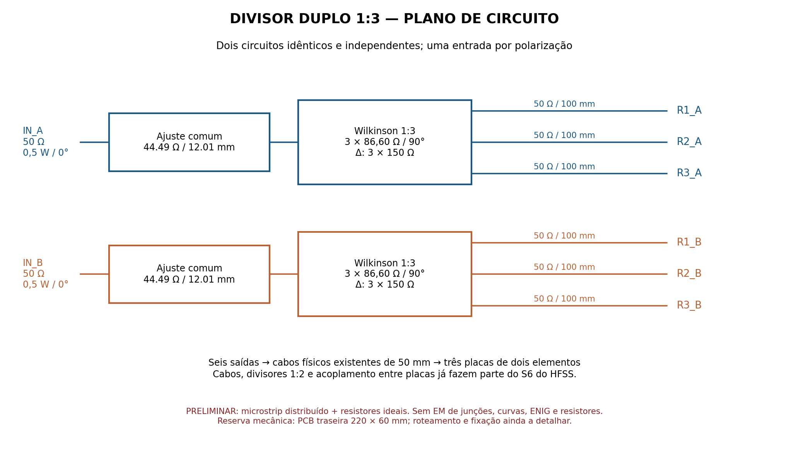
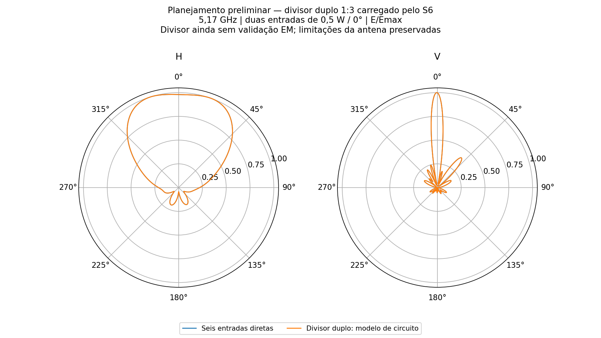

# P2S13 — plano do divisor duplo 1:3

**Histórico analítico.** A implementação física posterior, com cascata Wilkinson desigual/igual, foi simulada no HFSS e **não confirmou** estas metas de casamento e ganho. Consultar o [estudo EM e a correção da junção](../divisor_duplo_1x3_hfss/README.md); os resultados abaixo continuam sendo do plano de linhas distribuídas.

**Planejamento e circuito preliminares, 11/11/2026.** Duas redes Wilkinson 1:3 idênticas alimentam as polarizações A e B das três placas de dois elementos. O ajuste comum de entrada resultou em VSWR ativo **1.1979/1.0895** e, com a outra entrada casada em 50 Ω, **1.0895/1.1978**. Os quatro valores ficam abaixo de 1,25 **neste modelo de circuito e nesta frequência**. O divisor ainda não tem layout roteado ou validação EM.

O ganho frontal calculado é **13.1432 dBi**, H **98.720°** e V **9.931°**, em 5,17 GHz, com duas entradas de 0,5 W / 0°. Não há sweep. São incorporados a matriz S6 e os campos complexos das três placas juntas, incluindo acoplamento, divisores 1:2 impressos e seis cabos físicos de 50 mm com perdas. Esses cabos **não foram acrescentados outra vez**. A alimentação anterior aos planos de referência e os conectores externos são ideais.

## Topologia e posição propostas

Reservar uma placa de distribuição traseira de aproximadamente **220 × 60 mm**, centralizada longitudinalmente no refletor de 296 mm. Colocar os dois divisores 1:3 na região central, com entradas simétricas e cada polarização ocupando uma metade da largura. Alinhar as três saídas de cada polarização com as conexões existentes, em X = −93,491 / +2,509 / +98,509 mm e Y = ±18 mm, nas coordenadas do HFSS. Isso permite conservar os seis cabos iguais já simulados.

Os três ramais de 50 Ω de cada rede têm **100 mm de comprimento de linha**, após os transformadores de quarto de onda. O ramal da placa central precisa de meandro para igualar os caminhos. São seis ramais nominalmente idênticos; não foram impostas correções de fase diferentes entre placas ou polarizações. A posição final em Z, transições coaxiais, folgas, fixação, separação entre meandros e interferência com as abas precisam de conferência no CAD e no modelo EM do divisor. O retângulo de 220 × 60 mm é uma reserva de espaço, não um desenho de fabricação.

O Wilkinson foi escolhido por manter a alimentação das três cargas mais uniforme na presença das reflexões do conjunto. A versão T sem resistores foi comparada com as mesmas linhas: dispersão de amplitude/fase nas seis portas **0.2799 dB / 3.3668°**, contra **0.0246 dB / 0.2421°** no Wilkinson ajustado. Sob cargas ideais iguais, ambas as polarizações têm potência e fase exatamente iguais em suas três saídas no modelo. Com a antena real, o acoplamento gera os pequenos desequilíbrios registrados; as duas fontes externas continuam iguais/em fase.

## Valores iniciais para o futuro layout

| Trecho, por polarização | Impedância | Largura nominal | Comprimento |
|---|---:|---:|---:|
| Ajuste de entrada, idêntico em A/B | 44.491 Ω | 4.627 mm | 12.01 mm |
| Três transformadores de quarto de onda | 86.603 Ω | 1.408 mm | 9.663 mm |
| Três ramais de saída iguais | 50 Ω | 3.867 mm | 100 mm |

Três resistores ideais de **150 Ω em triângulo** interligam as extremidades dos transformadores de cada Wilkinson: seis resistores no total. Encapsulamento, potência e modelo RF dos resistores ainda precisam ser escolhidos antes do layout. O valor não constitui especificação de componente aprovado para 5,17 GHz.

Material nominal do plano: **ZYF300CA-C, núcleo de 1,52 mm**, εr=2,94, tanδ=0,0016, cobre de 35 µm, σ=58 MS/m. A família e os parâmetros dielétricos constam no [serviço oficial de alta frequência da JLCPCB](https://jlcpcb.com/pcb-fabrication/high-frequency-pcb); 1,52 mm vem da cotação histórica do projeto em 7/11, não de uma nova cotação desta placa. Rugosidade RMS de 0,5 µm é hipótese de cálculo.

As linhas usam [MLine do scikit-rf](https://scikit-rf.readthedocs.io/en/latest/api/media/generated/skrf.media.mline.MLine.html), modelos Hammerstad–Jensen e dispersão Kirschning–Jansen. **Não foram modelados ENIG do divisor, descontinuidades das junções, curvas, acoplamento entre trilhas, parasitas dos resistores e soldas.** As perdas das placas radiantes e seus cabos já estão nos dados HFSS, conforme os materiais do R06. Não há aprovação para fabricação.

## Casamento visto nas duas entradas

| Rede carregada pelo mesmo S6 | VSWR ativo A/B | VSWR outra casada A/B | G frontal (dBi) | H / V (°) |
|---|---:|---:|---:|---:|
| T nao isolado | 1.2234 / 1.2168 | 1.2890 / 1.3993 | 13.1257 | 98.795 / 9.970 |
| Wilkinson sem ajuste | 1.2224 / 1.2163 | 1.2894 / 1.3993 | 13.1346 | 98.727 / 9.931 |
| Wilkinson ajustado | 1.1979 / 1.0895 | 1.0895 / 1.1978 | 13.1432 | 98.720 / 9.931 |

A otimização variou somente a impedância e o comprimento do trecho comum de entrada, mantendo valores idênticos nas duas polarizações. Objetivo: minimizar o maior módulo de reflexão entre os dois casos ativos e os dois casos com a outra entrada casada. Busca limitada a 35–80 Ω e 1–20 mm, somente em 5,17 GHz. A largura final foi arredondada a 0,001 mm e o comprimento a 0,01 mm; o circuito foi recalculado após arredondar. Isso é precisão de parametrização, não tolerância de fabricação prometida.

No modelo nominal com saídas em 50 Ω, a perda excedente de transmissão do divisor ajustado é **0.2737 dB**, além da divisão ideal de 4,7712 dB. Esse valor inclui o descasamento do ajuste projetado para a carga real; não é apenas dissipação. Com o painel conectado e 1 W incidente: reflexão **0.004971 W**, dissipação na rede distribuidora **0.052288 W**, potência líquida aceita no modelo da antena **0.942741 W**. A soma confere. O ganho já incorpora esse carregamento e as perdas nominais do divisor do circuito.

Os máximos continuam H **+19.50°**, V **-0.25°**. O corte H tem topo quase plano com dois máximos próximos; o plano do divisor não corrige esse formato. O maior lóbulo vertical frontal é **-7.914 dB** em relação ao máximo. A largura H permanece próxima de 100°, mas não chegou a 100° exatos; V continua perto de 10°, não 18°.

## Verificações e limites de confiança

O Wilkinson ideal de três vias foi conferido por montagem independente: entrada e saídas casadas, saídas isoladas, transmissão −j/√3. Erro máximo **1.18e-16**. O circuito de linhas com perdas foi resolvido por redução nodal e também por interconexão de ondas no scikit-rf; erro **4.69e-16**. A interconexão completa com S6 foi conferida por dois algoritmos e, depois, pelo **Ansys Circuit/Nexxim**, com erro máximo **3.43e-16** na matriz S2. Isso verifica o cálculo e a ligação; não valida a física ainda ausente no modelo do divisor.

O S6 original não foi simetrizado ou modificado. SHA-256: `f40a442d96af7113a3aa20e59a25e762b5da3c1fbd24fbc3cf01fb8a6c4e5015`. A rede distribuidora é passiva e recíproca, mas a matriz carregada herda o erro numérico da antena: |S−Sᵀ| máximo **2.0528282e-05**, ainda acima do limite de auditoria de 1×10⁻⁵. A [continuação da antena](../continuacao_tres_placas2/README.md) convergiu em ΔS=0,01760, porém não passou na estabilidade das nove sondas nem na reciprocidade estrita. **Assim, o VSWR abaixo de 1,25 é uma indicação preliminar; o conjunto não está qualificado.**

Como verificação de sensibilidade, a mesma rede aplicada aos dados anteriores de seis passes dá VSWR máximo **1.2762**; com oito passes, **1.1979**. O caso de seis passes ultrapassa 1,25, reforçando que não se deve liberar a PCB com base apenas no casamento do modelo atual. Não houve novo solve FEM, varredura de frequência ou adaptação além dos passes 7 e 8 solicitados.

## Arquivos e próximo desenvolvimento

[Parâmetros](parametros.json) · [Resultados dos três circuitos](comparacao_circuitos.json) · [Sensibilidade](sensibilidade_6_8.json) · [Conferência Nexxim](circuito/verificacao_nexxim.json) · [S2 final](Wilkinson_ajustado_conjunto.s2p) · [S8 do divisor duplo](Wilkinson_ajustado_duplo.s8p).

[Circuito nativo](circuito/P2S13_Divisor_Duplo3.aedt) · [Arquivo AEDTZ portátil com Touchstones, sem malhas](circuito/P2S13_Divisor_Duplo3_sem_malhas.aedtz). Preferir restaurar o AEDTZ para trazer os arquivos externos; o `.aedt` conserva os caminhos locais originais. O projeto contém dois blocos S4 idênticos e o S6 da antena, com duas portas externas de 50 Ω. A potência/fase operacional é aplicada na recomposição de ondas documentada pelo script.

A próxima implementação é rotear as duas redes simétricas, selecionar resistores RF e transições, conferir o encaixe traseiro e simular a PCB distribuidora completa separadamente em HFSS. Depois substituir o S8 analítico pelo S8 EM e repetir a ligação ao painel. O casamento, ganho e forma do diagrama deverão ser revistos com a malha da antena qualificada. Não foi iniciada essa etapa automaticamente.

Reprodução: `divisor_duplo3_planejar.py`, seguido de `divisor_duplo3_nexxim.py` e `divisor_duplo3_entregar.py`, em `../automacao`. Trabalho local: `D:/dev/EMBRAER/P2S13/R07_Divisor_Duplo3`. O script Nexxim recusa sobrescrever um projeto existente. [Manifesto](manifesto.json) rastreia os arquivos; nenhum `.aedtresults`, malha, lock ou campo volumétrico é enviado ao Git.
