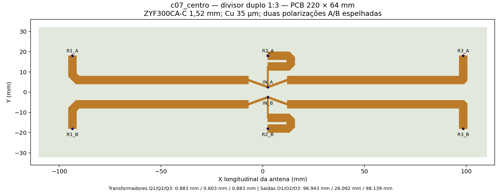
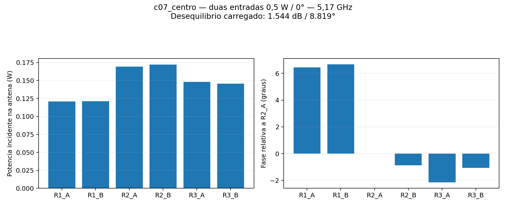
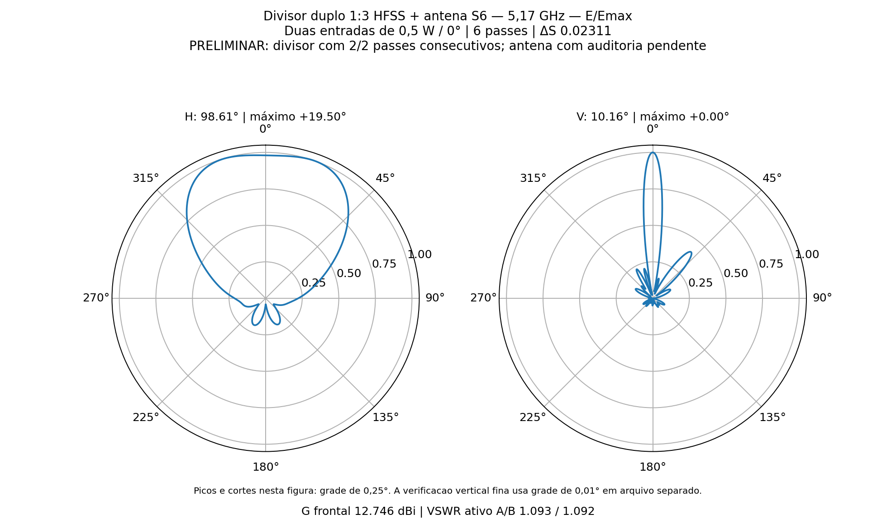
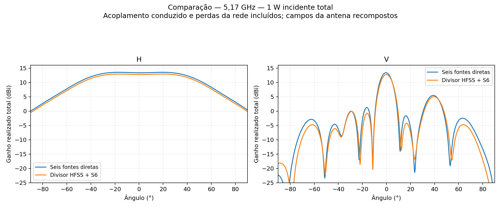
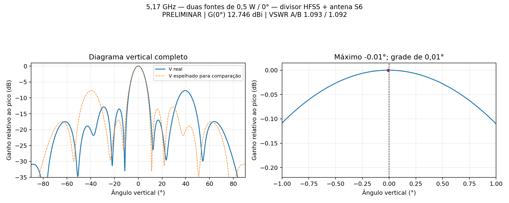

# P2S13 — correção do divisor duplo 1:3

Estudo de 11/11/2026, **5,17 GHz**, duas entradas iguais de **0,5 W / 0°**, total 1 W, sem sweep. Versão selecionada: **c07_centro**. A antena R06 de três placas de dois elementos permaneceu inalterada; seus seis cabos físicos de 50 mm e respectivas perdas já estão incluídos no S6. Não se adicionaram cabos ideais ou fases artificiais para corrigir os resultados.

| Verificação do conjunto carregado | Resultado | Meta |
|---|---:|---:|
| Ganho frontal realizado total | 12.7461 dBi | ≥12 dBi: sim |
| VSWR ativo A / B | 1.0931 / 1.0923 | ≤1,25: sim |
| VSWR com outra entrada casada A / B | 1.1765 / 1.2551 | ≤1,25: não |
| Dispersão nas seis saídas carregadas | 1.5441 dB / 8.8192° | equilíbrio de amplitude / fase |
| Aberturas H / V | 98.614° / 10.162° | medição do resultado |
| Máximos H / V | +19.50° / -0.01° | H: grade0,25°; V: grade0,01° |
| Assimetria do lóbulo principal V | 0.0595 dB | maior diferença entre +θ e −θ em ±4° |
| Lóbulo secundário V mais alto | -7.722 dB | relativo ao máximo frontal do corte |
| Passes / ΔS final | 6 / 0.02311234 | máximo 6 / ΔS≤0,05 |
| Consecutivos / convergência do divisor | 2/2 / sim | dois passes abaixo do alvo |

A meta inicial era 13 dBi. Durante a rodada, o usuário aceitou **12 dBi incluindo os divisores** e priorizou uniformidade do diagrama vertical com máximo em **0°**. As duas fontes externas continuam iguais/em fase; eventuais pequenas compensações são comprimentos físicos de trilha e não alterações das fontes. Os resultados são nominais e preliminares: o S6 e os campos da antena conservam pendências anteriores de estabilidade e reciprocidade. Cumprimento numérico das metas, quando indicado, não equivale a validação experimental ou liberação de fabricação.

## Correção física

O divisor em cascata da R08 foi substituído por duas trifurcações diretas espelhadas, com três transformadores de impedância por entrada, sem resistores de isolamento. Essa escolha reduz o percurso e elimina a dissipação nos resistores, mas as saídas deixam de ser isoladas entre si. As reflexões das seis cargas são incluídas pela conexão das matrizes completas S8 e S6.

A PCB mantém **220 × 64 mm**, ZYF300CA-C de núcleo **1,52 mm**, εr=2,94, tanδ=0,0016, Cu físico **35 µm**, rugosidade nominal 0,5 µm e ENIG Au **0,0254 µm** / NiP **4,5 µm**, σNiP=1,5 MS/m. Pinos, acessos PTFE, massas e soldas locais estão representados. As saídas permanecem em X=−93,491 / +2,509 / +98,509 mm e Y=±18 mm, alinhadas aos cabos existentes.

As rotas externas foram abertas para reduzir acoplamento com a dobra da linha central. Comprimentos e larguras foram ajustados com o divisor carregado pela antena. O ramo central é fisicamente menor em cerca de duas ondas guiadas; isso iguala a fase somente próximo da frequência central. Não há demonstração de banda.

Compensação adicional de comprimento nas saídas dos grupos R1/R3: **-0.597892 / +0.597892 mm**, aplicada igualmente nas polarizações A/B por alteração do chanfro das curvas; os terminais não mudam de posição. Ela busca compensar a inclinação residual do diagrama da célula. Isso não significa fases exatamente idênticas nas seis portas carregadas: as fases efetivas são listadas abaixo, e as duas fontes externas permanecem 0°.

A versão selecionada não usa máscara nas trilhas simuladas.

| Trecho em cada polarização | Z de síntese (Ω) | Largura (mm) | Comprimento da linha central (mm) |
|---|---:|---:|---:|
| Q1 | 105.000 | 0.8828 | 10.2000 |
| O1 | 50.000 | 3.8674 | 96.9427 |
| Q2 | 120.000 | 0.6034 | 10.2000 |
| O2 | 50.000 | 3.8674 | 26.0917 |
| Q3 | 105.000 | 0.8828 | 10.2000 |
| O3 | 50.000 | 3.8674 | 98.1385 |

Os valores de Z são de síntese de microstrip uniforme; curvas, junções, transições e acoplamento são calculados no HFSS. A/B mantêm geometria espelhada e fontes iguais/em fase. Nenhuma matriz foi simetrizada para melhorar artificialmente o resultado.

## Histórico das geometrias

Cada candidato abaixo é uma geometria própria, limitada a seis passes. Não houve continuação de um candidato além desse limite. BasisOrder1=primeira ordem, 2=segunda ordem, −1=mista. C03 e C04 também diferem na discretização; sua comparação não isola exclusivamente a contribuição da máscara. O parâmetro PercentRefinement consta na configuração de cada caso, e não representa necessariamente o crescimento efetivo da malha.

| Caso | BasisOrder | Passes / ΔS | Consecutivos | VSWR ativo A / B | G frontal (dBi) | Dispersão amplitude (dB) / fase (°) |
|---|---:|---:|---:|---:|---:|---:|
| c00_direto | 1 | 6 / 0.139720 | 0/2 | 1.2470 / 1.0658 | 11.9056 | 5.397 / 56.017 |
| c01_aberto | 1 | 6 / 0.054237 | 0/2 | 1.2277 / 1.3510 | 12.4147 | 0.559 / 33.406 |
| c02_fase | 1 | 6 / 0.093645 | 0/2 | 1.3920 / 1.4659 | 12.5423 | 2.616 / 10.913 |
| c03_ordem2 | 2 | 6 / 0.036961 | 1/2 | 1.0939 / 1.0883 | 12.7635 | 1.205 / 2.133 |
| c04_mascara | -1 | 6 / 0.090616 | 0/2 | 1.1221 / 1.1215 | 12.7437 | 1.054 / 8.857 |
| c05_blindado | 2 | 5 / 0.036913 | 2/2 | 1.1644 / 1.0633 | 13.1596 | 0.724 / 8.054 |
| c06_vertical | 2 | 6 / 0.038232 | 1/2 | 1.0966 / 1.0949 | 12.7546 | 1.423 / 6.880 |
| c07_centro | 2 | 6 / 0.023112 | 2/2 | 1.0931 / 1.0923 | 12.7461 | 1.544 / 8.819 |

A separação de perdas foi obtida por pós-processamento dos campos existentes, com as oito ondas incidentes correspondentes ao circuito carregado, sem novo solve. Na C03, a diferença de potência de 0,129506 W contém **0,082144 W radiados pelo divisor** e aproximadamente 0,047362 W dissipados. Isso motivou a C05: tampa/parede de alumínio AL5052 nominal, espessura 1 mm, tampa 6 mm acima das trilhas e contato elétrico contínuo ideal com a borda da massa. Essa C05 também ajusta o transformador central; não é uma comparação de uma única variável.

A C05 convergiu em cinco passes e atingiu **13,1596 dBi**, VSWR ativo **1,1644/1,0633**, mas máximo V **−0,37°**. Seu balanço apresenta 0,049540 W de perda total, dos quais apenas 0,000046 W radiados pelo divisor. A geometria com blindagem fica preservada como alternativa, com contato e montagem ainda nominais. Após o usuário aceitar 12 dBi, a centragem do lóbulo principal passou a ser a prioridade da versão sem tampa. O pequeno ajuste de fase foi feito em cobre, sem mudar os ângulos ou normalizar artificialmente os diagramas.

Na versão selecionada: **129674 tetraedros**, **14 núcleos em todos os passes**, Classic, sem MeshLink, sem operações locais de pré-refinamento, sem refinamento lambda e solver iterativo residual 1×10⁻⁵. A convergência exige dois passes consecutivos; a flag genérica `Converged: Yes` do HFSS não substitui esse contador. Reparos Major/Minor: **0/0**. Evidências: [histórico](c07_centro/historico_passes.json), [convergência](c07_centro/convergencia.txt), [recursos](c07_centro/recursos_matriz.json).

## Equilíbrio e circuito

O campo foi recomposto com as excitações efetivas calculadas após todas as reflexões múltiplas. A potência abaixo é a onda incidente em cada porta da antena, não a potência líquida absorvida. As fontes externas permanecem 0,5 W / 0° em todos os casos.

| Porta | Potência da onda incidente (W) | Fase relativa a R2_A (°) |
|---|---:|---:|
| R1_A | 0.1206231 | +6.4374 |
| R1_B | 0.1210613 | +6.6747 |
| R2_A | 0.1691964 | +0.0000 |
| R2_B | 0.1721233 | -0.8708 |
| R3_A | 0.1480957 | -2.1445 |
| R3_B | 0.1456052 | -1.0523 |

Para 1 W incidente: potência refletida **0.0019624 W**; potência líquida aceita pela antena **0.8664074 W**; diferença no divisor **0.1316302 W**. A diferença inclui dissipação e radiação do divisor, sem separação por mecanismo. A recomposição das fontes uniformes confere com o campo original da antena; a interconexão foi verificada por solução matricial, scikit-rf e Nexxim (erro máximo **8.63e-16**).

Maior valor singular S8: **0.97464550**; erro de reciprocidade S8: **0.0001580582**. Referência estrita de reciprocidade dos estudos anteriores: 1×10⁻⁵. As matrizes e as limitações são preservadas tal como exportadas.

O pico V foi conferido reexportando os campos já resolvidos da antena em −2°…+2°, passo **0,01°**. O máximo amostrado está em **-0.01°**; estimativa interpolada **-0.00630°**. Diferença de ganho entre pico e zero: **0.00000284 dB**. A concordância de ganho com a grade original nos ângulos coincidentes é **2.52e-06 dB**. A grade angular mais fina não refina a malha FEM nem comprova tolerância de fabricação.

Na região comum de −3 dB, a maior diferença entre +θ e −θ é **0.1375 dB**; o ponto médio dos dois cruzamentos de −3 dB é **+0.0562°**. O usuário confirmou que os lóbulos secundários serão apenas documentados nesta etapa, priorizando o lóbulo principal. A centragem nominal não garante zero exato após tolerâncias de placa, cabos e montagem.

O corte H da antena de referência tem topo amplo com dois máximos próximos de ±19°; a mudança de lado do maior pico não deve ser interpretada isoladamente como deslocamento significativo do feixe. Aberturas medidas a −3 dB. Os diagramas são os campos da antena recompostos: não somam a radiação direta do divisor nem seu acoplamento espacial com o refletor.

## Arquivos e reprodução

[HFSS](c07_centro/Divisor_Duplo3.aedt) · [FreeCAD](c07_centro/Divisor_Duplo3.FCStd) · [S8](c07_centro/divisor.s8p) · [S2 carregado](c07_centro/conjunto.s2p) · [Resultados](c07_centro/resultado.json) · [Circuito portátil Nexxim](c07_centro/circuito/P2S13_Divisor_EM_sem_malhas.aedtz).

Os nativos são modelos editáveis, sem solução FEM arquivada. O AEDTZ de circuito inclui Touchstones externos e exclui resultados/malhas. S6 original SHA-256 `f40a442d96af7113a3aa20e59a25e762b5da3c1fbd24fbc3cf01fb8a6c4e5015`. O [manifesto](manifesto.json) registra origem, tamanho e SHA-256. Os dados volumétricos, malhas, g3derr e locks permanecem locais e não entram no Git. Estes arquivos não constituem Gerbers aprovados.

Scripts: `divisor3_corrigir_preparar.py`, `divisor3_em_cad.py`, `divisor3_em_hfss.py`, `divisor3_em_analisar.py`, `divisor3_corrigir_resumir.py`, `divisor3_em_nexxim.py` e este empacotador. Usar `P2S13_DIV3_ROOT` em diretório próprio e `P2S13_DIV3_PARAM` com os parâmetros preservados; a criação recusa sobrescrever um nativo existente.

Fontes: [materiais e ENIG para RF na JLC](https://jlcpcb.com/pcb-fabrication/high-frequency-pcb), [acabamento somente nas aberturas da máscara](https://jlcpcb.com/blog/basic-design-of-solder-mask), [parâmetros genéricos de máscara JLC](https://cart.jlcpcb.com/client/template/placeOrder/impedance.html), [perdas e limitações da máscara em RF — Rogers](https://www.rogerscorp.com/blog/2020/finding-the-right-solder-mask-for-rfmicrowave-pcbs). Não foi solicitada compra nem nova cotação.
