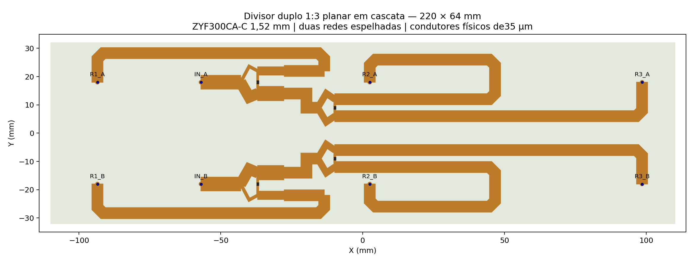
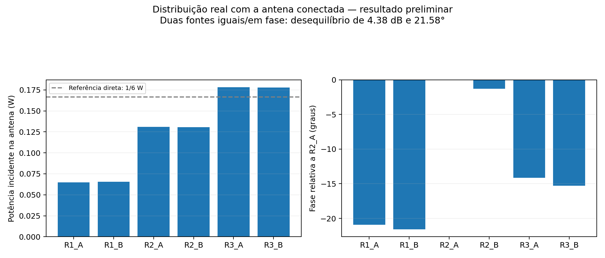
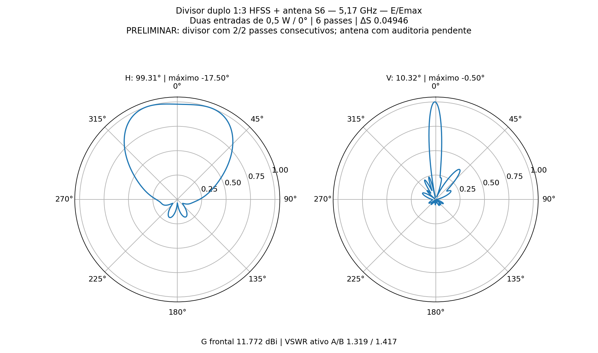
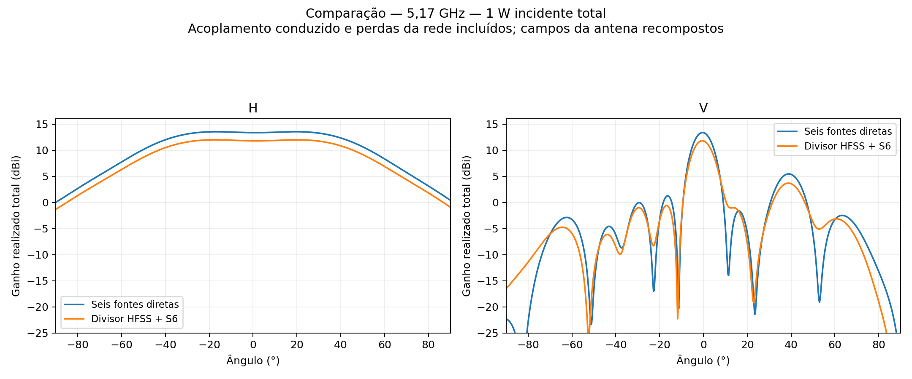

# P2S13 — divisor duplo 1:3 físico no HFSS

Rodada de **11/11/2026**, somente **5,17 GHz**, sem sweep. Foram construídas duas redes 1:3 espelhadas, simuladas juntas como uma PCB de oito portas, e conectadas à matriz S6 real das três placas de dois elementos. Duas fontes externas de **0,5 W / 0°**, total 1 W. A antena R06 permaneceu inalterada; os seis cabos físicos de 50 mm e suas perdas já estão no S6 e não foram duplicados.

**Resultado da C01:** ganho frontal realizado **11.7724 dBi**, H **99.308°**, V **10.321°**. VSWR ativo A/B **1.3188/1.4170**; outra entrada casada em 50 Ω **1.5283/1.6425**. Meta VSWR≤1,25 nos quatro casos: **não**. Meta anterior de ganho≥13 dBi: **não**. A qualificação completa continua pendente das limitações numéricas e físicas abaixo.

## Geometria construída e correção

A implementação plana usa, em cada polarização, um Wilkinson desigual que divide em 1/3 e 2/3, seguido de um Wilkinson igual no ramo de 2/3. Transformadores levam as saídas intermediárias para 50 Ω. O ramo de 1/3 recebe compensação de fase. Essa arquitetura substitui o Wilkinson 1:3 com três resistores em triângulo do estudo de circuito, cuja interligação exigiria cruzamentos no layout. Há dois resistores por polarização: 106,066 Ω e 100 Ω.

A PCB tem **220 × 64 mm**, ZYF300CA-C de núcleo **1,52 mm**, εr=2,94, tanδ=0,0016, cobre físico de 35 µm e ENIG nominal. A largura cresceu de 60 para 64 mm para acomodar as trilhas com margem à borda. As seis saídas mantêm X=−93,491/+2,509/+98,509 mm e Y=±18 mm, alinhadas aos cabos existentes. O modelo tem 40 sólidos válidos; o CAD reaberto confere e não há interpenetração volumétrica entre peças. Os sólidos são BREP gerados a partir de configuração e scripts; não se trata de uma PCB KiCad ou Gerber liberado.

A primeira geometria revelou uma junção de entrada lateral cobrindo **3,792 mm da linha central E1** e zero em E2. Essa sobreposição fazia parte do metal comum de entrada e alterava o comprimento efetivo de um ramo, sem curto entre as duas polarizações. Na C01, a entrada do segundo estágio foi deslocada para chegar pela esquerda, com **zero sobreposição de linha central em E1 e E2**. Recalcularam-se os percursos e o ajuste comum de entrada; ambos continuam idênticos nas polarizações A/B. A geometria inicial e seus resultados foram preservados em `inicial`.

| Trecho de cada polarização | Z nominal (Ω) | Largura (mm) | Linha central (mm) |
|---|---:|---:|---:|
| QH | 102.988 | 0.929 | 9.782 |
| QL | 51.494 | 3.691 | 9.312 |
| MH | 59.460 | 2.910 | 9.406 |
| ML | 42.045 | 5.032 | 9.188 |
| DELAY | 50.000 | 3.867 | 17.000 |
| E1 | 70.711 | 2.129 | 9.523 |
| E2 | 70.711 | 2.129 | 9.523 |
| BYPASS | 50.000 | 3.867 | 14.058 |
| OUT1 | 50.000 | 3.867 | 94.211 |
| OUT2 | 50.000 | 3.867 | 119.150 |
| OUT3 | 50.000 | 3.867 | 119.150 |
| INPUT | 43.098 | 4.852 | 13.999 |

Os números de linha são valores de síntese, não impedâncias uniformes garantidas em curvas/junções. A soma da fase de BYPASS+OUT1 é projetada como equivalente a DELAY+90°+OUT3, menos uma onda guiada de 50 Ω; por isso os comprimentos físicos de saída não são iguais. A igualdade de fase nominal foi calculada somente no centro. O HFSS determina a fase efetiva, com franjamento, curvas, acoplamento e transições. Não há verificação de banda.

Os resistores são um modelo nominal de montagem flip-chip **CH0402F**, com corpo de 1,0×0,6×0,5 mm, pads de 0,65 mm e vão de 0,4 mm, conforme dimensões de referência do [fabricante Vishay](https://www.vishay.com/docs/53014/ch.pdf). A resistência é uma boundary Lumped RLC resistiva entre os pads; o corpo usa alumina εr=9,8/tanδ=0,0001 **assumidos**. Não foi importado Touchstone de componente real, nem validadas tolerância, dissipação máxima ou disponibilidade do valor exato. O cobre inclui rugosidade nominal de 0,5 µm; ENIG Au 0,0254 µm / NiP 4,5 µm, σNiP=1,5 MS/m, conforme os estudos anteriores. Os terminais locais incluem pino, solda SAC305 e curto acesso PTFE. São oito portas lumped de 50 Ω, com polaridade sinal→massa compatível com o S6.

## Execução e convergência

Foram executadas **duas geometrias distintas, cada uma limitada a seis passes**; não houve continuação além do sexto passe nem sweep de frequência. Ambas usaram 14 núcleos em todos os passes adaptativos, HFSS 2024 R2 headless, Classic, sem operações locais de pré-refinamento, sem MeshLink, sem refinamento lambda, BasisOrder1 e solver iterativo com residual1×10⁻⁵. O critério foi ΔS≤0,05 por dois passes consecutivos. As geometrias são diferentes, portanto a segunda rodada começou com sua própria malha.

| Geometria | Passes / ΔS | Consecutivos | VSWR ativo A/B | G frontal (dBi) | H / V (°) |
|---|---:|---:|---:|---:|---:|
| Inicial — junção lateral | 6 / 0.037488 | 1/2 | 1.2866 / 1.2740 | 11.6099 | 99.421 / 10.223 |
| C01 — junção corrigida | 6 / 0.049458 | 2/2 | 1.3188 / 1.4170 | 11.7724 | 99.308 / 10.321 |

Na C01, a malha final tem **72104 tetraedros**. Último ΔS **0.04945786**; contador **2/2**; auditoria de convergência completa: **sim**. O texto exportado pelo HFSS escreve `Converged : Yes` quando o último passe atende ao alvo, mesmo quando o contador ainda é 1/2. O indicador genérico não substitui a exigência de dois passes. O [histórico](c01_juncao/historico_passes.json), o [arquivo nativo de convergência](c01_juncao/convergencia.txt) e os [recursos por passe](c01_juncao/recursos_matriz.json) ficam disponíveis.

Reparos Major/Minor C01: **0/0**. Isso não implica que todos os tetraedros tenham qualidade ideal; os cabeçalhos compactos dos avisos estão em [malha.json](c01_juncao/malha.json), sem os triângulos do g3derr. Maior singular do S8 **0.9355047**, e erro máximo de reciprocidade **6.271609e-05**; referência estrita de reciprocidade dos estudos anteriores: 1×10⁻⁵.

## Circuito carregado e diagramas

O S8 completo do HFSS foi reordenado por nome de porta para IN_A, IN_B, R1_A/B, R2_A/B, R3_A/B. Conectou-se ao S6 sem simetrizar, extrapolar ou alterar matrizes. A solução usa todas as reflexões múltiplas e o acoplamento conduzido, e recompõe os campos complexos de cada porta da antena. A interconexão foi conferida por solução matricial, scikit-rf Circuit e **Ansys Circuit/Nexxim**, erro máximo **1.28e-15**. As redes são todas de um ponto real: 5,17 GHz.

| Porta da antena | Potência incidente (W) | Fase relativa a R2_A (°) |
|---|---:|---:|
| R1_A | 0.064955 | -20.906 |
| R1_B | 0.065406 | -21.576 |
| R2_A | 0.131048 | -0.000 |
| R2_B | 0.130539 | -1.275 |
| R3_A | 0.178142 | -14.157 |
| R3_B | 0.177942 | -15.309 |

Mesmo com as duas fontes externas iguais/em fase, as reflexões e a distribuição física produzem dispersão de amplitude **4.382 dB** e fase **21.576°** nas seis entradas da antena. Não confundir a condição das fontes com alimentação efetiva uniforme nas seis portas. [Diagnóstico em cargas de 50 Ω e com antena](c01_juncao/diagnostico_divisao.json).

Para 1 W incidente, o circuito devolve **0.024335 W** às fontes, entrega **0.739353 W** líquidos ao modelo da antena e tem diferença de potência **0.236312 W** no divisor. Essa diferença inclui dissipação nos materiais/resistores e radiação do divisor; não foi separada por mecanismo. O ganho reportado é o campo radiado pela antena recomposto e referido à potência incidente nas duas entradas externas.

Máximos H/V: **-17.50°/-0.50°**. O corte H continua com topo amplo e dois máximos próximos; a troca do lado do maior pico não representa sozinha uma grande alteração do feixe. SLL vertical frontal: **-8.118 dB**, referência ao máximo do corte.

## Limites e arquivos

A radiação direta da placa distribuidora e o acoplamento espacial entre distribuidora, refletor e antena **não são somados** na recomposição de blocos separados. O S8 incorpora a potência perdida por radiação do divisor como redução da potência entregue. O S6 da antena conserva as pendências anteriores de estabilidade dos nove campos e reciprocidade; seu hash permanece `f40a442d96af7113a3aa20e59a25e762b5da3c1fbd24fbc3cf01fb8a6c4e5015`. As metas numéricas de centro não constituem qualificação do produto ou aprovação para fabricação. A análise sem sweep não comprova comportamento em 5,09–5,25 GHz.

[HFSS físico C01](c01_juncao/Divisor_Duplo3.aedt) · [FreeCAD C01](c01_juncao/Divisor_Duplo3.FCStd) · [S8 EM](c01_juncao/divisor.s8p) · [S2 do conjunto](c01_juncao/conjunto.s2p) · [Resultado completo](c01_juncao/resultado.json) · [Circuito portátil Nexxim](c01_juncao/circuito/P2S13_Divisor_EM_sem_malhas.aedtz).

O AEDTZ contém os Touchstones externos e pode ser restaurado em outro diretório; o `.aedt` simples conserva caminhos locais. Nativos, CAD, campos distantes derivados e evidências compactas estão no [manifesto](manifesto.json); a solução FEM completa permanece local, sem `.aedtresults`, malhas, g3derr ou locks no Git. O caso inicial também foi arquivado para não ocultar a correção. Nenhuma nova simulação foi agendada.

Reprodução pelos scripts `divisor3_em_*.py` em `../automacao`. Para C01: `P2S13_DIV3_ROOT=D:/dev/EMBRAER/P2S13/R08_Divisor_HFSS/c01_juncao` e `P2S13_DIV3_JUNCAO=1` na preparação, em pasta vazia. A criação recusa sobrescrever nativo existente. O CAD é gerado em FreeCADCmd isolado; a criação/solve HFSS usa a mesma variável de diretório. Trabalhos originais permanecem preservados.
