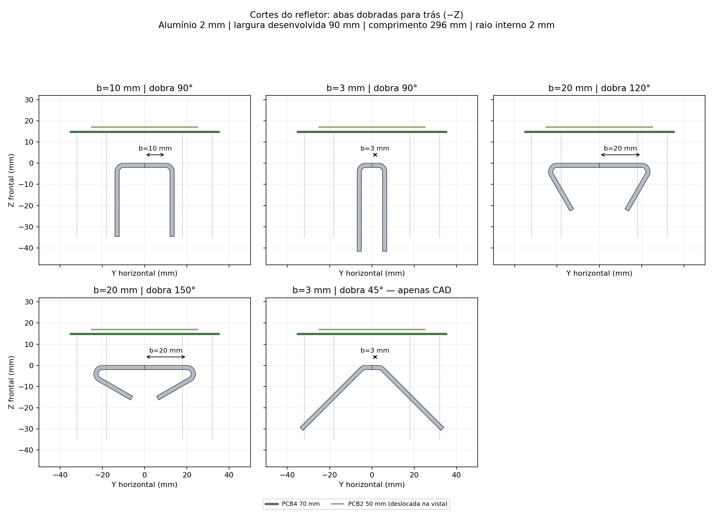
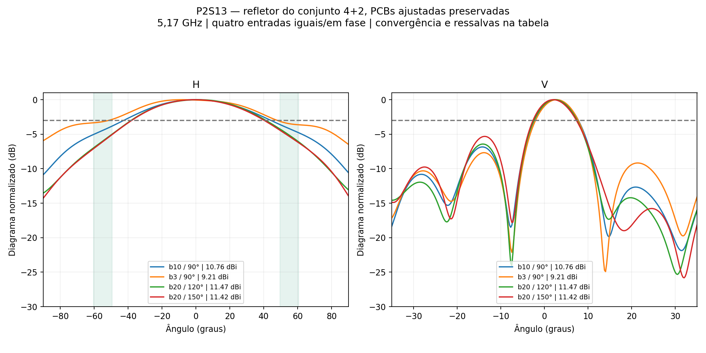

# P2S13 — estudo 4+2 interrompido pelo usuário

**Histórico encerrado em11/11.** O usuário substituiu esta topologia por três placas idênticas de dois elementos, com alvo horizontal100°. As filas foram paradas; o ensaio20/150 terminou durante a parada e foi apenas pós-processado. O caso3/45 tem CAD preparado, mas não foi simulado. Nenhum solve desta campanha será retomado automaticamente. [Registro da interrupção](interrupcao.json).

**Nenhum dos casos calculados atende simultaneamente a abertura horizontal, ganho e VSWR solicitados.** Estudo central em 5,17 GHz, sem sweep. Não há liberação de banda, fabricação ou medição experimental implícita.

## Método e parâmetros

Foram alterados somente **b**, a distância do eixo central Y=0 até o início tangente da dobra, e o **ângulo das abas para trás**. São duas dobras simétricas. 0° seria plano; 90° significa abas paralelas à direção frontal, para −Z; acima de 90° as abas se aproximam do eixo na parte traseira. A figura usa as mesmas equações de CAD/HFSS.

Mantidos: alumínio de 2 mm, largura desenvolvida 90 mm, comprimento 296 mm, raio interno 2 mm e K nominal 0,4. A face inferior das PCBs fica em Z=14,949 mm. Uma PCB C12 de quatro elementos + a PCB simétrica de dois elementos ajustada, passo vertical 48 mm e quatro cabos coaxiais físicos de 50 mm, com perdas. Os transformadores da PCB2 continuam em 0,546717 × 13,151813 mm. Não se alteraram materiais, radiadores, redes impressas ou fases.

**Quatro entradas de 0,25 W/0°, total 1 W, 14 núcleos.** Potências externas iguais não equivalem a potência uniforme por radiador entre as placas 4 e 2. Ganho realizado frontal total em +Z; não é ganho MIMO por entrada isolada. O VSWR é conferido tanto ativo quanto com as demais entradas casadas em 50 Ω, nas quatro entradas.

Metas desta etapa: **G frontal ≥13 dBi, H de 99° a 121° (110° ±10%) e VSWR ≤1,25**. A vertical é registrada; a meta histórica de 18° ±10% não é declarada atendida.

Cada nova geometria usa um ciclo independente de **no máximo seis passes, ΔS≤0,05 por dois passes consecutivos**, Classic automático, sem operações locais, MeshLink ou refinamento lambda. A geração inicial separada da malha serve para auditar os corpos antes dos passes, sem adicionar refinamento prévio. A referência histórica possui oito passes; não foi recalculada. Não se reutilizou uma malha incompatível com a nova chapa.

## Resultados

| Início b / ângulo | G frontal dBi | H ° | V ° | VSWR máx. ativo / casado | Passes / ΔS | Convergiu S |
|---|---:|---:|---:|---:|---:|---|
| [b10 / 90°](../continuacao_placa2/README.md) | 10.755 | 86.74 | 10.15 | 1.2208 / 1.1709 | 8 / 0.01643 | Sim |
| [b3 / 90°](d00_b3_a90/resultado.json) | 9.207 | 99.40 | 9.79 | 1.3111 / 1.3210 | 6 / 0.05618 | Não |
| [b20 / 120°](d01_b20_a120/resultado.json) | 11.470 | 79.48 | 9.88 | 1.2528 / 1.2708 | 6 / 0.03527 | Não |
| [b20 / 150°](d02_b20_a150/resultado.json) | 11.417 | 78.13 | 9.96 | 1.2099 / 1.3876 | 6 / 0.03461 | Não |

- **b10 / 90°:** máximo H -0.50°, V +2.50°; lóbulo secundário V -6.85 dB; 3 passes consecutivos em ΔS; estabilidade das nove sondas pendente; auditoria de matriz/potência/malha reprovada.
- **b3 / 90°:** máximo H -8.25°, V +2.75°; lóbulo secundário V -6.92 dB; 0 passes consecutivos em ΔS; estabilidade das nove sondas pendente; auditoria de matriz/potência/malha reprovada.
- **b20 / 120°:** máximo H +1.25°, V +2.25°; lóbulo secundário V -6.43 dB; 1 passes consecutivos em ΔS; estabilidade das nove sondas pendente; auditoria de matriz/potência/malha atendida.
- **b20 / 150°:** máximo H -0.50°, V +2.00°; lóbulo secundário V -5.32 dB; 1 passes consecutivos em ΔS; estabilidade das nove sondas pendente; auditoria de matriz/potência/malha atendida.

Os JSONs preservam passividade, reciprocidade (limite 1×10⁻⁵), balanço de potência, recomposição dos campos e reparos de malha. Concluir seis passes não equivale a convergir. A comparação não prova um ótimo global; todos os candidatos calculados estão apresentados.

Entre os casos com casamento numérico ≤1,25, o mais próximo de 110° é **b=10 mm / 90°**, com **H=86.74° e G=10.755 dBi**. Esta indicação compara os resultados e não aprova um caso que falhe nas demais metas ou auditorias.

## Rastreabilidade

As fontes das duas PCBs foram conferidas por SHA-256; o CAD verifica sólidos válidos, cópia dos componentes e ausência de interpenetrações. O HFSS usa a construção nativa das dobras com arcos e extrusão, conferindo os demais corpos físicos após reconstruir a chapa. O arquivo FreeCAD contém sólidos e propriedades documentais; reconstruir pelo script/configuração para alterar suas dimensões.

`comparacao.json` inclui a decomposição dos campos embutidos das duas placas em boresight. A fase relativa dessa projeção não mede diretamente a fase em cada radiador. Qualquer limite de ganho com fases alinhadas é apenas diagnóstico algébrico com campos congelados; não foi aplicado às fontes nem tratado como nova simulação.

[Tabela CSV](comparacao.csv) · [Dados e diagnóstico](comparacao.json) · [Manifesto SHA-256](manifesto.json). Cada pasta de caso contém HFSS, FreeCAD, chapa STEP, S4, campos distantes, diagramas e evidências compactas. Malhas, `.aedtresults`, campos volumétricos e locks permanecem somente no trabalho local `D:/dev/EMBRAER/P2S13/R04_Dobras_Ajustadas`.
