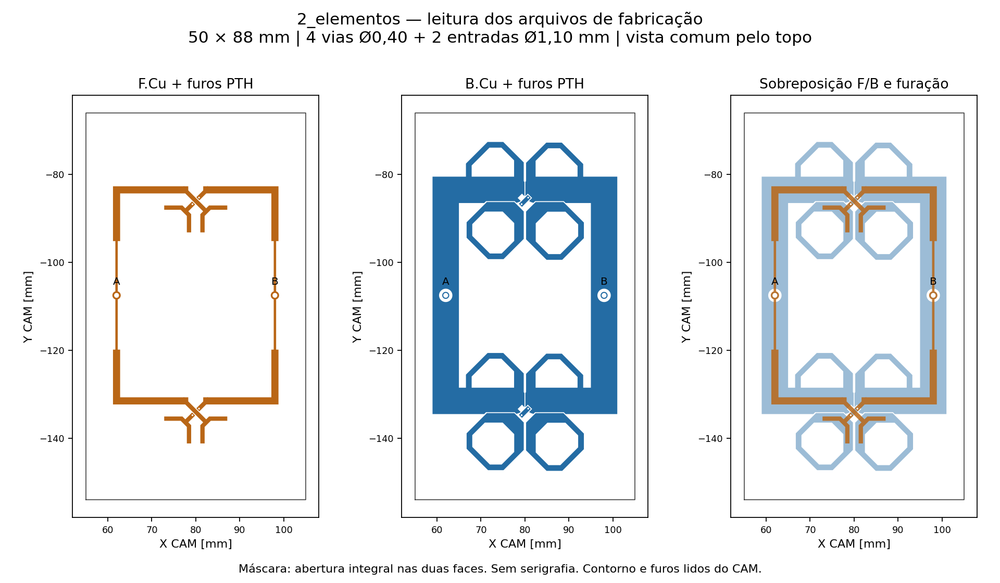
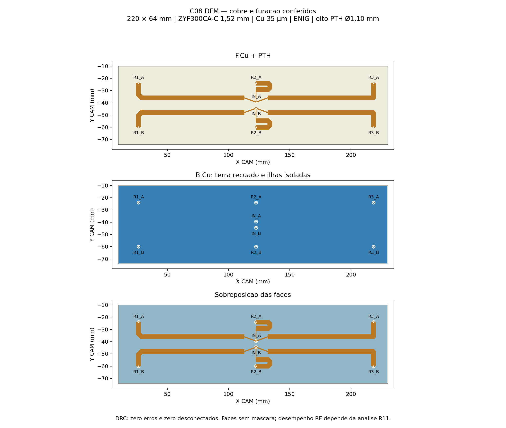

# Conjunto R12 no KiCad — três placas M00 e divisor C08

Pacote de 12/11/2026 com **três placas radiantes idênticas de dois elementos M00** e **um divisor duplo 1:3 C08**. São quatro PCBs, seis elementos radiantes e seis interligações coaxiais de 50 mm. As duas entradas externas pertencem à C08; cada polarização alimenta uma das entradas das três M00.

**Geometria nominal simulada preservada. A qualificação RF é separada e este pacote não libera produção.** A R12 com radome está em verificação de convergência; consultar [resultados R12](../../curvilinear_simplificado/README.md) e sua continuação. Não foi alterado cobre para corrigir casamento, DRC ou adaptação de processo.

| PCB | Quantidade por antena | Arquivo editável | Gerbers |
| --- | ---: | --- | --- |
| Radiante M00, dois elementos e dois divisores 1:2 | 3 | [2_elementos.kicad_pro](placa2_M00/2_elementos.kicad_pro), [PCB](placa2_M00/2_elementos.kicad_pcb) | [M00 — para revisão RF/processo](placa2_M00/M00_Gerbers_PARA_REVISAO_RF.zip) |
| Divisor duplo 1:3 C08 | 1 | [divisor_duplo_1x3_C08.kicad_pro](divisor_C08/divisor_duplo_1x3_C08.kicad_pro), [PCB](divisor_C08/divisor_duplo_1x3_C08.kicad_pcb) | [C08 — pacote original preservado](divisor_C08/C08_Gerbers_PARA_REVISAO_RF.zip) |

A M00 foi criada agora no KiCad 10.0.5 a partir da arte exata usada no HFSS. A placa antiga `projetos/P2M21/kicad/2_elementos` é uma versão v05 diferente e foi preservada. A C08 já existia e foi reutilizada byte a byte, incluindo suas conferências; não houve redesenho.

## Especificações nominais

| Item | M00 | C08 |
| --- | --- | --- |
| Dimensões | 50 × 88 mm | 220 × 64 mm |
| Núcleo dielétrico | RO4350B, 0,76 mm | ZYF300CA-C, 1,52 mm |
| Valores usados no HFSS | εr 3,66; tanδ 0,0037 | εr 2,94; tanδ 0,0016 |
| Cobre externo | 35 µm por face | 35 µm por face |
| Espessura geométrica núcleo+cobre | 0,83 mm, antes do acabamento | 1,59 mm, antes do acabamento |
| Acabamento | ENIG nominal, sem máscara e sem serigrafia | ENIG nominal, sem máscara e sem serigrafia |
| Furos acabados por placa | 4 vias Ø0,40 mm + 2 entradas Ø1,10 mm, todos PTH | 8 entradas/saídas Ø1,10 mm, todos PTH |
| Diâmetro nominal das ilhas | Vias Ø0,726 mm; pads PTH Ø1,60 mm, com cobre superior de entrada Ø1,90 mm incorporado à arte | Ø1,80 mm |
| Metalização de parede no modelo RF | **35 µm** | **18 µm** |
| NPTH / componentes SMD | Nenhum | Nenhum |

O acabamento ENIG do modelo usa Au 0,0254 µm e NiP 4,5 µm nominal. As espessuras de parede dos PTH foram lidas dos sólidos do CAD; não são suposições do exportador KiCad. Em especial, **não substituir os 35 µm de metalização da M00 pelos 18 µm da C08 sem revisão de engenharia**. As notas preservam o modelo, mas disponibilidade, tolerâncias finais e stackup precisam ser confirmados com o fabricante antes da compra. Não houve cotação ou pedido nesta entrega.

Na M00, o passo dos elementos é 48 mm; transformadores de sinal medem 0,546717 mm de largura × 13,151813 mm de comprimento. O sinal de 50 Ω tem largura 1,623415 mm. As entradas ficam em HFSS X=2,509168413 mm, Y=−18 mm (A) e +18 mm (B). Os planos de retorno e divisores acrescentados são simétricos, mantendo as transições dos radiadores originais.

## Conferências

- M00: **zero erros DRC e zero itens desconectados**. Os 138 avisos são de pontes de máscara porque a abertura cobre toda a PCB; não há exclusões DRC para ocultá-los.
- C08: DRC repetido em 12/11, **zero erros e zero desconectados**, com 113 avisos do mesmo tipo. Todos os 18 arquivos originais do pacote foram comparados por SHA-256.
- Cobre KiCad M00 comparado à arte efetiva, incluindo anilhas, pads e furos: desvio máximo de 0,000001 mm nas bordas. Conferência independente com as 14 faces de cobre do CAD FreeCAD usado na R12: tolerância de 0,000005 mm, dez grupos camada/rede.
- Gerbers X2 e Excellon realmente exportados foram relidos e comparados. Contorno fechado, máscara integral, cobre e furação corretos. Furação em formato 3:6 mm, resolução nominal 0,000001 mm; erro máximo de arredondamento XY de 0,000000878 mm. Esses números são precisão digital de exportação, **não tolerâncias de fabricação**.
- Continuidade das redes SIG_A, SIG_B, RET_A e RET_B verificada, sem curto entre redes. Folga mínima entre redes da M00: 0,188750 mm; cobre a 4 mm da borda.

Evidências: [conferência CAD do conjunto](conferencia_CAD_conjunto.json), [M00 KiCad](placa2_M00/verificacao.json), [M00 CAM](placa2_M00/verificacao_gerbers.json), [C08](divisor_C08/verificacao.json), [origem C08](origem_C08.json) e [manifesto](manifesto.json).

## Montagem e reprodução

Centros das três placas radiantes no conjunto: X=−96, 0 e +96 mm. Entre bordas há 8 mm de vão. Divisor C08 com giro de 180° em X e translação Z=−35,231 mm conforme a configuração HFSS; não espelhar Gerbers para obter essa orientação de montagem. Ver [lista de placas](lista_placas.csv) e [interligações](interligacoes.csv).

Os projetos contêm objetos KiCad editáveis: polígonos de cobre associados a redes, pads PTH, vias, contorno e stackup. Não foram criados componentes fictícios nem um esquema lumped para substituir a geometria distribuída RF. Identificações estão em F.Fab e não são enviadas como serigrafia. Não há BOM/CPL de montagem automática; os cabos são soldados manualmente.

Os scripts `r12_kicad_preparar.py`, `r12_kicad_placa2.py`, `r12_kicad_furacao.py`, `r12_kicad_conferir.py`, `r12_kicad_gerbers.py`, `r12_kicad_faces_cad.py` e `r12_kicad_validar_cad.py` em `projetos/P2S13/automacao` reproduzem geração e auditoria sem executar HFSS. Preservar os arquivos-fonte, as notas de fabricação e a revisão antes de regenerar o pacote.
