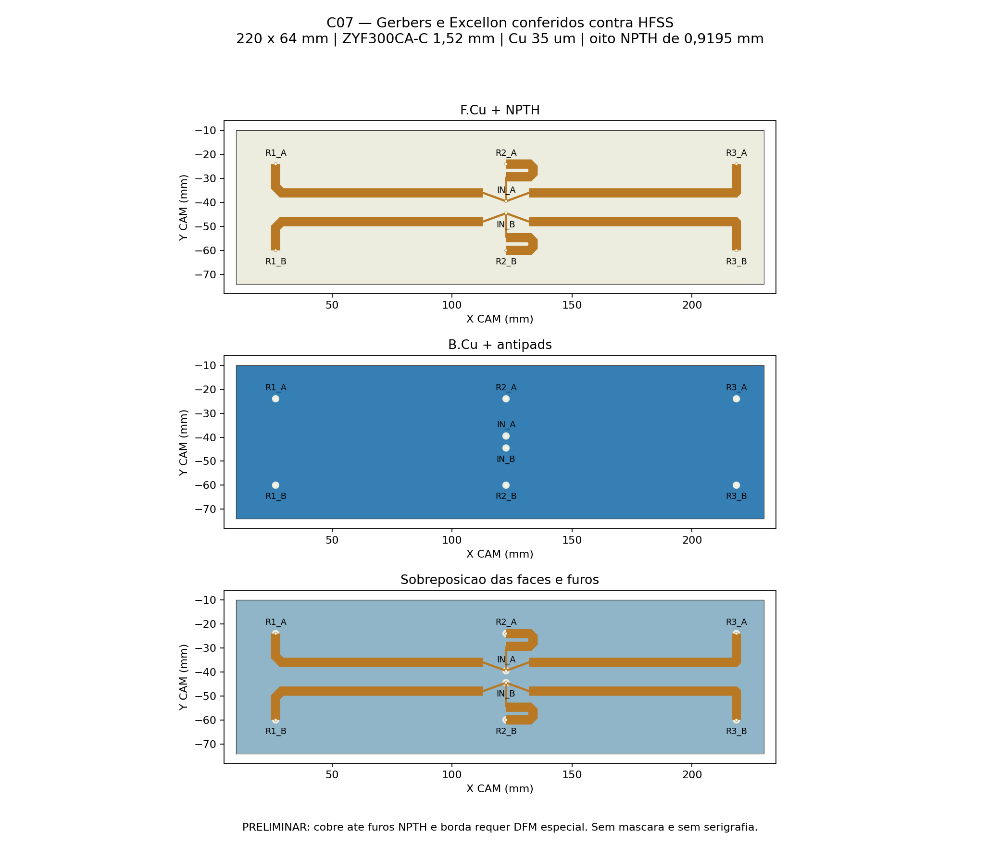
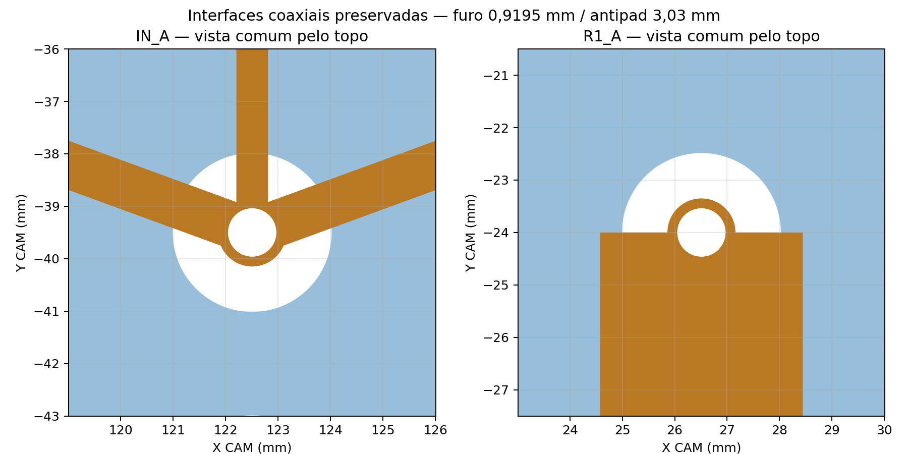

# Divisor duplo 1:3 C07 — KiCad e Gerbers

Conversão de **11/11/2026**, KiCad **10.0.5**, a partir da [C07 simulada](../../divisor_duplo_1x3_correcao/README.md). As duas redes A/B, comprimentos compensados, larguras, chanfros, posições das oito conexões, contorno e terra foram preservados. **Nenhuma nova simulação foi executada.**

[Projeto KiCad](divisor_duplo_1x3_C07.kicad_pro) · [PCB editável](divisor_duplo_1x3_C07.kicad_pcb) · [Gerbers e furação — ZIP JLCPCB](divisor_duplo_1x3_C07_Gerbers_JLCPCB.zip) · [Instruções para a fábrica](FABRICACAO_JLCPCB.txt).

**Geometria convertida e conferida; fabricação padrão ainda não liberada.** A C07 simulada possui cobre até a borda e até os furos não metalizados. Esses detalhes conflitam com regras padrão publicadas pela JLCPCB. Foram mantidos conforme o pedido de preservar a geometria; não se apagaram as violações do DRC. O ZIP serve para revisão técnica de fabricação desta geometria, não representa aprovação de alterações automáticas pela fábrica.

## Construção preservada

| Item | Especificação |
|---|---|
| Contorno nominal | 220 × 64 mm; um perfil fechado |
| Camadas | Duas; sinais A/B em F.Cu, terra comum em B.Cu |
| Laminado | ZYF300CA-C, núcleo 1,52 mm |
| Propriedades usadas no HFSS | εr 2,94; tanδ 0,0016 |
| Cobre | 35 µm por face |
| Espessura nominal núcleo + cobre | 1,59 mm, sem contar ENIG |
| Acabamento | ENIG; modelo nominal NiP 4,5 µm / Au 0,0254 µm |
| Máscara / serigrafia / pasta | Ausentes; máscaras abertas em toda a placa |
| Furação | Oito NPTH Ø0,9195 mm; zero PTH e zero vias |
| Antipads no terra | Oito círculos Ø3,03 mm, somente no cobre inferior |
| Entradas / saídas | IN_A, IN_B / R1_A…R3_A e R1_B…R3_B |

O ZYF300CA-C consta na [oferta de materiais RF da JLCPCB](https://jlcpcb.com/pcb-fabrication/high-frequency-pcb). A presença do material no catálogo não confirma aceitação das particularidades desta placa. A espessura de 1,52 mm refere-se ao **núcleo dielétrico**, não à espessura acabada.

O PCB não inclui os sólidos de pino, PTFE, massa local ou solda do modelo HFSS: são itens da montagem. O pino central nominal tem Ø0,9195 mm e ocupa o furo sem folga no modelo EM. A tolerância de montagem ainda precisa ser definida com o fabricante, sem mudar silenciosamente o diâmetro nominal.

## Conferência da geometria

A configuração reproduziu os sólidos do CAD usado no HFSS com **diferença booleana zero** em `Sinal_A`, `Sinal_B`, `Terra` e `Substrato`. Veja [conferência CAD/HFSS](conferencia_cad_hfss.json). O CAD e o HFSS originais não foram modificados.

Os polígonos de cobre são objetos editáveis com redes no KiCad. As conexões usam pads nativos de rede totalmente contidos no cobre existente; esses pads não acrescentam cobre à arte. Os furos são pads mecânicos NPTH, sem barril metalizado. Não foi criado um esquemático genérico que substitua a geometria RF.

A auditoria reabre o `.kicad_pcb`, lê polígonos/pads/furos e compara com a referência. Outra leitura independente verifica os Gerbers X2 e o Excellon realmente exportados: cobre, continuidade, separação A/B, contorno, máscaras, diâmetros, posições e quantidade de furos. Os [resultados completos](verificacao.json) distinguem fidelidade geométrica de aprovação de fabricação.

KiCad e CAM usam grade de coordenadas de 0,000001 mm. Os antipads circulares foram representados por 2048 vértices; a sagita nominal é 0,000001783 mm. Os limites de comparação de borda são 0,000004 mm no nativo e 0,000005 mm no CAM, incluindo quantização. Essa discretização digital não é tolerância de fabricação e não autoriza mudanças nominais. O arquivo [leitura_kicad.json](leitura_kicad.json) registra os objetos efetivamente salvos.

A exportação Excellon do KiCad mantém coordenadas 3:6, mas formata ferramentas com apenas três decimais. O pós-processador restaurou **somente o diâmetro T1 de 0,919 para 0,919500 mm**, lendo o diâmetro do próprio nativo, e conferiu o arquivo novamente. Coordenadas e quantidade não mudaram. [Evidência da correção de precisão](precisao_furacao.json).

O arquivo `.gbrjob` é evidência do exportador e fica fora do ZIP: ele mede 220,05 × 64,05 mm incluindo a espessura gráfica de Edge.Cuts. A linha central do perfil é **220 × 64 mm**, conferida independentemente. A marcação de stackup/impedância do job não autoriza a fábrica a recalcular larguras de microstrip.

## DRC e revisão necessária da JLCPCB

| Verificação | Resultado |
|---|---:|
| Itens desconectados | 0 |
| Erros de distância entre cobre e furos NPTH | 8 |
| Erro de cobre na borda | 1 |
| Avisos de abertura comum de máscara | 25 |

Os nove erros foram **preservados**, sem exclusões ou redução de limites para apresentar DRC limpo. Os 25 avisos de máscara são coerentes com ausência de máscara em toda a placa. [DRC completo](drc.json).

As [capacidades publicadas pela JLCPCB](https://jlcpcb.com/capabilities/pcb-capabilities) indicam folga mínima de 0,2 mm entre cobre e borda roteada, 0,2 mm entre NPTH e trilhas, e recomendam anel NPTH de 0,45 mm, descrevendo remoção de 0,2 mm de cobre ao redor do furo. A C07 tem folga zero na borda e nos furos e anel superior mínimo nominal de aproximadamente **0,18886 mm**. Uma remoção automática de 0,2 mm pode eliminar essa área de solda. Exigir confirmação da fábrica de que consegue preservar a arte; qualquer desvio requer revisão da engenharia e da resposta RF. Não converter os furos em PTH para contornar essa questão.

## Imagens do pacote

As imagens mostram ambas as faces pela mesma vista superior para permitir comparação; o Gerber inferior não foi espelhado manualmente.

## Montagem e orientação

Transformação de coordenadas: `KiCad X = 120 + HFSS X`; `KiCad Y = 42 − HFSS Y`, em mm. No CAM, `X = 120 + HFSS X`, `Y = HFSS Y − 42`. A [lista de conexões](conexoes.csv) associa J1…J8 às portas do HFSS.

As identificações ficam somente em F.Fab, fora das camadas de produção. As duas entradas permanecem iguais/em fase na operação; a compensação das saídas é obtida pela geometria do cobre preservada. Os cabos existentes e suas posições não foram redesenhados.

## Estado RF preservado

Na C07 em 5,17 GHz, duas entradas de 0,5 W / 0°: ganho frontal realizado 12,746 dBi, VSWR ativo 1,093/1,092, H/V 98,614°/10,162° e máximo vertical −0,01°. O divisor convergiu em seis passes, ΔS 0,023112, com 14 núcleos. Com a outra entrada casada, B tem VSWR 1,255. Permanecem as pendências numéricas da antena e a ausência da radiação direta do divisor nos diagramas recompostos. A conversão KiCad não acrescenta aprovação RF ou de banda.

## Reprodução e rastreabilidade

Os scripts em [automacao](../../automacao) são `divisor3_c07_kicad.py`, `divisor3_c07_conferir_cad.py`, `divisor3_c07_furacao.py`, `divisor3_c07_conferir.py`, `divisor3_c07_exportar.ps1` e `divisor3_c07_empacotar.py`. O script CAD roda em FreeCADCmd isolado. A geração e a furação usam o Python do KiCad; a comparação usa Python 3.12 com Shapely/Matplotlib.

O [manifesto](manifesto.json) registra hashes dos nativos fonte, arquivos entregues e ZIP. Não houve compra, upload à JLCPCB, nova cotação ou aprovação de fabricação.
