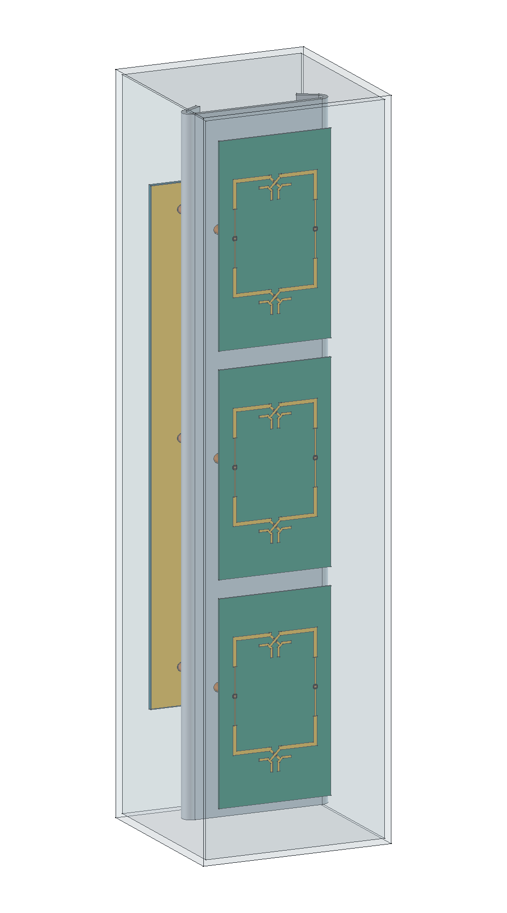
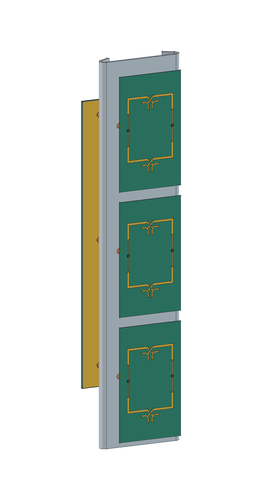
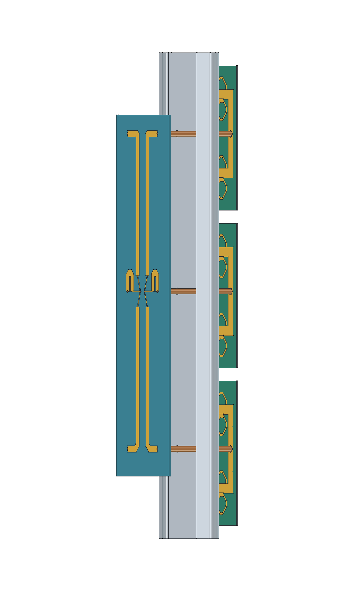
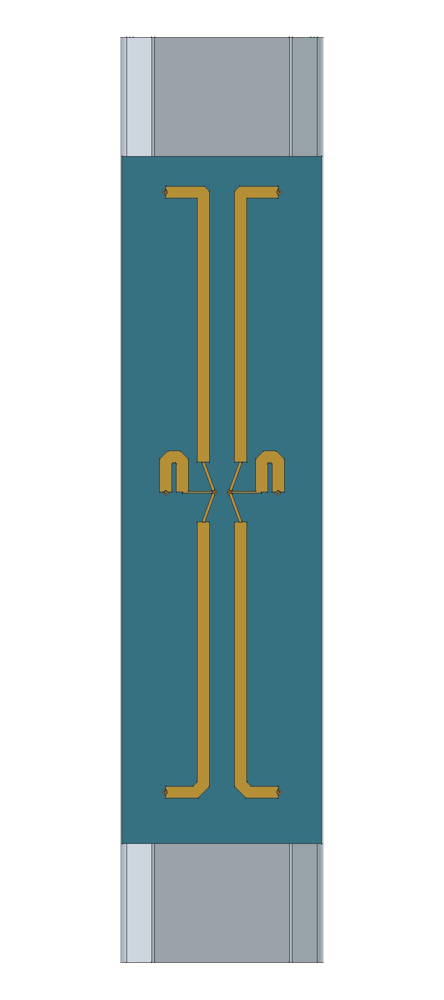
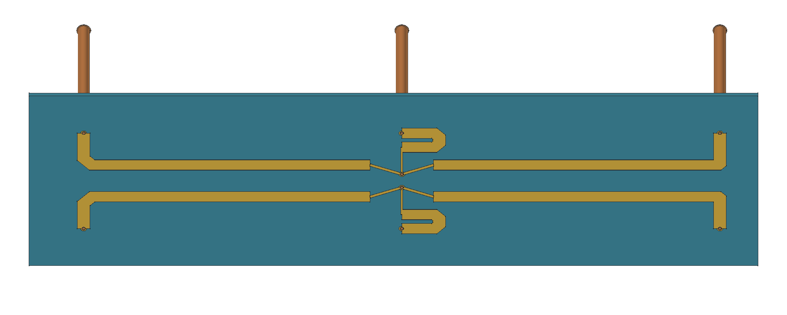
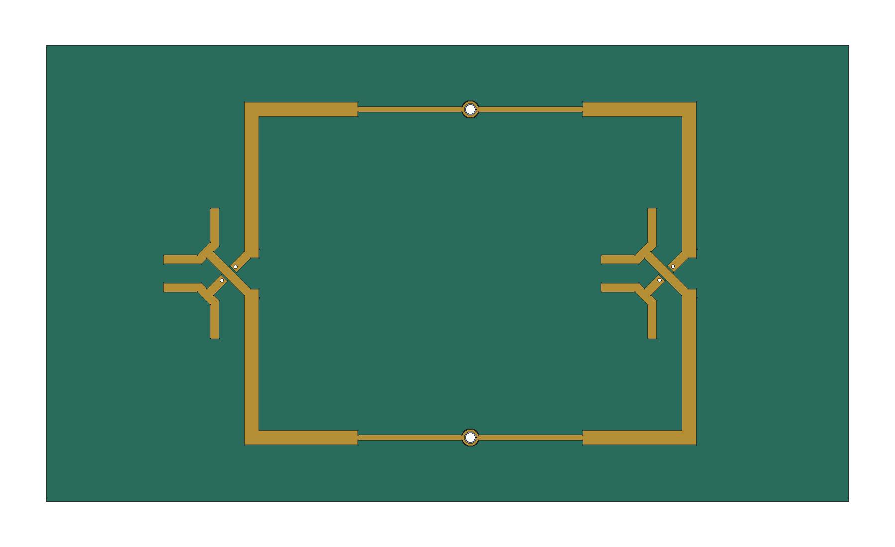

# Antena P2S13 R12 — montagem completa do modelo RF

**PRELIMINAR.** Montagem criada em 12/11/2026 para acompanhar a continuação da R12. A geometria corresponde aos **123 sólidos do modelo HFSS**: três placas simétricas de dois elementos, divisor duplo 1:3 C08, seis ramais coaxiais, refletor dobrado e radome FR-4 de 2 mm. Nenhum componente RF foi deslocado, redesenhado ou removido.

[Abrir montagem no FreeCAD](Antena_R12_PRELIMINAR.FCStd) · [STEP dos sólidos RF](Antena_R12_RF.step) · [Lista de materiais](lista_materiais.csv) · [Resultado RF da continuação de oito passes](../curvilinear_simplificado/continuacao8/README.md)

A sessão FreeCAD foi deixada aberta com o documento `Antena_R12_PRELIMINAR` e o radome transparente. Para inspecionar o interior, selecionar o grupo **07 — Radome** ou o sólido `Radome_FR4_2mm` e alternar sua visibilidade com a barra de espaço. Os sete grupos separam R1/R2/R3, divisor, chicote, refletor e radome. As cores distinguem substratos, cobre, solda, PTFE e alumínio. A transparência é apenas visual; não representa o aspecto óptico real do FR-4.

## Configuração geométrica

| Componente | Quantidade | Dimensões e posição nominal |
| --- | --- | --- |
| Placa radiante simétrica de dois elementos | 3 | 88 × 50 mm; núcleo RO4350B 0,76 mm; centros X = −96, 0 e +96 mm |
| Elementos radiantes | 6 | Passo vertical de 48 mm |
| Divisor duplo 1:3 C08 | 1 | 220 × 64 mm; núcleo ZYF300CA-C 1,52 mm; atrás do refletor |
| Ramais coaxiais soldados | 6 | 50 mm iguais; cobre/PTFE nominais do modelo RF |
| Refletor | 1 | Alumínio 5052 nominal, espessura 2 mm, comprimento 296 mm, largura desenvolvida 90 mm; dobra começa em 28,5 mm, ângulo 150°, raio interno 2 mm |
| Radome | 1 | Caixa externa 314 × 84 × 84 mm; espessura 2 mm; FR-4 Isola 370HR nominal sem cobre |

O eixo X é vertical, Y horizontal e +Z aponta para a frente. A face inferior dos núcleos radiantes fica em Z = 14,949 mm. A PCB distribuidora ocupa Z = −36,751 a −35,231 mm. As dimensões registradas no objeto **00 — Dados e limites** são referências rastreadas, somente leitura; não alteram automaticamente as formas.

## Verificações e editabilidade

- Os 123 sólidos foram preservados e permanecem válidos, com material, volume, área e posição conferidos antes/depois da organização e após reabertura. Tolerância numérica da conferência: 1e−8 mm³/mm²/mm, não uma tolerância de fabricação.
- A conferência na GUI após salvar encontrou diferença zero de volume e caixa envolvente para os 123 objetos. Ver `conferencia_geometria.json` e `conferencia_gui.json`.
- A auditoria de interseções da origem, sem interpenetrações volumétricas, permanece aplicável porque nenhuma forma/posição foi alterada. Não foi executada outra simulação RF ou estrutural por esta montagem.
- O arquivo nativo contém sólidos BREP organizados e posicionados, editáveis por operações Part/Placement. Ele **não é uma montagem cinemática com juntas**, nem recupera uma árvore paramétrica de fabricação das PCBs importadas. O STEP é uma exportação de intercâmbio dos mesmos sólidos.
- A janela foi conferida visualmente por captura nativa do computador: montagem completa visível, GUI respondendo e deixada aberta. Uma captura intermediária `QWidget.grab()` apresentou artefatos de OpenGL, ausentes na tela real e nas exportações `saveImage`; ela foi descartada.

## Interfaces mecânicas ainda pendentes

Esta entrega monta integralmente o **modelo RF atual**. Não libera um produto acabado para fabricação. Apoios/fixadores, conectores N externos, passagens vedadas, juntas, método de montagem e fixação do radome não estão caracterizados no modelo recebido. Não foram acrescentadas peças arbitrárias que alterassem a geometria simulada ou os cabos.

O modelo 3D de referência [Amphenol 082-6784](../../P2M21/mecanica_preliminar_R18/referencias/82-6784.stp) já está disponível no repositório histórico. Ele não foi posicionado nem conectado nesta revisão: a interface RF atual termina nas duas portas internas do divisor. Tampouco há equivalência RF demonstrada para o conector de um sólido encontrado anteriormente no Drive.

O estado RF deve ser consultado no resultado de oito passes acima; a organização CAD e a presença de Gerbers não constituem aprovação de ganho, casamento, vedação ou resistência mecânica.

## Imagens da montagem

As demais imagens incluem a vista frontal e a orientação final da GUI. Todas foram exportadas do FreeCAD e revisadas.

## Reprodução

`../automacao/r12_mecanica_preparar.py` organiza uma cópia do CAD fonte sem solver. `../automacao/r12_mecanica_abrir.FCMacro` abre a montagem em uma sessão FreeCAD, aplica apenas aparência/visibilidade, produz as imagens e deixa o aplicativo aberto. O script de preparação deve ser executado em uma pasta sem alterações locais da montagem que precisem ser preservadas. O arquivo RF original permanece intacto em `D:/dev/EMBRAER/P2S13/R12_Curvilinear_Simplificado`.
