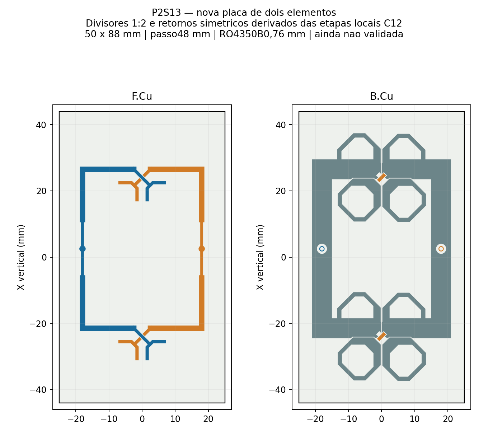
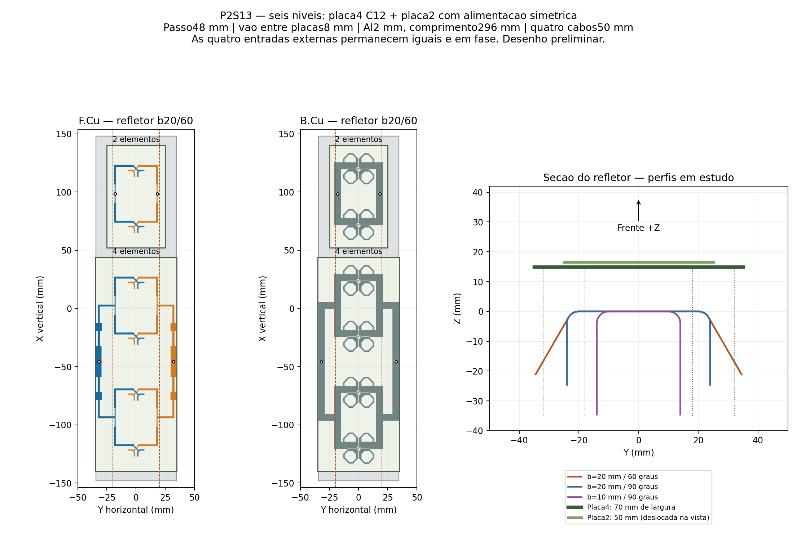
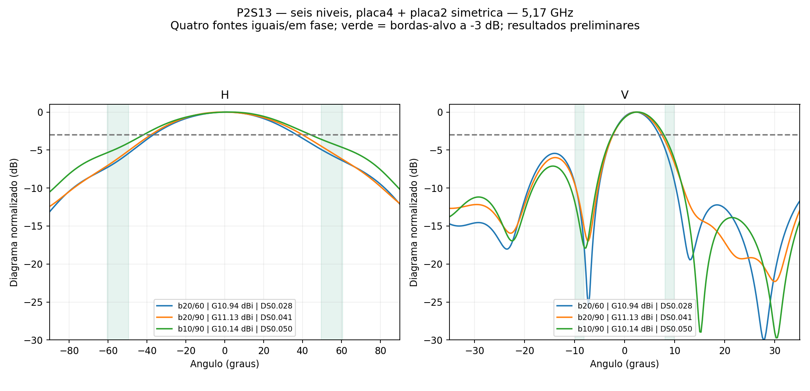

# P2S13 — seis níveis, uma placa de quatro e outra de dois

Estudo de 10/11/2026, conforme a alteração solicitada: **uma placa C12 de quatro elementos e uma nova placa de dois elementos**, empilhadas. A prioridade é buscar abertura horizontal de **110° ±10% (99–121°)**. Ganho frontal de 13 dBi e abertura vertical de 18° ±10% continuam apresentados como referências; nenhum critério foi relaxado para declarar aprovação.

## Alimentação simétrica da placa de dois elementos

A placa nova tem **50 × 88 mm**, passo vertical **48 mm**, núcleo RO4350B de **0,76 mm**, cobre físico de **35 µm** e ENIG nominal. Os radiadores e suas transições derivam da mesma geometria usada na C12. As entradas A/B ficam alinhadas em X=+2,509168 mm e Y=±18 mm. Há um divisor 1:2 por polarização, com os mesmos transformadores das etapas locais da C12: largura **0,860433 mm**, comprimento **8,816344 mm**, seguido de linha de **1,623415 mm**. Retornos novos com largura nominal de **6 mm**, recortados nas transições para preservar a isolação.

Os sinais e retornos acrescentados são espelhados em Y=0; os quatro ramos têm comprimento de linha central **39,490832 mm**. Não foram reutilizados os meandros desiguais da placa antiga v05. As transições originais dos radiadores são preservadas: a simetria auditada se refere à distribuição acrescentada, não a uma alegação de que todo o cobre dos radiadores seja geometricamente espelhado. Igual comprimento geométrico não comprova fase elétrica igual sob acoplamento.

A verificação CAD confirmou as quatro redes alimentadas contínuas (**SIG_A, RET_A, SIG_B, RET_B**), sem contato entre redes distintas, sem interpenetrações e com folga planar mínima de **0,188750 mm**. A placa C12 de quatro elementos e a antiga placa KiCad `2_elementos` não foram modificadas. A placa nova ainda não tem Gerbers liberados nem qualificação isolada.

[Geometria e parâmetros](celula2_simetrica/geometria.json) · [Auditoria da simetria](celula2_simetrica/simetria.json) · [Conectividade CAD](celula2_simetrica/conectividade.json) · [FreeCAD da placa nova](celula2_simetrica/2_elementos_simetrica.FCStd).

## Montagem e modelo

Os centros dos seis radiadores são X=−120, −72, −24, +24, +72 e +120 mm. A PCB4 tem centro em −48 mm e a PCB2 em +96 mm, com **8 mm de vão entre bordas**. Ambas têm a face inferior do núcleo em Z=14,949 mm. O refletor comum usa alumínio de 2 mm, comprimento de **296 mm** e largura desenvolvida de **90 mm**; raio interno de dobra 2 mm e fator K nominal de 0,4. `b` é a distância do eixo central ao início tangente da dobra; o ângulo é medido para trás a partir da posição plana. As duas abas são simétricas.

O ensaio inclui os divisores impressos e quatro cabos coaxiais físicos de 50 mm, com perdas dielétricas e condutivas. Não inclui conectores N, suportes plásticos ou distribuição externa. São **quatro entradas de 0,25 W a 0°**, 1 W total. Como metade da potência vai para cada placa, a placa de dois elementos recebe nominalmente o dobro de potência por radiador em relação à placa de quatro. Não foi imposta uniformidade de potência nos seis radiadores nem alterada a fase externa para corrigir os diagramas.

O refletor usa a construção nativa corrigida do HFSS. Classic automático, sem MeshLink, refinamento lambda ou operações locais; frequência única **5,17 GHz**, sem sweep, **14 núcleos**, no máximo **seis passes**, ΔS-alvo **0,05** e dois passes consecutivos. As nove sondas de campo monitoram estabilidade e não autorizam ultrapassar o limite. Nenhuma destas soluções qualifica a banda completa.

Na preparação do caso b20/90, a conferência inicial parou antes do RF por arredondamento do limite da região automática de ar em 1,7×10⁻⁸ mm. Os demais objetos físicos ficaram exatamente iguais. O guard passou a registrar a diferença e aceitar apenas arredondamento do ar inferior a 1×10⁻⁵ mm e variação relativa de volume inferior a 1×10⁻⁸; a igualdade dos objetos físicos continua exata. Não houve alteração de critérios de erro RF ou reinício de passes por esse evento.

## Resultados calculados

| Ensaio | b mm / dobra | G frontal dBi | H | V | Pico H / V | VSWR ativo máx. | ΔS final | Convergiu |
|---|---:|---:|---:|---:|---:|---:|---:|---|
| [s00_b20_a60](s00_b20_a60/resultado.json) | 20 / 60° | 10.939 | 73.71° | 9.25° | +0.50° / +2.00° | 1.864 | 0.02775 | Não (1/2) |
| [s01_b20_a90](s01_b20_a90/resultado.json) | 20 / 90° | 11.134 | 78.01° | 9.78° | -0.75° / +2.25° | 1.906 | 0.04132 | Não (1/2) |
| [s02_b10_a90](s02_b10_a90/resultado.json) | 10 / 90° | 10.145 | 85.91° | 10.26° | +2.25° / +2.50° | 1.943 | 0.04988 | Não (1/2) |

A abertura horizontal mais próxima de 110° entre os ensaios calculados foi a de **s02_b10_a90**, com **85.91°** e ganho frontal de **10.145 dBi**. Esta seleção é apenas uma comparação dos valores obtidos; não comprova otimização global ou validade de um resultado não convergido. Estado de qualificação conjunta desse caso: **não aprovado**.

Cada `resultado.json` preserva os critérios de passividade, reciprocidade, potência, malha, recomposição e estabilidade. O limite de erro máximo de reciprocidade permanece **1×10⁻⁵**. Números de ensaios que falhem na convergência ou auditoria devem ser tratados como preliminares. O ganho informado é frontal realizado total, não ganho de uma entrada MIMO isolada.

Nos três ensaios, somente o sexto passe ficou abaixo de ΔS=0,05: **1 de 2 passes consecutivos necessários**. As nove sondas de campo também não confirmaram estabilidade. Não foram executados passes adicionais. A malha inicial levou 172,02 s, 140,09 s e 129,91 s, respectivamente, sem reparos Major ou Minor. O caso b20/90 apresentou ainda erro de reciprocidade de 1,10765×10⁻⁵, acima do limite mantido em 1×10⁻⁵.

A placa nova ainda exige ajuste de casamento: seus VSWR ativos A/B ficaram em **1,864/1,734**, **1,906/1,778** e **1,943/1,813**, respectivamente. A simetria geométrica da distribuição foi atendida; isso não representa aprovação RF.

Os arquivos `contribuicoes_placas.json` mostram a soma vetorial dos campos embutidos de cada placa e seu termo de interferência. Essa decomposição usa os campos do mesmo painel acoplado; não substitui ensaios isolados nem mede diretamente a fase em cada radiador.

As projeções vetoriais dos campos frontais das duas placas apresentaram fases relativas de aproximadamente −53,25°, −61,16° e −62,18°. As quatro entradas externas continuam iguais e em fase. Isso indica que repetir os transformadores locais e igualar os ramos da placa de dois elementos não garante alinhamento elétrico com a rede 1:4 da C12. O próximo ajuste deve considerar casamento e caminho elétrico entre placas, mantendo a simetria dos ramos; os resultados atuais não isolam esse efeito do acoplamento e do refletor.

[Tabela CSV](comparacao.csv) · [Resultados estruturados](comparacao.json) · [Manifesto com SHA-256](manifesto.json). Projetos AEDT/FreeCAD, S4, cortes e campos distantes foram arquivados. Malhas, campos volumétricos, locks e caches de solver ficam somente na pasta de trabalho. O `.aedt` do Git preserva o modelo, mas não restaura a solução FEM completa sem gerar malha novamente.

Trabalho local: `D:/dev/EMBRAER/P2S13/R01_Seis_Elementos`. Os scripts reproduzíveis estão em `../automacao/seis_*.py`, junto aos geradores e auditores comuns. Não iniciar novamente uma pasta já resolvida; novos ensaios devem usar pastas próprias. O histórico de oito níveis permanece em `../refletor_nativo_b20_60`.
