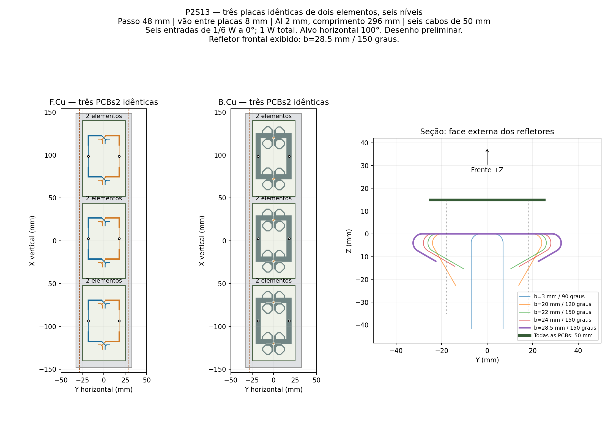
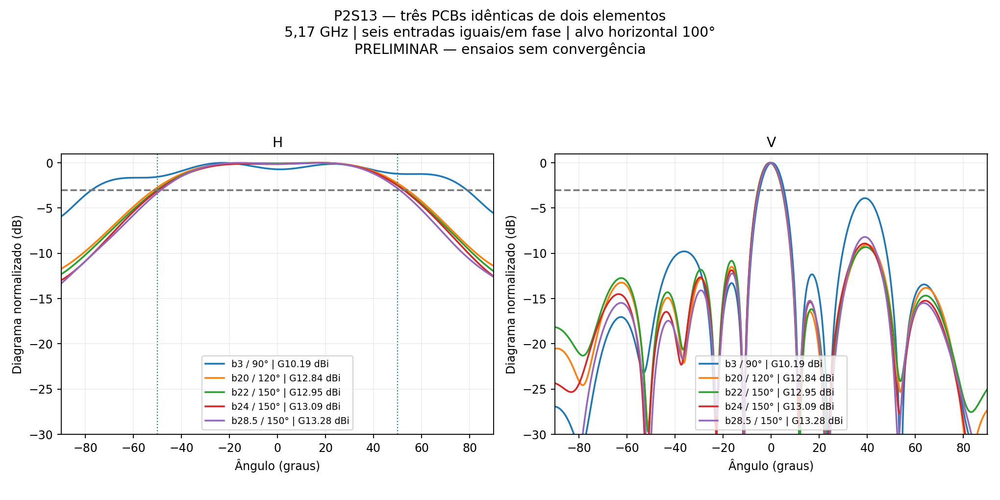
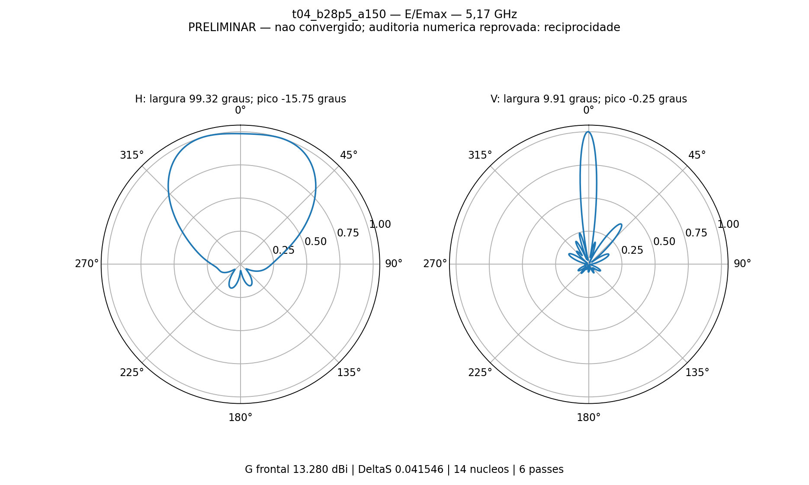

# P2S13 — três placas idênticas de dois elementos

O usuário encerrou a composição 4+2 e pediu três PCBs de dois elementos idênticas, buscando **100° de abertura horizontal**. A campanha anterior está [preservada e bloqueada contra retomada](../dobras_placas_ajustadas/README.md).

**Caso mais próximo do alvo calculado: b=28.5 mm / 150°, H=99.32°, ganho frontal=13.280 dBi.** Desvio frente a 100°: -0.68°. Aproximação nominal de busca ≤1°: atendida numericamente. Aprovação numérica conjunta: **não**. Não confundir proximidade ao alvo com convergência ou validação experimental.

## Montagem e condições

Três cópias da PCB2 ajustada, 50 × 88 mm, RO4350B de 0,76 mm, cobre de 35 µm e ENIG nominal. Transformadores simétricos de 0,546717 × 13,151813 mm. Centros das placas em X=−96,0,+96 mm; centros dos seis radiadores em −120,−72,−24,+24,+72,+120 mm. Passo de 48 mm e vãos entre PCBs de 8 mm. R1 é inferior, R2 central e R3 superior. Nenhum radiador, trilha ou divisor local foi alterado entre as cópias.

Seis cabos coaxiais físicos de 50 mm, seis portas de 50 Ω: **1/6 W a 0° em cada entrada, 1 W total**. Perdas de cobre/dielétrico/rede impressa/cabos incluídas. Sem conectores N, suportes plásticos ou rede externa. A mesma amplitude/fase nos acessos não elimina diferenças de acoplamento entre a placa central e as extremas.

Refletor de alumínio de 2 mm, comprimento de 296 mm e largura desenvolvida de 90 mm, raio interno de 2 mm e K nominal 0,4. `b` mede do eixo central ao início tangente de cada dobra; o ângulo é para trás (90°=abas paralelas a −Z). Altura inferior do núcleo das PCBs de 14,949 mm. As duas abas são simétricas.

**5,17 GHz, sem sweep, 14 núcleos, até 6 passes, ΔS≤0,05 por 2 passes consecutivos.** Classic automático, sem MeshLink ou refinamento local/lambda. A malha inicial é auditada separadamente, sem refinamento prévio imposto. Nove sondas de campo monitoram estabilidade em 0,1 dB. Não se ultrapassa o limite de passes para ocultar falta de convergência.

O alvo nominal atual é 100°; o intervalo histórico de ±10% foi registrado como 90–110°. Para ajustar perto do valor nominal, a busca usa desvio ≤1°, sem apresentar qualquer valor do intervalo amplo como se fosse 100°. Ganho de 13 dBi e VSWR ≤1,25 continuam verificados. A vertical é relatada; não há aprovação implícita da antiga meta de 18° ±10%.

## Comparação dos ensaios reais

| Início / ângulo | G frontal dBi | H ° | Erro H ° | V ° | VSWR máx. ativo / casado | Passes / ΔS | Convergiu S |
|---|---:|---:|---:|---:|---:|---:|---|
| [b3 / 90°](t00_b3_a90/resultado.json) | 10.193 | 156.14 | +56.14 | 10.13 | 1.2004 / 1.3535 | 6 / 0.04217 | Não |
| [b20 / 120°](t01_b20_a120/resultado.json) | 12.835 | 105.52 | +5.52 | 9.96 | 1.4246 / 1.3637 | 6 / 0.04259 | Não |
| [b22 / 150°](t02_b22_a150/resultado.json) | 12.955 | 102.95 | +2.95 | 10.10 | 1.5645 / 1.3783 | 6 / 0.05124 | Não |
| [b24 / 150°](t03_b24_a150/resultado.json) | 13.094 | 102.06 | +2.06 | 10.03 | 1.5128 / 1.3987 | 6 / 0.04720 | Não |
| [b28.5 / 150°](t04_b28p5_a150/resultado.json) | 13.280 | 99.32 | -0.68 | 9.91 | 1.4783 / 1.4423 | 6 / 0.04155 | Não |

Para o caso mais próximo: máximos H/V **-15.75° / -0.25°**, maior lóbulo secundário V **-8.19 dB**. Passes consecutivos em ΔS: **1**; estabilidade das nove sondas: **pendente**; auditoria de matriz/potência/malha: **reprovada, consultar resultado.json**.

O ganho em 0° está **0.1267 dB** abaixo do pico horizontal; o ponto médio entre os cruzamentos de −3 dB fica em **+1.16°**. Esses valores descrevem o formato do lóbulo, sem substituir o ângulo real do máximo.

Última malha: **392050 tetraedros**. Maior variação das nove sondas no último passe: **0.240804 dB**, contra o monitor de 0,1 dB. Diferença máxima de reciprocidade **|S−Sᵀ|=1.6003741e-05**, limite da auditoria **1×10⁻⁵**. A matriz é passiva; a potência aceita é **0.972875 W**, a eficiência total é **85.40%** e não há reparos Major/Minor. A falta de convergência e as ressalvas da auditoria impedem chamar este resultado de validado.

| Porta | VSWR ativo | VSWR demais casadas |
|---|---:|---:|
| R1_A | 1.30040 | 1.29202 |
| R1_B | 1.29250 | 1.37542 |
| R2_A | 1.47830 | 1.26116 |
| R2_B | 1.44790 | 1.37484 |
| R3_A | 1.39850 | 1.32029 |
| R3_B | 1.42809 | 1.44235 |

## Arquivos e limites

[HFSS do caso mais próximo](t04_b28p5_a150/P2S13_TresPCB2.aedt) · [FreeCAD](t04_b28p5_a150/P2S13_TresPCB2.FCStd) · [Tabela CSV](comparacao.csv) · [Resultados e fases dos campos embutidos](comparacao.json) · [Manifesto SHA-256](manifesto.json).

Os campos são a solução integral do conjunto, com acoplamento, e sua soma complexa é conferida contra o HFSS. O diagnóstico de fase usa projeção dos campos frontais de cada PCB sobre a placa central; não representa uma medição direta em cada dipolo. O ganho é realizado total em +Z para as seis entradas, não ganho MIMO por porta.

No caso selecionado, as fases dessas projeções para R1/R2/R3 são **-5.11° / +0.00° / -1.87°**. As três redes impressas idênticas eliminam a diferença nominal de percurso entre divisores 1:4 e 1:2; as diferenças residuais dos campos incluem o acoplamento e o erro numérico ainda relatado.

Nativos, S6, cortes/campos distantes e evidências compactas são arquivados, sem malhas, `.aedtresults`, locks ou campos volumétricos. O nativo preserva o modelo; restaurar a solução FEM completa exige os resultados locais. As propriedades do CAD são documentais; editar `configuracao.json` e reconstruir pelos scripts para alterar o BREP. Trabalho: `D:/dev/EMBRAER/P2S13/R05_Tres_Placas2`.
