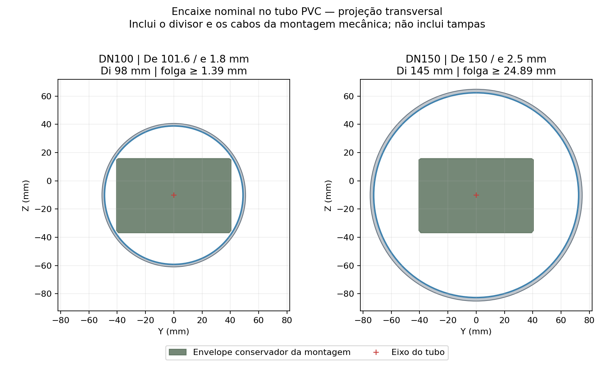
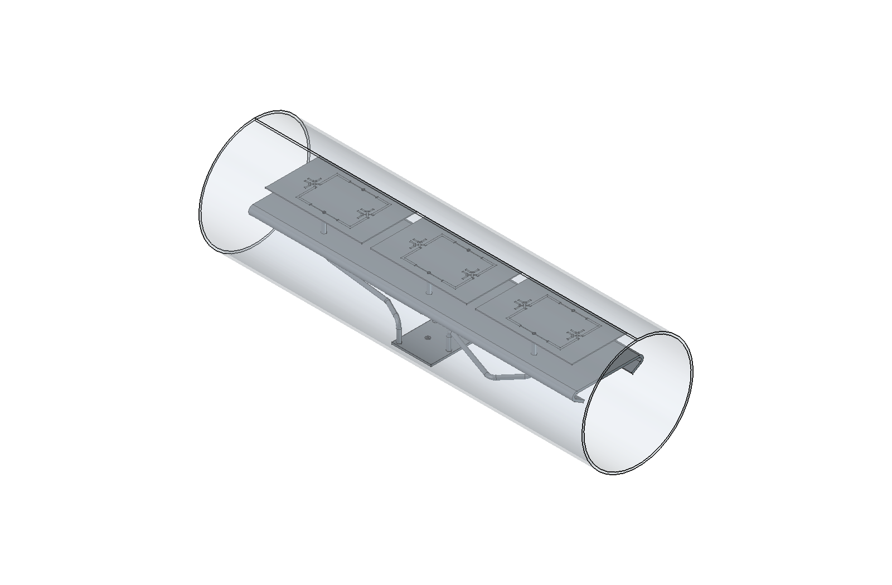
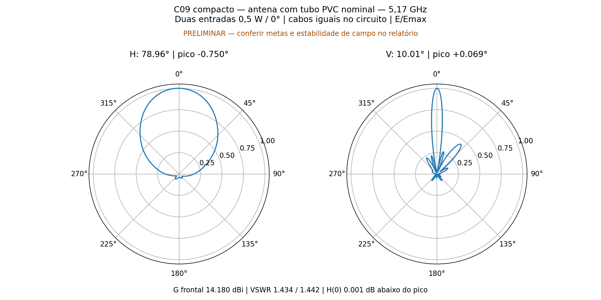
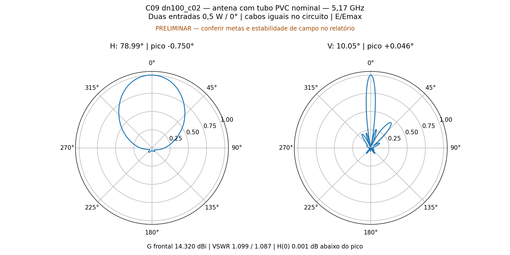
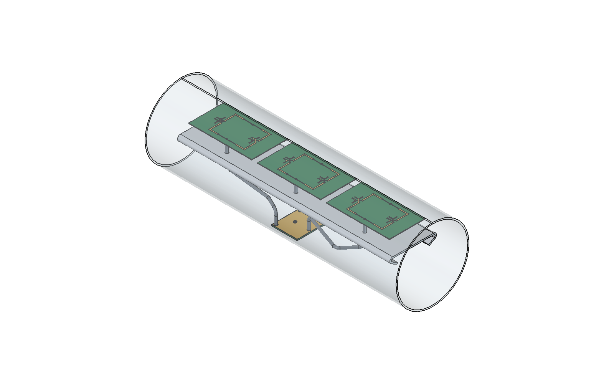

# P2S13 — tubo PVC e prioridade ao casamento

Prioridade atual: menor VSWR nas duas entradas externas iguais e em fase. Aberturas H/V passam a ser apenas informativas. Frequência 5,17 GHz; sem sweep; 14 núcleos, até seis passes e ΔS alvo 0,05 por ciclo novo.

## Tubos de construção civil localizados

Referência dimensional: **Tigre Esgoto Série Normal, PVC rígido branco**, barras de 3 ou 6 m. O trecho da antena será cortado da parte reta, sem a bolsa. As dimensões abaixo são nominais de catálogo, não medidas no produto comprado.

| Bitola DN | Diâmetro externo | Parede | Interno calculado | Folga radial conservadora |
|---|---:|---:|---:|---:|
| 75 | 75.5 mm | 1.7 mm | 72.1 mm | -11.56 mm |
| 100 | 101.6 mm | 1.8 mm | 98.0 mm | 1.39 mm |
| 150 | 150.0 mm | 2.5 mm | 145.0 mm | 24.89 mm |
| 200 | 200.0 mm | 3.6 mm | 192.8 mm | 48.79 mm |

DN75 não comporta esta montagem. DN100 é o menor da tabela que cabe nominalmente; a folga de 1,39 mm é pequena e deve ser conferida com a ovalização, tolerâncias e fixação do tubo real. DN150 oferece mais espaço; DN200 é dimensionalmente desnecessário nesta montagem. A Série R 3 m consultada aparece como descontinuada no site do fabricante; não foi selecionada.

Fontes consultadas em 12/11/2026: [tabela oficial Série Normal 6 m](https://www.tigre.com.br/produto/tubo-serie-normal-6m), [ficha técnica Tigre](https://tigresite.s3.amazonaws.com/2023/07/FT_Esgoto-Serie-Normal_2023_final_compressed-1.pdf), [Série R 3 m](https://www.tigre.com.br/produto/tubo-serie-r-3m). A ficha cita NBR 5688; isso se refere ao uso hidráulico, não à qualificação como radome.

## Modelo selecionado para o primeiro cálculo

Tubo DN100, De=101.6 mm, parede=1.8 mm, Di=98.0 mm e comprimento **350 mm**. Eixo longitudinal X, centro Y=0 e Z=-10.141 mm. O comprimento do painel é 296 mm; ficam 27 mm livres em cada extremidade. O envelope conservador da montagem requer diâmetro 95.229 mm. As coordenadas foram escolhidas para acomodar também os cabos e o divisor da montagem mecânica.

Tubo aberto, sem tampas, bolsa, anéis, cola, água ou conectores N. Esses componentes ainda não têm geometria definida neste estudo. O CAD contém 123 sólidos, sendo 122 originais e o tubo; nenhum sólido original foi alterado. A transparência na imagem é apenas para mostrar a montagem interna.

**Material eletromagnético preliminar:** εr=2,68 e tanδ=0,008, isotrópico. O iEMSL/Texas A&M publica essa referência para uma amostra de filme PVC medida entre 10,2 e 52,2 GHz. Aplicá-la em 5,17 GHz é uma hipótese de trabalho, não uma medição do PVC rígido branco Tigre; pigmentos, aditivos e lote podem alterar a resposta. A ficha do tubo não informa εr/tanδ em 5,17 GHz. Portanto nenhum resultado desta hipótese confirma por si só o desempenho de um tubo comercial. [Referência dielétrica](https://iemsl.engr.tamu.edu/services/material-characterization-services/material-characterization-examples/).

O HFSS resolve separadamente a antena S6 com tubo e o divisor S8 com tubo, nas posições equivalentes da montagem. Os cabos de 134 mm continuam somente no Nexxim (133,82 mm entre planos EM, com perdas nominais). A cadeia usa duas entradas de 0,5 W / 0°. O método inclui o acoplamento entre radiadores, mas não o acoplamento espacial entre divisor e antena nem a radiação dos cabos/divisor no diagrama recomposto.

## Por que o divisor isolado tinha VSWR próximo de 1,7

A C09 c02 foi otimizada para a impedância complexa da antena vista através dos seis cabos iguais. Ao trocar essas cargas por seis terminações ideais de 50 Ω, mede-se outro problema de casamento. No HFSS, as entradas do divisor isolado ficaram próximas de **29 Ω**, e não 50 Ω. Isso explica o VSWR de aproximadamente 1,7. O ajuste anterior melhorou o conjunto carregado e piorou o divisor como componente genérico para cargas de 50 Ω. Não é possível concluir o VSWR do conjunto apenas pelo S11 isolado do divisor.

| Condição anterior, sem tubo | VSWR A/B | Impedância A | Impedância B |
|---|---:|---:|---:|
| Divisor com saídas em 50 Ω | 1.7158 / 1.7058 | 29.15 -0.83j Ω | 29.32 -0.78j Ω |
| Divisor + cabos + antena, entradas em fase | 1.1838 / 1.2257 | 52.39 +8.31j Ω | 58.38 +7.15j Ω |
| Conjunto, outra entrada casada | 1.1423 / 1.2072 | 53.14 +6.11j Ω | 59.13 +4.66j Ω |

Com VSWR=1,7, |Γ|=(1,7−1)/(1,7+1)=0,2593 e |Γ|²=6,72% da potência incidente é refletida. Isso não significa 1,7 dB de perda. Na c02 sem tubo, as duas portas ativas refletiam 0,709% e 1,028%, respectivamente. Os ramais permanecem nominalmente iguais; a carga real e seu acoplamento podem produzir pequenas diferenças de ondas nas saídas.

## Resultado com tubo

As métricas abaixo pertencem ao PVC nominal descrito acima, em um único ponto de frequência.

| Métrica | Resultado |
|---|---:|
| VSWR ativo A / B | 1.43449 / 1.44216 |
| VSWR com outra entrada casada | 1.37530 / 1.39309 |
| Ganho frontal realizado | 14.1798 dBi |
| H / V, informativos | 78.964° / 10.006° |
| antena: passes / ΔS / convergiu | 6 / 0.041601 / False |
| divisor: passes / ΔS / convergiu | 5 / 0.019486 / True |

**Resultado preliminar, sem aprovação de convergência completa.** A auditoria exige dois passes consecutivos com ΔS ≤0,05, além do valor final. O texto “Converged: Yes” do HFSS sozinho não satisfaz essa verificação. O limite de seis passes foi respeitado; nenhum passe adicional foi executado.

Estabilidade de campos observada: **False**. Últimas variações: [0.4991732650095013, 0.35139508594159974] dB. Nexxim pendente: **False**. Balanço de potência aprovado: **True**.

O Nexxim foi efetivamente resolvido; diferença máxima entre sua matriz S2 e a conexão independente: **5.79e-16**. Essa conferência verifica a interligação dos blocos, sem substituir a convergência EM nem a caracterização do material comercial.

## Ressintonia do divisor para o tubo — DN100_C02

A C09 anterior foi preservada. Este candidato altera apenas as duas seções de transformação, da mesma forma nos seis ramais. A solução S6 com PVC é reutilizada por hash; não houve passe adicional na antena. O divisor ajustado foi novamente resolvido no HFSS com tubo, seguido por uma nova solução Nexxim.

W1/W2 = **0.560161 / 1.373922 mm**; L1/L2 = **11.455566 / 7.868341 mm**. Comprimento total de cada ramal: 19.323906720 mm. Placa, terminais, cabos e tubo mantidos.

| Condição | VSWR ativo A / B | Outra entrada casada A / B | Ganho frontal |
|---|---:|---:|---:|
| Sem tubo, C09 anterior | 1.18382 / 1.22572 | 1.14234 / 1.20721 | 14.1456 dBi |
| Com tubo, C09 anterior | 1.43449 / 1.44216 | 1.37530 / 1.39309 | 14.1798 dBi |
| Com tubo, dn100_c01 | 1.13664 / 1.35634 | 1.15282 / 1.37443 | 14.2675 dBi |
| Com tubo, dn100_c02 | 1.09868 / 1.08690 | 1.09043 / 1.10378 | 14.3198 dBi |

Divisor selecionado dn100_c02: **6 passes, ΔS=0.017252, convergência=True**, 14 núcleos. Nexxim conferido com erro máximo 9.1e-16; balanço de potência True.

**Compromisso de casamento:** com seis cargas de 50 Ω, o divisor selecionado isolado tem VSWR **2.1543 / 2.1527**. O objetivo minimizado foi o VSWR nas entradas do conjunto carregado pela antena, não um divisor universal para cargas de 50 Ω. A nova sintonia melhora esse conjunto e piora o casamento isolado.

VSWR ≤1,25 nas duas entradas ativas: **True**. H/V informativos: 78.986° / 10.050°. Máximo vertical: +0.0463°; assimetria principal V: 0.0391 dB.

**A ressalva de convergência/campos da antena e a hipótese de material PVC continuam válidas.** O melhor resultado entre os candidatos calculados não demonstra mínimo global de VSWR nem qualifica o tubo comercial.

[HFSS do divisor selecionado](dn100_c02/divisor/Divisor_Duplo3.aedt) · [Nexxim](dn100_c02/circuito/C09_PVC_Nexxim_sem_malhas.aedtz) · [Montagem FreeCAD](dn100_c02/visual/Antena_PVC_DN100_C02_PRELIMINAR.FCStd)

## Arquivos

[Configuração](dn100/configuracao.json) · [HFSS antena](dn100/antena/PCB_Tubo_DN100.aedt) · [HFSS divisor](dn100/divisor/Divisor_Tubo_DN100.aedt) · [Montagem FreeCAD](dn100/visual/Antena_PVC_DN100_PRELIMINAR.FCStd)

Fontes R14/R15 preservadas; nenhum cabo longo no HFSS. Dados de solver volumétricos e malhas ficam apenas na pasta de trabalho local.
